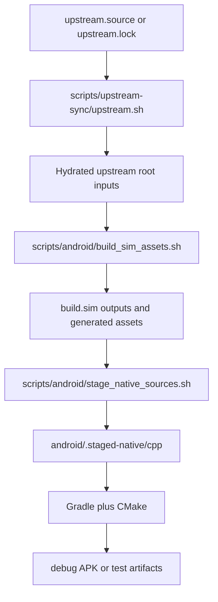

# Build And Source Layout

This page is the canonical Android ownership, build, and rebuild contract for
this repository. Do not split that contract into a second guide.

Read `00-project-and-upstream.md` first. This page starts after the project,
upstream, and ownership boundary are already established.

Use this page for build entry points, source ownership, staged-input boundaries,
and checkout-sensitive root surfaces. Read
`07-ci-and-release-workflow.md` for the GitHub Actions lane split and
`03-upstream-interface-surfaces.md` for the Android-facing upstream
interface map. Read `08-tests-and-contracts.md` for the contract-to-test and
rerun-lane map.

## Build At A Glance

- `scripts/upstream-sync/upstream.sh` resolves and hydrates upstream inputs.
- `scripts/android/build_android.sh` is the canonical full Android build path.
- `scripts/android/build_sim_assets.sh` rebuilds the required `build.sim`
  outputs.
- `scripts/android/stage_native_sources.sh` and related helpers refresh
  `android/.staged-native/cpp`.
- Gradle and CMake then compile the Android app against the staged native tree.
- The upstream Meson graph already hard-enables `b_lto=true` for the desktop
  `c47` and `r47` simulator executables in `src/c47-gtk/meson.build`.
- The Android-owned `r47zen` CMake target keeps one shared library load
  path and applies target-scoped ThinLTO compile and link flags on the
  release-native configs, `Release` and `RelWithDebInfo`, using `lld` for the
  link step.

## Python Maintainer Tooling

- The grouped contract lane under `scripts/r47_contracts/` is maintained
  through the repo root `pyproject.toml` and runs with `uv run --locked
  --group dev ...`, on the Python `requires-python` names as its floor;
  `run_contract_suite.sh` sets `UV_PYTHON` to that floor, because uv would
  otherwise pick the newest interpreter on the machine.
- The `dev` group in `pyproject.toml` is the tool set: `pre-commit`, `ruff`,
  `ty`, `fontTools`, and `valgebra` with `annotated-types`. The schemas' PEP 728
  `closed=True` TypedDict is stdlib `typing` from Python 3.15, which is why
  3.15 is the floor and ruff's `runtime-evaluated-base-classes` names
  `typing.TypedDict`. Dependabot's updater installs 3.15, so its `uv` entry
  proposes these too ([07](07-ci-and-release-workflow.md#other-workflows)).
- A Python move is one commit: `requires-python`, ruff's `target-version`, ty's
  `python-version`, and every `setup-python` move together, and
  `run_action_pin_consistency_contract.sh` fails until all four agree.
- The font-policy and visual-policy derivers, the font-policy test, and the
  provenance ledger read the shipped calculator fonts through `fontTools`, so a
  partial Python setup is not enough for the full contract lane.

## Build-Relevant File Layout

- `upstream.source`: the tracked upstream URL and ref; a local pin goes in the
  git-ignored `upstream.lock`.
- `src/`, `dep/decNumberICU`, `res/fonts/`, `meson.build`, and
  `meson_options.txt`: the hydrated upstream inputs the build reads.
- `build.sim/`: the Meson build of the simulator, whose generated tables the
  staged core compiles against.
- `scripts/upstream-sync/upstream.sh`: resolve and hydrate the upstream core.
- `scripts/android/build_android.sh`, `scripts/android/build_sim_assets.sh`,
  and `scripts/android/stage_native_sources.sh`: the full build, its
  `build.sim` step, and its staging step.
- `scripts/r47_contracts/data/r47_physical_geometry.json` and
  `scripts/r47_contracts/data/r47zen_ui_contract.json`: the two hand-kept
  inputs the geometry derivers in `scripts/r47_contracts/` read
  ([08](08-tests-and-contracts.md#python-contract-suite)).
- `android/app/src/main/java/io/github/ppigazzini/r47zen/`: the Kotlin shell
  ([02](02-kotlin-shell-architecture.md)).
- `android/app/src/main/cpp/r47zen/`: the native glue
  ([04](04-native-core-and-jni.md)).
- `android/.staged-native/cpp/`: the staged build-only copy of the core.
- `android/gradle/wrapper/`: the tracked Gradle wrapper the build runs.
- `android/r47-defaults.properties`: the toolchain and SDK pins.

## Build Flow



## Checkout-sensitive root surfaces

Public and partial checkouts do not always keep the full upstream-shaped root
tree present at rest. `scripts/upstream-sync/upstream.sh` and
`scripts/android/build_android.sh` hydrate or verify the required root inputs
for the active lane.

Do not treat the absence of one root file in one checkout as proof that the
Android contract changed. Verify whether the surface is checked in locally,
hydrated on demand, or only exercised in CI before updating the docs.

## Checked-in defaults

- machine-readable Android tool defaults live in
  `android/r47-defaults.properties`, one `R47_DEFAULT_*` key each: the compile,
  target, and minimum SDK, the compile SDK minor, build tools, NDK, CMake, the
  Gradle and AGP versions, the shipped ABI filter, the hosted test and 16 KB
  test API levels and the test ABI filters, the pinned xlsxio URL plus commit,
  and the minizip version, URLs, and checksums, among others. Read the values from the file; a page that
  copies one is wrong the day the key moves.
- two of those keys are about Java and they are not interchangeable. Read the
  values from the file; what matters here is which is which:
  - `R47_DEFAULT_ANDROID_BUILD_JDK_VERSION` is the JDK the Gradle Java toolchain
    in `android/app/build.gradle` resolves: javac and the JVM unit tests run on
    it, and the Kotlin compile reads its JDK home. That makes it a requirement
    on the host rather than a description of it: a host with no matching
    installation fails with "Cannot find a Java installation on your machine"
    instead of silently compiling on whatever `JAVA_HOME` points at. It does not
    choose the JDK that runs Gradle, AGP, and the Kotlin compiler: `JAVA_HOME`
    does, or `java` on `PATH` when it is unset, and no tracked file pins either
    on a host. CI makes the two equal through
    the `actions/setup-java` steps that
    `run_build_jdk_pin_coherence_contract.sh` holds to this key, so a host that
    launches Gradle on another JDK runs a build CI never ran.
    `./scripts/android/build_android.sh --doctor` reports it as the `build jdk`
    row, searching every installation Gradle would, not just `JAVA_HOME`.
  - `R47_DEFAULT_ANDROID_JAVA_VERSION` is the language and bytecode level the
    app is compiled *to* (`sourceCompatibility`, `targetCompatibility`, and the
    Kotlin `jvmTarget` AGP derives from them; verified by reading the emitted
    class-file major version, not inferred). Its reach is narrow. The app has
    no Java source of its own, which `find android/app/src -name '*.java'`
    shows by printing nothing, so `sourceCompatibility` governs only the
    ViewBinding classes AGP generates; it does not affect Kotlin source. What
    the key moves is the class-file format of everything compiled, which D8,
    or R8 in a minified release, compiles into dex; no JVM runs on a device. A
    higher level can let the Kotlin compiler use a newer Java feature
    directly, and can force a higher `minSdk`. The Java versions and d8 pages
    in [the toolchain references](09-official-references.md#toolchain-references)
    state each of these.

    The key stays below the build JDK because moving it changes shipped dex,
    and only a device or emulator runs dex: here, the connected lane. The
    Kotlin compiler is not what holds it there: with the key raised to the
    build JDK, `:app:compileDebugKotlin` on the KGP the catalog's `kotlin`
    entry names emits that JDK's class-file major version. That compile is
    the only step measured at that level; D8, R8, and the connected lane are
    not. Move the key only when `:app:assembleDebug`, `:app:assembleRelease`
    (which runs R8), and the connected lane pass on the new value, and confirm
    the level with `javap -v` on a class `:app:compileDebugKotlin` emitted.
- settings-owned repositories via `android/settings.gradle`
- version catalog `android/gradle/libs.versions.toml`, which owns the AGP
  plugin coordinate, the Kotlin Gradle plugin version, and the AndroidX and
  Material library versions.
  `run_toolchain_pin_coherence_contract.sh` holds `R47_DEFAULT_ANDROID_AGP_VERSION`
  equal to it.
- Jetifier explicitly disabled in `android/gradle.properties`
- base `namespace` and `applicationId` `io.github.ppigazzini.r47zen`
- the app, JVM-test, instrumentation-test, and instrumentation-host sources
  (`main`, `test`, `androidTest`, and `instrumentationHost`) live under
  `app/src/**/java/io/github/ppigazzini/r47zen` so manifest, layout, and JNI class
  wiring stay aligned with that checked-in identity
- debug builds add `applicationIdSuffix ".debug"`
- release version inputs come from `r47.versionCode`, `r47.versionName`, and
  `r47.coreVersion`; without the first two, Gradle reads the next release's
  numbers from `R47_DEFAULT_ANDROID_VERSION_CODE` and
  `R47_DEFAULT_ANDROID_VERSION_NAME` in `android/r47-defaults.properties`
- the About line names both commits, as the published file names do:
  `R47 Zen <versionName> (<versionCode>), <android8>`, then
  `Core: C47 custom build <core8>`. `<android8>` comes from
  `r47.sourceCommit`; a build without it reads its own tree and adds `-mod`
  for uncommitted changes. `r47.upstreamVersion`, which `build_android.sh`
  takes from `scripts/android/read_upstream_version.sh`, is the core's
  `VERSION1` only when upstream's tag of that name points at the core commit,
  and then the core line reads `Core: C47 <version>, <core8>`. Upstream sets
  `VERSION1` when it cuts a release and keeps it until the next, so a commit
  between releases carries the last release's number, and upstream's own
  build names it `custom build <commit>`. `SettingsPreferenceSummaryTest`
  locks the format, `run_version_naming_contract.sh` the tag check
- release minify and resource shrinking default to on via
  `r47.releaseMinify` and `r47.releaseShrinkResources`
- `r47.releaseChannel=dev` switches the release install identity to `.dev`,
  appends `-<token>` to `versionName`, making it a SemVer pre-release of the
  next release (the CI token is `<run>.<attempt>`; without one it is the core
  commit), defaults `testBuildType` to
  `release`, and uses dedicated prerelease signing when the full
  `R47_PRERELEASE_*` or `r47.prerelease*` input set is present. Without it AGP
  writes `app-release-unsigned.apk`, which is how CI builds the dev APK before
  `sign-dev-prerelease` signs it; `build_android.sh` reads the file name from
  `output-metadata.json` rather than assuming one
- release native debug symbols default to `FULL` via
  `r47.releaseNativeDebugSymbolLevel`

## Dependency update cadence

- Update `android/r47-defaults.properties` when SDK, NDK, CMake, build-tools,
  hosted-emulator, or xlsxio pins change, then rerun `./scripts/android/build_android.sh --doctor`
  before a broader build.
- Review AGP compatibility and JDK requirements whenever a new AGP stable line
  is adopted; keep `android/gradle/libs.versions.toml` and
  `android/r47-defaults.properties` aligned when that happens. AGP states a
  minimum JDK, not a maximum, so "AGP requires JDK N" is not evidence that the
  build JDK must be N: raising
  `R47_DEFAULT_ANDROID_BUILD_JDK_VERSION` past it is a measurement (compile,
  JVM unit tests, coverage gate, lint, `assembleDebug`), not a reading.
- Review compile and target SDK levels when Android publishes the next stable
  API level, and keep local plus hosted test lanes on explicit API images.
- Review NDK and CMake pins when Android's AGP/NDK guidance or CMake release
  notes move, and rerun packaging checks before landing the update.
- Kotlin is pinned as the `kotlin` entry in `android/gradle/libs.versions.toml`.
  `android/build.gradle` puts that Kotlin Gradle plugin (KGP) on the root
  buildscript classpath, the route the
  [AGP 9.0 release notes](https://developer.android.com/build/releases/agp-9-0-0-release-notes)
  give for running AGP's built-in Kotlin on a KGP newer than the one AGP
  depends on, and declares AGP `apply false` beside it so KGP on that
  classloader sees AGP's classes. Its compiler must read the Kotlin metadata
  of every catalog library: kotlinx-serialization is built with a newer Kotlin
  than AGP's own KGP reads, and on that KGP `:app:compileDebugUnitTestKotlin`
  refuses it. Gradle upgrades a KGP older than AGP's to AGP's, so the entry
  can only raise the compiler; `./gradlew buildEnvironment` prints the
  resolution as `kotlin-gradle-plugin:<AGP's> -> <catalog's>`. No contract
  holds the pair. JetBrains states the Gradle and AGP range each KGP fully
  supports
  ([toolchain references](09-official-references.md#toolchain-references));
  no contract compares the pins to it. Prove an AGP or `kotlin` bump with lint,
  the JVM unit tests, detekt, and `:app:compileDebugAndroidTestKotlin`; running the
  instrumented tests is the connected lane's.
- Review the xlsxio pin only when upstream font-generation behavior, security
  fixes, or CI breakage require it.

## Repository ownership map

Top-level repo-owned overlay paths:

- `android/` owns the Android shell, compat inputs, compliance assets, and
  maintainer docs. That includes the repo-owned notice inventory used for
  Android packaging and the shared `mini-gmp` notice text consumed by
  simulator CI artifacts. It also owns the policy for copying notice text from
  hydrated upstream submodules such as `dep/jimtcl` when those modules become
  part of maintained CI package evidence.
- `scripts/` owns repo-only automation, including the stable maintainer
  entry points `scripts/android/build_android.sh` and
  `scripts/upstream-sync/upstream.sh`, plus grouped implementations under
  `scripts/android/`, `scripts/docs/`, `scripts/keypad-fixtures/`,
  `scripts/lib/`, `scripts/package-notices/`, `scripts/r47_contracts/`,
  `scripts/security/`, `scripts/upstream-sync/`, `scripts/windows/`, and
  `scripts/workload-regressions/`.
- `.github/` and the tracked root files (`git ls-files | grep -v /`), among
  them `upstream.source`, `pyproject.toml`, and `.pre-commit-config.yaml`, are
  repo-owned overlay paths outside the Android module.

Shared upstream-shaped top-level surfaces when the active lane hydrates them:

- `src/`
- `dep/decNumberICU` and related upstream root build inputs
- `meson.build` and `meson_options.txt`
- repo-root `res/fonts`
- fuller-hydration or CI-owned upstream surfaces such as `Makefile`,
  `docs/code/meson.build`, `subprojects/`, and `tools/`

Maintenance rule:

- add new repo-owned automation under `scripts/` and its grouped feature
  folders, not under `tools/`, `src/`, or other upstream-shaped folders.

## Android Root Dependency Split

When auditing top-level stale paths for Android, do not use repo-wide activity
as proof that Android still needs a path. The current Android lane has a
narrower dependency set.

Current full-lane hard dependencies:

- the hydrated upstream root Meson inputs `meson.build`,
  `meson_options.txt`, and `dep/meson.build`, because the Android-owned helper
  configures the root Meson build graph directly for `build.sim`
- hydrated upstream `dep/decNumberICU`, because Android staging and the staged
  native CMake build both consume it

Current full-lane Android-owned build entry:

- `scripts/android/build_sim_assets.sh`, which reconfigures `build.sim` with
  `-DRASPBERRY=false -DDECNUMBER_FASTMUL=true` and runs `ninja sim`. When the
  explicit test mode is enabled, it also builds `testPgms`, stages
  `build.sim/src/generateTestPgms/testPgms.bin` into `res/testPgms/`, and runs
  `meson test -C build.sim --print-errorlogs`.

Root surfaces outside the Android lane:

- `Makefile`
- `tools/onARaspberry`
- `subprojects/gmp-6.2.1/mini-gmp`

Current `--android-only` lane behavior:

- skips the script's own resolve, hydration, `ninja sim` build of
  `build.sim`, and clean
- first checks the staged tree against current canonical `src/c47`,
  `dep/decNumberICU`, generated outputs under `build.sim`, canonical fonts
  under `res/fonts`, and the tracked Android mini-gmp staging source, and
  refuses a stale one
- then runs Gradle, whose `prepareStagedNativeInputs` runs before every native
  build in any lane: it resolves upstream (`--auto --write-lock`), hydrates
  missing paths, reconfigures `build.sim` through Meson, builds the generated
  tables with ninja, and re-stages. So this lane needs `meson`, `ninja`,
  `xlsxio_xlsx2csv`, and a resolvable upstream like the full one; it does not
  execute `Makefile`

Root surfaces that never justify an Android ownership claim:

- the upstream `dist` and `distS` release-packaging scripts
- upstream DMCP SDK submodule paths under `dep/DMCP_SDK` and
  `dep/DMCP5_SDK`, which the Android lane never stages, even after
  `scripts/upstream-sync/hydrate_submodules.sh` has fetched them
- cross-build helper tools such as `tools/add_pgm_chsum`, `tools/modify_crc`,
  `tools/gen_qspi_crc`, and `tools/size.py`

## Build entry points

Public maintainer entry points:

- `./scripts/upstream-sync/upstream.sh sync --latest --write-lock` is the
  authoritative upstream hydration entry point, and running it again is how a
  checkout moves to a newer upstream HEAD. It reads Git-tracked defaults from
  `upstream.source` and resolves the latest commit from the configured upstream
  ref; `--auto`, the default, which `build_android.sh` and CI use, takes an
  `upstream_commit` in the Git-ignored local `upstream.lock` first. Because
  `--write-lock` writes the synced commit there, a checkout synced once with
  `--auto --write-lock` stays at that commit on every later `--auto` sync and
  build, with only a stderr note to say so. It writes the resolved
  upstream tree into the working tree. It leaves out every path in
  `REPO_OWNED_RESTORE_PATHS`, so it never writes a file this repo tracks, staged
  or not, and a tracked edit needs no `--force`; shared upstream-shaped root
  files such as `Makefile`, `meson.build`, `meson_options.txt`, `dep/`,
  `docs/code/meson.build`, `subprojects/`, and `tools/` stay upstream-owned. It
  writes only the files whose content differs, so an unchanged file keeps its
  mtime and a changed one gets the current time, and it removes the files its
  last sync wrote that the commit no longer holds. A manifest in the git
  directory (`r47-upstream-manifest.json`) records what each sync wrote; a sync
  refuses to overwrite a hydrated file edited since, or a file of yours where
  the commit adds one, unless `--force`, and writes nothing when it refuses.
  The upstream paths a build rewrites in place, the staged `testPgms.bin` and
  upstream's own `constantsVerification.txt`, are in
  `UPSTREAM_BUILD_REWRITTEN_PATHS` and do not count as edits. A sync that stops
  halfway is resumed by the next one, without `--force`.
  `--write-lock` writes the resolved state to `upstream.lock` only once the tree
  is complete. `upstream.sh hydrated-commit` prints the commit the last complete
  sync wrote. `run_upstream_sync_contract.sh` holds each rule.
- `scripts/upstream-sync/hydrate_submodules.sh <commit> [<url>]` checks out
  each submodule at the commit upstream pins, which a sync, built on
  `git archive`, leaves out. A submodule already checked out at that commit is
  left alone, edits and all, with no network; any other is fetched beside the
  old checkout and swapped in only once checked out, so a failed fetch, offline
  or not, keeps the old one. `build_android.sh` runs it on every full build.
- `./scripts/android/build_android.sh` is the authoritative Android debug-build
  entry point. It detects Java and the Android NDK, resolves one shared
  upstream commit through `scripts/upstream-sync/upstream.sh`,
  syncs that resolved core with `sync --if-missing --commit`, which skips only
  when every path `UPSTREAM_REQUIRED_DIRS` and `UPSTREAM_REQUIRED_FILES` name in
  `upstream.sh` (among them `src/c47`, the root Meson inputs, `dep/decNumberICU`,
  the `Makefile`, and `tools/onARaspberry`) and the canonical calculator fonts
  are present and the last complete sync wrote that commit,
  so the commit the build stamps is the tree it builds, runs
  `scripts/android/build_sim_assets.sh` to reconfigure `build.sim` through
  Meson and build `ninja sim`,
  stages native inputs into
  `android/.staged-native/cpp`, regenerates staged native metadata there,
  requires the canonical calculator font assets under repo-root `res/fonts`, writes
  `android/local.properties`, and runs Gradle `clean`, skipped when the staged
  inputs' fingerprint is unchanged and `android/app/.cxx` exists, then
  `assembleDebug`, or `assembleRelease` on the dev channel, through
  the repo `./gradlew` launcher backed by the tracked wrapper runtime under
  `android/gradle/wrapper/`. Missing wrapper files are a repo-integrity
  failure, not a signal to fall back to host Gradle. It
  also exposes `--doctor`, which reports every row and exits 1 when the host
  lacks what the build cannot provide: the build JDK, the SDK platform and
  build tools, the NDK (a missing one on its row, not a stop before the report;
  another installed one warns that it is not the pin), CMake at the pinned
  version (a `cmake` on `PATH` of another version fails AGP, so it fails the
  row), `meson`, `ninja`, `python3`, `pkg-config`, and the GTK 3, FreeType, and
  GMP packages upstream's Meson requires, which
  `scripts/android/install_linux_build_deps.sh` installs on Debian or Ubuntu.
  xlsxio, the font source, and the staged inputs, which a full build provides,
  report without failing. Beside it come `--run-sim-tests` to run upstream's
  stock suite from the full build, through
  `scripts/android/build_sim_assets.sh --run-tests` (the suite on the app's own
  configuration is `run_upstream_suite_android_config.sh`), and `--android-only`,
  which skips the script's own native steps and refuses stale staged native
  inputs.
  `--collect-host-pgo` and `--validate-release-pgo` are full-build-only flags
  that let the wrapper own the host-side PGO collector and the Android
  release-native consumer check in one pass, while `--host-pgo-output-dir`
  chooses the emitted `.profdata` location.
  It also forwards optional extra Gradle arguments from `R47_GRADLE_ARGS`, split
  on blanks; CI passes its daemon and console flags there. Hosted CI's
  emulator ABI override is `R47_CONNECTED_ANDROID_TEST_ABI_FILTERS`, which
  `run_connected_android_tests.sh` reads. Add
  `--verify-packaging` with `R47_RELEASE_CHANNEL=dev` when you want the local
  build to write the same release evidence files CI publishes for Android APK
  artifacts. On the default debug build it fails: that APK carries the
  instrumentation host and `gwpAsanMode`, which the collector refuses.
- `./scripts/android/build_android.sh --android-only` is the faster
  Android-only path. It skips the script's resolve, hydration, `ninja sim`, and
  clean, and refuses to continue unless
  `android/.staged-native/cpp/STAGED-INPUTS.properties` still matches the
  canonical root, generated inputs, the tracked Android mini-gmp staging
  source, and the current calculator font source. It does not skip Meson or
  re-staging: Gradle's `prepareStagedNativeInputs` runs both, as in every lane
  that builds native code.
- `./scripts/android/build_android.sh --run-sim-tests` runs upstream's stock
  suite from the full build path, as the release lane does. It stages
  `res/testPgms/testPgms.bin` before the suite runs, and is intentionally
  incompatible with `--android-only`.
- `R47_RELEASE_CHANNEL=dev ./scripts/android/build_android.sh --collect-host-pgo --validate-release-pgo`,
  then `bash scripts/workload-regressions/run_upstream_suite_android_config.sh`,
  is the CI-matching Android build lane: the wrapper owns the host-core PGO
  collector and the release-native consumer check in one pass, and the script
  runs upstream's suite as the app builds the core
  ([08](08-tests-and-contracts.md#upstream-suite-on-the-apps-configuration)).
- `cd android && ./gradlew assembleDebug` refreshes a stale staged tree itself:
  `prepareStagedNativeInputs` runs before the native build. Its prerequisites
  are those of that task, `meson`, `ninja`, `xlsxio_xlsx2csv` on `PATH` (or
  in the xlsxio cache a full build fills), and a resolvable upstream, not a
  current staged tree.
- `cd android && ./gradlew lint` is the maintained Android Lint lane when
  Kotlin, Java, manifest, resource, or Android Gradle files change. Lint is not run
  automatically by `assembleDebug`, so CI and local maintainer verification
  need to call it explicitly. `android/app/lint.xml` holds only the
  suppressions whose reason holds for every file; one with a local reason sits
  at its site, as `tools:ignore` in XML or `@SuppressLint` in Kotlin, next to
  the comment that justifies it.
- `cd android && ./gradlew :app:bundleRelease` or
  `cd android && ./gradlew :app:assembleRelease` is the module-local release
  lane, with the same prerequisites as `assembleDebug`. Release
  builds remain unsigned unless all `r47.releaseStore*` and `r47.releaseKey*`
  inputs are supplied together.
- `cd android && ./gradlew :app:testDebugUnitTest` validates the Robolectric
  and fixture-backed Android JVM suite.
- `cd android && ./gradlew :app:assembleDebugAndroidTest` compiles and
  packages the instrumentation suite, and `stageProgramFixtureAssets` stages
  the upstream `PROGRAMS` fixtures into the test APK's assets under
  `program-fixtures/PROGRAMS`. The app APK never carries them, and a lint,
  unit-test, or assemble run never stages them; the tests read them through
  the instrumentation context. The storage tests launch
  `StorageAccessTestActivity` and open documents of `RecordingDocumentProvider`,
  both from `src/instrumentationHost`, which has to be in the app's manifest: it
  joins the debug source set always and the release one only with
  `-Pr47.includeInstrumentationHost=true`, which the instrumented lanes pass, so
  a release androidTest build without it does not compile. The same manifest sets
  `android:gwpAsanMode="always"`, so the debug build and every instrumented run
  crash on a heap error GWP-ASan samples. `collect_packaging_evidence.sh` fails a
  signed APK whose manifest declares either test host or sets `gwpAsanMode`,
  whatever its variant, so it also fails the debug APK. The
  JVM tests host on a plain `ComponentActivity`.
  `:app:connectedDebugAndroidTest` requires a device or emulator and
  `-Pr47.includeProgramLoadTestBridge=true`, without which most instrumented
  classes find no bridge natives, and `-Pr47.abiFilters=arm64-v8a,x86_64` is the
  supported override when that emulator is `x86_64`. The current required emulator-backed coverage includes
  the repo-owned `scripts/android/run_connected_android_tests.sh` wrapper,
  which runs one selection per class: each non-fixture instrumentation class on
  its own, then the whole `ProgramFixtureInstrumentedTest` class, which covers
  `BinetV4.p47`, `GudrmPL.p47`, `MANSLV2.p47`, `NQueens.p47`, and `SPIRALk.p47`,
  under GNU `timeout --kill-after`. A comma-joined class filter runs only its
  first class under `connectedReleaseAndroidTest`, so no filter names two.
  Every selection is required: a timeout fails the lane rather than degrading
  coverage, and so does a selection that reports success having executed no
  test or reports a class other than the one it asked for. Each selection
  starts from an empty results directory and is counted on its own results,
  which the wrapper then keeps under
  `androidTest-results/selections/<selection>`. The wrapper runs
  `connectedReleaseAndroidTest`
  when the build type is `release` (the default on the `dev` channel, which is
  how CI runs it) and `connectedDebugAndroidTest` otherwise.
  `ProgramFixtureInstrumentedTest` loads each program through the Android
  `READP` path, and the `MANSLV2` case remains bounded: once the harness
  observes real run activity it presses `R/S` on the same key buffer as the live
  keypad. The required emulator
  coverage also includes `DisplayLifecycleInstrumentedTest`, which proves that
  background save and a Settings-style pause or resume preserve the visible
  packed LCD snapshot on a staged `SPIRALk` graph, and
  `SystemBarInsetsInstrumentedTest`, which proves with fullscreen off that the
  calculator and the Settings screen stay out of the system bars.
- `ProgramFixtureInstrumentedTest` also treats LCD redraw activity from the JNI
  snapshot as valid run evidence for fast-returning fixtures such as
  `GudrmPL.p47`, matching the host workload harness instead of requiring only
  step, pause, wait, or `VIEW` markers.
- `MANSLV2.p47` remains an upstream example program whose public export text
  still calls it a manual solver with "no checks and stabilisations", so the
  repo treats it as a bounded interrupt contract rather than a completion
  contract.
  Both the host and Android-owned lanes must let it show post-load activity,
  then stop on a pushed `R/S` inside a maintained budget and require a clean
  stop verdict without calculator error.
- `make sim` is the canonical root simulator and generator validation path for
  the upstream-shaped desktop lane. Android full builds drive the same
  `build.sim` Meson/Ninja targets through `scripts/android/build_sim_assets.sh`
  rather than routing through the root Makefile. Each `android-ci.yml` run that
  the release gate lets build runs upstream's suite three times on the upstream
  commit it resolves: as upstream builds
  it, in `upstream-simulator-sanity`, as the app builds the core, in the
  build job, through `run_upstream_suite_android_config.sh`, and as the app
  builds it for arm64, in `upstream-suite-arm64`. The release lane runs
  only the first, through `./scripts/android/build_android.sh --run-sim-tests`,
  which stages the generated `testPgms.bin` into `res/testPgms/` before running
  `meson test -C build.sim`; the second there would be a new gate on a release,
  the maintainer's to add.

Internal helpers:

- `scripts/upstream-sync/upstream.sh` owns the grouped upstream resolution and
  sync implementation. Document the grouped path directly when the task is
  about upstream resolution or restore-boundary internals.
- `scripts/android/build_android.sh` owns the grouped Android build
  implementation.
- `scripts/android/build_sim_assets.sh` owns the Android full-lane
  `build.sim` Meson/Ninja generation step, plus the optional simulator-native
  test lane when `--run-tests` is set, and is normally invoked by
  `scripts/android/build_android.sh` or
  `scripts/android/prepare_native_build_inputs.sh`. The second, which Gradle's
  `prepareStagedNativeInputs` runs before every native build, passes
  `--generated-only`: ninja builds just the generated tables the staged core
  compiles against (`r47_sim_generated_files` in `scripts/lib/common.sh`,
  which `stage_native_sources.sh` and `compute_staged_native_inputs.sh` read
  too), not `sim`. Upstream's `vcs.h` target is always dirty, so `ninja sim`
  recompiles every simulator object on each run; the tables alone are a no-op
  when current.
- `scripts/android/stage_native_sources.sh` stages canonical native inputs into
  `android/.staged-native/cpp` and is normally invoked by
  `scripts/android/build_android.sh`.
- `scripts/android/generate_staged_native_metadata.sh` refreshes
  `STAGED-SOURCE-MANIFEST.txt` and `staged_native_sources.cmake` inside the
  build-only staging root. It is an internal helper, not a primary maintainer
  entry point. The core's sources in that list are upstream's own `c47_src` in
  `src/c47/meson.build`, read by `r47_core_c47_sources` in `scripts/lib/common.sh`,
  which the harness builds read too: `src/c47` also holds
  `reservedRegisterLookupGenerator.c`, a developer tool with its own `main()` that
  upstream does not compile, so a glob of the directory would link it into the
  app.
- `scripts/android/compute_staged_native_inputs.sh` fingerprints the canonical root,
  generated, calculator-font, and mini-gmp inputs behind `--android-only`
  freshness checks and writes `STAGED-INPUTS.properties` during staging.
- `scripts/android/stage_program_fixture_assets.sh` stages canonical upstream
  `res/PROGRAMS` fixtures for instrumentation coverage; the
  `stageProgramFixtureAssets` task in `android/app/build.gradle` runs it into
  the androidTest assets. The host PGO collector and the workload harness read
  the hydrated `res/PROGRAMS` instead.
- `scripts/keypad-fixtures/export_upstream_keypad_fixtures.sh` owns the grouped
  keypad-fixture exporter implementation; it compiles
  `scripts/keypad-fixtures/keypad_fixture_exporter.c` with the glue and the
  staged core, one object per source in parallel, and runs it. It writes the
  tracked test resources, or `--output-dir`.
  `scripts/keypad-fixtures/report_keypad_fixture_drift.sh` exports to
  `android/build/keypad-fixtures-export` and reports what differs from the
  tracked scenes; it fails on a failed export, a scene it cannot read, or drift
  with no upstream move. The exporter refuses an upstream commit that is not the
  staged core's.
- `scripts/android/run_connected_android_tests.sh` owns the grouped hosted
  emulator instrumentation wrapper. It runs each non-fixture Android test class
  as a selection of its own and the whole `ProgramFixtureInstrumentedTest`
  class, which runs each program fixture it names, as a last one, each
  selection under GNU `timeout`; all are required. First it marks Android's
  "Viewing full screen" confirmation seen
  (`settings put secure immersive_mode_confirmations confirmed`): on Android 7
  that system window covers the app and the system refuses a test's tap on it.
- `scripts/workload-regressions/run_workload_regressions.sh` owns the grouped
  workload-regression implementation: it compiles the host harness once, runs
  each required fixture in its own host process, and applies the same outer
  timeout-and-kill safety net to each of them. This is
  the focused host compatibility harness, not the normal pull-request owner of
  the collector-driven host-core PGO contract.
- `scripts/workload-regressions/collect_host_pgo_profile.sh` owns the
  host-core PGO collector: it trains an instrumented upstream `testSuite` build
  on the `broad-ci` corpus plus the imported `.p47` fixtures and merges the
  indexed `.profdata` the release native build consumes. LLVM keys a static
  function's counters by the path the compiler was given, and the `testSuite`
  build passes upstream sources relative to its build directory while the
  Android build passes the absolute staged path, so the collector renames the
  `src/c47` and `dep/decNumberICU` keys to the staged path before the final
  merge, and fails when it finds none to rename; without it the `broad-ci`
  counters of every static function were never looked up. Its `--help` names the
  corpus and the profiling-runtime shim the NDK makes necessary; it normally
  runs through `scripts/android/build_android.sh --collect-host-pgo`.
- `scripts/package-notices/generate_simulator_notice_artifacts.sh` owns the
  grouped simulator-package notice implementation.

## Canonical versus staged native inputs

Canonical inputs for shared core work:

- `src/c47`
- `dep/decNumberICU`
- generated outputs under `build.sim`
- Android-only code under `android/app/src/main/java`
- Android bridge, HAL, and stub code under `android/app/src/main/cpp/r47zen`
- the tracked Android mini-gmp staging source under
  `android/compat/mini-gmp-fallback`

Staged Android inputs built by CMake:

- `android/.staged-native/cpp/c47`
- `android/.staged-native/cpp/decNumberICU`
- `android/.staged-native/cpp/generated`
- `android/.staged-native/cpp/gmp`

Staging strips the `src/` and `dep/` prefixes: `src/c47/assign.c` stages as
`android/.staged-native/cpp/c47/assign.c`, and `dep/decNumberICU/` as
`android/.staged-native/cpp/decNumberICU/`. A staged path is not an upstream
path, and the staged copy is replaced on the next build.

Development rule:

- Change the canonical root sources for shared calculator behavior.
- Change the build-only staged tree directly only when working on staging logic
  or generated metadata.
- Change tracked Android-specific code under
  `android/app/src/main/cpp/r47zen` for shims, stubs, and bridge logic.

Build-safety rule:

- The synced upstream `src/**` tree, including `src/**/meson.build`, is
  authoritative for the shared native build graph.
- `scripts/upstream-sync/upstream.sh sync --auto --write-lock` and hosted CI
  write the resolved upstream tree leaving out the repo-owned paths of
  `REPO_OWNED_RESTORE_PATHS`, so that list must never name `src/**` or other
  shared upstream-shaped root files such as `Makefile`, `meson.build`,
  `meson_options.txt`, `dep/`, `docs/code/meson.build`, `subprojects/`, or
  `tools/`: a path on it is one upstream never writes.
- `scripts/upstream-sync/upstream.sh verify-restore-boundary` is the focused
  guard for that contract, and `sync` runs the same check before it fetches or
  writes anything. It guards the list from both sides: no entry may re-own an
  upstream root surface, and every tracked root file must appear in it. The
  second half matters because a tracked root file left out of the list is
  written over with upstream's copy on the next sync, with no diff to review;
  upstream carries its own `AGENTS.md` and `CLAUDE.md`, so those two are the
  live case.
- Android-only native fixes belong under
  `android/app/src/main/cpp/r47zen` or in staging logic, not in tracked
  root `src/**` overrides.
- The former tracked directories
  `android/app/src/main/cpp/{c47,decNumberICU,generated,gmp}` are retired
  snapshot paths and must stay absent during normal builds.

## Android build flow

1. `scripts/upstream-sync/upstream.sh sync --auto --write-lock` validates
  that the restore list stays off upstream-owned root surfaces and still covers
  every tracked root file, writes the resolved upstream core and the ignored
  upstream-owned root build inputs into the working tree, leaving the tracked
  Android-port files alone, removes the files upstream no longer holds, and,
  once the tree is complete, refreshes the local ignored `upstream.lock` with
  the commit used for that run.
2. `scripts/android/build_android.sh` runs `scripts/android/build_sim_assets.sh`, which
  reconfigures `build.sim` through Meson with Android-owned options and then
  builds `ninja sim` directly.
3. `scripts/android/stage_native_sources.sh` copies the synced core tree,
  `dep/decNumberICU`, generated outputs, `vcs.h` (the core commit, which the
  core's VERSION screen shows after `custom build`), `r47_backup_version.h` (the state
  file versions `restoreCalc()` takes, read from `saveRestoreBackup.c`), and mini-gmp
  inputs into
  `android/.staged-native/cpp`, then regenerates
  `STAGED-SOURCE-MANIFEST.txt`, `staged_native_sources.cmake`, and
  `STAGED-INPUTS.properties` there.
4. `android/app/build.gradle` invokes CMake at
   `android/app/src/main/cpp/CMakeLists.txt` and passes
   `-DR47_STAGED_CPP_DIR=<repo>/android/.staged-native/cpp`.
5. CMake regenerates the staged metadata when needed, selects `-DOS32BIT` or
  `-DOS64BIT` from `ANDROID_ABI`, and builds the `r47zen` shared library from
  the build-only staged core, explicit decNumberICU sources, generated files,
  Android bridge files, and mini-gmp without using recursive globs.
6. Gradle packages the debug APK as
  `android/app/build/outputs/apk/debug/app-debug.apk`.
7. When the caller requests packaging verification, the repo-owned helper
  `scripts/android/collect_packaging_evidence.sh` copies that APK to the
  published Android debug artifact name
  `r47zen-<upstream short>-<android short>-debug.apk` and writes ABI,
  zipalign, ELF `LOAD` segment, SHA256, and provenance evidence beside it. The
  expected ABI list comes from `R47_VERIFY_PACKAGING_ABIS` when set, else the
  active `-Pr47.abiFilters=...` override forwarded through `R47_GRADLE_ARGS`,
  else `R47_DEFAULT_ANDROID_ABI_FILTERS`. On the debug APK the collector then
  fails its manifest check, since debug carries the instrumentation host and
  `gwpAsanMode`; the dev channel's APK passes it.

## Local Start-To-End Pipeline

Use this order for the local maintainer flow the repo expects from a clean
shell:

1. Run `./scripts/android/build_android.sh --doctor` to confirm the JDK, SDK,
   NDK, CMake, and the host tools and libraries upstream's Meson needs; on
   Debian or Ubuntu, `bash scripts/android/install_linux_build_deps.sh`
   installs the host packages it names.
2. Run `./scripts/upstream-sync/upstream.sh sync --latest --write-lock` to
  hydrate the authoritative upstream core at upstream HEAD,
   the upstream-shaped root build inputs, and the canonical calculator font
   tree.
3. If `xlsxio_xlsx2csv` is not installed system-wide, export the cached pinned
   helper before the simulator lane:

   ```bash
   export PATH="$HOME/.cache/r47/xlsxio/$(sed -n 's/^R47_DEFAULT_XLSXIO_COMMIT=//p' android/r47-defaults.properties)/bin:$PATH"
   ```

4. Run `make test` for the root simulator and native suite. It writes its test
   outputs into the repository root (`backupTest.cfg` and `c47*Test.*` files,
   plus plot bitmaps and `*.REGS.TSV` tables for some suites). They are upstream's
   test artifacts, git-ignored by the root `/*` rule, safe to delete, and
   recreated by the next run.
5. Run `./scripts/android/build_android.sh` for the full Android lane. That regenerates
   `build.sim`, refreshes `android/.staged-native/cpp`, writes
  `android/local.properties`, and assembles the APK through `./gradlew`: debug,
  or release on the dev channel.
6. Run the Android JVM and instrumentation-assembly lane from `android/` with
  `./gradlew`:

   ```bash
   cd android
   ./gradlew --max-workers 8 \
     :app:testDebugUnitTest :app:assembleDebugAndroidTest
   ```

   Host `gradle` is not a supported fallback. If `./gradlew` or
   `android/gradle/wrapper/` is missing, restore the tracked wrapper files.

7. Check `adb devices`. Only run `:app:connectedDebugAndroidTest` when at least
   one device or emulator is attached, with
   `-Pr47.includeProgramLoadTestBridge=true`. If the emulator is `x86_64`, add
   `-Pr47.abiFilters=arm64-v8a,x86_64`.
8. When the task needs runtime proof on a real 16 KB target, run the focused
  connected-device lane:

  ```bash
  bash ./scripts/android/run_16kb_runtime_smoke.sh
  ```

  The script fails unless the target reports `16384`-byte pages, then runs the
  explicit activity-recreation lifecycle probe.

Practical note:

- `./scripts/android/build_android.sh --doctor` validates the pinned xlsxio cache, but
  `make test` still needs `xlsxio_xlsx2csv` on `PATH` unless it is installed
  system-wide.

## CI lane

The GitHub Actions workflow at `.github/workflows/android-ci.yml` keeps the same
ownership model as the local build. `07-ci-and-release-workflow.md` owns the full
lane split, per-job descriptions, artifact names, and release gating; this
section records only the build-layout details that live here.

- Each consuming job recreates its own `Load shared Android defaults` step. Step
  outputs stay local to the current job unless they are promoted through
  `jobs.<job_id>.outputs` and consumed via `needs.<job_id>.outputs.*`.
- The Windows simulator lane keeps any bootstrap step that runs before
  `msys2/setup-msys2` on an explicit host shell, then uses the job-level
  `msys2 {0}` default only after MSYS2 is installed.

The CI lane verifies packaged ABIs and 16 KB alignment. Runtime execution on a
16 KB target runs `scripts/android/run_16kb_runtime_smoke.sh`: android-ci's
nightly, and a dispatch with `sixteen_kb_smoke`, run it on the `x86_64`
`google_apis_ps16k` image at `R47_DEFAULT_ANDROID_16KB_TEST_API_LEVEL`, and a
maintainer can run it on a connected 16 KB device. This is not a store-release lane.

Store-release signing lives in the separate protected workflow
`.github/workflows/android-release.yml`, which is manual-dispatch only. Its
build job holds no signing input; `sign-production-release`, the one job bound
to the `production-release` environment, signs the unsigned outputs with
`scripts/android/sign_android_artifacts.sh`. See the signing isolation section
of `07-ci-and-release-workflow.md`.

## Release and packaging policy

This section keeps the build-configuration policy that lives with the build
layout. See `07-ci-and-release-workflow.md` for the CI lane split, the signed
dev-prerelease publication, the protected production release workflow, artifact
names, and release gating.

- The Android app keeps the default checked-in lane debug-first. Release work is
  opt-in and remains a maintainer lane.
- `android/app/build.gradle` defines release signing from
  `r47.releaseStoreFile`, `r47.releaseStorePassword`, `r47.releaseKeyAlias`,
  and `r47.releaseKeyPassword`. Supplying only some of those values is a hard
  configuration error. The shipped bytes never take this path: both CI lanes
  build unsigned and sign outside Gradle. In CI only `verify-production-release`
  supplies them, with a throwaway keystore, for its test installs.
- Release builds default `minifyEnabled` and `shrinkResources` to `true` and
  request `ndk.debugSymbolLevel "FULL"`.
- `bundleRelease` is the canonical AAB command. `assembleRelease` remains
  available when an APK is required for local inspection or GitHub distribution.
- `scripts/android/collect_packaging_evidence.sh` is the canonical provenance
  collector for both CI and local packaging checks. For debug it verifies ABI
  contents, zip alignment, and ELF `LOAD` segment alignment. For release it also
  accepts a bundle, mapping file, and native-symbol archive so provenance can
  travel with the output.

## Verification by change type

- Kotlin-only Android UI changes: `cd android && ./gradlew assembleDebug`.
- Android module-only changes with the staged tree already current:
  `./scripts/android/build_android.sh --android-only`, which refuses a stale
  one.
- Host or cache diagnosis before building: `./scripts/android/build_android.sh --doctor`.
- Robolectric, release-test-helper, or runtime-seam changes:
    `cd android && ./gradlew :app:testReleaseUnitTest -Pr47.releaseChannel=dev -Pr47.testBuildType=release -Pr47.releaseMinify=false -Pr47.releaseShrinkResources=false`.
- PROGRAMS fixture, SAF, release-source-set helper, or Activity Result
  lifecycle changes:
    `cd android && ./gradlew :app:assembleReleaseAndroidTest -Pr47.releaseChannel=dev -Pr47.testBuildType=release -Pr47.includeInstrumentationHost=true -Pr47.releaseMinify=false -Pr47.releaseShrinkResources=false`,
  then run `scripts/android/run_connected_android_tests.sh` on a device or
  emulator with all four `R47_PRERELEASE_*` inputs set and the
  `R47_CONNECTED_ANDROID_TEST_*` variables it requires; any keystore works, and
  CI generates a throwaway one in-job for these installs. Set
  `R47_CONNECTED_ANDROID_TEST_ABI_FILTERS=arm64-v8a,x86_64` when that emulator
  is `x86_64`. The
  hosted gate runs one selection per non-fixture class plus one bounded
  `ProgramFixtureInstrumentedTest` selection that covers
  `BinetV4.p47`, `GudrmPL.p47`, `MANSLV2.p47`, `NQueens.p47`, and
  `SPIRALk.p47`. That grouped PROGRAMS selection must still observe run
  activity, stop cleanly on `R/S`, and fail the Android
  lane if its outer timeout is hit. When the change touches background save,
  Settings return, or packed-LCD lifecycle preservation, the same release-path
  wrapper lane must also pass `DisplayLifecycleInstrumentedTest`.
- JNI, HAL, CMake, or packaging changes: `./scripts/android/build_android.sh`.
- packaging evidence changes with local proof: `R47_RELEASE_CHANNEL=dev ./scripts/android/build_android.sh --verify-packaging`
- root core or generator changes: `make test` and then `./scripts/android/build_android.sh`.
  If `xlsxio_xlsx2csv` is only available in the pinned cache, export the cached
  `~/.cache/r47/xlsxio/<commit>/bin` path first.
- CI-only changes: verify the touched workflow files against the local build
  contract and the artifact names described above. Keep Android artifact names
  on the `upstream short + Android short` rule and keep Linux plus Windows
  simulator package names upstream-only. When one job needs data from
  another, promote it through `jobs.<job_id>.outputs` and consume it via
  `needs.<job_id>.outputs.*` instead of reading another job's
  `steps.<step_id>.outputs.*`. In the Windows lane, keep any step that runs
  before `msys2/setup-msys2` on a host shell such as `pwsh` or `bash`. Keep the
  protected release workflow on the same wrapper-owned host-core optimization
  flow as `android-build-test-package`, and keep the signed bundle on the
  collected `r47-host-core.profdata` path.
- sync or restore-boundary changes: confirm
  `restore_path_reowns_upstream_root_surface` still refuses `src` and `src/*`,
  and that no tracked local override under `src/**` returns; confirm the
  build-only staged metadata under `android/.staged-native/cpp` regenerates and
  the retired `android/app/src/main/cpp/{c47,decNumberICU,generated,gmp}`
  snapshot paths stay absent.

## When to rebuild from the top

Use `./scripts/android/build_android.sh` after any of the following:

- a sync from upstream
- changes under `src/c47`
- changes under `dep/decNumberICU`
- changes that affect generated files
- changes to `scripts/android/stage_native_sources.sh`
- changes to `android/app/src/main/cpp/CMakeLists.txt`
- changes that alter Android packaging or the JNI bridge surface

## Practical maintenance rules

- Treat the debug APK as a derived artifact, not as the source of truth.
- Keep `android/settings.gradle`, `android/gradle/libs.versions.toml`, and the
  app module in sync when dependency ownership changes.
- Keep `README.md`, `android/r47-defaults.properties`,
  `android/gradle/libs.versions.toml`, and CI defaults aligned when toolchain
  versions or package identity change.
- If a change affects both the canonical root tree and the staged Android tree,
  change the canonical owner first and restage the build-only Android tree.
- Keep the Android artifact identity and the upstream-only simulator package
  identity aligned across workflow code, release notes, and docs.
