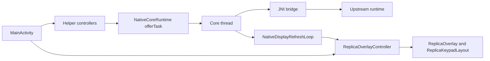

# Kotlin Shell Architecture

This page maps the Kotlin shell: the single-activity coordinator, helper
ownership, lifecycle, storage, settings, input flow, and direct live-stop
routing. Read `00-project-and-upstream.md` and
`01-build-and-source-layout.md` first.

## Top-level model

The Android app is a single-activity, view-based shell around a long-lived
native core. `MainActivity` coordinates Android lifecycle, preferences,
settings, and external integrations. It does not own the calculator
engine loop.

The keypad render path is explicitly spec-first: `CalculatorKeyView` and
`CalculatorSoftkeyPainter` resolve `KeyRenderSpec` data for one key, then
`KeyRenderPainter` and `C47TextRenderer` own the shared draw-stage policy.

Use this page for Kotlin-side ownership, coordinator structure, lifecycle, and
storage flow. Read `03-upstream-interface-surfaces.md` for the upstream bridge
contract, `06-runtime-hot-paths.md` for the hottest runtime loops, and
`08-tests-and-contracts.md` for the focused parity and lifecycle regression
surfaces.

## Kotlin Structure At A Glance

The files under `android/app/src/main/java/io/github/ppigazzini/r47zen/`,
grouped by role; the directory itself is the authority when a file is added:

- activity entrypoints and settings surfaces: `MainActivity.kt`,
  `SettingsActivity.kt`, `SettingsSwitchPreference.kt`,
  `RepoNoticeIndexActivity.kt`, `NoticeAssetActivity.kt`, `ScreenToolbar.kt`,
  and `EnglishResourceContext.kt`
- runtime loops: `NativeCoreRuntime.kt`, `NativeDisplayRefreshLoop.kt`,
  `NativeKeypadSnapshotStore.kt`, `NativeFileRequestGate.kt`, and
  `DeveloperPerformanceSnapshot.kt`
- shell coordination: `ReplicaOverlayController.kt`,
  `MainActivityPreferenceController.kt`, `DisplayActionController.kt`,
  `WindowModeController.kt`, `SystemBarInsets.kt`, `FactoryResetController.kt`,
  `CoreWarning.kt`, `MainMenuButtonDescription.kt`,
  `HapticFeedbackController.kt`, `AudioEngine.kt`, `LiveKeyRouter.kt`,
  `LiveProgramStopKeyPolicy.kt`, `GraphGestureAccumulator.kt`,
  `GraphGestureFlusher.kt`, and `NativeShellCodes.kt`
- rendering and geometry: `ReplicaOverlay.kt`, `PackedLcdRaster.kt`,
  `ReplicaKeypadLayout.kt`,
  `ReplicaChromeLayout.kt`, `CalculatorKeyView.kt`,
  `CalculatorSoftkeyPainter.kt`, `KeyRenderSpec.kt`, `KeyRenderPainter.kt`,
  `C47TextRenderer.kt`, `C47TypefacePolicy.kt`, `MainKeyLabelMirrors.kt`,
  `SoftkeyOverlayPainter.kt`, `SettingsMenuGlyph.kt`, `R47Geometry.kt`,
  `R47KeypadPolicy.kt`, `TopLabelLaneLayout.kt`, and `LcdThemePolicy.kt`
- storage: `StorageAccessCoordinator.kt`, `DocumentTransfer.kt`,
  `DataFolderMirror.kt`, `ProviderLookup.kt`, `WorkDirectory.kt`, `SavedManual.kt`,
  and `AppPreferences.kt`
- keyboard and keypad models: `PhysicalKeyboardInputController.kt`,
  `PhysicalKeyboardInput.kt`, `PhysicalKeyboardBindingTables.kt`,
  `PhysicalKeyboardShortcutId.kt`, `KeypadSnapshot.kt`,
  `KeyboardStateSnapshot.kt`, `KeypadTopology.kt`, and `KeypadLabelModes.kt`

## Kotlin Runtime Flow

## Ownership by slice

| Concern | Primary Kotlin owner | Boundary this page cares about | Read next |
| --- | --- | --- | --- |
| activity and settings coordination | `MainActivity`, `SettingsActivity`, `SettingsSwitchPreference` | startup, preferences, PiP, intent routing, helper wiring, and explicit settings-switch widget tinting | `03-upstream-interface-surfaces.md` |
| native execution coordination | `NativeCoreRuntime`, `NativeDisplayRefreshLoop`, `NativeKeypadSnapshotStore` | one core thread, one task queue, one UI-side poller, one cached keypad snapshot owner, and one lightweight developer-only performance snapshot path | `06-runtime-hot-paths.md` |
| overlay and scene coordination | `ReplicaOverlayController`, `ReplicaOverlay`, `ReplicaKeypadLayout` | scene application after layout, including PiP-exit geometry replay, not the geometry formulas themselves | `05-ui-rendering-and-gtk-mapping.md` |
| storage coordination | `StorageAccessCoordinator`, `WorkDirectory`, `SavedManual` | SAF routing, where each file picker starts, the work-directory tree `SettingsActivity` stores, the saved manual's read grant, save and load ordering | `03-upstream-interface-surfaces.md`, `08-tests-and-contracts.md` |
| Android input adapters | `DisplayActionController`, `PhysicalKeyboardInputController`, mapping tables | convert Android events into core-thread work or small Android-side actions | `03-upstream-interface-surfaces.md` |

## Architecture boundary

- the native core owns calculator state, command execution, softmenu semantics,
  and most shared keypad state
- `KeypadSnapshot` is the Kotlin projection of native keypad arrays, so
  downstream Android code consumes named fields instead of re-indexing raw
  metadata offsets
- `KeypadLabelModes.kt` plus the stored keypad-label preferences are
  Android-local presentation policy: the main-key mode selects the app-facing
  native snapshot mode, which native composes, `user` included, and Kotlin
  composes only `virtuoso` after decode, while the softkey mode masks decoded
  softkey scene bits before rendering
- `KeypadTopology`, work-directory preferences, and shell
  preferences are Android-local models
- geometry constants, render-spec builders, label placement formulas, painter
  policy, and chrome projection are rendering contracts owned by
  `05-ui-rendering-and-gtk-mapping.md`, not by this page
- JNI signatures, cached callbacks, and lock-sensitive bridge behavior are
  native-interface contracts owned by `04-native-core-and-jni.md` and
  `03-upstream-interface-surfaces.md`

## Main coordination flow

Calculator state does not live in `Activity` fields. The durable owner is the
native core plus `NativeCoreRuntime`'s shared thread and task queue.

Main flow:

1. `MainActivity` and helper controllers receive lifecycle, touch, keyboard,
   menu, PiP, and settings work.
2. Native work enters `NativeCoreRuntime` through `offerCoreTask(...)` or the
  small direct bridge methods exposed by `MainActivity`. The live touch stop
  seam first applies `LiveProgramStopKeyPolicy` so `R/S` and `EXIT`
  can call `requestStopProgramNative()` before queue fallback. LCD graph-touch
  queueing also stays here: `ReplicaOverlay` starts pan only after
  `ViewConfiguration` touch slop, keeps a smaller continuation deadband so
  stationary finger jitter does not turn into endless micro-pan updates, and
    `GraphGestureAccumulator` caps queued pan backlog to a small recent range,
    slices the retained backlog into bounded per-apply chunks, and clamps queued
    pinch scale before JNI apply. `GraphGestureFlusher` queues at most one
    flush task at a time, spaces flushes at least 16 ms apart, and applies one
    batch per task, so a continuous drag interleaves with the other queued core
    tasks instead of re-solving back to back ahead of them.
3. `NativeCoreRuntime` serializes calculator execution on one shared core
   thread. The thread outlives each Activity and reaches its host only through
   the runtime the latest `attach()` published, so a recreated Activity's
   predecessor is released once the successor attaches.
4. `NativeDisplayRefreshLoop` is the single UI-side poller for LCD and keypad
   scene state.
5. `NativeDisplayRefreshLoop` watches packed-display and keypad-snapshot
  generations, refreshes `NativeKeypadSnapshotStore` with the current
  main-key mode code from `ReplicaOverlayController`, and emits a lightweight
  `DeveloperPerformanceSnapshot` for Android-owned observability.
6. `ReplicaOverlayController.currentKeypadSnapshot()` resolves that cached
  `KeypadSnapshot`, which native composed for the main-key mode, `user`
  included, blanks it for `virtuoso`, applies the softkey `graphic` or `off`
  mask, and `ReplicaKeypadLayout` applies scene
  changes after a real layout boundary. Runtime-provided non-null snapshots
  from `NativeDisplayRefreshLoop` also pass through the same softkey-mode mask
  normalization before scene apply.

The performance snapshot stays Android-local. `NativeCoreRuntime` forwards it
through `MainActivity`, `MainActivityPreferenceController` owns the
`show_developer_performance_hud` preference, and `ReplicaOverlay` may paint the
red developer HUD in the top shell area. This is a manual observability aid, not a
runtime-policy seam or a replacement for real benchmark and profiler work.

This page stops at the coordination boundary. Read
`06-runtime-hot-paths.md` for cadence, skip gates, and lock-sensitive loops;
`05-ui-rendering-and-gtk-mapping.md` for geometry formulas and label placement;
and `03-upstream-interface-surfaces.md` for the exact JNI entry points and
callbacks.

## Lifecycle contract

- `onCreate()` executes five startup phases in order:
  `configureActivityShell()` sets the music stream, inflates view binding,
  and sets content view; `initializeStartupControllers()`
  wires `WindowModeController`, `FactoryResetController`,
  `StorageAccessCoordinator`, `NativeFileRequestGate`, `DisplayActionController`,
  and `PhysicalKeyboardInputController`;
  `initializeOverlayAndPreferences(...)` binds `ReplicaOverlay`,
  `ReplicaOverlayController`, `MainActivityPreferenceController` with its
  initial pass, which applies the stored LCD palette before the overlay's first
  draw, deferred overlay preference application, and the settings-discovery
  tap handler;
  `startCoreRuntime()` creates `NativeCoreRuntime`, attaches it, and starts
  `AudioEngine`; `handleInitialIntent()` routes factory-reset intents after the
  shell and runtime are ready.
- `onNewIntent()` is the reuse path for root-activity actions such as the
  controlled factory-reset request.
- `onStart()` and `onStop()` tell `NativeCoreRuntime` whether the calculator is
  visible. While it is not, the core thread parks: it still runs every queued
  task, including the background save, but stops the 5 ms tick. A running
  program is unaffected, because it runs inside a task.
  `onStop()` first hands `DataFolderMirror` its copy of the core's prints and
  unnamed captures, to run on that class's own worker.
- `onResume()` lets the overlay-side resume path run without forcing a native
  LCD redraw, and queries no document provider: the work directory is checked
  when a file request needs it. The app asks for no directory at startup. A
  normal Settings round-trip must preserve the current calculator snapshot.
- `onPause()` performs a synchronous native save when auto-save on minimize is
  enabled and the app is not moving into PiP or a reset-driven relaunch. That
  save is lifecycle-passive from the LCD point of view and must not rebuild the
  visible screen.
- `onDestroy()` cancels a native file request whose posted launch it just
  dropped (`NativeFileRequestGate`), and, when the activity is finishing, also
  a launched picker that has not answered, since its result will never arrive.
  It stops the shared runtime when the activity is actually finishing, never
  touches the native activity globals (the core thread releases them), and on
  the factory-reset path clears internal app data
  only once the core thread has stopped. When the thread outlived the dispose
  join fence, `FactoryResetController` keeps the data and the shared runtime
  state: a live thread would autosave into a wiped directory, and a reset
  shared state would let the relaunch start a second core thread
  (`FactoryResetControllerTest`). `MainActivity` is exported, so a reset intent
  counts only when it carries the token `FactoryResetController.createIntent`
  puts in it, a fresh one per process: another app's intent with the same action
  starts the app and wipes nothing.
- `onPictureInPictureModeChanged()` routes PiP state through
  `ReplicaOverlayController`, which switches the overlay between normal shell
  mode and PiP mode and treats PiP exit as a geometry-replay boundary for the
  current keypad snapshot.
- `WindowModeController.enterPictureInPicture()` is the PiP entry seam. It
  always builds `PictureInPictureParams` with the LCD's fixed `400 x 240`
  width-over-height ratio instead of the portrait shell bounds, so Android PiP
  tracks the native LCD contract rather than a device-window snapshot.

Activity Result launchers are registered during
`initializeStartupControllers()` when `createStorageAccessCoordinator()` calls
`StorageAccessCoordinator.registerLaunchers()`. Helper construction must stay
side-effect free after resume so tests can call `deliverLoadResult()` and
`deliverSaveResult()`
without violating the Activity Result lifecycle contract.

Focused verification for this lifecycle contract lives in
`DisplayLifecycleInstrumentedTest.kt`, `StorageAccessCoordinatorTest.kt`,
`WorkDirectoryTest.kt`, `StorageAccessCoordinatorInstrumentedTest.kt`, and
`MainShellThemeTest.kt` as mapped in `08-tests-and-contracts.md`.

## Input surfaces

The Kotlin shell accepts input from four paths:

- on-screen keys built by `ReplicaKeypadLayout`
- accessibility click activation on those same key views once they hold focus
- physical keyboard mappings handled by `PhysicalKeyboardInputController`,
  `PhysicalKeyboardMapper`, and `PhysicalKeyboardBindingTables`
- the projected top-bezel main-menu button coordinated by
  `DisplayActionController`

A PiP window is not a path: the system takes every touch on it for its own
controls, so the app receives none
([PiP](https://developer.android.com/develop/ui/views/picture-in-picture)).

Each path ultimately resolves to core-thread work or a small Android-side action.

The on-screen keypad takes one key at a time, as the hardware scans it:
`ReplicaOverlay` disables motion-event splitting, so a second finger reaches
the first touched key view as `ACTION_POINTER_*`, which the key listeners
ignore. Native input keeps one pressed-key slot, so a second `ACTION_DOWN` on
another key would leave the first key pressed with no release.

The physical-keyboard HOME and MYMENU shortcuts pass `NativeShellCodes` values,
never upstream item numbers: `items.h` renumbers between upstream revisions, so
`jni_input.c` resolves each code to its `MNU_*` symbol at build time.

`Paste Number` enters one real or complex number, or refuses the clip whole, since
a number typed from part of a clip is a wrong number on the stack. `PasteNumber.kt`
refuses text it cannot read as one number: a date, two numbers, `1,234` (1.234 or
1234 by locale), digits other than ASCII, or digits apart by any Unicode space,
a no-break space among them. Its classes are spelled out, since `\d` and `\s`
match Unicode on Android and ASCII on the JVM that runs its tests. One core task
then calls `pasteNumberNative`, whose
`r47_paste_number` enters the items through `processKeyAction`, below the key
tables, under one lock, so USER assignments, a pending shift, and the multi-press
timers cannot turn a digit into a function and no key press can land inside the
number.

It refuses when the core would read digits as something else: alpha entry, a
parameter prompt, a catalog, a running program, or a matrix cell the user is still
typing. The digits enter as typed digits do, so the last short integer base applies
to them. It also backs the entry out when
the core drops a token, which number entry does with no error: a digit past the
display width, an exponent digit past the `RNG` setting, the radix mark in integer
input mode. The width depends on the grouping settings, so no fixed length guards
it. `PasteNumberTest.kt` locks clip text to tokens,
`DisplayActionControllerTest.kt` locks the core task and the refusals, and
`clipboard_overflow_harness.c` locks tokens to stack values against the live core
([08](08-tests-and-contracts.md)). It does not paste dates, times, tagged angles,
matrices, or strings.

`ReplicaOverlay` also owns the shell-level focus policy for the physical-
keyboard path. It stays focusable in touch mode, blocks descendant focus
navigation, and keeps touchscreen focus from suppressing the shell, so the
first DPAD event reaches `MainActivity` and the physical-keyboard controller
instead of Android focus search on keypad descendants.

The live on-screen stop path is narrower than the general queue path:

- `ReplicaOverlayController` routes touch through
  `MainActivity.dispatchLiveKey(...)`
- `LiveProgramStopKeyPolicy` marks only key codes `36` (`R/S`) and `33`
  (`EXIT`) as direct live-stop candidates
- `dispatchLiveKey(...)` delegates the forward-vs-swallow decision to the pure
  `LiveKeyRouter.route(...)`: it consults the side-effecting
  `requestStopProgramNative()` gate only for those stop-candidate keys, and only
  falls back to queued `sendKey(...)` when the gate declines (no program running
  or paused). The split keeps the routing consequence unit-testable
  (`LiveKeyRouterTest`) without an emulator, separately from the native gate
  predicate

That rule keeps normal `EXIT` semantics outside long-running program execution
while matching the desktop simulator's stop-key parity during an active run.

## Persistence model

- the app holds one calculator state, `backupR47.cfg` in the app's files
  directory, and `SAVE` and the automatic save are `SAVFILES/R47.sav` and
  `SAVFILES/R47auto.sav`: upstream's simulator names, from its `hal/io.h`.
  Versions before 0.3.0 put a slot number, `_0`, in all three, from a slot list
  no screen could switch; that switch was deleted, and `hal/io.c` moves each
  old file to the new name once, when the base path is set, never over a file
  of the new name. `AppPreferences.NAME` is the shared preferences file every
  setting uses, and `AppPreferences.RETIRED_SLOTS_NAME` is the slot list those
  versions wrote, which a factory reset deletes
- SAF-backed user files remain outside the internal app directory contract
- `DataFolderMirror` copies the files the core writes by a relative name in
  `<filesDir>/DATA`, its working directory, to the work directory: prints to DATA and
  captures a `SNAP` left unnamed to SCREENS, as the firmware files them. When the
  Activity stops it copies, on its own worker, each file whose time or size changed
  since its last copy, whole, making a new one as `application/octet-stream` so a
  provider keeps its name. A copy that fails is made at the next stop. With no work
  directory the app can write, the files wait, and the user is told once for each new
  print that a Work Directory gets them. The private files are never deleted, so
  Auto Backup leaves `DATA` and the record of copies out: a program that `SNAP`s in
  a loop would grow them past the 25 MB an app's backup may hold, where Android
  stops backing the app up, and the copies are the user's already
- the work directory is chosen in one place: `SettingsActivity` launches
  `OpenDocumentTree()` and stores the pick through
  `WorkDirectory.persistSelectedTreeUri(...)`, the persistable grant plus the
  stored tree, its only caller. The app asks for none at startup. A file request
  whose stored tree the app can no longer reach starts its picker with no folder,
  so the system picker opens where it last was (`PickerStart`,
  `PickerStartTest.aWorkDirectoryTheAppCannotUse_isNotAskedForAFolder`)
- no provider call runs on the main thread, since a provider is another app and a
  binder call to it can block for as long as it takes to answer. A file request finds
  where its picker starts on the core thread, which waits for the answer anyway:
  `PickerStart` gives the work directory's folder for the file type, made for a save
  and only found for a load, so a canceled load leaves no folder, or the work
  directory itself with no such folder. Settings shows the
  stored Work Directory at once and changes the summary only if `ProviderLookup`'s
  worker finds it gone; the saved manual's tap and pick ask on that worker too
- the work-directory contract is a user-facing SAF tree, not a replacement for
  the app-internal native base path
- a setting's default has two holders that must agree: `root_preferences.xml`,
  which Settings shows while nothing is stored, and the `DEFAULT_` constant of the
  class that reads the key, which every read passes; `AudioEngine` starts from the
  beeper's constants until the stored values arrive.
  `SettingsPreferenceSummaryTest` holds the pairs and
  `test_settings_default_reads_contract.py` the reads
- `SavedManual` keeps a read grant to the one PDF the user picks in Settings and
  the name it had, and `SavedManualEntries` hands it to a PDF app with
  `ACTION_VIEW`, so a downloaded manual reopens in one tap with no network and
  no storage permission. A tap asks the provider whether the file can be reached,
  and a pick asks for its name, both on `ProviderLookup`'s worker, and the file
  opens with the answer; opening Settings asks nothing, and the no-PDF dialog
  shows the stored name. A document it cannot reach stays remembered until the user picks
  another, because a removed card can come back; a new pick releases the old
  grant. A provider can answer for a file that is gone, as Downloads does for a
  raw path, and the PDF app then reports it. A picker that gives no lasting
  grant opens the file once. With no PDF app a dialog offers the hosted manual
  and opens nothing until asked, because that copy needs a network and may be
  another version
- deleting the preferences does not end a grant, so a factory reset also releases
  every persisted grant through `FactoryResetController`
- manifest backup rules intentionally exclude the retired `R47Slots` and the
  preferences file holding the work-directory and saved-manual URIs because SAF grants
  are device-specific; general shell preferences remain migratable

## Current platform shape

- the app is view-based and uses view binding, and stays so by decision, not by
  default: no defect needs Jetpack Compose, the keypad and LCD are drawn on a
  `Canvas` under either toolkit, and a move would rewrite every screen for no
  change a user sees. Revisit it when a feature needs something only Compose
  offers
- `MainActivity` remains portrait-first in the manifest for shell fidelity.
  From targetSdk 36 the platform ignores that lock on large screens (smallest
  width 600 dp and up), so there the activity takes whatever window it gets and
  `ReplicaOverlay` letterboxes the replica into it; the lock still holds on
  phones
- the application is explicitly resizable, which decides multi-window support
  on screens below smallest width 600 dp. On larger screens the platform
  ignores `resizeableActivity` and the portrait lock, the activity fills
  whatever window it gets, and a system letterbox appears only if the user
  picks one in the device's aspect ratio settings
- Picture-in-Picture is enabled
- settings live in a separate non-exported `SettingsActivity`
- `MainActivity` installs one projected top-right orange-left and blue-right
  rectangle touch target into `ReplicaOverlay` after keypad rebuild. The
  visible marker sits near the LCD top edge, but the touch zone extends around
  and above it.
  `DisplayActionController` anchors the shell popup there for `Settings`,
  `Copy...`, `Paste Number`, and `Picture in Picture`. `Copy...` opens a
  dedicated follow-up popup that mirrors the upstream desktop clipboard actions
  with `Copy X Register`, `Copy Stack Registers`, and `Copy All Registers`.
  Both popup layers use a dedicated dark popup theme so device light mode can
  never flip the shell menu to a light surface, while `ReplicaOverlay` treats
  only the projected marker as the settings target, not the full top bezel, and
  dismisses the onboarding card on the first shell touch
- `SettingsActivity` is Preference-based and its host layout is adaptive: the
  base `settings_activity.xml` uses `ConstraintLayout`, and
  `layout-w600dp/settings_activity.xml` centers the preferences inside a
  bounded `MaterialCardView` panel for larger or resizable windows
- the settings-owned activity stack uses the dedicated
  `Theme.R47.Settings` dark Material 3 theme from `AndroidManifest.xml`, so
  settings, the notice screens, and settings-owned dialogs do not fall back to
  white surfaces when the device stays in light theme
- the notice screens are `RepoNoticeIndexActivity` over an asset index and
  `NoticeAssetActivity` for one text. The repo-owned notices come from
  `android/compliance/repo-notices/components.json`; the Android library
  licenses come from the `oss-licenses` Gradle plugin, which reads each runtime
  dependency's POM and embedded license, and from
  `generate<Variant>LibraryLicenseAssets` in `app/build.gradle`, which turns
  its output into `library-licenses/NOTICE-INDEX.json`. For the release's 68
  Maven libraries the plugin's entry is only the Apache 2.0 URL, so each such
  entry shows one shared copy of the tracked
  `android/compliance/repo-notices/source-texts/apache-2.0.txt`, and the task
  fails on any other entry that is only a link. The app links no
  license-viewer library: `play-services-oss-licenses` brought Compose, Play
  services, and Guava, nearly two thirds of the shipped dex classes, for that
  one screen. A debug variant lists the plugin's single placeholder entry
- `SettingsFragment` owns the user-facing behavior copy for
  `fullscreen_mode` and `force_close_on_exit`; those summaries stay fixed and
  describe what enabling each toggle does instead of duplicating the visible
  on or off state
- `MainActivity` keeps the calculator shell dark even on a light-themed
  device: `Theme.R47` is a fixed dark Material 3 theme, not a DayNight theme,
  and the phone light or dark setting must never change the app theme.
  `DisplayActionController` also wraps popup menus in the dedicated dark
  `Theme.R47.PopupMenu` context so that invariant still holds if future work
  touches activity theming. The projected main-menu affordance stays on that
  same dark shell surface instead of depending on a hidden top-bezel gesture
- every activity draws edge to edge on every API level, the layout targetSdk
  35 and later enforces, through `SystemBarInsets.kt`: transparent bars with
  light icons over the activity's own dark background, and a root padded by
  the system-bar and display-cutout insets. The Settings-family screens always
  pad; `WindowModeController` pads the main screen by them only while
  fullscreen is off, and in fullscreen hides the bars and pads by the caption bar
  alone, which a desktop window keeps for its controls and a phone does not
  have. The root
  consumes the insets, so no descendant pads for them again, and
  `ReplicaOverlay` projects the calculator into whatever size that leaves
- LCD appearance stays on a curated Android-local theme list owned by
  `LcdThemePolicy.kt`; `MainActivityPreferenceController.kt` normalizes stored
  `lcd_theme` values, clamps `lcd_luminance` to
  `MIN_LCD_LUMINANCE..MAX_LCD_LUMINANCE`, and routes the optional
  `lcd_negative` inverse-display toggle before `MainActivity.kt` applies the
  selected palette
- `show_developer_performance_hud` is a developer-only Android setting.
  `MainActivityPreferenceController.kt` reads that toggle plus the companion
  `developer_performance_hud_window_millis` slider and dispatches them
  directly to `ReplicaOverlay.kt` and `NativeDisplayRefreshLoop.kt`, while the
  loop supplies the sampled `DeveloperPerformanceSnapshot` label data used by
  the overlay. The fixed settings copy names those fields as UI Hz, LCD Hz,
  dirty-row percent, and LCD update ms (`Upd` on the HUD: copy, decode, and
  redraw request, not the copy alone). The first field is the UI-thread
  `Choreographer#doFrame(...)` cadence, not the phone panel's raw refresh
  rate. The second field counts accepted non-empty packed LCD snapshot copies,
  not raw native row writes. Read `06-runtime-hot-paths.md` for the default
  `500 ms` sample window, the `100..1000 ms` clamp, and the exact `DR` and
  `Copy` semantics.
- keypad haptics are Android-view concerns first: `ReplicaKeypadLayout` uses
  press-only keypad haptics for calculator interaction. `ACTION_DOWN`
  uses `HapticFeedbackConstants.VIRTUAL_KEY`, while `ACTION_UP` and
  `ACTION_CANCEL` only clear pressed state and send key `0` with no release
  pulse. `HapticFeedbackController` owns the three preference-driven states
  behind that press path: `haptic_enabled` is the master gate,
  `haptic_use_android_default` is a dependent default-on toggle, and
  `haptic_keypress_duration_ms` is a custom `0..100 ms` slider that only
  applies when the Android-default toggle is off. With the default toggle on,
  the controller uses the Android view path alone: when the view declines, which
  on API 32 and below is how the system says the user turned touch feedback off,
  nothing vibrates. With it off, positive
  values switch to short app-owned one-shot press pulses that intentionally
  override the system touch-haptics setting, while `0 ms` means no app pulse
- haptics, audio, fullscreen state, LCD display theme, keypad
  label modes, touch-zone overlays, and the developer-only performance HUD are
  preference-driven Android concerns

- `SettingsFragment` keeps the haptics surface intentionally lean and
  duration-focused: `Haptic feedback` is the master switch,
  `Use system duration` is the dependent toggle that keeps the stock Android
  press response on by default, and `Custom duration (ms)` is the right-value
  `SeekBarPreference` that only enables when the app is in custom mode

## Kotlin-side change rules

- Keep `MainActivity` as a coordinator, not as a second calculator engine.
- Keep blocking work off the main thread.
- Add new Android integrations through focused helper types when they do not
  belong in `MainActivity`.
- Keep `registerForActivityResult()` calls in the unconditional activity or
  fragment initialization path, not in helper constructors or late callbacks.
- When adding a native call, update the Kotlin external declaration and the JNI
  registration table together.
- When a feature needs both Android lifecycle logic and native execution,
  prefer a small Kotlin coordinator plus core-thread work instead of splitting
  state across both sides.
- If a new feature needs durable calculator state, decide first whether the true
  owner is the native core or Android preferences.
