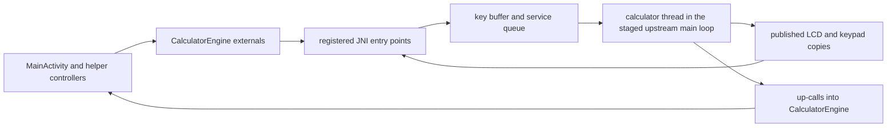

# Upstream Interface Surfaces

This page maps the exact Android-owned calls that cross into the staged
upstream core and the exact native up-calls that cross back into
`CalculatorEngine`.

Read `00-project-and-upstream.md` first. This page assumes the project and
ownership boundary is already clear.

Read this page when a task touches `CalculatorEngine` external methods, JNI
registration, the key buffer, service requests, packed LCD export, lifecycle
saves, instrumentation-only bridge seams, keypad-scene export, SAF-backed file
requests, or the DMCP HAL the staged `PC_BUILD` core calls. Read
`08-tests-and-contracts.md` for the focused bridge, READP, and storage
verification surfaces.

## Interface Inventory

| Surface | Android side | Native bridge | Shared-core side | Sensitive detail |
| --- | --- | --- | --- | --- |
| calculator start and stop | `CalculatorEngine.start()` runs `runCalculatorNative()` on its thread; `stopCalculatorNative()`, `isReadyNative()`, `onHostStoppedNative()`, `setAutoSaveNative()` | `jni_registration.c` plus `jni_lifecycle.c` | `doFnReset()`, `restoreCalc()`, `fnTimerConfig(...)`, `mainLoop()`, `saveCalc()` | `r47_init_runtime()` publishes `r47_runtime_ready()` last, and the display copies return early until it is true; a later Activity's `start()` runs nothing native, so a recreated Activity neither redraws nor touches the packed snapshot |
| key input | `sendKey()`, `cancelKey()`, `releaseKeyIfDown()` | `jni_input.c` plus `hal/keys.c` | `key_pop()`, `keyPopForMainLoop()`, `keyDispatchHostEvent()`, `processKeyCode()` | any thread pushes; only the calculator thread pops; a press has to be released, since `wait_for_key_release(0)` holds the calculator thread until it is |
| service requests | `pasteNumberNative()`, `showShellMenuNative()`, `graphGestureNative()`, `resetGraphNative()`, `copyRegistersNative()`, `saveStateNative()`, `switchSlotNative()` | `jni_input.c`, `jni_clipboard.c`, `jni_lifecycle.c`, and `host_services.c` | `processKeyAction(...)`, `showSoftmenu(...)`, `fnEqSolvGraph(...)`, `saveCalc()`, `restoreCalc()` | queued apart from the keys, run from `sys_sleep` at rest, and answered through an up-call; a full queue refuses |
| LCD and keypad snapshot export | `getPackedDisplayGeneration()`, `getPackedDisplayBuffer()`, `getKeypadSnapshotGeneration()`, `copyKeypadSnapshotNative()` | `jni_display.c`, `keypad_scene.c`, and `hal/lcd.c` | `packedDisplayGeneration`, packed LCD rows, `publishedKeypadGeneration`, visible key tables, label resolvers | the generation checks short-circuit unchanged LCD and keypad work; both copies read only what the calculator thread published, and exit early before `r47_runtime_ready()` and when their mutex is busy |
| instrumentation-only runtime probes | `ProgramLoadTestBridge.forceRefresh()`, `saveBackgroundStateForTest()`, `captureDisplayHash()`, `beginSimFunction()`, `beginMainActivityKeySequence()`, `snapshotState()` | `jni_program_load_test.c` | `r47_force_refresh()`, `r47_save_settled()`, packed LCD snapshot state, READP or RUN | everything that touches core state runs on the calculator thread at rest, through `r47_run_at_rest`; lifecycle snapshot hashes ignore packed-row transport metadata so assertions compare visible LCD bytes only |
| native to Kotlin up-calls | `requestFile()`, `playTone()`, `clearTones()`, `onFileWriteFailed()`, `onCalculatorOff()`, `onClipboardText()`, `setClipboardText()`, `onPasteResult()`, `onWarning()`, `onDisplayText()` | `jni_upcalls.c`, bound once in `JNI_OnLoad()` | `ioFileOpen(...)`, `_Buzz(...)`, `mainLoop()`, `guiSetClipboardText(...)`, `show_warning(...)` | static methods of `CalculatorEngine`, which outlives each Activity; the bound signatures and Kotlin methods must stay aligned (`test_jni_registration_contract.py`) |
| storage boundary | `StorageAccessCoordinator` and `DocumentTransfer` return a pipe, or a private file with the name the provider shows, through `onFileSelectedNative()`, or cancel through `onFileCanceledNative()` | `jni_storage.c` plus `android_runtime.c` | `ioFileOpen(...)` | the calculator thread saves, then parks on `fileCond` until the answer |

## Bridge Flow

## Boot And Host Contract

- `register_calculator_engine_natives()` in `jni_registration.c` registers the
  full `CalculatorEngine` external-method surface and binds the up-calls through
  `r47_upcalls_bind()`. Signature drift fails `JNI_OnLoad()`, so change Kotlin
  declarations, `JNINativeMethod` entries, and native implementations in the same
  edit.
- `CalculatorEngine.start()` runs `runCalculatorNative(...)` on the `R47Calculator`
  thread, once per process. A later call returns at once and runs nothing native,
  so a recreated Activity never redraws and never touches the packed snapshot:
  the new `ReplicaOverlay` decodes the first frame it receives whole
  ([06](06-runtime-hot-paths.md#lcd-frame-state-inventory)).
- `r47_native_preinit_path(...)` sets the Android base path used by
  `hal/io.c` and installs the GMP allocator hooks before the shared core starts.
- `r47_init_runtime()` initializes the key buffer's
  clock and the LCD buffers, resets and restores calculator state, clears a run
  state the file holds, sanitizes the graph bounds, sets both `nextScreenRefresh`
  and `nextTimerRefresh`, registers the native timer callbacks that the staged
  core expects, arms the `SNAP` capture, draws, publishes the keypad, and publishes
  `r47_runtime_ready()` last. The UI thread is live before init finishes, so the
  display copies gate on that flag;
  `scripts/workload-regressions/build_bridge_tsan_harness.sh` races them against
  init.
- `r47_calculator_main(...)` is the thread's whole life, the shape of upstream's
  `calcThreadMain` in `src/c47-gtk/c47-gtk.c`: init, one AUTXEQ, then `mainLoop()`.
  When OFF ends the main loop it saves if autosave is on, tells Kotlin through `r47_upcall_quit()`,
  clears the power flags, and enters `mainLoop()` again, because OFF leaves the app
  in the background with its process alive. `r47_calculator_stop(...)` is the one
  way out, and only a factory reset calls it.
- `clearInterruptedRun()` runs after every restore. A state file can hold a run
  state, because a file request saves before it parks, inside a running program
  too, and a pending save can run in a program's pause. A running state leaves the
  keys dead, and a solver flag turns `EXIT` into
  "Solver abort" and switches undo off, so `programRunStop`, the hourglass,
  `FLAG_SOLVING`, and `FLAG_INTING` are cleared.

## Lifecycle Save And Explicit Refresh Contract

- `MainActivity.onStop()` calls `CalculatorEngine.onHostStopped(...)`, which calls
  `saveStateNative(SAVE_FENCE_MILLIS)`. `r47_service_save_and_wait()` takes a ticket
  and waits up to `R47_SAVE_IDLE_GRACE_MS` for `r47_keys_calculator_idle()`. A
  calculator that does not get there cannot answer, so the call returns false and the
  save stays pending; an idle one is waited for up to the fence. `r47_services_run()`
  runs a pending save last, so that it holds what the requests ahead of it changed.
- `r47_save_settled()` wraps `saveCalc()`, upstream's shutdown routine, which resets
  the graph variable and dismisses a confirmation; the wrapper restores both for a
  calculator that keeps running. It must stay display-passive for a normal background
  save or Settings-entry transition, and it does nothing once a factory reset asked
  for no save.
- It runs at rest for the save service and the idle checkpoint; in
  a program's pause for a pending save, when the pause is a step boundary; in
  `r47_calculator_main()` after the main loop; and before a picker in
  `r47_save_before_picker()`. The last is the only one that can run inside a
  computation.
- `setAutoSaveNative(...)` passes the `auto_save_minimize` setting. With it off there
  is no idle checkpoint, no save before a picker, and no save after OFF, and
  `onHostStopped` checks the setting itself.
- `hal/io.c` writes the state file whole or not at all: `ioFileOpen(ioPathBackup, ...)`
  opens `<file>.tmp`, `ioFileClose()` renames it over `backupR47.cfg` and syncs
  the directory, and a save that cannot start returns `FILE_CANCEL`, because
  `saveCalc` ends the process on an error. A kill during a save leaves the last
  complete file. Before the restore, a file that is cut, older than upstream's floor,
  for another RAM size, or newer than this core's `BACKUP_VERSION`, or whose restore
  did not finish twice, is moved aside and kept
  ([04](04-native-core-and-jni.md)). The version range is upstream's: `BACKUP_VERSION`
  and the floor in `restoreCalc()`, read at staging.
- A save folds a running stopwatch into the saved copy, as upstream's own saves do by
  stopping it, and starts it again: `timerStartTime` is not saved, so a file saved
  running would restore as running with its time lost.
- `MainActivity.onResume()` must not trigger a native redraw for a normal
  Settings return: the display loop and the overlay resume hook already preserve
  the current snapshot, so a redraw there is redundant.
- `r47_force_refresh()` is the native redraw for runtime init, which calls it
  directly, and for instrumentation, which reaches it through
  `ProgramLoadTestBridge.forceRefresh()`. `CalculatorEngine` has no redraw entry
  point; a passive lifecycle callback that does not replace calculator state must
  not gain one. `test_jni_registration_contract.py` fails a reference to
  `r47_force_refresh` from any other glue source or header, or a second one in
  runtime init. A stop's save still redraws once, since `r47_services_run`
  refreshes the LCD after any service it ran.

## Input Dispatch Contract

- Touch and PiP taps reach `CalculatorEngine.dispatchKey(...)`, physical-keyboard
  keys reach `sendKey(...)`, and both push onto one FIFO in `hal/keys.c`. No path
  runs core code on the caller's thread.
- `sendKey(int)` is the key path, `r47_key_push` behind it: a press is `1..37` for
  the keys and `38..43` for the softkeys, and a release is `0`, one code for every
  key. Upstream's `processKeyCode(...)` maps those codes onto `btnPressed(...)`,
  `btnFnPressed(...)`, and their release handlers.
- `cancelKey()` is for a touch the platform canceled. It pushes a host event behind
  the press, and the main loop runs `cancelPressedKey()`: it clears the function
  name on show, which is the abort upstream's release path already knows, stops a
  single step, and leaves an `ASSIGN` unassigned, on a main key or a softkey, the two
  that act on the release without looking at that name. What upstream does on the press
  itself stays done, such as a digit entered. A harness case locks each.
- `releaseKeyIfDown()` is the same cancel, only when a press is down. `onHostStopped`
  and `r47_calculator_stop` call it, because `wait_for_key_release(0)` holds the
  calculator thread until a release arrives.
- `key_pop()` and `keyPopForMainLoop()` are the two ways out of the buffer, the split
  upstream's `hal/keys.h` defines. A long operation pops through `key_pop()`, which
  never runs core code: a quit becomes `EXIT` plus a release at the head of the
  buffer, and any other host event is dropped. The main loop pops through
  `keyPopForMainLoop()` and runs a host event whole in `keyDispatchHostEvent()`. A
  redraw pops through it too, so it returns nothing while a program runs
  ([06](06-runtime-hot-paths.md#what-a-key-does-during-a-computation)).
  What a computation does with the keys it pops is on
  [06](06-runtime-hot-paths.md#what-a-key-does-during-a-computation).
- `showShellMenuNative(int)` queues a shell menu code (`R47_SHELL_MENU_*` in
  `jni_bridge.h`, mirrored by `NativeShellCodes.kt`). At rest `r47_show_shell_menu`
  resolves it to its `-MNU_*` softmenu, does what upstream's `shortCutCommand` does
  before it shows a menu, calls `showSoftmenu(...)`, and refreshes the screen. An
  unknown code logs and does nothing. It takes no upstream item number, since
  `items.h` renumbers between upstream revisions.
- `pasteNumberNative(String)` queues the tokens `PasteNumber.kt` writes; a true
  return means queued, and the answer comes through `onPasteResult`. At rest
  `r47_paste_number` resolves each token to its `ITM_*` item, again never a number
  across JNI, and enters them through `processKeyAction(...)`, and `runFunction(...)`
  when the core leaves the item unprocessed, as the key path does. That is below
  `determineItem`, so the key tables, USER assignments, and the shift state do not
  apply. It depends on `processKeyAction(...)` accepting these items in the normal
  and program-entry modes; `clipboard_overflow_harness.c` fails when it stops.
- `sendSimKeyNative(String, boolean, boolean)` exists only in
  `jni_program_load_test.c`, and pushes the key it names. `r47_send_sim_key` exists
  only in a `HOST_TOOL_BUILD`, where a harness has no calculator thread and
  `keyDispatchNow()` runs on its own thread what the main loop would run.

## Display And Keypad Snapshot Export

- `NativeDisplayRefreshLoop.doFrame(...)` is the only continuous poller on the
  Android side. It reads `getPackedDisplayGeneration()` first and only attempts
  a packed-LCD copy when the generation changed, and it reads
  `getKeypadSnapshotGeneration()` and refreshes the keypad only when that one
  changed.
- `getPackedDisplayBuffer(...)` pins the Java array and hands it to
  `r47_try_take_packed_display(...)`, which returns `false` until
  `r47_runtime_ready()`, whose acquire load is what makes the
  `packedDisplayBuffer` pointer safe to read, and then
  `lcd_try_take_packed_snapshot(...)` copies every row and clears the row
  flags under `pthread_mutex_trylock`, so a busy native section skips one frame
  instead of blocking the UI thread. The TSan harness calls
  `r47_try_take_packed_display(...)` directly, so it races the production
  gate and copy.
- `getKeypadSnapshotGeneration()` reads `publishedKeypadGeneration`, which moves
  only when the calculator thread published a snapshot that differs from the last
  one.
- `copyKeypadSnapshotNative(mainKeyDynamicMode, metaBuffer, labelBuffer)` is
  the Android hot-path keypad export. It copies the published front snapshot, one
  fixed `KEYPAD_META_LENGTH` integer array plus one label array, under one
  `pthread_mutex_trylock(&publishedKeypadMutex)`. It reads no core state. It returns
  `false` before `r47_runtime_ready()`, when that mutex is busy, or when the
  published snapshot is in another main-key mode; that last case queues the mode
  as a service request, and the generation moves once the calculator has published
  it. The gate and the copy live in `r47_try_copy_app_keypad_snapshot(...)`, which
  the TSan harness calls directly, so the harness races the production gate.
- `NativeKeypadSnapshotStore` owns the reusable Kotlin-side buffers and caches
  the last accepted snapshot per main-key mode. `NativeDisplayRefreshLoop`
  checks generation first and reuses that cached snapshot when the native copy
  path reports `false`.
- USER-mode composition happens inside `fillAppKeypadSnapshot()`, on the calculator
  thread, so the UI assembles one logical keypad scene from a single JNI read rather
  than several.
- A copy carries every row's current pixels; the row flag only says which rows
  changed since the previous copy. That flag is transport bookkeeping, not part
  of the visible LCD contract.
- A theme change never reaches native: the palette lives only in the
  overlay's `PackedLcdRaster`, which recolors the frame it holds.
- `r47_get_keypad_meta(..., bool isDynamic)` and
  `r47_get_keypad_labels(..., bool isDynamic)` in `keypad_fixture_bridge.h`
  are the fixture-export contract the keypad fixture exporter reads. They read core
  state with no lock, so only a single-threaded host tool may call them. They take
  a two-state `isDynamic` where the app's `r47_try_copy_app_keypad_snapshot` takes
  the `mainKeyDynamicMode` int, and resolve the main labels through
  `buildLegacyMainLabelPresentation` in `keypad_scene.c`, so the fixture goldens do
  not move with the app's label modes.
- Kotlin converts the copied buffers into `KeypadSnapshot`, and the renderer
  uses named fields from that model instead of indexing raw native arrays
  again. `ReplicaOverlayController` then applies any `virtuoso` keypad-label
  composition plus the softkey `graphic` or `off` mask before the snapshot
  reaches the live renderer.

## Instrumentation-Only Bridge Contract

- `ProgramLoadTestBridge` is the Android-owned instrumentation seam for READP
  program execution coverage, stopping a run, and passive lifecycle LCD
  preservation. Only an instrumentation build compiles its native half, with
  `R47_TEST_BRIDGE` defined.
- It holds the app's one thread rule: everything that touches core state runs on
  the calculator thread at rest, through `r47_run_at_rest` or
  `r47_run_at_rest_async`, so such a probe blocks until the calculator reaches rest.
  The state a test watches is the exception: the calculator thread publishes it at
  every sleep, every poll of a running program, and after every probe, and
  `snapshotState()` reads that copy without waiting, since a program paused for a key
  the test is about to send never reaches rest. `trySnapshotState()` reads the same
  copy; whether a function or key sequence the bridge started has returned is
  `isSimFunctionRunning()`.
- `beginSimFunction(...)` and `beginMainActivityKeySequence(...)` start the work and
  return at once, `snapshotState()` reads the published state, `pressRunStopKey()` pushes
  `R/S` as the keypad does, and the file-descriptor override helpers drive the same
  READP or RUN paths used by `ProgramFixtureInstrumentedTest`.
- `saveBackgroundStateForTest()` runs `r47_save_settled()` at rest so lifecycle
  tests can assert that a background save is display-passive.
- `captureDisplayHash()` hashes only visible packed LCD bytes. It intentionally
  ignores the row-dirty transport flag that `getPackedDisplayBuffer(...)`
  clears after each successful UI poll.
- `forceRefresh()` remains the explicit redraw seam for tests that need to
  assert the opt-in native refresh path.

## Up-Calls Into CalculatorEngine

- `r47_upcalls_bind()` in `jni_upcalls.c` caches `CalculatorEngine`'s class and the
  method IDs once, in `JNI_OnLoad()`, on a thread whose class loader sees the app's
  classes ([04](04-native-core-and-jni.md#up-call-bindings)). Nothing native holds
  an Activity. A missing binding fails the library load.
- Each up-call runs on the calculator thread. `playTone(...)` and `clearTones()` go
  straight to `AudioEngine`. `onFileWriteFailed()` posts a toast from the application
  context, so it needs no host: it is how `hal/io.c` reports a file it could not write
  in full, because upstream reports only a failed open. `onWarning(...)` is upstream's
  `show_warning(...)`: it posts to the host, which shows a dialog, because the core's
  messages run to five lines and a toast shows two from Android 12 on. With no host it
  only logs.
- `onCalculatorOff()`, `onClipboardText(...)`, `setClipboardText(...)`,
  and `onPasteResult(...)` go to the `CalculatorHost` attached
  at that moment, and do nothing with none attached, so an answer that arrives
  between two Activities is dropped. `onCalculatorOff()` follows OFF, once the state
  is saved. `onClipboardText(...)` answers a `copyRegistersNative(...)` request,
  `setClipboardText(...)` carries text the core itself copies through
  `guiSetClipboardText(...)` in `hal/gui.c`, and `onPasteResult(...)` answers a paste.
- `onDisplayText(...)` answers a `describeDisplayNative()` request with what the display
  shows, for a screen reader, and whether it is an error: the error the screen shows
  (upstream holds its code in `lastErrorCode` and clears it on the next key), a TAM
  prompt's `tamBuffer`, the number or alpha text being typed in `aimBuffer`, else X as
  Copy X gives it, cut on a whole character to 400 bytes. Like `onWarning(...)` it posts
  to the main thread, and the host hands it to the LCD's accessibility node.
- `requestFile(...)` hands the request to `CalculatorEngine.fileRequestGate`, one
  `NativeFileRequestGate` for the process. Still on the calculator thread, it finds
  where the picker starts through `PickerStart`, provider calls that must not run on
  the main thread, then posts the launch onto a process-scoped main handler exactly
  once, with no start folder if the lookup fails, and forwards the picker's answer. The posted launch reaches
  the attached host, is canceled at once with none attached, and a finishing
  `onDestroy` cancels a launched picker that never answered, so the calculator thread
  parked in `requestAndroidFile` always gets a result or a cancel
  (`NativeFileRequestGateTest`). The launch hands control
  to `StorageAccessCoordinator`, which owns the SAF launcher registration and hands
  the picked document to `DocumentTransfer` (see
  [04](04-native-core-and-jni.md#file-io-boundary)). The work directory itself is
  chosen only in `SettingsActivity`; a request whose stored tree the app cannot
  reach opens its picker with no start folder.

These up-calls are part of the interface contract, not optional convenience
hooks. If their names or signatures drift, the library load fails, and a release
that lost one to R8 fails `check_jni_surface.sh`.

## Storage Boundary

- `hal/io.c::ioFileOpen(...)` intercepts state, program, RTF-export, register
  data export and import, and manual save paths into `requestAndroidFile(...)`
  when the Android build is active.
- `hal/io.c::r47_offer_snap()` reaches `requestAndroidFile(...)` from
  `r47_services_run()`, at rest, for the capture upstream's `fnScreenDump` wrote to
  `_ioFileNameOverride`. That function clearing the name is the signal, so a change
  there stops the offer with no build error; `clipboard_overflow_harness.c` holds
  the live core to it.
- `requestAndroidFile(...)` in `jni_storage.c` writes the state through
  `r47_save_before_picker()`, unless the user turned autosave off, since the process
  can die behind a picker and no save can run while this thread waits. It then marks
  `isCoreBlockingForIo = true`, calls the
  `requestFile` up-call, and waits on `fileCond`. It holds no other lock, so nothing
  unwinds around the wait. Keys pile up in the buffer, and requests in their queue,
  until the answer.
- `Java_io_github_ppigazzini_r47zen_CalculatorEngine_onFileSelectedNative(...)`
  and `Java_io_github_ppigazzini_r47zen_CalculatorEngine_onFileCanceledNative(...)`
  wake that wait by updating `fileDescriptor`, `fileReady`, and
  `fileCanceled` under `fileMutex`. `onFileSelectedNative` also keeps the document's
  name, its last 255 bytes, which `hal/io.c` records for a read as GTK's `ioFileOpen`
  records a file's, for STATE# to report. With no request waiting,
  `onFileSelectedNative` takes nothing and returns false, and its caller closes the
  descriptor.
- The base path `runCalculatorNative(...)` configures and the SAF work-directory
  URI owned by `WorkDirectory` are separate contracts. The docs and code must
  keep them separate.
- Choosing the work-directory tree stays on the Kotlin side, in
  `SettingsActivity` and `WorkDirectory`; it does not cross the native bridge
  unless a later file open request reaches the SAF seam.

## DMCP HAL Contract

The staged upstream core runs in `PC_BUILD` mode, and on that build it calls the
HAL `src/c47/hal/keys.h` declares, the DMCP calls a calculator's firmware makes.
`hal/keys.c` is Android's implementation, the counterpart of upstream's
`src/c47-gtk/hal/keys.c`. The core runs no GTK event loop: of GLib, the glue
supplies only `g_get_monotonic_time()` and `g_get_real_time()`, in
`glib_clock.c`.

- `key_empty()`, `key_push()`, `key_tail()`, `key_pop()`, `key_pop_all()`: the
  FIFO, where a full buffer drops the key as DMCP does. `key_pop_all()` keeps `EXIT`
  and `R/S` and a release behind them, because upstream calls it after a poll found
  no stop key, and one pushed in between would otherwise be lost.
- `keyPopForMainLoop()`, `keyIsHostEvent()`, `keyDispatchHostEvent()`: the host
  events, key codes from `KEY_HOST_EVENT_FIRST` up, for an input the keyboard does
  not have. `hostEventKind_t` in `hal/keys.c` lists them.
- `wait_for_key_release()`, which holds the calculator thread until no pushed key
  is down.
- `sys_sleep()`, the one place the calculator thread waits for work, and the one
  place service requests run
  ([06](06-runtime-hot-paths.md#calculator-thread)).
- `sys_delay()`, a `nanosleep`, which first runs a pending save when it is a program's
  pause. `_Buzz` uses it for a note's length, so a program's notes are spaced in
  program time.
- `sys_current_ms()`, counted from this process's start on `CLOCK_MONOTONIC`, because
  the main loop compares its deadlines with a plain `<=`, as the hardware can, whose
  clock restarts with the calculator.
- `sys_timer_start()`, `sys_timer_disable()`, `reset_auto_off()`, `get_vbat()`,
  `rtc_wakeup_delay()`, and `calc_state`.

`hal/keys.h` declares `keyPushPcEvent(const GdkEventKey *, ...)` for every non-DMCP
build, so `android_mocks.h` keeps a `GdkEventKey` typedef. `run_upstream_hal_contract.sh`
holds the one assumption the signatures cannot: who calls `sys_sleep`.

These are active runtime behavior, not placeholders. Changes here can break the
host workload-regression lane and Android long-running program behavior even
when the app still launches.

## Interface Change Rules

- Change canonical upstream sources for shared calculator behavior.
- Change `r47zen` only for Android runtime compatibility, JNI, HAL, or
  marshaling behavior.
- Keep Kotlin external declarations, `JNINativeMethod` registration, bound
  method IDs, and native implementations aligned in one change.
- A new native pushes a key, queues a service request, or copies a published
  state. It does not run core code on the caller's thread.
- Keep the parking of the calculator thread explicit on storage paths.
- Do not add a redraw entry point or other synthetic redraw work
  to a passive lifecycle callback such as a normal Settings return.
- Do not hand-edit the build-only staged native tree as a lasting fix.
