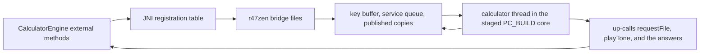

# Native Core And JNI

This page covers the Android-owned native bridge, CMake integration, JNI
registration, HAL seams, and packaging constraints. Read
`03-upstream-interface-surfaces.md` for the broader map of which upstream core
entry points the Android shell actually depends on. Read
`08-tests-and-contracts.md` for the JNI, SAF, and host-regression verification
surfaces.

## JNI And Native Flow

## Native library shape

The Android module builds one shared library: `r47zen`. `CalculatorEngine`
loads it from its `init` block via `System.loadLibrary("r47zen")`.

The Android-owned CMake target keeps that single-library load path. It does
not ship same-ABI CPU-specific variants or a runtime dispatcher.
`android/app/src/main/cpp/CMakeLists.txt` applies target-scoped ThinLTO compile
and link flags to the release-native target configs, `Release` and
`RelWithDebInfo`, and uses `lld` for the link step. That keeps Android
shipping builds on the optimized shared-library path while debug builds stay on
the normal non-LTO lane.

The Android-owned glue (`r47zen/*.c` and `r47zen/hal/*.c`) is listed once, in
`r47zen/glue_sources.txt`: the app's `CMakeLists.txt` reads it, and so do the
keypad fixture exporter and every host harness through `r47_glue_sources` in
`scripts/lib/common.sh`, so a new glue file is one line there.
`scripts/android/run_glue_sources_contract.sh` fails when a glue `.c` is not
listed, a listed file is missing, or a build keeps a list of its own. Only the
program-load test bridge, `jni_program_load_test.c`, stays out of it; an
instrumentation build adds it. The glue follows `r47zen/.clang-format` (LLVM style, includes kept in their order,
comments as written); `scripts/android/check_native_format.sh` checks it with
the pinned NDK's `clang-format`, in CI and as the `native-format` pre-commit
hook, and `--fix` applies it.
`scripts/android/run_native_clang_tidy.sh` runs the pinned NDK's `clang-tidy`
with `r47zen/.clang-tidy`, which enables the static analyzer and the bugprone
checks and says why it turns each other check off, and fails on any finding. Of
the analyzer's insecure-API checks, only the Annex K one is off, so a new `strcpy`,
`gets`, or `mktemp` fails it. `cert-err33-c` is on too, so a return such as
`snprintf`'s or `fclose`'s is handled: a file path or a name is built with
`r47_format` in `host_services.h`, which fails the operation when the text does not
fit, since a cut path would name another file. The whole library builds as gnu17, set on the target: upstream's meson
build names no C standard, so the core compiles as the compiler default, and
the host harnesses build the same sources as gnu17 too. The whole library
compiles with `-fsigned-char -fno-strict-aliasing`, the language flags of the
firmware's two `cross_arm_gcc.build` files: arm64 makes a plain `char` unsigned
and clang's `-O3` assumes strict aliasing, so without them the app would run the
core in a dialect the shipping calculator never runs. The PGO collector, the fuzzer,
and the calculator thread harness compile with both too.
`run_core_language_flags_contract.sh` holds the app and the collector to the list,
and sorts every other `-f` flag of the cross files as code layout only. With the
flags, the arm64 ThinLTO library's `.text` is 604 bytes smaller (measured, no PGO);
its speed on arm64 was not measured, and on x86-64, where `char` is already signed,
upstream's suite at `-O3` moved within its run-to-run spread. The glue compiles
with `-Wall -Wextra`; the staged upstream sources keep upstream's
warning level. The flags stop short of `-Werror` because the glue includes
upstream headers, so a new warning from an upstream commit would otherwise break
the build with no commit here. `r47zen/android_mocks.h` reaches every
translation unit through `-include`, so its `LOG_TAG` (`R47Native`) is the one
native log tag. Its `LOGE`, `LOGI` and `LOGD` reach logcat through the NDK's
`__android_log_print`: `r47zen/stubs/android/log.h`, the host tools' stand-in,
defers to the NDK header with `#include_next` on Android, because the stub
directory comes first on the Android include path for the GTK and cairo
stubs. A release build (`NDEBUG`) keeps `LOGE` only; `LOGI` and `LOGD` compile
to nothing. On the Kotlin side `proguard-rules.pro` lets R8 remove
`Log.v`, `Log.d` and `Log.i` from a minified release. To check a build, look
for `__android_log_print` among the library's dynamic symbols
(`llvm-readelf --dyn-syms`).

When a reviewed indexed LLVM profile is available, the Android build also
consumes it through Gradle property `r47.pgoProfilePath` or environment
variable `R47_PGO_PROFILE_PATH`, which feed CMake cache entry
`R47_PGO_PROFILE_PATH`. Only the release-native configs consume that profile;
the default debug lane remains profile-free. The release lane's build job and
its emulator job compile with the profile the build job collects; android-ci's
dev APK is assembled before its profile exists, so its library is not
profile-guided, and its release notes say so.

The library links with `r47zen/exports.map`, a version script that exports
`JNI_OnLoad`, which registers `CalculatorEngine`'s natives by pointer, and every
`Java_` name: `CalculatorEngine`'s implementations and, in a build with the
instrumentation-only `ProgramLoadTestBridge`, the bridge's, which it binds by
name. It makes every other symbol local. ThinLTO then
internalizes the core, so inlining moves: the release lane's emulator tests run
on that build, PGO included. `check_native_exports.sh`, run by
`check_native_hardening.sh` on every packaged library, fails any other export.

CMake builds the library from:

- build-only staged core sources under `android/.staged-native/cpp/c47`
- build-only staged decNumber sources under
  `android/.staged-native/cpp/decNumberICU`
- build-only staged generated sources under
  `android/.staged-native/cpp/generated`
- the glue `r47zen/glue_sources.txt` lists, under
  `android/app/src/main/cpp/r47zen`
- the staged mini-gmp under `android/.staged-native/cpp/gmp`, which
  `stage_native_sources.sh` copies from the tracked
  `android/compat/mini-gmp-fallback`; CMake never reads the tracked copy

Tracked Android stub headers under `r47zen/stubs` and the forced include
of `android_mocks.h` let the Android build satisfy upstream GTK, GDK, and Cairo
includes without rewriting staged source files during the Gradle build.

A stand-in that shadows a header upstream was written for compiles whatever it
does, so each one has a check that runs it:

| stand-in | what it replaces | held by |
|---|---|---|
| `stubs/gtk/gtk.h`, `stubs/gdk/gdk.h`, `stubs/cairo.h` | the GTK, GDK, and Cairo types the core's headers name; no GTK call runs on Android | the build: a call that reached them would not link |
| `stubs/android/log.h` | the NDK's log header on the host; on Android it defers to the NDK's with `#include_next` | `check_native_hardening.sh` fails a packaged library that imports no `__android_log_print` |
| `execinfo.h` | `<execinfo.h>`, below the NDK's API 33 | the calculator thread harness reads `strs[1]` under AddressSanitizer and frees the array |
| `mpz_fits_uint_p`, `mpz_nextprime`, `mpz_fib_ui`, `mpz_div_2exp` in `gmp_names.h`, which `android_mocks.h` includes | GMP names mini-gmp lacks | the harness's "the stand-ins agree with GMP" case, on boundary values computed apart; of the four, upstream's suite on the app's configuration catches only a wrong `mpz_fib_ui` ([08](08-tests-and-contracts.md#upstream-suite-on-the-apps-configuration)) |

The Android native module compiles the staged upstream core in `PC_BUILD` mode
and runs upstream's `mainLoop()` on one thread of its own, as upstream's simulator
does. That means the Android-owned bridge layer must provide the DMCP HAL that
loop and every long operation call: the key buffer, `sys_sleep`, the timers, and
the rest of `src/c47/hal/keys.h`, in `hal/keys.c`
([03](03-upstream-interface-surfaces.md#dmcp-hal-contract)).

`PC_BUILD` is defined for every config in
`android/app/src/main/cpp/CMakeLists.txt`, including the shipped `Release`
native build -- it is load-bearing (the desktop code paths the port reuses), not
a sim-only debug affordance, so the `PC_BUILD`-gated upstream diagnostics ride
into production. The costly one is
the `items.c` `gmpMemInBytes` self-check, which prints to stderr on the
per-operation hot path whenever the allocation counter fails to return to zero.
The Android core links the vendored mini-gmp fallback, so
`android/compat/mini-gmp-fallback/mini-gmp.c` must carry a size-prefix header
and hand the real block size to the c47 `freeGmp`/`reallocGmp` accounting hooks;
a stock mini-gmp passes size 0 there and fires the self-check on every
operation. `run_mini_gmp_accounting_contract.sh` is the host contract that
compiles that file with counting hooks and fails when a free or a realloc names
a size other than its block's, so a re-vendor cannot drop the header.

That `PC_BUILD` choice also makes the Android HAL responsible for any desktop-
side helper symbols that upstream starts exporting through `src/c47/hal/*.h`.
Examples are `create_dir(char *dir)` and
`_ioFileNameOverride[]` from `hal/io.h`, plus
`lcd_buffer_pixel_on(uint32_t x, uint32_t y)` from `hal/lcd.h`. When an
upstream sync advances those HAL contracts, update the Android HAL in
`android/app/src/main/cpp/r47zen/hal/` in the same change instead of assuming
the staged core will keep linking against older Android-owned exports. A
contract can also change meaning under an unchanged signature. The `lcd_buffer`
polarity is one: `hal/lcd.c` follows the upstream simulator HALs, where a 1 bit
is a white pixel as on DMCP, and inverts each row once in `LCD_write_line` so
the packed snapshot Kotlin reads keeps a 1 bit as a dark pixel.
`run_keypad_generation_contract.sh` locks both halves.

`android/app/src/main/cpp/CMakeLists.txt` passes and consumes
`R47_STAGED_CPP_DIR` so the live Android native build reads shared-native inputs
from the build-only staging root rather than any retired app-module snapshots.

The former tracked directories
`android/app/src/main/cpp/{c47,decNumberICU,generated,gmp}` are retired
snapshot paths and must stay absent during normal builds.

The glue is split by responsibility. Every file `glue_sources.txt` lists
appears below; `run_docs_lint.sh` fails when one does not:

- `jni_lifecycle.c` for the calculator thread's whole life: init, AUTXEQ, the main
  loop, the save after OFF, and the stop, plus the start, stop, readiness, and save
  JNI entry points
- `jni_input.c` for the key and service JNI entry points, and for what runs at rest
  behind them: graph gestures and paste
- `pc_keyboard.c` for the PC keyboard: the port of upstream's GTK key handler for
  the R47 profile, which runs each PC key's host event on the calculator thread
- `hal/keys.c` for the DMCP HAL: the key FIFO and its host events, `sys_sleep`,
  `sys_delay`, the clock, and the timers. It is the counterpart of upstream's
  `src/c47-gtk/hal/keys.c`, with no GTK types
- `host_services.c` for the service queue: paste, graph gesture and
  reset, copy, a description of the display, save, and keypad label mode. Any
  thread queues a request and the calculator thread runs it from `sys_sleep` at
  rest, apart from the key buffer because a long operation wipes that buffer; a
  save also runs in a program's pause and at a stopped host's poll
  ([06](06-runtime-hot-paths.md#calculator-thread)). It also owns the idle checkpoint
- `jni_upcalls.c` for the JVM handle, the `CalculatorEngine` class reference and
  method IDs, and every call from native into Kotlin
- `jni_display.c` for packed LCD generations and pixels and keypad snapshot
  generations and copies
- `keypad_scene.c` for the keypad scene those copies carry: every key's labels,
  roles, and flags from the core's keyboard, shift, mode, and softmenu state, and
  the published copy of it. It makes no JNI call, so the keypad fixture exporter and
  the TSan harness run it as the app does
- `jni_clipboard.c` for clipboard-export text for X, stack, and all-register
  payloads, and for `describeDisplayNative` and `r47_display_text`, what a screen
  reader hears of the display
- `legacy_printf.c` for the `sprintf` family on Android 7.0 to 8.1 (below)
- `hal/power.c` for the power hooks `mainLoop` calls: `LCD_power_off` sets
  `backToDMCP`, which ends the main loop, and the other two are empty
- `jni_storage.c` for SAF-backed blocking file handoff
- `jni_registration.c` for `JNI_OnLoad()` and explicit native registration
- `android_runtime.c` for the `fileMutex` and `fileCond` globals and
  `isCoreBlockingForIo`, and a few symbols upstream's `PC_BUILD` code expects
- `glib_clock.c` for `g_get_monotonic_time()` and `g_get_real_time()`, the two GLib
  calls the core makes. It needs no JNI, so the arm64 build of upstream's suite
  links it as the app does
- `hal/lcd.c` for the LCD buffer, the packed snapshot Kotlin copies, and
  `packedDisplayGeneration`
- `hal/io.c` for file I/O through the SAF handoff, state and program files, the
  temporary copy and rename that replace the state file whole, and the `hal/io.h`
  exports
- `hal/audio.c` for `_Buzz`, which up-calls `playTone` and then takes the note's
  length with `sys_delay`, `r47_tones_at_rest`, which `sys_sleep` calls so that notes a
  stopped run queued do not outlast it, and the volume calls: the setters do
  nothing, and `getBeepVolume` answers `NOVAL`, as GTK's does, so the VOL softkeys
  show no value
- `hal/gui.c` for `setupUI()` and the `calcMode*Gui` hooks upstream's `calcMode.c`
  calls, all empty because `doFnReset` does the core allocations and
  `init_lcd_buffers` owns the screen, plus `guiSetClipboardText`, which up-calls
  `setClipboardText` or, while `r47_capture_clipboard` runs a copy, hands the text
  to it
- `hal/print_ir.c` for the infrared-printer hooks, which send nothing

`jni_program_load_test.c` is not in the list: only an instrumentation build
compiles it, for `ProgramLoadTestBridge`. The headers beside the glue are
`jni_bridge.h` (the shared JNI helpers and the up-call declarations),
`host_services.h` (the key and service calls, each with the thread that may make
it), `keypad_fixture_bridge.h` (the C entry points the fixture exporter and the
TSan harness call), `core_label.h` (the glyph-boundary label copy
`run_core_label_copy_contract.sh` proves), `android_mocks.h` (forced into every
unit), `gmp_names.h` (the GMP names mini-gmp lacks, which `android_mocks.h`
includes and upstream's suite on the app's configuration force-includes), and
`execinfo.h`, which shadows the NDK's header for the `<execinfo.h>`
include upstream's `c47.h` makes on Linux: the NDK declares `backtrace()` only from
API 33, above the app's `minSdk`, so the stub's `backtrace()` reports no frames and
its `backtrace_symbols()` returns a real two-entry array, because upstream's
`freeList.c` prints `strs[1]` whatever the frame count, then frees it.

## JNI contract

JNI registration is explicit. `JNI_OnLoad()` stores the JVM handle and calls
`register_calculator_engine_natives(...)`, which registers the natives and binds
the up-calls, so a name or signature that drifts fails the library load instead of
the first call.

`jni_registration.c`'s table is the list, and each entry is an `external fun`
of `CalculatorEngine.kt`. `scripts/android/check_jni_surface.sh` fails a minified
APK whose dex lacks one. The entries cover:

- the calculator thread's start and stop, its readiness, the host's visibility, and
  the autosave setting
- key pushes: a press or a release, a cancel, a release if a key is down, and a PC
  key's press or release
- service requests: paste, graph gesture and reset, register copy, and save
- LCD graph-touch dispatch for drag-pan and pinch-zoom, gated to the proven
  graph-active path (`CM_GRAPH` with menus `-MNU_PLOT_FUNC` and
  `-MNU_GRAPHS`) and defined as a no-op outside supported graph screens
- native-owned graph-touch sensitivity calibration for pan and pinch, with
  Kotlin forwarding normalized deltas and scale factors through
  `GraphGestureFlusher`, where `GraphGestureAccumulator` splits queued pan into
  bounded `<= 1.0f` normalized steps after capping queued pan backlog to a
  `+/-4.0f` recent range per axis, and clamps queued pinch factors to
  `0.4f..2.5f` before native apply
- native graph-touch admission checks that reject non-finite or oversized
  per-apply inputs before candidate bound math (`|dx|, |dy| <= 1.0f`,
  `scaleFactor` in `0.4f..2.5f`)
- transactional graph-bounds commit checks for pan and pinch so candidate
  bounds must remain finite and inside the shared-core-compatible
  `+/-1.0e38f` domain before state is written
- restore-time graph-bounds sanitization after `restoreCalc()` on startup so a
  bad saved graph window cannot poison the first refresh of the next launch; only repaired bounds are written back
  into `LX`, `UX`, `LY`, and `UY`, each in place, so a start leaves what the user
  stored and borrows no stack register
- packed LCD generation reads and packed LCD transfer
- keypad snapshot generation reads and whole-snapshot copy
- the SAF picker's result, `onFileSelectedNative` and `onFileCanceledNative`

Native merges the gesture batches that arrive while the calculator is busy, with no
clamp, and the admission checks above still apply to the merged batch. A drag that
outlasts a slow re-solve can merge past `|dx| <= 1.0f` or the pinch range, and then
the whole merged motion is rejected. That is a gap: it is read from
`r47_service_graph_gesture` and `r47_apply_graph_gesture`, and no test drives it.

`CalculatorEngine` has no redraw entry point; `r47_force_refresh()` redraws at
runtime init and for instrumentation only (see
[03-upstream-interface-surfaces.md](03-upstream-interface-surfaces.md)).

The clipboard export is an Android-owned bridge seam around upstream's own text for
`Copy X Register`, `Copy Stack Registers`, and `Copy All Registers`, which keeps the
Android menu policy out of the upstream core. A
copy is a service request: `copyRegistersNative` queues it, and `r47_clipboard_text`
builds it at rest and answers through `onClipboardText`, so a copy during a
computation waits for rest, and one the full queue refuses shows nothing. The text is
upstream's own: its builders in `src/c47/screen.c`, `copyRegisterXToClipboard`,
`copyStackRegistersToClipboard`, and `copyAllRegistersToClipboard`, compile into the
app under `PC_BUILD`, size each copy from the registers it holds, and hand the text to
`guiSetClipboardText`. `hal/gui.c` sends it to `setClipboardText`, unless
`r47_capture_clipboard` is running the copy for the Copy menu, which then takes the
text to label it. No cap of the app's cuts a copy, so a matrix or a UTF-8 sequence
arrives whole, and an upstream change to a register's format reaches the app as it
reaches the simulator; the stack copy runs from `W` down to `X`, upstream's range.
Android's clipboard has its own limit: a copy of all registers that hold large
matrices can exceed what one binder call carries, and `CalculatorAnswers` then
says the copy was not made instead of crashing, as it does when the calculator
answers an empty text because it could not allocate the copy.
`clipboard_overflow_harness.c` holds the copies whole and the capture to the one
copy it runs ([08](08-tests-and-contracts.md#host-regression-and-build-contracts)).

Shared helpers in `jni_bridge.h` centralize `JNIEnv` acquisition,
detach-on-scope-exit for native-owned threads, exception detection and clearing
after Java calls, and fallback Java-string creation. New Android bridge code
should use those helpers instead of open-coded `GetEnv`, `AttachCurrentThread`,
or unchecked `Call*Method` paths.

Development rule:

- Keep the Kotlin external declarations, `JNINativeMethod` table, signatures,
  and implementations aligned in one change.
- Keep app-class lookups and registration failures early in `JNI_OnLoad()` so a
  broken bridge fails at library load time rather than on first use.
- Use `jni_acquire_env(...)`, `jni_release_env(...)`, and
  `jni_check_and_clear_exception(...)` for native-owned JVM work instead of
  duplicating attach, detach, and exception logic at each call site.
- Keep graph-touch sensitivity in one layer. If touch feel must change,
  update native calibration constants in `jni_input.c`; keep Kotlin gesture
  forwarding linear except for the bounded accumulator and pinch clamp behind
  `GraphGestureFlusher`.

That alignment rule is the main Android-owned seam. The upstream core remains
the source of calculator behavior, while the bridge owns registration,
marshaling, and Android runtime compatibility.

A minified release keeps that surface by name and nothing more of
`CalculatorEngine`. `proguard-rules.pro` keeps every class with a native method,
under its name and with those methods, so `FindClass` and `RegisterNatives` find
each name and signature; each method the core calls through `bindMethod` carries
a member `@Keep`, which the AndroidX annotation library's consumer rules honor.
`CalculatorEngine` itself carries no class-level `@Keep`, which would keep every
member. `scripts/android/check_jni_surface.sh` reads the expected names from
`jni_bridge.h`, the `jni_registration.c` table, and every `bindMethod`, and fails a
minified APK whose dex lacks one; `collect_packaging_evidence.sh` runs it over every
signed release and dev prerelease APK, because a lookup R8 broke fails only on a
device.

## Threading and synchronization

One thread runs core code: the calculator thread, `R47Calculator`, which
`CalculatorEngine` starts for the life of the process. Its loop and its rule are on
[06](06-runtime-hot-paths.md#calculator-thread). Every lock below exists so the other
threads can hand it work or read what it published; none of them guards core state.
The host harnesses, with TSan, are the only check of the lock rules: CI's `x86_64`
emulator runs the instrumented tests on this thread, and every phone runs the app
on it, but neither looks for a race.

- `keyMutex` in `hal/keys.c` guards the FIFO, the pressed-key state, and the timers.
  `keyCond`, on `CLOCK_MONOTONIC`, wakes `sys_sleep` and `wait_for_key_release`.
- `serviceMutex` in `host_services.c` guards the queue, the merged gesture, and the
  save tickets, and `saveCond` wakes `r47_service_save_and_wait`. `sys_sleep` takes
  `serviceMutex` under `keyMutex`, and no path takes them the other way, because a
  queuing call drops `serviceMutex` before it wakes the calculator.
- `packedDisplayMutex` in `hal/lcd.c` guards `packedDisplayBuffer`, and
  `publishedKeypadMutex` in `keypad_scene.c` guards the swap of the keypad's two
  copies. The calculator thread holds each for one row or one compare and swap, and
  the main thread only ever trylocks them.
- `fileMutex` and `fileCond` carry a file answer to the parked calculator thread.
- `r47_init_runtime(...)` sets `r47_runtime_ready()` last (a release store, read
  with acquire). The display copies return early until it is true, because the UI
  thread is live before init finishes: `MainActivity` posts a keypad refresh after
  first layout. The startup phase of `build_bridge_tsan_harness.sh` races them
  against init and fails on any unsynchronized access.
- `NativeDisplayRefreshLoop` uses `Choreographer.postFrameCallback(...)` on the
  main looper, first reads `getPackedDisplayGeneration()`, only calls
  `getPackedDisplayBuffer(...)` when the generation changes, retries the same
  generation after a failed non-blocking copy, and reads keypad refreshes
  through `getKeypadSnapshotGeneration()` plus the cached
  `NativeKeypadSnapshotStore`. `copyKeypadSnapshotNative(...)` copies one published
  logical keypad scene, and a failed copy reuses the last accepted Kotlin snapshot
  until the same generation is copied successfully.
- `ReplicaOverlayController` consumes that same cached whole-snapshot store for
  overlay replay and dynamic-key refresh, which keeps the UI thread from
  building one logical keypad scene through multiple JNI calls.
- The lock-free signals, `packedDisplayGeneration` in `hal/lcd.c`,
  `publishedKeypadGeneration` and `requestedKeypadMode` in `keypad_scene.c`, and
  `isCoreBlockingForIo` in `android_runtime.c`, are C11 atomics, not plain
  `volatile`. One thread writes each and another samples it with no lock; the
  mutexes carry the happens-before for the payloads, so the generations stay relaxed
  hints. Plain `volatile` would leave that concurrent access a data race under the C
  memory model, which `build_bridge_tsan_harness.sh` flags, and
  `run_lock_free_signal_atomicity_contract.sh` holds the declarations.
- What holds the thread rule: `runCalculatorNative` is the one native that runs core
  code, as the calculator thread's body. `jni_core_reach.py`, which
  `build_calculator_thread_harness.sh` runs, fails on a route from any other JNI
  entry to a core symbol, and a debug build aborts at a checked HAL call or request
  off the thread (`R47_CALCULATOR_THREAD_ONLY`);
  [06](06-runtime-hot-paths.md#calculator-thread) owns both. The reach check misses
  a pointer stored at run time and called later, the Android-only branch of
  `hal/io.c`, and the instrumentation bridge; the abort covers only the calls that
  carry it, and only in a debug build. `build_bridge_tsan_harness.sh` fails on a race
  only in the paths it drives.
- `scripts/workload-regressions/run_workload_regressions.sh` is the repo-owned
  Linux host harness for long native runs. It compiles the staged core plus the
  Android bridge in `HOST_TOOL_BUILD` and `PC_BUILD`, then runs the canonical host
  workload set in isolated host processes: the imported `.p47` fixtures
  `BinetV4.p47`, `GudrmPL.p47`, `MANSLV2.p47`, `NQueens.p47`, and `SPIRALk.p47`. It
  has no calculator thread and no main loop: a worker thread runs the function while
  the harness pushes keys and watches. Every workload runs under the same outer GNU
  `timeout --kill-after` safety net so a hung workload degrades coverage instead of
  wedging the host lane. Inside that shared framework, the maintained `MANSLV2`
  scenario waits for observed run activity and then pushes `R/S`, which the running
  program polls. The script remains the focused rerun surface, not the normal
  pull-request owner of the collector-driven PGO contract; the broad `broad-ci` base
  already covers `prime` and `factorial` through upstream `testSuite` inputs
- `build_calculator_thread_harness.sh` is the host proof
  of the thread itself: upstream's `mainLoop()` on its own thread, as the app runs it
  ([08](08-tests-and-contracts.md#host-regression-and-build-contracts)).
- `scripts/workload-regressions/collect_host_pgo_profile.sh` builds that same
  upstream `src/testSuite/testSuite` target with the pinned NDK Clang and
  `llvm-profdata` under ThinLTO plus LLVM IRPGO instrumentation, and runs the
  imported `.p47` overlay through the same host path, so the profile also covers
  graph, pause, wait, and LCD workloads. Its `--help` names the training corpus and
  the `libclang_rt.profile` shim.
  `./scripts/android/build_android.sh --collect-host-pgo --validate-release-pgo`
  runs it and checks that the release native build consumes the profile
- `jni_program_load_test.c` exposes the instrumentation-only bridge used by
  `ProgramFixtureInstrumentedTest`, `FactorsInstrumentedTest`,
  `ClipboardRoundTripInstrumentedTest`, `DisplayDescriptionInstrumentedTest`,
  `DisplayLifecycleInstrumentedTest`,
  `DocumentLoopInstrumentedTest`, `GraphRedrawInstrumentedTest`,
  `GraphTouchStressInstrumentedTest`, and `KeypadTouchInstrumentedTest`. It runs
  everything that touches core state on the calculator thread at rest through
  `r47_run_at_rest`, and provides function starts, such as READP, SAVEST, and
  LOADST, and RUN starts that return at once, a seed
  of X as a long integer or a real, X as the clipboard copies it, explicit refresh
  and background-save helpers, LCD
  refresh count, a packed-LCD snapshot hash, the `00` key press used to resume staged
  `SPIRALk` runs, an extreme graph-touch stress helper that repeatedly submits very
  large pan and pinch deltas while asserting the bridge rejects those out-of-family
  inputs without mutating the current graph bounds, and a restore-path helper that
  injects invalid graph bounds and proves the Android-owned restore sanitizer repairs
  them before refresh.
- `snapshotStateNative()` in that bridge reads what the calculator thread last
  published, through `r47_test_bridge_publish_state()` in `sys_sleep()`, in
  `key_empty()`, which every poll of a running program calls, and after each probe.
  It never waits: a program paused for a key the test sends would never reach rest.
  `snapshotStateIfAvailableNative()`, Kotlin `trySnapshotState()`, reads the same copy,
  during a run too, since the test must see a pause to send the key that ends it.
  Release builds compile none of it.
- The lifecycle snapshot helper hashes only visible packed LCD bytes. It does
  not hash the row-dirty transport flag that `getPackedDisplayBuffer(...)`
  clears after each successful UI poll.
- The staged `SPIRALk` lifecycle probe retries the simulated `00` resume while
  the program remains paused and uses a `90 s` hosted-emulator budget so a
  missed short pause pulse does not strand CI at the terminal `PAUSE 99`.
- The Android fixture seam still uses LCD redraw activity as valid run evidence
  for fast-returning fixtures such as `GudrmPL.p47` when step, pause, wait, or
  `VIEW` markers never surface before a clean return.
- Android's official ANR guidance explicitly calls out main-thread lock
  contention as a foreground input-dispatch failure mode. The main thread takes no
  lock a computation can hold: the display copies trylock, and the key and service
  mutexes are held only around the buffer they guard. `saveStateNative` is the one
  native that waits: `R47_SAVE_IDLE_GRACE_MS` for a calculator that is not idle, and
  up to `SAVE_FENCE_MILLIS` for one that is.
- If a shared-core loop polls no keys, Android cannot preempt it
  ([06](06-runtime-hot-paths.md#residual-hang-a-core-loop-with-no-poll)).
- native-owned JVM work acquires `JNIEnv` through `jni_acquire_env()` and
  `jni_release_env()` so attach and detach remain scope-bound
- file I/O handoff uses a condition-based native wait path so the calculator
  core can request a file without inventing a second storage protocol

Practical rule:

- when a native change can block on Android UI or storage, make the parking of the
  calculator thread explicit before changing behavior

Activity recreation runs nothing native: `CalculatorEngine.start()` returns, the new
Activity attaches as the host, and the calculator never notices. The new
`ReplicaOverlay` gets the frame from its first packed copy, which it decodes whole
([06](06-runtime-hot-paths.md#lcd-frame-state-inventory)).
`DisplayLifecycleInstrumentedTest.kt` exercises that contract through full
`ActivityScenario.recreate()` coverage
(`activityRecreationPreservesSpiralkGraphSnapshot`). The main loop keeps repainting
the LCD from calculator state on its own schedule, so an injected framebuffer is safe
to hash only within one run on the calculator thread, and the recreation test asserts
over a state-derived image instead. It keeps a real `SPIRALk` graph, because a graph
display is cursor-free and byte-stable.
`pauseResumePreservesSpiralkGraphSnapshot` drives the same `SPIRALk` graph and
compares a `forceRefresh` render of the persisted state before and after the
transition, which holds the state, not the absence of a redraw. The local 16 KB
runtime smoke script reuses the recreation probe on a connected 16 KB target.

### Up-call bindings

Native code reaches Kotlin through `g_jvm` and the class reference and method IDs in
`jni_upcalls.c`: `g_engineClass`, `g_requestFileId`, `g_playToneId`, `g_tonesClearId`,
`g_fileWriteFailedId`, `g_quitId`, `g_clipboardTextId`, `g_setClipboardId`,
`g_pasteResultId`, `g_warningId`, and `g_displayTextId`. This table, with
`CalculatorEngine.host` behind them, is their state inventory for the checks in
[11-reviewing-a-change.md](11-reviewing-a-change.md#the-four-checks).

| access | function | thread |
|---|---|---|
| write | `JNI_OnLoad` and `r47_upcalls_bind`, once, inside `System.loadLibrary` | the thread that first touches `CalculatorEngine`, before the calculator thread starts |
| read | `r47_upcall_*`, from `requestAndroidFile`, `_Buzz`, `r47_report_file_write_failure`, `show_warning`, `guiSetClipboardText`, `runService`, and `r47_calculator_main` | calculator |
| write `CalculatorHostSlot.current` | `attachHost`, `detachHost` | main |
| read `CalculatorHostSlot.current` | the `@Keep` up-calls `onCalculatorOff`, `onClipboardText`, `setClipboardText`, and `onPasteResult` | calculator |
| read `CalculatorHostSlot.current` | `onHostStopped`, `hasHost`, and what `onDisplayText`, `onWarning`, and `fileRequestGate`'s launch and `onLost` post | main |
| write and read `CalculatorHostSlot.pickerOwner`, `pickerWaitsForRecreatedOwner` | `attachHost`, `detachHost`, `fileRequestGate`'s launch through `pickerLaunchedBy`, and `cancelFileRequestOf` through `ownsPicker` | main |

No lock covers the bindings, and none is needed: they are written once before the
only thread that reads them exists, and nothing clears them. Native holds no
reference to an Activity. `current` is `@Volatile`, and a host method that arrives on the
calculator thread posts its Android work to the main handler, so a call that races
`detachHost` reaches an Activity that is going away and touches none of its views from
that thread. The two picker fields are plain, since only the main thread touches
them; the transfer worker posts `onLost` to it rather than read the host.

### Key and service state

| state | owner | written by (thread) | read by (thread) | change signal |
|---|---|---|---|---|
| `keyBuffer`, `keyCount` | `hal/keys.c`, under `keyMutex` | `r47_key_push` and its kin (any); `r47_key_push_key`, the head inserts of `translateHostEvent` and `cancelPressedKey`, `popKey`, through `key_pop` and `keyPopForMainLoop`, and `key_pop_all` (calculator) | `key_empty`, `key_tail`, `popKey`, `sys_sleep` (calculator) | `keyCond` |
| `hostEvents` slots, `nextHostEvent` | `hal/keys.c` | `pushHostLocked`, under `keyMutex` (any), which a full FIFO stops before it writes a slot | `hostEventOf`, under `keyMutex` (calculator) | the slot's key code, popped under `keyMutex` |
| `insertAt`, `insertThread` | `hal/keys.c`, under `keyMutex` | `translateHostEvent`, `cancelPressedKey` (calculator) | `pushLocked`, which puts a key at the head only for the thread that set them | none |
| `CTRL_State`, `SHIFT_State`, `event_keyval`, `ctrlUsed`, `pcKeyBusy` | `pc_keyboard.c` | `r47_pc_key_handle` (calculator) | the same | none; one thread |
| `pushedKeyDown` | `hal/keys.c`, under `keyMutex` | `r47_key_push`, `r47_key_cancel`, `r47_key_release_if_down`, and a PC key's release in `r47_key_push_pc` (any); `r47_key_push_key` and `keyDispatchHostEvent` (calculator) | `wait_for_key_release` (calculator) | `keyCond` |
| `pcPressPushed` | `hal/keys.c`, under `keyMutex` | `r47_key_push`, `r47_key_cancel`, `r47_key_release_if_down`, `r47_key_push_pc` (any); `r47_key_push_key`, `keyDispatchHostEvent` (calculator) | `r47_key_push_pc` (any); `keyDispatchHostEvent` (calculator) | none; read with `pushedKeyDown` under the lock |
| `keysFromHost` | `hal/keys.c`, under `keyMutex` | `r47_keys_from_host`, from `r47_calculator_main` (calculator) | `wait_for_key_release` (calculator) | none; set once before the main loop |
| `quitPending` | `hal/keys.c`, under `keyMutex` | `r47_key_push_quit` (any); `keyDispatchHostEvent` (calculator) | `sys_sleep`, `popKey` (calculator) | `keyCond` |
| `quitInRing` | `hal/keys.c`, under `keyMutex` | `keyPopForMainLoop`, `popKey`, `keyDispatchHostEvent` (calculator) | `key_empty` (calculator) | none; one thread |
| `timerDeadlineUs` | `hal/keys.c`, under `keyMutex` | `sys_timer_start`, `sys_timer_disable`, `sys_sleep` (calculator) | `sys_sleep` (calculator) | none |
| `hostStopped` | `hal/keys.c`, under `keyMutex` | `r47_keys_on_host_stopped` (main) | `sys_sleep`, again under the lock its wait takes, and `key_empty` through `saveIfHostStopped` (calculator) | `keyCond` |
| `calculatorIdle` | `hal/keys.c`, atomic | `sys_sleep`, around its wait at rest (calculator) | `r47_service_save_and_wait` (main) | polled through the grace period |
| `calculatorThread`, `calculatorThreadKnown`, debug builds only | `hal/keys.c`; the flag atomic, release and acquire | `r47_keys_init` (calculator); a host tool's `r47_keys_claim_calculator_thread` | `r47_assert_calculator_thread` (any) | the flag's release store |
| `queue`, `queueHead`, `queueCount` | `host_services.c`, under `serviceMutex` | `enqueue` (any); `r47_services_run` (calculator) | `r47_services_run`, `r47_services_pending` (calculator) | `r47_keys_wake` |
| merged gesture | `host_services.c`, under `serviceMutex` | `r47_service_graph_gesture` (any); `r47_services_run` (calculator) | `r47_services_run` (calculator) | `r47_keys_wake` |
| `savesRequested`, `savesDone` | `host_services.c`, under `serviceMutex` | `r47_service_save_and_wait` (main); `completeSaves` (calculator) | both | `r47_keys_wake`, `saveCond` |
| `saveInProgress` | `host_services.c`, under `serviceMutex` | `saveMarked` (calculator) | `r47_service_save_and_wait` (main); `r47_services_save_pending` (calculator) | polled through the grace period |
| `inputSinceSave`, `lastInputMs`, `lastSaveMs` | `host_services.c` | `r47_services_note_input`, `r47_services_note_saved` (calculator) | `r47_services_checkpoint_due_ms` (calculator) | none; `sys_sleep` waits for the deadline |
| `restSaveOwed` | `host_services.c` | `r47_services_save_pending`, `r47_services_note_saved`, `r47_services_checkpoint` (calculator) | `r47_services_checkpoint_due_ms` (calculator) | none; one thread, and the checkpoint is then due at once |
| `autosaveEnabled` | `host_services.c`, atomic | `r47_service_set_autosave` (main) | the checkpoint, `r47_save_before_picker`, and the save after OFF in `r47_calculator_main` (calculator) | none |
| `g_r47_stop_requested`, `g_r47_stop_without_save` | `jni_lifecycle.c`, atomic | `r47_calculator_stop` (main) | `r47_calculator_main`, `r47_save_settled` (calculator) | the quit it pushes |

A full FIFO drops the key, as DMCP does, and a full queue refuses the request and logs
it. Kotlin sees that refusal only where a native returns it: `pasteNumberNative`,
`copyRegistersNative`, and `describeDisplayNative` return it and `resetGraphNative`
does not; `DisplayActionController` ignores the one from a copy, and the LCD's
accessibility node asks again at the next settled frame.
A keypad label mode the queue refuses is asked for again at the next copy,
`r47_try_copy_app_keypad_snapshot`, and the harness case "a refused keypad mode is
asked for again" holds that.

## Lifecycle Save And Explicit Refresh Contract

`jni_lifecycle.c` owns two different display-affecting paths and they do not
share the same contract.

- `r47_save_settled()` persists. It wraps `saveCalc()`, undoes what that shutdown
  routine changes in a running calculator, and never touches `packedDisplayBuffer`,
  so it must stay display-passive for Settings entry, normal background save, and
  other lifecycle-only transitions. A confirmation prompt on show is the one case that
  refreshes the screen, to put the prompt back.
  `DisplayLifecycleInstrumentedTest.backgroundSavePreservesInjectedDisplaySnapshot`
  proves the display-passive contract deterministically: it injects a non-trivial
  framebuffer pattern, hashes it, runs the save, and re-hashes, all on the calculator
  thread at rest (via the `backgroundSaveKeepsInjectedDisplayBuffer` bridge), with no
  program run, so the assertion does not depend on an emergent graph render.
- `r47_force_refresh()` is the explicit native redraw for runtime init and the
  test-owned `ProgramLoadTestBridge.forceRefresh()`.
- runtime init clears a restored run state and sanitizes restored
  graph bounds before that first redraw, so a corrupted save cannot carry a dead
  keypad or non-finite, collapsed, or out-of-range windows into the first refresh.

The key distinction is whether the calculator state changed.

- runtime init may redraw because it reconstructs the state from the file.
- `r47_save_settled()` must not redraw because persistence alone should not alter
  the visible LCD snapshot.

`CalculatorEngine` exposes no redraw entry point. Do not add one for a passive
activity lifecycle callback such as a normal Settings return unless the owner
path can prove that calculator state really changed.

## File I/O boundary

`hal/io.c` uses two Android-specific paths:

- a runtime base path set by `set_android_base_path(...)` for app-internal files
  and subdirectories, held as an absolute path. It also sets the core's working
  directory, `<base>/DATA`: upstream's prints (the print commands, and the register
  print a `SNAP` ends with) append to a dated `.TSV` named relative to it, and a `SNAP`
  with no name armed writes its `.bmp` there, as GTK's land beside the simulator and
  the firmware's in its DATA folder. `DataFolderMirror` copies them to the work
  directory when the app stops
- SAF handoff for state, program, RTF export, manual save, register data
  (`EXPreg` and its family, `IMPORTr`), and related user-facing file operations.
  `WRXPall`, upstream's bulk export for developers, is refused with `FILE_ERROR`,
  as the hardware refuses the item: it would open the picker twice for each
  program, and a cancel would not stop it

The SAF path works as follows:

1. Native code calls `requestAndroidFile(...)` with save or load mode, default
   name, and category. It writes the state first, unless the user turned autosave
   off, since the process can die behind a picker, and parks the calculator thread on
   `fileCond`.
2. Inside that call, before the thread parks, Kotlin finds where the picker starts:
   the work directory's folder for the category, made for a save and only found for a
   load. Those are binder calls to the provider, which must not run on the main
   thread; the main thread then launches the correct SAF intent through
   `StorageAccessCoordinator`.
3. `DocumentTransfer` returns a descriptor native may hold: for a save the write
   end of a pipe, for a load a private copy of the document, with the name the
   provider shows for it.
4. Native code wraps the descriptor with `fdopen(...)` and continues using
   standard file I/O. A read records the name's last 19 bytes in
   `fileNameSelected`, as GTK's `ioFileOpen` records a file's, and a state file's
   load passes them to STATE#.

That save runs inside a computation when a running program reaches a file request,
as a stopped host's save does at a poll
([06](06-runtime-hot-paths.md#calculator-thread)), which is why a restore clears a
run state. While the
thread is parked, keys pile up in the FIFO, service requests in their queue, and
`onStop()`'s save, which the picker itself triggers, gives up after its grace period
and stays pending.

The state file is the one private file that holds the user's work, so it is replaced
whole: `ioFileOpen(ioPathBackup, ioModeWrite)` opens `<file>.tmp` and `ioFileClose()`
renames it over the file and syncs the directory. A failed write unlinks the
temporary copy and reports through `r47_report_file_write_failure()`, and a save that
cannot start returns `FILE_CANCEL`, because `saveCalc` ends the process on an error.
`calculator_thread_harness.c` kills a process during saves and fails on a cut file,
and fails when a refused save or a short write changes the file or ends the process.

The restore reads it back only after `ioFileOpen(ioPathBackup, ioModeRead)` checks
the file's structure. Upstream writes `name:type:value` lines, each `hexDump` followed
by its bytes at 32 to a line, so a cut file is one whose last dump runs out or whose
last line has no end; that holds for every file a past core wrote, so no trailer is
needed, and a field the check does not know passes. A cut at a line's end after the
memory image passes, and the fields it lost take their defaults, as upstream's restore
gives any field a file lacks; a cut inside a line would restore a wrong value, so it is
refused. A file that is cut, older than the restore's floor, for another RAM size, or
newer than this core's `BACKUP_VERSION`, is moved to `<file>.v<version>.<time>`, never
over a copy kept before, the user is told, and the restore finds no file and starts
afresh. Upstream's restore refuses the first three itself and has no ceiling; a newer
file is refused here, because upstream migrates a file only forward, by its version,
so a layout a later core wrote, such as renumbered items, reads as this core's. `stage_native_sources.sh` reads both versions from `saveRestoreBackup.c` into
the staged `generated/r47_backup_version.h`, and fails when either line moves.

A file can also crash its own restore through a value no structure check judges, and
then every launch crashes the same way. `r47_restore_guard_begin()` counts, in
`<file>.restoring`, the starts that began a restore and did not finish it and the
first refresh of what it restored, where `r47_restore_guard_end()` clears it, before
`AUTXEQ` or a key can run anything; a start that finds two moves the file to
`<file>.crashed.<time>`, tells the user, and starts afresh. One is not enough, since a
start also dies when the user closes the app. Auto Backup leaves the marker and
temporary file out, so a restored install counts from zero. The kept files are in the app's private
storage, which the user cannot reach: they are there for a later release to recover.

Some libc calls the core makes are linked to the glue (`-Wl,--wrap=` in
`CMakeLists.txt`). `__wrap_exit()` logs and aborts, so an error the core does not
recover from leaves a crash report, not a silent stop. `__wrap_remove()` turns
`DELBkup`'s relative path into the app's SAVE and automatic save. The calculator
thread harness links both the same way.

Each `sprintf` and `snprintf` form, the fortified `__sprintf_chk` family with them,
goes to `r47zen/legacy_printf.c`, for Android 7.0 to 8.1 (API 24 to 27). Their
bionic formats with OpenBSD's `vfprintf`, which reads the format string as UTF-8
through `mbrtowc` and returns -1 at the first byte that is not; Android 9 scans it
for `%` byte by byte. The core pastes its own glyph encoding into format literals
(`STD_SPACE_EM` is `"\xa0\x03"`), and `__vsprintf_chk` takes the -1 for an overflow
and aborts, so without the wrapper `showStep`'s `"%04" PRIu16 ":" STD_SPACE_EM`
ends the app when a program step is shown on API 24 to 27. Each wrapper calls the platform at once from
API 28, and for a format of ASCII alone below it, so only a format holding a byte
over 0x7f is formatted here: its literal bytes are copied as they are, and each
conversion, whose spec is ASCII, goes alone to the platform's `snprintf`. The
fortified entries keep bionic's two checks against the size the compiler saw. It
takes no `%n` and no positional `%1$`, which return -1. `fprintf` and `printf` stay
the platform's: an app's stdout and stderr go nowhere, and each `fprintf` to a file
has an ASCII format. `run_legacy_printf_contract.sh` holds the formatter to glibc's
`vsnprintf`, which scans bytes as Android 9 does.

Native never holds a provider's descriptor. Android documents that a descriptor
opened in `r` or `w` mode may be a pipe, and upstream's `READP` reads a file twice
and seeks back between the passes. It also documents that a descriptor should not
be detached when its creator expects a reliable signal through `close()`; AOSP's
`FileSystemProvider` requests its media scan from that signal, and a cloud provider
may start an upload from it. So the provider's stream stays in Kotlin and closes
there.

`DocumentTransfer` is process-wide and runs every transfer in order on one worker
thread, so a load picked right after a save reads the finished document.

- **Save:** the worker drains the pipe to a private file, so a slow provider stalls
  the calculator thread only for a second save larger than the pipe's buffer, which
  waits for the first. At end of file, which is native's `fclose`, it opens the document
  with `wt`, copies, and syncs it, which a provider's pipe answers with an error
  that loses nothing. `wt` empties the document, so it runs only once all the data
  exists. An empty pipe leaves the document alone. A failure shows
  `file_write_failed`, after upstream's own saved message, which the HAL cannot
  withdraw.
- **Load:** the worker copies the document to a private file, refusing one past
  `MAX_LOAD_BYTES`, hands native a descriptor and the name the provider shows, and
  unlinks the file. A provider owes no name, so one that shows none, or whose query
  throws, loads all the same under an empty name. The calculator
  thread stays parked in `requestAndroidFile` meanwhile, with no progress shown, for as
  long as the provider takes; a failure shows `file_read_failed` and cancels. Canceling
  a stuck provider call is not implemented: `NativeFileRequestGate` can release the
  calculator thread when the app stops, but the worker stays blocked until the provider
  returns, and later transfers queue behind it.
- **An answer with no request:** a process killed behind the picker comes back with
  the answer and no calculator thread parked. `onFileSelectedNative` refuses it,
  `NativeFileRequestGate` closes the descriptor, which ends a save's pipe with
  nothing written, and `file_request_lost` tells the user.

`DocumentTransferTest.kt` and `NativeFileRequestGateTest.kt` hold the transfer, the
name it hands on, and its one answer per request. `scripts/android/run_hal_io_contract.sh`
holds the native side: each file path's name and folder, the name a read records,
and a save through a pipe arriving whole with nothing reported.
`clipboard_overflow_harness.c` holds the refused answer and the name an answer
leaves native.
None of them runs a real cloud provider; whether a given provider accepts `wt` is a
device question.

### Document transfer state

| copy | owner | written by | read by | change signal |
|---|---|---|---|---|
| the document | the provider | the worker, at the end of a save | the worker, at a load | none; the worker runs transfers in order |
| private temp file | `DocumentTransfer` | the worker | the worker; native reads a load through its descriptor | deleted when its transfer ends; a new process clears the directory |
| pipe of a save | `DocumentTransfer` | the calculator thread, through `hal/io.c` | the worker | native's `fclose` is end of file |
| capture file, `<base>/snap.bmp` | `hal/io.c` | upstream's `fnScreenDump` | `r47_offer_snap` | deleted when its offer ends; arming at init drops one a dead process left |
| capture name, `_ioFileNameOverride` | `hal/io.c` | `r47_arm_snap`, `r47_offer_snap`; `fnScreenDump` clears it | `fnScreenDump`, `r47_offer_snap` | going empty; all on the calculator thread |
| `NativeFileRequestGate.state` | the gate | calculator, main, and worker threads | main and worker threads | atomic; `TRANSFERRING` marks a load in flight |
| `fileDescriptor`, `fileReady`, `fileCanceled` | `jni_storage.c` | the calculator thread at a request; the main or worker thread at an answer | the calculator thread | `fileCond` under `fileMutex`; `isCoreBlockingForIo` tells an answer whether a request is waiting |

Upstream's HAL write and close return nothing, and upstream reports only a
failed open, so `hal/io.c` checks every write, the flush, `fsync`, and the
close of a file opened for writing, on both paths, and reports a loss once per
file at `ioFileClose` through `r47_report_file_write_failure()`. That calls
`CalculatorEngine.onFileWriteFailed()`, which shows a toast from the application
context. An `fsync` that answers
`EINVAL`, as a pipe or a character device does, loses nothing and is not
reported; `DocumentTransfer` syncs the document behind a pipe. A program save still shows upstream's own saved message
(`TI_SAVED`, set after the close), which the HAL cannot withdraw, so the toast
is the signal. `scripts/android/run_hal_io_contract.sh`
links `hal/io.c` alone on the host and locks the report against `/dev/full` and
its absence against a regular file, a read, and `/dev/null`. A failure in the
worker, after native has closed the pipe, reports through `DocumentTransfer`.

`SNAP` and `PRLCD` reach upstream's `fnScreenDump`, which writes a BMP to the name in
`_ioFileNameOverride` and clears the name. Holding `EXIT` for about a second runs
`SNAP` too, so it also opens the picker. `r47_init_runtime` arms that
name with `<base>/snap.bmp` through `r47_arm_snap()`. `r47_services_run()` calls
`r47_offer_snap()`, which returns on its first test while the name is armed. Once
the name is empty it asks `requestAndroidFile(...)` for a document in category 3,
SCREENS, named `YYYYMMDD-HHMMSS00.bmp` like upstream's default, copies the capture
to that descriptor, deletes the private file, and arms again. A canceled picker
drops the capture, and a lost write reports as above. Upstream's `SNAP` also appends
the stack to a dated `.REGS.TSV` relative to the working directory, `<base>/DATA`,
which `DataFolderMirror` copies to the work directory's DATA folder when the app
stops.

The offer runs from a sleep at rest, so it never starts while a core function or a
program is running. A running program does not sleep at rest, so of the `SNAP`s it
takes before it stops only the first is offered; the rest find no name and go to
upstream's relative default, a dated `.bmp` in `<base>/DATA`, which
`DataFolderMirror` copies to the work directory's SCREENS folder when the app stops.

Android instrumentation uses a one-shot detached-fd override in
`jni_storage.c` so `ProgramFixtureInstrumentedTest` can drive `READP` through
the same native load boundary with staged canonical fixtures instead of
launching a real SAF picker. The override is test-owned and must be cleared
after each load.

Native owns the descriptor it receives, and closes it on the `fdopen()` failure
path or through `fclose()`. The detach is safe here because no provider is on the
other end: the descriptor is a pipe or a private file.

The runtime base path is separate from the user-selected work directory. The
base path supports internal files; the work-directory contract supports user
data organized through SAF.

For host workload runs, `HOST_TOOL_BUILD` bypasses the Android SAF interception
in `hal/io.c` and uses the runtime base path directly so canonical upstream
program files can be staged and loaded without an Android document-provider
round trip.

## JNI change checklist

1. Update the Kotlin external declaration.
2. Update the registered method table.
3. Update the bridge header and the owning C implementation.
4. Recheck thread and lock behavior if the call can touch UI, storage, or long
  native work.
5. A new `bindMethod` target gets a member `@Keep`; run
  `scripts/android/check_jni_surface.sh --apk` over a minified release build.

## Change ownership

- For shared calculator behavior, change the canonical root core and restage it
  into `android/.staged-native/cpp` through the normal Android build flow.
- Change `android/app/src/main/cpp/r47zen` directly only for Android
  bridge, HAL, or stub behavior.
- Do not patch build-only staged upstream C files in place when a tracked
  Android stub or bridge-layer fix can own the compatibility rule.

## 16 KB and packaging contract

The checked-in Android build relies on the NDK's default 16 KB alignment, which
[the 16 KB page](09-official-references.md#native-and-build-integration) states
for NDK r28 and higher:

- the NDK is `R47_DEFAULT_ANDROID_NDK_VERSION` in
  `android/r47-defaults.properties`, and AGP is the `agp` entry of
  `android/gradle/libs.versions.toml`
- `android/app/build.gradle` also passes
  `-DANDROID_SUPPORT_FLEXIBLE_PAGE_SIZES=ON`, which only restates that default:
  the pinned NDK's `build/cmake/flags.cmake` reads the variable to turn 16 KB
  off when it is false

The default checked-in APK target is `arm64-v8a`. The workflow and local
Gradle invocations can temporarily add `x86_64` through `r47.abiFilters` for
emulator-backed test runs, but the shipped debug artifact remains
`arm64-v8a` by default. Any added prebuilt native dependency must also satisfy
the 16 KB requirements for ELF and APK alignment.

The CI lane verifies that contract by checking zip alignment and native library
`LOAD` segment alignment in the built APK. It also checks the two things the
16 KB page names beyond those: `collect_packaging_evidence.sh` holds each
library's `GNU_RELRO` to end on a 16 KB page (`check_relro`), and the AAB's
`BundleConfig.pb` to request `PAGE_ALIGNMENT_16K`
(`page_alignment_16k.py bundle-config`), so the Play bundle, the artifact the
2027 Play rule applies to, carries its own proof. The `android-tests` lane uses
the temporary multi-ABI override only for hosted `x86_64` emulator execution.

Runtime proof for the same contract lives in
`scripts/android/run_16kb_runtime_smoke.sh`, which android-ci's nightly runs on a
16 KB `x86_64` emulator image. That script checks the connected
device or emulator page size through `adb shell getconf`, requires
`16384`-byte pages, and then runs only
`DisplayLifecycleInstrumentedTest#activityRecreationPreservesSpiralkGraphSnapshot`.

That artifact verification is the reason packaging changes should be documented
alongside the workflow and Gradle files, not only in the CMake layer.
