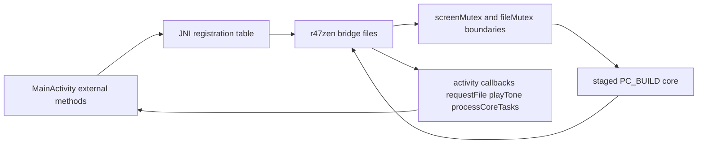

# Native Core And JNI

This page covers the Android-owned native bridge, CMake integration, JNI
registration, HAL seams, and packaging constraints. Read
`03-upstream-interface-surfaces.md` for the broader map of which upstream core
entry points the Android shell actually depends on. Read
`08-tests-and-contracts.md` for the JNI, SAF, and host-regression verification
surfaces.

## JNI And Native Flow

## Native library shape

The Android module builds one shared library: `r47zen`. `MainActivity`
loads it from a static initializer via `System.loadLibrary("r47zen")`.

The Android-owned CMake target keeps that single-library load path. It does
not ship same-ABI CPU-specific variants or a runtime dispatcher. When
`android/app/src/main/cpp/CMakeLists.txt` applies target-scoped ThinLTO compile
and link flags to the release-native target configs, `Release` and
`RelWithDebInfo`, and uses `lld` for the link step. That keeps Android
shipping builds on the optimized shared-library path while debug builds stay on
the normal non-LTO lane.

The Android-owned glue (`r47zen/*.c` and `r47zen/hal/*.c`) is listed once, in
`r47zen/glue_sources.txt`: the app's `CMakeLists.txt` reads it, and so do the
keypad fixture exporter and every host harness through `r47_glue_sources` in
`scripts/lib/common.sh`, so a new glue file is one line there.
`scripts/android/run_glue_sources_contract.sh` fails when a glue `.c` is not
listed, a listed file is missing, or a build keeps a list of its own. Only the
program-load test bridge, `jni_program_load_test.c`, stays out of it; an
instrumentation build adds it. The glue follows `r47zen/.clang-format` (LLVM style, includes kept in their order,
comments as written); `scripts/android/check_native_format.sh` checks it with
the pinned NDK's `clang-format`, and `--fix` applies it.
`scripts/android/run_native_clang_tidy.sh` runs the pinned NDK's `clang-tidy`
with `r47zen/.clang-tidy`, which enables the static analyzer and the bugprone
checks and says why each check it turns off is noise here, and fails on any
finding. The whole library builds as gnu17, set on the target: upstream's meson
build names no C standard, so the core compiles as the compiler default, and
the host harnesses build the same sources as gnu17 too. The glue compiles
with `-Wall -Wextra`; the staged upstream sources keep upstream's
warning level. The flags stop short of `-Werror` because the glue includes
upstream headers, so a new warning from an upstream commit would otherwise break
the build with no commit here. `r47zen/android_mocks.h` reaches every
translation unit through `-include`, so its `LOG_TAG` (`R47Native`) is the one
native log tag. Its `LOGE`, `LOGI` and `LOGD` reach logcat through the NDK's
`__android_log_print`: `r47zen/stubs/android/log.h`, the host tools' stand-in,
defers to the NDK header with `#include_next` on Android, because the stub
directory comes first on the Android include path for the GTK and cairo
stubs. A release build (`NDEBUG`) keeps `LOGE` only; `LOGI` and `LOGD` compile
to nothing. On the Kotlin side `proguard-rules.pro` lets R8 remove
`Log.v`, `Log.d` and `Log.i` from a minified release. To check a build, look
for `__android_log_print` among the library's dynamic symbols
(`llvm-readelf --dyn-syms`).

When a reviewed indexed LLVM profile is available, the Android build also
consumes it through Gradle property `r47.pgoProfilePath` or environment
variable `R47_PGO_PROFILE_PATH`, which feed CMake cache entry
`R47_PGO_PROFILE_PATH`. Only the release-native configs consume that profile;
the default debug lane remains profile-free.

CMake builds the library from:

- build-only staged core sources under `android/.staged-native/cpp/c47`
- build-only staged decNumber sources under
  `android/.staged-native/cpp/decNumberICU`
- build-only staged generated sources under
  `android/.staged-native/cpp/generated`
- the glue `r47zen/glue_sources.txt` lists, under
  `android/app/src/main/cpp/r47zen`
- the staged mini-gmp under `android/.staged-native/cpp/gmp`, which
  `stage_native_sources.sh` copies from the tracked
  `android/compat/mini-gmp-fallback`; CMake never reads the tracked copy

Tracked Android stub headers under `r47zen/stubs` and the forced include
of `android_mocks.h` let the Android build satisfy upstream GTK, GDK, and Cairo
includes without rewriting staged source files during the Gradle build.

The Android native module compiles the staged upstream core in
`PC_BUILD` mode. That means the Android-owned bridge layer must provide the
GLib and GTK compatibility behavior used by upstream pause, wait, and progress
paths instead of treating those entry points as no-op stubs.

`PC_BUILD` is defined for every config in
`android/app/src/main/cpp/CMakeLists.txt`, including the shipped `Release`
native build -- it is load-bearing (the desktop code paths the port reuses), not
a sim-only debug affordance, so the `PC_BUILD`-gated upstream diagnostics ride
into production. The costly one is
the `items.c` `gmpMemInBytes` self-check, which prints to stderr on the
per-operation hot path whenever the allocation counter fails to return to zero.
The Android core links the vendored mini-gmp fallback, so
`android/compat/mini-gmp-fallback/mini-gmp.c` must carry a size-prefix header
and hand the real block size to the c47 `freeGmp`/`reallocGmp` accounting hooks;
a stock mini-gmp passes size 0 there and fires the self-check on every
operation. `run_mini_gmp_accounting_contract.sh` is the host contract that
compiles that file with counting hooks and fails when a free or a realloc names
a size other than its block's, so a re-vendor cannot drop the header.

That `PC_BUILD` choice also makes the Android HAL responsible for any desktop-
side helper symbols that upstream starts exporting through `src/c47/hal/*.h`.
Examples are `create_dir(char *dir)` and
`_ioFileNameOverride[]` from `hal/io.h`, plus
`lcd_buffer_pixel_on(uint32_t x, uint32_t y)` from `hal/lcd.h`. When an
upstream sync advances those HAL contracts, update the Android HAL in
`android/app/src/main/cpp/r47zen/hal/` in the same change instead of assuming
the staged core will keep linking against older Android-owned exports. A
contract can also change meaning under an unchanged signature. The `lcd_buffer`
polarity is one: `hal/lcd.c` follows the upstream simulator HALs, where a 1 bit
is a white pixel as on DMCP, and inverts each row once in `LCD_write_line` so
the packed snapshot Kotlin reads keeps a 1 bit as a dark pixel.
`run_keypad_generation_contract.sh` locks both halves.

`android/app/src/main/cpp/CMakeLists.txt` passes and consumes
`R47_STAGED_CPP_DIR` so the live Android native build reads shared-native inputs
from the build-only staging root rather than any retired app-module snapshots.

The former tracked directories
`android/app/src/main/cpp/{c47,decNumberICU,generated,gmp}` are retired
snapshot paths and must stay absent during normal builds.

The glue is split by responsibility. Every file `glue_sources.txt` lists
appears below; `run_docs_lint.sh` fails when one does not:

- `jni_lifecycle.c` for init, deadline-driven tick, refresh, and slot-state lifecycle work
- `jni_input.c` for key and menu dispatch
- `jni_display.c` for packed LCD generations and pixels and keypad snapshot
  generations and copies
- `keypad_scene.c` for the keypad scene those copies carry: every key's labels,
  roles, and flags from the core's keyboard, shift, mode, and softmenu state.
  It makes no JNI call, so the keypad fixture exporter and the TSan harness run
  it as the app does
- `jni_clipboard.c` for clipboard-export queries for X, stack, and
  all-register payloads
- `hal/power.c` for the core's power and exit hooks, which close the activity
  through `MainActivity.quitApp`
- `jni_storage.c` for SAF-backed blocking file handoff
- `jni_registration.c` for `JNI_OnLoad()` and explicit native registration
- `jni_activity_bridge.c` for shared JVM, activity callbacks, and bridge globals
- `android_runtime.c` for the GLib and GTK main-loop, timeout, and clock calls
  the `PC_BUILD` core makes, the `screenMutex` and `fileMutex` globals, and
  `yieldToAndroidWithMs()`, the yield boundary
  [06-runtime-hot-paths.md](06-runtime-hot-paths.md) calls the bridge's most
  sensitive re-entrancy boundary
- `android_helpers.c` for the clipboard text formatters `jni_clipboard.c`
  returns
- `hal/lcd.c` for the LCD buffer, the packed snapshot Kotlin copies, and the
  display-change generations
- `hal/io.c` for file I/O through the SAF handoff, state and program files,
  and the `hal/io.h` exports
- `hal/audio.c` for the buzzer and volume calls, routed to
  `MainActivity.playTone`
- `hal/gui.c` for `setupUI()`'s core allocations, plus the `calcMode*Gui`
  hooks upstream's `calcMode.c` calls, which Android leaves empty
- `hal/print_ir.c` for the infrared-printer hooks, which send nothing

`jni_program_load_test.c` is not in the list: only an instrumentation build
compiles it, for `ProgramLoadTestBridge`. The headers beside the glue are
`jni_bridge.h` (the shared JNI helpers), `keypad_fixture_bridge.h` (the C entry
points the fixture exporter and the TSan harness call), `r47_time.h` (the
wrap-safe deadline helpers `run_wrap_safe_time_contract.sh` proves),
`android_mocks.h` (forced into every unit), and `execinfo.h`, which shadows
the NDK's header for the `<execinfo.h>` include upstream's `c47.h` makes on
Linux: the NDK declares `backtrace()` only from API 33, above the app's
`minSdk`, so the stub's `backtrace()` reports no frames.

## JNI contract

JNI registration is explicit. `JNI_OnLoad()` initializes the JVM handle, the
recursive `screenMutex`, and calls `register_main_activity_natives(...)`. The
bridge does not rely on name-based native lookup.

`jni_registration.c`'s table is the list, and each entry is an `external fun`
of `MainActivity.kt`. `scripts/android/check_jni_surface.sh` fails a minified
APK whose dex lacks one. The entries cover:

- activity reattachment and final runtime release
- native pre-init, init, and tick
- key, menu, and function dispatch, plus direct live-program stop publication
- LCD graph-touch dispatch for drag-pan and pinch-zoom, gated to the proven
  graph-active path (`CM_GRAPH` with menus `-MNU_PLOT_FUNC` and
  `-MNU_GRAPHS`) and defined as a no-op outside supported graph screens
- native-owned graph-touch sensitivity calibration for pan and pinch, with
  Kotlin forwarding normalized deltas and scale factors through
  `GraphGestureFlusher`, where `GraphGestureAccumulator` splits queued pan into
  bounded `<= 1.0f` normalized steps after capping queued pan backlog to a
  `+/-4.0f` recent range per axis, and clamps queued pinch factors to
  `0.4f..2.5f` before native apply
- native graph-touch admission checks that reject non-finite or oversized
  per-apply inputs before candidate bound math (`|dx|, |dy| <= 1.0f`,
  `scaleFactor` in `0.4f..2.5f`)
- transactional graph-bounds commit checks for pan and pinch so candidate
  bounds must remain finite and inside the shared-core-compatible
  `+/-1.0e38f` domain before state is written
- restore-time graph-bounds sanitization after `restoreCalc()` on startup and
  explicit state load so a bad saved graph window cannot poison the first
  refresh of the next launch or slot switch; repaired bounds are resynced into
  `LX`, `UX`, `LY`, and `UY` before refresh
- state save and load
- packed LCD generation reads and packed LCD transfer
- keypad snapshot generation reads and whole-snapshot copy
- slot selection plus clipboard-export fetches for X register, stack
  registers, and all registers
- the SAF picker's result, `onFileSelectedNative` and `onFileCancelledNative`

`MainActivity` has no redraw entry point; `r47_force_refresh()` redraws at
runtime init and for instrumentation only (see
[03-upstream-interface-surfaces.md](03-upstream-interface-surfaces.md)).

The clipboard-export getters are Android-owned bridge seams. They mirror the
upstream desktop clipboard payload shapes for `Copy X Register`, `Copy Stack
Registers`, and `Copy All Registers` without moving Android menu policy into
the upstream core. When those payloads change, keep
`DisplayActionController.kt`, `jni_clipboard.c`, and the formatter helpers in
`android_helpers.c` aligned with the upstream reference behavior in
`src/c47/screen.c`.

Shared helpers in `jni_bridge.h` centralize `JNIEnv` acquisition,
detach-on-scope-exit for native-owned threads, exception detection and clearing
after Java calls, and fallback Java-string creation. New Android bridge code
should use those helpers instead of open-coded `GetEnv`, `AttachCurrentThread`,
or unchecked `Call*Method` paths.

Development rule:

- Keep the Kotlin external declarations, `JNINativeMethod` table, signatures,
  and implementations aligned in one change.
- Keep app-class lookups and registration failures early in `JNI_OnLoad()` so a
  broken bridge fails at library load time rather than on first use.
- Use `jni_acquire_env(...)`, `jni_release_env(...)`, and
  `jni_check_and_clear_exception(...)` for native-owned JVM work instead of
  duplicating attach, detach, and exception logic at each call site.
- Keep graph-touch sensitivity in one layer. If touch feel must change,
  update native calibration constants in `jni_input.c`; keep Kotlin gesture
  forwarding linear except for the bounded queue accumulator and pinch clamp
  used by `MainActivity` queue flush.

That alignment rule is the main Android-owned seam. The upstream core remains
the source of calculator behavior, while the bridge owns registration,
marshalling, and Android runtime compatibility.

A minified release keeps that surface by name and nothing more of
`MainActivity`. `proguard-rules.pro` keeps every native method, so
`RegisterNatives` finds each name and signature; each method the core calls
through `GetMethodID` carries a member `@Keep`, which the AndroidX annotation
library's consumer rules honor; the manifest keeps the class name `FindClass`
loads. `MainActivity` itself carries no class-level `@Keep`, which would keep
every member. `scripts/android/check_jni_surface.sh` reads the expected names
from `jni_bridge.h`, the `jni_registration.c` table, and every `GetMethodID`,
and fails a minified APK whose dex lacks one; `collect_packaging_evidence.sh`
runs it over every signed release and dev prerelease APK, because a lookup R8
broke fails only on a device.

## Threading and synchronization

`NativeCoreRuntime` runs the engine loop on a background thread. The JNI bridge
supports that model by keeping shared synchronization in native code:

- `NativeCoreRuntime` drains queued work, calls `tick()`, then waits on
  `coreTasks.poll(nextDelay, ...)` for the returned deadline instead of
  sleeping a fixed 10 ms; `dispose(stopApp = true)` clears the queue and
  offers a sentinel runnable so a blocked wait wakes promptly
- `screenMutex` is recursive
- `r47_init_runtime(...)` holds `screenMutex` for the whole init and sets
  `r47_runtime_ready()` last (a release store, read with acquire). Every
  UI-thread entry point that touches core state -- `copyKeypadSnapshotNative`,
  `getPackedDisplayBuffer`, `requestStopProgramNative` -- returns early until
  it is true, because the UI thread is live before init finishes: `MainActivity`
  posts a keypad refresh after first layout. The startup phase of
  `build_bridge_tsan_harness.sh` races those entry points against init and
  fails on any unsynchronized access
- `Java_io_github_ppigazzini_r47zen_MainActivity_tick(...)` keeps
  `pthread_mutex_trylock(&screenMutex)` semantics, advances due timer and LCD
  work, and returns the next required wake delay through
  `r47_next_tick_delay_ms(...)`; when the lock is busy it returns `1` so the
  Kotlin side stays responsive without reviving the rejected async scheduler
- `yieldToAndroidWithMs()` refreshes the LCD, releases the recursive screen
  lock, advances due timer callbacks, lets Android process queued work, sleeps
  briefly, and then reacquires the lock
- `NativeDisplayRefreshLoop` uses `Choreographer.postFrameCallback(...)` on the
  main looper, first reads `getPackedDisplayGeneration()`, only calls
  `getPackedDisplayBuffer(...)` when the generation changes, retries the same
  generation after a failed non-blocking copy, and reads keypad refreshes
  through `getKeypadSnapshotGeneration()` plus the cached
  `NativeKeypadSnapshotStore`; `copyKeypadSnapshotNative(...)` assembles one
  logical keypad scene under one `pthread_mutex_trylock(&screenMutex)` window,
  USER mode composition stays inside that one native copy, and busy results
  reuse the last accepted Kotlin snapshot until the same generation is copied
  successfully
- `ReplicaOverlayController` consumes that same cached whole-snapshot store for
  overlay replay and dynamic-key refresh, which keeps the UI thread from
  building one logical keypad scene through multiple blocking JNI calls
- the two lock-free display-change signals the UI thread polls without a
  display mutex held -- `packedDisplayGeneration` and
  `keypadSnapshotGeneration` in `hal/lcd.c` -- are C11 relaxed atomics, not
  plain `volatile`. The core thread writes them under `packedDisplayMutex` and
  the reader samples them with no lock; `packedDisplayMutex` carries the
  happens-before for the packed buffer payload, so these stay relaxed hints.
  Plain `volatile` would leave that concurrent access a data race under the C
  memory model, which `build_bridge_tsan_harness.sh` flags
- `android_runtime.c` also supplies the `PC_BUILD` event-loop shims
  ([03-upstream-interface-surfaces.md](03-upstream-interface-surfaces.md#event-loop-compatibility-contract)
  lists them), so staged upstream pause and progress loops keep yielding on
  Android instead of hanging behind no-op mocks
- `scripts/workload-regressions/run_workload_regressions.sh` is the repo-owned
  Linux host harness for that compatibility contract. It compiles the staged
  core plus the Android bridge in `HOST_TOOL_BUILD` and `PC_BUILD`, probes the
  wait or progress shims in `android_runtime.c`, then runs the canonical host
  workload set through the host-side Android compatibility path in isolated
  host processes: the imported `.p47` fixtures `BinetV4.p47`, `GudrmPL.p47`,
  `MANSLV2.p47`, `NQueens.p47`, and `SPIRALk.p47`. Every workload runs under
  the same outer GNU `timeout --kill-after` safety net so a hung
  workload degrades coverage instead of wedging the host lane. Inside that
  shared framework, the maintained `MANSLV2` scenario still waits for observed
  run activity and then publishes a direct stop through `fnStopProgram(0)`.
  The script remains the focused host-compatibility rerun surface, not the
  normal pull-request owner of the collector-driven PGO contract; the broad
  `broad-ci` base already covers `prime` and `factorial` through upstream
  `testSuite` inputs
- `scripts/workload-regressions/collect_host_pgo_profile.sh` builds that same
  upstream `src/testSuite/testSuite` target with the pinned NDK Clang and
  `llvm-profdata` under ThinLTO plus LLVM IRPGO instrumentation, and runs the
  imported `.p47` overlay through the same host compatibility path, so the
  profile also covers graph, pause, wait, and LCD workloads. Its `--help`
  names the training corpus and the `libclang_rt.profile` shim.
  `./scripts/android/build_android.sh --collect-host-pgo --validate-release-pgo`
  runs it and checks that the release native build consumes the profile
- `jni_program_load_test.c` exposes the instrumentation-only bridge used by
  `ProgramFixtureInstrumentedTest`, `DisplayLifecycleInstrumentedTest`, and
  `GraphTouchStressInstrumentedTest`. It provides READP or RUN worker control,
  explicit refresh and background-save helpers, LCD refresh count, a
  packed-LCD snapshot hash, the synthetic `00` key path used to resume staged
  `SPIRALk` runs, the direct-stop publisher plus explicit refresh helper
  reused by the per-fixture `ProgramFixtureInstrumentedTest` methods and
  `DisplayLifecycleInstrumentedTest`, an extreme graph-touch stress helper
  that repeatedly submits very large pan and pinch deltas while asserting the
  bridge rejects those out-of-family inputs without mutating the current graph
  bounds, and a restore-path helper that injects invalid graph bounds and
  proves the Android-owned restore sanitizer repairs them before refresh.
- `snapshotStateNative()` in that bridge is a blocking `screenMutex` reader.
  Use it only after the READP or key worker has quiesced. If a test worker has
  already timed out and may still own `screenMutex`, callers must use the
  non-blocking `snapshotStateIfAvailableNative()` or Kotlin
  `trySnapshotState()` path instead of waiting on the mutex.
- The lifecycle snapshot helper hashes only visible packed LCD bytes. It does
  not hash the row-dirty transport flag that `getPackedDisplayBuffer(...)`
  clears after each successful UI poll.
- The staged `SPIRALk` lifecycle probe retries the simulated `00` resume while
  the program remains paused and uses a `90 s` hosted-emulator budget so a
  missed short pause pulse does not strand CI at the terminal `PAUSE 99`.
- The Android fixture seam still uses LCD redraw activity as valid run evidence
  for fast-returning fixtures such as `GudrmPL.p47` when step, pause, wait, or
  `VIEW` markers never surface before a clean return.
- `yieldToAndroidWithMs()` in `android_runtime.c` is the only
  Android-owned mid-run seam that both releases the recursive `screenMutex` and
  drains `processCoreTasksNative()` while shared-core execution is still in
  flight
- `MainActivity.dispatchLiveKey(...)` routes live positive `R/S` and `EXIT`
  presses to `requestStopProgramNative()` before queue fallback.
  `requestStopProgramNative()`
  publishes stop intent through the existing upstream `fnStopProgram()` path
  without taking `screenMutex` or queueing onto `NativeCoreRuntime`, and it
  also marks a pending stop-refresh request.
- `requestStopProgramNative()` is gated on `programRunStop` through the pure
  `r47_direct_stop_allowed(runState)` predicate and fires the out-of-band stop
  **only** for the genuinely-busy run states `PGM_RUNNING` (executing) and
  `PGM_PAUSED` (inside a timed `PSE` loop) -- the states that cannot drain the
  queued `sendKey` in time. For the interactive parked states `PGM_WAITING` and
  `PGM_RESUMING` (a graphing program holding its plot, a program between
  `PSE`/`VIEW` steps, an open `f`/`g`/`I/O` menu) it returns `JNI_FALSE`, so
  `dispatchLiveKey(...)` falls through to `sendKey` and the core receives the
  keystroke: `R/S` resumes/replots and `EXIT` leaves the menu. This mirrors
  `src/c47/programming/input.c`, which only treats `R/S`(36)/`EXIT`(33) as a
  stop request while `*prevStop == PGM_RUNNING`. Widening the gate to accept
  `PGM_WAITING`/`PGM_RESUMING` swallows those live keystrokes and strands the
  user. The shared predicate is probed
  side-effect-free through the instrumentation bridge
  (`ProgramLoadTestBridge.directStopAllowedForRunState(...)`), so
  `DisplayLifecycleInstrumentedTest.directStopGateDeclinesInteractiveWaitStates`
  asserts the decline contract deterministically across every run state, and
  `busySpiralkAcceptsLiveDirectStop` proves the live seam still accepts a stop
  for a genuinely-busy program.
- That lock-free property is required, not optional. The grouped Android
  `MANSLV2` fixture can still be executing inside the asynchronous `R/S`
  worker while that worker owns `screenMutex`; a blocking or try-lock stop
  publisher will miss the stop window and can strand the bounded-stop test.
- `tick()` in `jni_lifecycle.c` and `yieldToAndroidWithMs()` in
  `android_runtime.c` are the two core-owned consumption points for that
  pending stop-refresh request. They re-arm `SCRUPD_AUTO`, set
  `reDraw = true`, run `refreshScreen(190)`, `refreshLcd(NULL)`, and
  `lcd_refresh()`, then push `nextScreenRefresh` forward so the first direct
  stop on a staged `SPIRALk` graph already matches `r47_force_refresh()`
  without moving redraw work onto the UI thread.
- Android's official ANR guidance explicitly calls out main-thread lock
  contention as a foreground input-dispatch failure mode. The whole-snapshot
  try-copy keeps blocking keypad export off the UI thread.
- If a shared-core loop never observes `programRunStop`, Android cannot preempt
  it. That limit is a shared-core stop-observation gap, not Android queue
  starvation and not UI-thread keypad export blocking.
- native-owned JVM work acquires `JNIEnv` through `jni_acquire_env()` and
  `jni_release_env()` so attach and detach remain scope-bound
- the bridge can update the current activity reference when the activity is
  recreated
- file I/O handoff uses a condition-based native wait path so the calculator
  core can request a file without inventing a second storage protocol

Practical rule:

- when a native change can block on Android UI or storage, make the lock
  boundaries explicit before changing behavior

Final app shutdown uses `releaseNativeRuntime()` to delete the global
`MainActivity` reference and clear the cached method IDs, on the core thread as
it leaves its loop (inventory below). Activity recreation
rebinds the new host without tearing down the native core: the core thread
runs `updateNativeActivityRef()`, which refreshes JNI references and cached
method IDs only and must not synthesize a redraw. The new `ReplicaOverlay`
gets the frame from its first packed copy, which it decodes whole
([06](06-runtime-hot-paths.md#lcd-frame-state-inventory)). The core
thread outlives each Activity, so its loop lives in `NativeCoreRuntime`'s
companion and reaches its host only through the runtime the latest `attach()`
published; the predecessor, with its view tree, becomes collectable once the
successor attaches
(`NativeCoreRuntimeTest.reattach_releasesThePreviousHost_soARecreatedActivityIsCollectable`).
`DisplayLifecycleInstrumentedTest.kt` exercises that contract through full
`ActivityScenario.recreate()` coverage
(`activityRecreationPreservesSpiralkGraphSnapshot`). The native runtime persists
across recreation (`NativeCoreRuntime`'s `isCoreThreadStarted` /
`isNativeInitializedShared` are process-shared, so the recreated Activity
re-attaches rather than re-initialising), but recreation **does re-render
`packedDisplayBuffer` from calculator state**. A raw injected framebuffer
therefore cannot survive recreation -- the state render replaces the injected
pattern -- so the recreation snapshot test must assert over a state-derived
image. It keeps a real `SPIRALk` graph: a graph display is cursor-free and
byte-stable, so re-rendering it from the persisted graph state reproduces the
same framebuffer. The *Settings-style pause/resume* transition re-renders the
same way against upstream HEAD, which this page tracks, so
`pauseResumePreservesSpiralkGraphSnapshot` drives the same `SPIRALk` graph and
compares a `forceRefresh` render of the persisted state before and after the
transition: pause/resume must preserve the calculator state, so the state-derived
render is byte-identical whether or not `onResume` itself redraws. The local
16 KB runtime smoke script reuses the recreation probe on a connected 16 KB
target.

### Activity reference writers and readers

Native code reaches the current `MainActivity` through five globals in
`jni_activity_bridge.c`: `g_mainActivityObj` and the cached method IDs
`g_requestFileId`, `g_playToneId`, `g_processCoreTasksId`, and
`g_fileWriteFailedId`. This table is their state inventory for the checks in
[11-reviewing-a-change.md](11-reviewing-a-change.md#the-four-checks).

| access | function | thread |
|---|---|---|
| write | `updateNativeActivityRef`, from `initNative` and, on reattach, from `NativeCoreRuntime`'s core-thread attach | core |
| write | `releaseNativeRuntime`, from `NativeCoreRuntime.releaseFinishedHost` as the core thread leaves its loop with no host attached | core |
| read | `processCoreTasksNative` (`jni_activity_bridge.c`), `r47_report_file_write_failure` (`jni_activity_bridge.c`), `_Buzz` (`hal/audio.c`), `requestAndroidFile` (`jni_storage.c`), `triggerQuit` (`hal/power.c`) | core |

No lock covers the five globals, and none is needed: every reader and both
writers run on the core thread, so a reader never sees a reference half
deleted. The main thread never calls `releaseNativeRuntime`; a Kotlin path that
did would be the race this table exists to rule out. `NativeCoreRuntimeTest`
holds the rule: a dispose releases on the core thread, and a dispose whose join
fence gives up while the core thread is busy releases nothing from the calling
thread. The cost of that rule: when a program outlasts the fence, `dispose`
clears the active host before the core thread leaves its loop, so the globals
keep the finished Activity until the next attach replaces them.

`NativeCoreRuntime` also orders `attach()` against the core thread's exit under
one lock: a host that attaches after the thread left its loop, while it still
counted as started, gets a fresh core thread from the exiting one instead of
none (`NativeCoreRuntimeTest.attach_whileTheCoreThreadExits_restartsTheCoreThreadForTheNewHost`).

## Lifecycle Save And Explicit Refresh Contract

`jni_lifecycle.c` owns two different display-affecting paths and they do not
share the same contract.

- `saveStateNative()` routes pause-side and background persistence through
  `r47_save_background_state_locked()`. That path must stay display-passive for
  Settings entry, normal background save, and other lifecycle-only transitions.
  `r47_save_background_state_locked()` only calls `saveCalc()` and never touches
  `packedDisplayBuffer`, so
  `DisplayLifecycleInstrumentedTest.backgroundSavePreservesInjectedDisplaySnapshot`
  proves the display-passive contract deterministically: it injects a non-trivial
  framebuffer pattern, hashes it, runs the background save, and re-hashes, all
  under `screenMutex` (via the `backgroundSaveKeepsInjectedDisplayBuffer` bridge),
  with no program run, so the assertion does not depend on an emergent graph
  render.
- `r47_force_refresh()` is the explicit native redraw for runtime init and the
  test-owned `ProgramLoadTestBridge.forceRefresh()`. `loadStateNative()` runs
  the same `refreshScreen(190)`, `refreshLcd(NULL)`, `lcd_refresh()` sequence
  inline after `restoreCalc()`, without setting `reDraw`.
- runtime init and `loadStateNative()` sanitize restored graph bounds before
  that first redraw so a corrupted auto-save cannot carry non-finite,
  collapsed, or out-of-range windows into the first graph refresh.
- The direct-stop pending refresh seam is a third owner in this area.
  `requestStopProgramNative()` publishes only the request; `tick()` and
  `yieldToAndroidWithMs()` later consume it under `screenMutex`, so first-stop
  cleanup stays off the UI thread and shares the same full-refresh primitives
  as `r47_force_refresh()`.

The key distinction is whether the calculator state changed.

- `loadStateNative()` may redraw because it reconstructs a different state.
- `saveStateNative()` must not redraw because persistence alone should not alter
  the visible LCD snapshot.

`MainActivity` exposes no redraw entry point. Do not add one for a passive
activity lifecycle callback such as a normal Settings return unless the owner
path can prove that calculator state really changed.

## File I/O boundary

`hal/io.c` uses two Android-specific paths:

- a runtime base path set by `set_android_base_path(...)` for app-internal files
  and subdirectories
- SAF handoff for state, program, RTF export, manual save, and related
  user-facing file operations

The SAF path works as follows:

1. Native code calls `requestAndroidFile(...)` with save or load mode, default
   name, and category.
2. Kotlin launches the correct SAF intent through `StorageAccessCoordinator`.
3. The selected file descriptor is detached from the
   `ParcelFileDescriptor` and returned to native code.
4. Native code wraps the descriptor with `fdopen(...)` and continues using
   standard file I/O.

Upstream's HAL write and close return nothing, and upstream reports only a
failed open, so `hal/io.c` checks every write, the flush, `fsync`, and the
close of a file opened for writing, on both paths, and reports a loss once per
file at `ioFileClose` through `r47_report_file_write_failure()`. That calls
`MainActivity.onFileWriteFailed()`, which shows a toast. An `fsync` that answers
`EINVAL`, as a pipe or a character device does, loses nothing and is not
reported. A program save still shows upstream's own saved message
(`TI_SAVED`, set after the close), which the HAL cannot withdraw, so the toast
is the signal. `scripts/android/run_hal_io_contract.sh`
links `hal/io.c` alone on the host and locks the report against `/dev/full` and
its absence against a regular file, a read, and `/dev/null`.

Android instrumentation uses a one-shot detached-fd override in
`jni_storage.c` so `ProgramFixtureInstrumentedTest` can drive `READP` through
the same native load boundary with staged canonical fixtures instead of
launching a real SAF picker. The override is test-owned and must be cleared
after each load.

After `detachFd()`, the `ParcelFileDescriptor` wrapper no longer owns that file
descriptor. Native closes it on the existing `fdopen()` failure path or through
`fclose()` on success.

The runtime base path is separate from the user-selected work directory. The
base path supports internal files; the work-directory contract supports user
data organized through SAF.

For host workload runs, `HOST_TOOL_BUILD` bypasses the Android SAF interception
in `hal/io.c` and uses the runtime base path directly so canonical upstream
program files can be staged and loaded without an Android document-provider
round trip.

## JNI change checklist

1. Update the Kotlin external declaration.
2. Update the registered method table.
3. Update the bridge header and the owning C implementation.
4. Recheck thread and lock behavior if the call can touch UI, storage, or long
  native work.
5. A new `GetMethodID` target gets a member `@Keep`; run
  `scripts/android/check_jni_surface.sh --apk` over a minified release build.

## Change ownership

- For shared calculator behavior, change the canonical root core and restage it
  into `android/.staged-native/cpp` through the normal Android build flow.
- Change `android/app/src/main/cpp/r47zen` directly only for Android
  bridge, HAL, or stub behavior.
- Do not patch build-only staged upstream C files in place when a tracked
  Android stub or bridge-layer fix can own the compatibility rule.

## 16 KB and packaging contract

The checked-in Android build uses the supported NDK flexible-page-size path:

- `android/app/build.gradle` passes
  `-DANDROID_SUPPORT_FLEXIBLE_PAGE_SIZES=ON` to CMake
- the NDK is `R47_DEFAULT_ANDROID_NDK_VERSION` in
  `android/r47-defaults.properties`, and AGP is the `agp` entry of
  `android/gradle/libs.versions.toml`

The default checked-in APK target is `arm64-v8a`. The workflow and local
Gradle invocations can temporarily add `x86_64` through `r47.abiFilters` for
emulator-backed test runs, but the shipped debug artifact remains
`arm64-v8a` by default. Any added prebuilt native dependency must also satisfy
the 16 KB requirements for ELF and APK alignment.

The CI lane verifies that contract by checking zip alignment and native library
`LOAD` segment alignment in the built debug APK. The `android-tests` lane uses
the temporary multi-ABI override only for hosted `x86_64` emulator execution.

Local runtime proof for the same contract lives in
`scripts/android/run_16kb_runtime_smoke.sh`. That script checks the connected
device or emulator page size through `adb shell getconf`, requires
`16384`-byte pages, and then runs only
`DisplayLifecycleInstrumentedTest#activityRecreationPreservesSpiralkGraphSnapshot`.

That artifact verification is the reason packaging changes should be documented
alongside the workflow and Gradle files, not only in the CMake layer.
