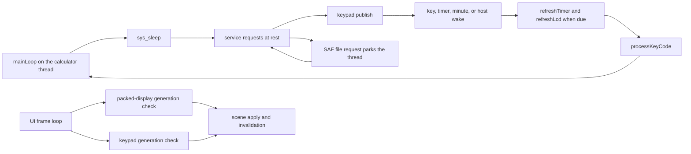

# Runtime Hot Paths

This page names the calculator thread and its rule, the concrete runtime loops,
redraw paths, cadence limits, and thread boundaries that are easiest to regress in
the Android shell.

Read `00-project-and-upstream.md` first and
`03-upstream-interface-surfaces.md` second. This page assumes the ownership and
interface boundary is already clear. Read `08-tests-and-contracts.md` for the
contract-to-regression map that proves these loops.

## Hot Paths At A Glance

| Path | Trigger and cadence | Main files | Why it is hot | Main failure mode |
| --- | --- | --- | --- | --- |
| calculator thread | upstream's `mainLoop()` for the life of the process; sleeps in `sys_sleep` until a key, a timer, a service request, a change of host visibility, or the minute | `CalculatorEngine.kt`, `jni_lifecycle.c`, `hal/keys.c`, upstream `src/c47/c47.c` | every key and request ends here, and only this thread runs core code | core code run from another thread is a race no lock covers; a new upstream `sys_sleep` caller could run a service inside a computation |
| stop during a run | the user presses `R/S` or `EXIT` while a program or long operation runs; the key goes on the FIFO and the operation's own poll sees it | `hal/keys.c`, upstream `runProgram`, `exitKeyWaiting`, `fnPause` | this is the only way Android stops a computation | a core loop that polls no keys ignores it and makes the app appear hung |
| service requests | each `sys_sleep` at rest runs `r47_services_run()`: every queued request, the merged gesture, a pending save, and the `SNAP` offer, then the idle checkpoint | `host_services.c`, `jni_input.c`, `jni_clipboard.c`, `jni_lifecycle.c` | paste, graph re-solves, copies, and saves all run here, on the thread that must also take the next key | a slow request delays the keys behind it; a full queue refuses; a finished `SNAP`, even one from a long-held `EXIT`, parks the thread on the save picker, as any file request does, and the `onStop` save waits behind it |
| main-loop timers and refresh | upstream's cadence: the loop wakes for its own deadlines, runs `refreshTimer()` when due and `refreshLcd()` plus `lcd_refresh()` every `SCREEN_REFRESH_PERIOD` | upstream `src/c47/c47.c`, `hal/keys.c`, `hal/lcd.c` | this is the steady-state heartbeat | heavy work in `sys_sleep` or the HAL lengthens every cycle |
| frame refresh loop | one `Choreographer` callback per UI frame while active; each frame checks the packed-display and keypad generations | `NativeDisplayRefreshLoop.kt`, `NativeKeypadSnapshotStore.kt`, `jni_display.c`, `ReplicaOverlay.kt` | this is the continuous UI-side polling loop | breaking generation or busy-copy handling can regress to stale keypad refreshes |
| keypad publish | at rest when marked dirty or just after input; during a long operation from `lcd_refresh`, when dirty, at most every `R47_KEYPAD_BUSY_PUBLISH_MS` | `keypad_scene.c`, `hal/lcd.c`, `hal/keys.c` | it resolves the whole scene on the calculator thread, inside a computation too | a publish that stops being marked leaves softkeys stale, because nothing re-reads on a clock; its cost on the calculator thread is not measured |
| packed LCD row decode | each accepted LCD update copies every packed row, decodes the flagged ones to the bitmap, and requests one redraw of the overlay | `ReplicaOverlay.kt`, `jni_display.c`, `hal/lcd.c` | this runs on the UI thread and touches the LCD bitmap path directly | forced full-snapshot redraws on passive lifecycle edges or transport-metadata coupling create visible regressions |
| keypad scene apply | scene changes update all live key views, invalidate per-key specs, and may request layout | `ReplicaOverlayController.kt`, `ReplicaKeypadLayout.kt`, `CalculatorKeyView.kt`, `CalculatorSoftkeyPainter.kt`, `KeyRenderSpec.kt` | keypad labels, render specs, and layout are the largest recurring view updates outside the LCD | bypassing the refresh gate or forcing layout or invalidation on unchanged scenes creates churn |
| lifecycle save and explicit refresh | `onStop` queues a save, and waits up to `SAVE_FENCE_MILLIS` only for an idle calculator; explicit redraw remains opt-in for real state changes | `CalculatorEngine.kt`, `MainActivity.kt`, `host_services.c`, `jni_lifecycle.c` | lifecycle callbacks are easy places to hide destructive redraw work | synthetic redraws during a passive save or resume mutate the LCD without a real calculator transition |
| SAF I/O boundary | a file request saves, then parks the calculator thread on `fileCond` until Kotlin answers | `jni_storage.c`, `hal/io.c`, `android_runtime.c` | this is the one place the calculator thread waits on Android | a request nobody answers parks the calculator for good, with keys and requests piling up behind it |

## Runtime Loop Graph

## Calculator Thread

One rule holds this model: only the calculator thread runs core code. Every other
thread pushes a key, queues a service request, or copies what that thread published.
There is no lock around core state, because one thread owns it, and no Kotlin task
queue. Nothing services Android work from inside a computation, so a key can never
re-enter one.

Two checks hold the rule. In a debug build, `R47_CALCULATOR_THREAD_ONLY()` in
`host_services.h` aborts when a key, sleep, or timer function of `hal/keys.c` that the
core calls, or a service, a save, the keypad publish, or a file request, runs on another
thread; `r47_keys_init()` records the thread, and a release build compiles the check out.
The rest of the HAL, such as `hal/lcd.c` and `hal/io.c`, carries no check.
`jni_core_reach.py`, which `build_calculator_thread_harness.sh` runs, follows what each
glue definition's relocations name, from every JNI entry: a call, a function pointer
taken, a global read. It fails on any core symbol it reaches, so the rule holds on paths
no test runs, with three limits: a pointer stored at run time and called later, the
Android-only branch of `hal/io.c`, which the host build compiles out, and the
instrumentation bridge, which it does not compile. `runCalculatorNative` is the one
exception: it is the calculator thread.

- `CalculatorEngine.start()` runs `runCalculatorNative` on the `R47Calculator`
  thread, once per process, with a stack of `THREAD_STACK_BYTES`, the size upstream's
  simulator main thread gets.
- `r47_calculator_main()` runs init, one AUTXEQ, and upstream's `mainLoop()` in
  `src/c47/c47.c`, in the shape of upstream's `calcThreadMain`. `mainLoop()` owns the
  timers, the screen refresh, and key dispatch, and calls `sys_sleep()` when it has
  nothing to do.
- `sys_sleep()` in `hal/keys.c` is the one place the thread waits for work. It wakes
  for a key, a due timer, a service request, a change of host visibility, the minute,
  or a due checkpoint.
- **At rest.** `calculatorAtRest()` reads `programRunStop`: a sleep with no program
  running or paused is the main loop at rest. A keyboard computation never sleeps, so
  that is sound while the idle main loop and a program's pause are the only callers
  on this build. `run_upstream_hal_contract.sh` fails when upstream
  adds another.
- **Service requests.** A sleep at rest runs `r47_services_run()` first and publishes
  the keypad, and returns at once when anything ran, because a request can change what
  the loop must do next. A sleep in a program's pause runs no request, so a request
  waits out a `PSE` as it waits out a computation. They live apart from the keys
  because `exitKeyWaiting()` wipes the key buffer, and each one answers through an
  up-call.
- **Saves.** The state goes to disk at these points, and a kill costs what changed
  since the last one; the file itself is replaced whole
  ([04](04-native-core-and-jni.md#file-io-boundary)):
  - at rest, for a save `onStop` asked for;
  - at rest as an idle checkpoint, when a key arrived since the last save, the keys
    have been quiet `R47_CHECKPOINT_QUIET_MS`, `R47_CHECKPOINT_INTERVAL_MS` has passed
    since that save, the host is not stopped, and autosave is on;
  - in a program's pause, for a pending `onStop` save, when no solver, integral, or
    plot is under way, so the pause is a step boundary (`saveIfInPause`, from
    `sys_sleep` and `sys_delay`);
  - after OFF, when autosave is on;
  - before a picker, when autosave is on, which can land inside a computation when a
    running program reaches a file request;
  - once the host has stopped, at the next poll of a computation or a running
    program, for a pending `onStop` save (`saveIfHostStopped`, from `key_empty`), so
    a run that outlasts the freezer's 10 s or a kill does not take the session with
    it. Not while the core has a file open, since the HAL holds one, and not before
    the start's restore. The image holds the run, which a restore clears. With the
    host in front a save still waits for rest.
- **Parking.** A sleep at rest with the host stopped waits with no deadline.
  Upstream's timers are deadlines against the clock, so the first wake fires every one
  that came due. A running or paused program never parks.
- **OFF.** `fnOff` only sets `STAT_PGM_END`. `mainLoop` calls `LCD_power_off`, which
  sets `backToDMCP`, and returns; `r47_calculator_main` saves if autosave is on, sends the
  `onCalculatorOff` up-call, clears the power flags, and enters `mainLoop` again, so the
  next launch finds a running calculator.
- **Stop.** `r47_calculator_stop()` ends the thread for good, and only a factory reset
  calls it. It releases a pressed key and pushes a quit, which a computation reads as
  `EXIT`.

`build_calculator_thread_harness.sh` runs this on a host
thread started as `CalculatorEngine` starts it, and
`scripts/workload-regressions/build_bridge_tsan_harness.sh` races the other threads
against it. Neither says anything about ART, bionic, or arm64. CI's `x86_64` emulator
runs the instrumented tests on this thread, and every phone runs the app on it, but
neither looks for a race, and `THREAD_STACK_BYTES` is not measured against
upstream's real stack use there.

Inspect this path when Android requests appear to arrive late, a state save stays
pending, or a key seems to do nothing.

## What A Key Does During A Computation

`r47_key_push` puts a key on the FIFO under `keyMutex`, whichever thread pushes it,
and the key waits for the calculator thread. What happens to it depends on what that
thread is doing:

| the calculator thread is | who takes the key | `R/S` or `EXIT` | any other key |
|---|---|---|---|
| at rest | `mainLoop`, through `keyBuffer_pop()` and `processKeyCode()` | runs as that key | runs as that key |
| in a long operation (`FACTORS`, the solver, the grapher) | its `exitKeyWaiting()` poll | stops the operation | wipes the FIFO and upstream's ring buffer (`key_pop_all()`, `clearKeyBuffer()`), so the key does nothing; `key_pop_all()` keeps `R/S` and `EXIT`, and a release behind them |
| in a running program | the outermost `runProgram`, when `getUptimeMs() >> 7` changes | sets `PGM_WAITING` and stops | taken, and recorded with `setLastKeyCode()` |
| in a program's `PSE` | `fnPause`, through `key_pop()` | stops a running program | ends the pause, except the `f` key |
| parked in a file request, or in a core loop with no poll | nothing yet | waits in the FIFO | waits in the FIFO |

- `key_pop()` runs no calculator function, which is what keeps a computation from
  being re-entered, with upstream's one exception: a PC Ctrl command, a copy or a
  capture, during a program's pause. A shift or a cancel popped during a long
  operation is dropped, since the operation owns the keys and a cancel has no press
  left to take back; a quit becomes `EXIT` plus a release at the head of the FIFO;
  and a PC key gives what upstream's busy `pcKeyHandle` gives, the key its row
  clicks or its item sits on, pushed at the head of the FIFO, or, in text entry, the
  whole event, which waits in the ring buffer for the main loop.
- A refresh inside a long operation also runs `keyBuffer_pop()`, which moves keys and
  host events into upstream's ring buffer. `exitKeyWaiting()` finds `R/S` and `EXIT`
  there through `interruptKeyInBuffer()`, and `key_empty()` reports a quit that went
  there, because the ring's wipe would lose it and the next poll has to find it.
- A refresh inside a running program moves nothing: `keyPopForMainLoop()` returns no
  key while `programRunStop` is `PGM_RUNNING`. The program's poll reads only the FIFO,
  so a stop key in the ring would never stop a loop that redraws with `VIEW`, `KEY?`
  would never see its key, and the ring's `R/S` would start the program again later. For
  the same reason the ring holds one key at a time: the second of two quick taps stays in
  the FIFO, where a program the first one starts can see it.
- The FIFO holds `KEY_BUFFER_SIZE` entries, and a full one drops the key, as DMCP does.
- A service request is not a key, so these wipes cannot reach it. A paste during a
  computation enters when it ends.
- A press must get a release, because `wait_for_key_release(0)` holds the calculator
  thread until one arrives. The keypad sends one, `ACTION_CANCEL` sends a cancel, and
  `onHostStopped` and `r47_calculator_stop` release whatever is still down.
- A loop of `PSE` steps can lose a stop key in one window, on every build, since
  both ends are upstream's: the outermost `runProgram` polls when the 128 ms slot of
  the uptime has changed, as it has once a pause of 0.2 s or more returns, and the
  next `PSE`'s `fnPause` runs `wait_for_key_release(0)` and a `key_pop()` whose key
  it never reads. A press between the two, over the steps and the redraw that come
  before the next pause, is lost unless a slot boundary passes first and the poll
  takes it; then the program needs a second press.
- `calculator_thread_harness.c` locks a digit during `FACTORS` doing nothing, `EXIT`
  and `R/S` stopping it, `R/S` running nothing afterward, both stopping a program
  loop that never yields, that pauses (pressed inside the pause), that waits on
  `KEY?`, and that redraws with `VIEW`, `KEY?` seeing its key behind a `VIEW`, and a
  stop key surviving the wipe. The table is read from upstream's code, which moves
  without a commit here.

## Main Loop And Timers

- The cadence is upstream's. `mainLoop()` sets `TIMER_IDX_REFRESH_SLEEP` to at most
  `SCREEN_REFRESH_PERIOD`, less while a key timer runs, and calls `sys_sleep()`; with
  no timer due it sleeps until a key or the minute.
- After each wake it runs `refreshTimer()` when `nextTimerRefresh` is due and
  `refreshLcd()` plus `lcd_refresh()` when `nextScreenRefresh` is due.
- `sys_sleep()` waits on `keyCond` for the earliest of the running HAL timers and the
  next real-time minute, and on waking clears the timers that came due and sets
  `STAT_CLK_WKUP_FLAG` when the minute changed.
- `sys_current_ms()` counts from this process's start on `CLOCK_MONOTONIC`, because
  the main loop compares its deadlines with a plain `<=`. A boot-based count would wrap
  into a stalled display 49.7 days into an uptime; this one needs a process that old.
- `sys_delay()` runs a pending save when it is a program's pause, then does a
  `nanosleep`. `_Buzz` uses it for each note's length, and the audio thread plays exactly
  that length, so a program's notes keep program time, a `TONE` loop cannot outrun the
  audio queue, and `R/S` waits out at most the note in progress. The first `sys_sleep` at
  rest after a note clears the queue, so whatever was queued ends with the run.
- `r47_init_runtime(...)` seeds `nextTimerRefresh` and `nextScreenRefresh`, and
  `mainLoop()` configures its timers again on every entry.

Changes here affect the full runtime even when the Android UI code is untouched, and
an upstream change to the loop arrives with no commit here.

## Frame Refresh Loop

- `NativeDisplayRefreshLoop` is the only continuous UI-thread poller for published
  native state, and it runs between `onStart()` and `onStop()`.
- Each `doFrame(...)` call first reads `getPackedDisplayGeneration()`. Only when
  the generation changed does it attempt `getPackedDisplayBuffer(...)`, then it
  forwards accepted packed rows to `ReplicaOverlay.updatePackedLcd(...)`.
- If the non-blocking packed-buffer copy fails, the same generation is retried
  on the next frame instead of being treated as consumed.
- When `show_developer_performance_hud` is enabled, that same loop also
  aggregates a developer-only sample window. The default is `500 ms`, and the
  developer-only `developer_performance_hud_window_millis` preference clamps
  that window to `100..1000 ms`.
- `UI Hz` counts `Choreographer#doFrame(...)` callbacks in the active sample
  window. It is the app's observed UI callback cadence, not the panel's raw
  hardware refresh rate.
- `LCD Hz` counts accepted non-empty `getPackedDisplayBuffer(...)` copies in
  that same active sample window.
- `DR` is the average count of flagged rows per accepted snapshot in that
  window, normalized by the `240` LCD rows and shown as a percent. Native flags
  only rows whose pixels changed, so `DR` measures real repaint, not how many
  rows the core rewrote.
- `Upd` is the average time of one accepted LCD update in the same window:
  the packed-buffer copy, the HUD's own dirty-row count, the decode of the
  flagged rows into the bitmap, and the redraw request. The copy alone is not
  timed apart.
- If a sample window finishes with no accepted packed copy, the HUD leaves
  `DR` and `Upd` blank instead of synthesizing zeros. Disabling the HUD or
  changing the configured window resets the active sample window.
- The loop reads `getKeypadSnapshotGeneration()` and refreshes keypad state only when
  the generation changed. There is no time-based re-read: the calculator thread
  publishes every change ([inventory below](#keypad-snapshot-state-inventory)).
- `refreshKeypadSnapshot(...)` delegates to
  `NativeKeypadSnapshotStore.refreshSnapshot(...)`, which owns reusable
  metadata and label buffers plus one cached `KeypadSnapshot` per main-key
  mode.
- `copyKeypadSnapshotNative(...)` copies the published snapshot under one
  `pthread_mutex_trylock(&publishedKeypadMutex)`, and returns `false` before
  `r47_runtime_ready()`, when that mutex is busy, or when the published snapshot is in
  another main-key mode. Then the store returns the last accepted snapshot for that
  mode instead of blocking the UI thread or synthesizing an empty scene.
- Only a refresh result marked `isUpToDate` advances `lastKeypadGeneration`.
  That keeps busy skips retryable on the next frame while still letting the
  renderer reuse the last good snapshot.
- `ReplicaOverlayController.currentKeypadSnapshot()` still applies the main-key
  mode transform plus the `virtuoso` blank-keycap composition and softkey
  `graphic` or `off` mask before the renderer path runs.

Do not add a second polling loop for LCD pixels, keypad labels, or scene state.
That would duplicate the most expensive JNI reads in the shell.

## Packed LCD Row Decode Path

- `NativeDisplayRefreshLoop` attempts a copy only after
  `getPackedDisplayGeneration()` changes, and once after each `start()`, so
  Kotlin does not receive a fresh packed snapshot on unchanged frames.
- `hal/lcd.c::LCD_write_line(...)` copies the row into the packed snapshot
  inverted, one pass over its 50 pixel bytes, because `lcd_buffer` stores a
  dark pixel as a 0 bit and the snapshot as a 1 bit. It flags the packed row
  and increments `packedDisplayGeneration` only when a pixel byte changed: the
  core rewrites rows it did not change, since `bitblt24` and `lcd_line_addr`
  mark a row dirty on every write, and this is the one place the transport
  compares rows. `init_lcd_buffers` flags every packed row. Several changed
  rows can collapse into one accepted
  Kotlin snapshot before the next UI frame, which is why the HUD's `LCD Hz`
  field is snapshot cadence rather than raw row-write frequency.
- `hal/lcd.c::lcd_try_take_packed_snapshot(...)` copies every row and clears
  every row's flag in one trylock section. The flag is transport bookkeeping,
  not part of the visible LCD contract: every row in a copy carries its current
  pixels.
- `ReplicaOverlay.updatePackedLcd(...)` hands the copy to its
  `PackedLcdRaster`, which decodes every row whose packed byte `0` is set,
  without comparing it again, or every row of the first frame it receives, and
  the overlay requests one redraw. It names no rectangle: from API 21 the
  platform ignores one and computes the area itself
  ([`View.invalidate(Rect)`](https://developer.android.com/reference/android/view/View#invalidate(android.graphics.Rect))). A row's
  display position is its index: native `LCD_write_line` already stores a row
  at the index its DMCP row id names.
- A palette change stays on the UI thread: `MainActivity.applyLcdTheme`
  resolves the palette through `LcdThemePolicy` and hands it to
  `setLcdPalette`, and native never sees it. Who writes the bitmap, the row
  cache, and the palette is in the
  [inventory below](#lcd-frame-state-inventory).
- the animated settings-discovery hint in `ReplicaOverlay` keeps its
  `StaticLayout` and card geometry in a cache rebuilt only on a real size or
  layout change, so the pulse animation allocates no text-layout objects per
  draw pass.

This path is sensitive because it runs on the UI thread, owns the live packed
snapshot cache, and is the easiest place to reintroduce transport-level work as
if it were visible LCD state.

## LCD Frame State Inventory

One LCD frame lives in five copies between the core and the screen. This table
is the state inventory that the first check in
[11-reviewing-a-change.md](11-reviewing-a-change.md#the-four-checks) starts
from: a change to any copy is reviewed against all five, and a change that adds
a copy adds a row here in the same commit.

| copy | owner | written by (thread) | read by (thread) | change signal |
|---|---|---|---|---|
| `lcd_buffer` | `hal/lcd.c`, drawn by the upstream core | upstream drawing through `lcd_line_addr`, `bitblt24` (and `lcd_fill_rect` on top of it), and `lcd_clear_buf` (calculator) | `LCD_write_line` through `lcd_refresh`, `lcd_refresh_lines`, and `lcd_clear_buf`; `lcd_buffer_pixel_on` (calculator) | row byte 0, set on every write, cleared by `LCD_write_line` |
| `packedDisplayBuffer` | `hal/lcd.c`, under `packedDisplayMutex` | `LCD_write_line`, and `init_lcd_buffers` once (calculator) | `lcd_try_take_packed_snapshot`, through `getPackedDisplayBuffer`, with a trylock (main) | row byte 0, set when the row's pixels changed and cleared by the take; `packedDisplayGeneration` |
| `packedLcdBuffer` | `NativeDisplayRefreshLoop` | `getPackedDisplayBuffer`, every byte of every row (main) | `ReplicaOverlay.updatePackedLcd` (main) | row byte 0 as copied |
| the frame in `PackedLcdRaster` | `PackedLcdRaster`, held by `ReplicaOverlay` | `applyFrame`, the flagged rows or every row of the first frame (main) | `decodeRow` (main) | none |
| `PackedLcdRaster.bitmap` | `PackedLcdRaster` | `decodeRow`, from the constructor, `applyFrame`, and `setPalette` (main) | `ReplicaOverlay.dispatchDraw` (main) | the overlay's `requestLcdRedraw`, after `applyFrame` reports a changed row and after every `setPalette` |

The palette, held by `PackedLcdRaster`, is decoded into every bitmap row, so it
is part of the same state.

What each rule rests on:

- **A row is flagged only when its pixels changed.** `LCD_write_line`
  compares before it flags, and `init_lcd_buffers` flags every row once.
  `run_keypad_generation_contract.sh` locks both.
- **Every copy carries the whole current frame, and the take clears the
  flags.** `run_keypad_generation_contract.sh` locks the copy, the clear, the
  refusal while the calculator thread holds the lock, and the packed byte and bit a pixel
  lands in. `PackedLcdRasterTest` decodes by the same rule and takes its
  expected pixels from the coordinates it lit, not from a second decoder.
- **A host that attaches to a live calculator receives the whole frame.** Its
  raster decodes the first frame it receives whole, flagged or not, because the
  previous host may have taken the flags; nothing native runs for it when it
  attaches.
  `PackedLcdRasterTest.firstFrame_decodesEveryRow_evenWithNoRowFlagged` holds it
  for a frame that flags no row, and `ReplicaOverlayLcdOrderTest` for one that
  flags none, one, or every row. `DisplayLifecycleInstrumentedTest` hashes
  native state, not the overlay, so no device test checks a recreated overlay's
  pixels.
- **The bitmap shows the frame in the palette, by construction.**
  `PackedLcdRaster` owns the frame, the palette, and the bitmap, offers no other
  write path, decodes only from its frame, and decodes the blank frame in its
  constructor, so the bitmap is never `createBitmap`'s transparent fill.
  `setPalette` repaints every row, with no equality guard.
  `PackedLcdRasterTest` and `ReplicaOverlayLcdOrderTest` hold each path, and
  `mutation_spot_check.sh` carries four raster mutants, two of which only the
  order test catches.
- **The palette has one source, and one writer before the first draw.** The
  `LcdTheme` entries in `LcdThemePolicy.kt` hold every base color, in one
  notation; `test_lcd_palette_owner_contract.py` fails on a copy of one in any
  other `src/main` Kotlin file or resource, and on a second notation. It cannot
  see a copy of a resolved palette, which `resolve` computes at run time. The
  overlay starts from `LcdThemePolicy.DEFAULT_PALETTE`, and
  `MainActivityPreferenceController.applyInitialPreferences` applies the
  stored theme in `onCreate`, before the overlay's first draw
  (`MainActivityPreferenceControllerTest.applyInitialPreferences_appliesTheStoredLcdTheme_beforeTheDeferredOverlayPass`).
  The policy owns the luminance range and defaults; the controller's constants
  refer to it.

## Keypad Snapshot State Inventory

One keypad scene lives in five copies between the core and the views. This table is
the state inventory the first check in
[11-reviewing-a-change.md](11-reviewing-a-change.md#the-four-checks) starts from.

| copy | owner | written by (thread) | read by (thread) | change signal |
|---|---|---|---|---|
| core state | the upstream core | key dispatch, timers, computations (calculator) | `fillAppKeypadSnapshot` (calculator) | `keypadDirty`, set by `LCD_write_line`, a popped key, and a service run |
| `backKeypad` | `keypad_scene.c` | `publishKeypad` (calculator) | the compare in `publishKeypad` (calculator) | none |
| `frontKeypad` | `keypad_scene.c`, under `publishedKeypadMutex` | the swap in `publishKeypad` (calculator) | `r47_try_copy_app_keypad_snapshot`, with a trylock (main) | `publishedKeypadGeneration` |
| `metaBuffer`, `labelBuffer` | `NativeKeypadSnapshotStore` | `copyKeypadSnapshotNative` (main) | `KeypadSnapshot.fromNative` (main) | the copy returned true |
| `cachedSnapshots` | `NativeKeypadSnapshotStore` | `refreshSnapshot` (main) | `NativeDisplayRefreshLoop`, `ReplicaOverlayController` (main) | the observed generation, per main-key mode |

What each rule rests on:

- **The main thread never reads core state.** It copies only the front snapshot, so it
  never waits for a computation. `build_bridge_tsan_harness.sh` races that copy against
  the publish.
- **The generation moves only when something changed.** `publishKeypad` compares the
  whole back copy with the front and swaps only when they differ.
  `calculator_thread_harness.c` locks that an idle calculator publishes nothing and the
  `f` key publishes.
- **A screen write asks for a publish.** Dynamic softmenus, notably the EQN editor,
  rebuild their labels on the refresh path with no key event, so `LCD_write_line` marks
  the keypad dirty. `run_keypad_generation_contract.sh` locks it.
- **A timer's label change is seen.** A long press can change a softkey with no key and
  no draw, so a sleep at rest publishes for `R47_KEYPAD_ACTIVITY_WINDOW_MS` after the last
  input whether or not it is marked. That is a window, not a guarantee: a timer that
  changes a label later and draws nothing stays unpublished.
- **One main-key mode is published at a time.** A copy in another mode returns false and
  queues `r47_service_keypad_mode` once, and the generation moves when the calculator has
  published it, so a mode change during a computation shows when the computation reaches
  rest or its next due publish.

## Lifecycle Save And Explicit Refresh Path

- `MainActivity.onStop()` queues a save, which makes it part of the activity lifecycle
  boundary. It also posts `DataFolderMirror`'s copy of the core's prints to that
  class's own worker, so no provider call runs on the main thread. At rest it finishes inside `SAVE_FENCE_MILLIS`. During a computation or a
  program's pause, or with the thread parked in a file request, the main thread gives up
  after `R47_SAVE_IDLE_GRACE_MS` and the save stays pending: it runs last in the next
  `r47_services_run()`, or in a program's pause. If the process dies first, what changed
  since the last save is lost and the last file stands whole.
- `r47_save_settled()` must stay persistence-only. Background save and Settings entry
  are passive transitions and must not redraw the LCD.
- `MainActivity.onResume()` for a normal Settings return must also stay passive
  from the native LCD point of view. The display loop is already running and the
  overlay resume path can handle geometry replay without a native force refresh.
- PiP mode changes stay UI-side as well. The PiP callback must route through
  `ReplicaOverlayController` so PiP exit reuses the pending geometry replay
  path for the current keypad snapshot instead of forcing a native redraw.
- `r47_force_refresh()` is the explicit redraw path for runtime init and the
  test-owned refresh seam.

## Keypad Scene-Application Path

- `ReplicaOverlayController.refreshDynamicKeys(...)` is the gatekeeper for
  scene application.
- `KeypadSnapshotRefreshGate.shouldApply(...)` skips unchanged snapshots by
  value so the shell does not relayout every time the frame loop polls.
- `ReplicaKeypadLayout.updateDynamicKeys(...)` updates every `CalculatorKeyView`
  only when `sceneContractVersion > 0`, then requests layout once.
- The overlay bind and PiP exit do not immediately replay the scene.
  `markGeometryChange()` sets a pending flag, and
  `schedulePendingGeometrySceneReplay()` waits until the next real overlay
  layout before forcing one replay.
- `CalculatorKeyView` keeps a cached `mainKeyRenderSpec` and refreshes it when
  label, layout-class, or size changes move main-key geometry.
- `CalculatorSoftkeyPainter` caches the resolved `KeyRenderSpec` by the
  current snapshot, font set, size, and pressed state, so an
  unchanged softkey frame stays on the painter path without rebuilding the spec
  graph. Unnecessary softkey `invalidate()` churn still costs a repaint; it does
  not cost a spec rebuild.
- PiP exit uses that same contract. The restored full-window shell marks a
  pending geometry replay and the next real overlay layout reapplies the
  current scene once.
- After layout, `applyTopLabelPlacementsAfterLayout(...)` reruns the row-local
  top-label solver for the visible key views of every main-key lane.

This path becomes expensive when unchanged snapshots stop being filtered, when
layout is requested more than once per scene change, or when scene work is
moved into the per-frame LCD path.

## SAF I/O Boundary

- `requestAndroidFile(...)` in `jni_storage.c` saves the state, unless autosave is off,
  then parks the calculator thread on `fileCond` until `onFileSelectedNative` or
  `onFileCanceledNative` answers. Its up-call first finds where the picker starts, on
  that thread: a few provider calls, which take as long as the provider does, while
  the thread would wait for the picker anyway and the main thread is not held. It holds nothing else, so no lock unwinds around the
  wait.
- While a file request is pending, `isCoreBlockingForIo` is true, a C11 atomic the
  lock-free signal contract holds. A late answer reads it to tell whether anything still
  waits for the descriptor.
- `hal/io.c::ioFileOpen(...)` is what sends state, program, RTF export,
  register data export and import, and manual-save traffic onto this boundary in
  the first place, and
  `hal/io.c::r47_offer_snap()` sends a finished capture.
- While parked, the thread takes no key, runs no service, and publishes nothing.
  Opening a picker stops the Activity, so `onStop()` queues a save the parked thread
  cannot take and gives up after its grace period; the save runs at the next rest.
- `NativeFileRequestGate` is what keeps the park from being permanent: every request
  ends in exactly one answer or cancel, and a launch with no host attached cancels at
  once. It cannot
  release a provider call stuck behind the worker
  ([04](04-native-core-and-jni.md#file-io-boundary)).

This is the place to inspect first when the app appears hung in a save or load
operation.

## Residual Hang: A Core Loop With No Poll

- Keys reach a computation only through the polls above. A core loop that reaches none
  of them cannot be stopped from Android: nothing preempts a thread, so `R/S` and `EXIT`
  wait in the FIFO.
- That is a gap rather than a design. The main thread stays live, because it takes no
  lock the loop holds, but the LCD stops changing with the loop, service requests pile
  up until the queue refuses, and a pending save never runs. A factory reset's join gives
  up, and the reset wipes and ends the process anyway.
- Which upstream loops lack a poll is not inventoried. A program that drifts into a
  non-terminating `NaN` loop is the case to try first, and no lane reproduces it. No
  owned-shell change closes this; the poll belongs in that loop, upstream.

## Regression And Evidence Surfaces

- `build_calculator_thread_harness.sh` covers the thread
  on upstream's real main loop under AddressSanitizer: key order, a key during a
  computation, stopping one, cancel, tones, OFF, every kind of save, a kill during saves,
  a restored run state, publishing, parking, and the stop.
- `scripts/workload-regressions/build_bridge_tsan_harness.sh` races the pushes and the
  display copies against the calculator thread, init included, under ThreadSanitizer.
- `run_upstream_hal_contract.sh` holds the `sys_sleep` callers the
  at-rest rule assumes.
- `android/app/src/test/java/io/github/ppigazzini/r47zen/NativeDisplayRefreshLoopTest.kt`
  covers generation gating and retry-after-failed-copy behavior for the packed
  LCD observer loop.
- `android/app/src/test/java/io/github/ppigazzini/r47zen/KeypadSnapshotRefreshGateTest.kt`
  covers the unchanged-snapshot skip gate, and `MainKeySnapshotRenderTest.kt`
  how main-key views apply keypad snapshots.
- `android/app/src/test/java/io/github/ppigazzini/r47zen/ReplicaOverlayGoldenTest.kt`
  covers renderer stability for the borderless native shell, and that the
  overlay intercepts a touch below the top bezel strip but not one on it.
- `android/app/src/androidTest/java/io/github/ppigazzini/r47zen/DisplayLifecycleInstrumentedTest.kt`
  proves that passive lifecycle edges preserve the calculator state behind a staged
  `SPIRALk` graph. It compares forced renders before and after, so it does not show
  that an edge draws nothing. No test holds that `onResume`, which runs nothing
  native today, stays that way; a stop's save redraws once, as `r47_services_run`
  refreshes the LCD after any service it ran.
- `scripts/workload-regressions/run_workload_regressions.sh` exercises long host runs
  across the canonical host workload set: the imported `.p47` fixtures `BinetV4.p47`,
  `GudrmPL.p47`, `MANSLV2.p47`, `NQueens.p47`, and `SPIRALk.p47`. Each workload runs in
  its own host process under the same outer timeout-and-kill safety net, while
  `MANSLV2` stays the maintained stop-after-activity scenario inside that framework,
  stopped by a pushed `R/S`. It has no calculator thread and no main loop.
- `scripts/workload-regressions/collect_host_pgo_profile.sh` trains the release
  profile on a different corpus, an upstream `testSuite` base plus the same
  `.p47` overlay; its `--help` lists it.
- `MANSLV2` is the required bounded-stop regression on Android too: the wrapper treats a
  timed-out `MANSLV2` selection as a hard failure rather than degraded coverage.
- `./scripts/android/build_android.sh --run-sim-tests` keeps the Android full
  build path aligned with the `build.sim` Meson and Ninja lane.
- `ProgramFixtureInstrumentedTest` drives canonical program fixtures through the
  Android `READP` path used by the live app and presses `R/S` the way the keypad does
  for the bounded `MANSLV2` interrupt scenario. Hosted CI runs the whole class as one
  connected selection under an outer GNU `timeout --kill-after`, and a timeout
  fails the lane (`scripts/android/run_connected_android_tests.sh`).
- The instrumentation above runs against this thread model on CI's `x86_64`
  emulator; no phone has run it. No lane measures how long the main thread waits in
  `onStop()` on a device, or the keypad publish's cost there.

When a task changes one of these hot paths, update the narrowest relevant
verification lane first and widen only if the first check does not cover the
regression surface.

## Hot-Path Change Rules

- Keep work off the main thread unless the Android view system requires it.
- Run core code only on the calculator thread. To read core state elsewhere, publish a
  copy from that thread, as the LCD and the keypad do.
- Do not duplicate refresh loops that already exist in upstream's `mainLoop()`,
  `NativeDisplayRefreshLoop`, or `ReplicaOverlay`.
- Respect Android's measure/layout/draw split: geometry changes call
  `requestLayout()`, visual-only changes should stay on `invalidate()`, and
  per-key spec recompute should remain tied to real size or scene changes
  instead of steady-state `onDraw()`.
- Keep redraw work tied to real pixel, scene, or layout changes.
- Keep `sys_sleep()` cheap, and add no wake the main loop did not ask for: it runs before
  every key.
- Do not pull packed LCD rows when the generation is unchanged.
- Put a stop on the FIFO, where the computation polls for it. Do not reach into core
  state from another thread to stop one.
- Keep a new host request on the service queue, not the key buffer, which a long
  operation wipes.
- Do not let a UI-thread copy block on the calculator thread; if a copy cannot take its
  mutex, prefer stale snapshot reuse or a skipped refresh over a blocking wait.
- Preserve the `trylock` and skip-one-cycle behavior of the display copies unless a
  real runtime bug proves it is wrong.
- Make the parking of the calculator thread explicit before changing storage, pause,
  wait, or progress behavior.
