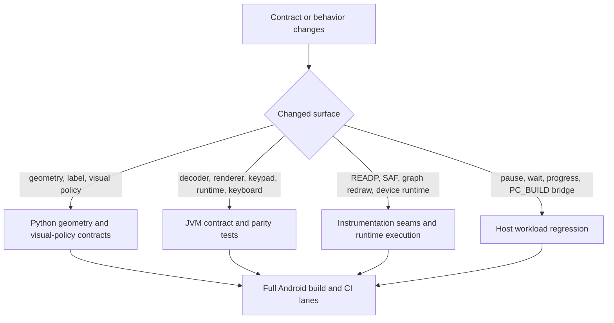

# Tests And Contracts

This page maps the maintainer verification surfaces, the contracts they lock,
and the smallest rerun lane that should move with each kind of change.

Read `01-build-and-source-layout.md` first. This page assumes the build,
ownership, and CI lane split are already clear.

Read this page when a task changes geometry, keypad snapshots, JNI seams,
storage flow, READP program loading, runtime cadence, or CI verification.

## Verification Flow



## Contract Inventory

| Contract surface | Source of truth | Focused verification surfaces | First rerun lane |
| --- | --- | --- | --- |
| shell geometry, top-right menu bounds, and LCD frame | `scripts/r47_contracts/derive_shell_geometry.py`, `R47Geometry.kt` | `scripts/r47_contracts/test_shell_geometry_contract.py`, `ReplicaOverlayGoldenTest.kt`, `MainShellThemeTest.kt` | grouped `scripts/r47_contracts` validation lane, then `:app:testDebugUnitTest --tests io.github.ppigazzini.r47zen.ReplicaOverlayGoldenTest --tests io.github.ppigazzini.r47zen.MainShellThemeTest` |
| key-label and visual policy constants | `scripts/r47_contracts/derive_key_label_geometry.py`, `scripts/r47_contracts/derive_key_visual_policy.py`, `scripts/r47_contracts/data/r47zen_ui_contract.json`, `KeyRenderSpec.kt`, `KeyRenderPainter.kt`, `CalculatorKeyView.kt`, `CalculatorSoftkeyPainter.kt` | `scripts/r47_contracts/test_key_label_geometry_contract.py`, `scripts/r47_contracts/test_key_visual_policy_contract.py`, `CalculatorKeyViewRenderSpecTest.kt`, `CalculatorSoftkeyPainterCanvasTest.kt` | grouped `scripts/r47_contracts` validation lane, then focused JVM render-spec tests when the Kotlin builder or shared painter stage moved |
| keypad font policy and C47 font coverage | `scripts/r47_contracts/data/r47_key_font_policy_contract.json`, `scripts/r47_contracts/derive_key_font_policy.py`, `ReplicaKeypadLayout.kt`, `CalculatorKeyView.kt`, `CalculatorSoftkeyPainter.kt`, `C47TypefacePolicy.kt` | `scripts/r47_contracts/test_key_font_policy_contract.py`, `CalculatorKeyViewFontSelectionTest.kt` | grouped `scripts/r47_contracts` validation lane, then `:app:testDebugUnitTest --tests io.github.ppigazzini.r47zen.CalculatorKeyViewFontSelectionTest` |
| top-label lane solve and alpha-case label export | `TopLabelLaneLayout.kt`, staged `assign.c` and `items.c`, `keypad_scene.c`, `ReplicaKeypadLayout.kt`, `CalculatorKeyView.kt` | `TopLabelLaneLayoutTest.kt`, `KeypadTopLabelLayoutTest.kt`, `scripts/r47_contracts/test_alpha_case_export_contract.py` | `cd android && ./gradlew :app:testDebugUnitTest --tests io.github.ppigazzini.r47zen.TopLabelLaneLayoutTest --tests io.github.ppigazzini.r47zen.KeypadTopLabelLayoutTest`, then the grouped contract scripts for the alpha-case export |
| `assign.c` layout tables, `items.c` display vocabulary, shared keyboard-layout JSON, and Android local override boundary | `scripts/r47_contracts/derive_keyboard_layout_contract.py`, `scripts/r47_contracts/data/r47_keyboard_layout_contract.json`, root `src/c47/assign.c`, root `src/c47/items.c`, and `keypad_scene.c` | `scripts/r47_contracts/test_keyboard_layout_contract.py`, `KeyboardLayoutContractRenderTest.kt` | grouped `scripts/r47_contracts` validation lane, then `:app:testDebugUnitTest --tests io.github.ppigazzini.r47zen.KeyboardLayoutContractRenderTest` when Android-local label export, render parity, or the shared contract payload moved |
| overlay geometry replay for unchanged keypad scenes | `MainActivity.kt`, `ReplicaOverlayController.kt`, `ReplicaOverlay.kt`, `ReplicaKeypadLayout.kt` | `MainKeySnapshotRenderTest.kt` | `cd android && ./gradlew :app:testDebugUnitTest` |
| keypad scene export manifest and decoder | `KeypadSnapshot`, exported keypad fixtures, `keypad_scene.c` | `KeypadFixtureContractTest.kt`, `KeypadSnapshotDecoderTest.kt` | `cd android && ./gradlew :app:testDebugUnitTest` |
| exported keypad fixtures against the core of today | `android/app/src/test/resources/keypad-fixtures/`, the staged core, `keypad_scene.c` | `scripts/keypad-fixtures/report_keypad_fixture_drift.sh`: it lists what drifted, up to 12 changes a scene, and fails on a failed export, a scene it cannot read, or drift with no upstream move, which it can tell apart only until upstream next moves after a re-export | the `android-ci.yml` build job, which marks the step and not the job, or the script after a full build; on drift, re-export with `export_upstream_keypad_fixtures.sh`, re-derive the keyboard-layout and font-policy goldens, which read the fixtures, once each move is root-caused, and run `:app:testDebugUnitTest`, which runs `KeypadTopLabelLayoutTest.kt` on the new scenes |
| rendered keypad and softkey semantics | `ReplicaKeypadLayout.kt`, `CalculatorKeyView.kt`, `CalculatorSoftkeyPainter.kt`, `KeyRenderSpec.kt`, `ReplicaOverlayController.kt`, `KeypadLabelModes.kt`, `C47TypefacePolicy.kt` | `CalculatorKeyViewRenderSpecTest.kt`, `CalculatorKeyViewFontSelectionTest.kt`, `ExportedKeypadFixtureRenderTest.kt`, `CalculatorSoftkeyPainterContractTest.kt`, `CalculatorSoftkeyPainterCanvasTest.kt`, `SoftkeyTextContrastTest.kt`, `ReplicaOverlayGoldenTest.kt`, `ReplicaOverlayControllerLabelModeTest.kt` | `cd android && ./gradlew :app:testDebugUnitTest` |
| physical keyboard mapping and first-key shell focus routing | `PhysicalKeyboardBindingTables.kt`, `PhysicalKeyboardMapper`, `PhysicalKeyboardInputController`, `ReplicaOverlay.kt` | `PhysicalKeyboardInputParityTest.kt`, `ReplicaOverlayVisualPolicyTest.kt` | `cd android && ./gradlew :app:testDebugUnitTest --tests io.github.ppigazzini.r47zen.PhysicalKeyboardInputParityTest --tests io.github.ppigazzini.r47zen.ReplicaOverlayVisualPolicyTest` |
| core thread, display loop, and runtime gate behavior | `NativeCoreRuntime.kt`, `NativeDisplayRefreshLoop.kt`, `NativeKeypadSnapshotStore.kt`, `jni_lifecycle.c`, `jni_display.c`, `android_runtime.c` | `NativeCoreRuntimeTest.kt`, `NativeDisplayRefreshLoopTest.kt`, `GraphRedrawInstrumentedTest.kt`, `KeypadTouchInstrumentedTest.kt`, `run_workload_regressions.sh` | focused JVM tests first, then the host workload lane when the compatibility path moved |
| live program-stop key routing (which keys publish the out-of-band direct stop, which run states accept it, and whether a key is forwarded or swallowed) | `LiveProgramStopKeyPolicy.kt`, `LiveKeyRouter.kt`, `MainActivity.kt` `dispatchLiveKey`, `jni_input.c` `r47_direct_stop_allowed`, upstream `src/c47/programming/input.c` (`key == 36 || key == 33` while `*prevStop == PGM_RUNNING`) | `scripts/r47_contracts/test_live_stop_key_policy_contract.py` (cross-source lock of the Kotlin policy to upstream `input.c`), `LiveProgramStopKeyPolicyTest.kt` (literal-code key-set sweep), `LiveKeyRouterTest.kt` (forward when the gate declines, swallow only when it accepts, never query the gate for non-stop keys), `DisplayLifecycleInstrumentedTest.directStopGateDeclinesInteractiveWaitStates` (pure run-state gate predicate) and `requestStopProgramHonorsRunStateGateEndToEnd` (the real `requestStopProgramNative` exercised end to end across every run state via deterministic `setProgramRunStop` injection rather than an emergent 90 s SPIRALk busy-stop wait), `ProgramFixtureInstrumentedTest` (rejects a direct stop accepted while parked in an interactive wait) | `scripts/r47_contracts/run_contract_suite.sh` and `:app:testReleaseUnitTest --tests io.github.ppigazzini.r47zen.LiveProgramStopKeyPolicyTest --tests io.github.ppigazzini.r47zen.LiveKeyRouterTest`, then the connected lane when the native gate or bridge moved |
| developer performance HUD preference, configurable sample-window slider, snapshot transport, and shell visibility | `DeveloperPerformanceSnapshot.kt`, `NativeDisplayRefreshLoop.kt`, `MainActivityPreferenceController.kt`, `MainActivity.kt`, `ReplicaOverlay.kt`, `android/app/src/main/res/xml/root_preferences.xml`, `android/app/src/main/res/values/strings.xml` | `NativeDisplayRefreshLoopTest.kt`, `MainActivityPreferenceControllerTest.kt`, `SettingsPreferenceSummaryTest.kt`, `ReplicaOverlayGoldenTest.kt` | `cd android && ./gradlew :app:testDebugUnitTest --tests io.github.ppigazzini.r47zen.NativeDisplayRefreshLoopTest --tests io.github.ppigazzini.r47zen.MainActivityPreferenceControllerTest --tests io.github.ppigazzini.r47zen.SettingsPreferenceSummaryTest --tests io.github.ppigazzini.r47zen.ReplicaOverlayGoldenTest` |
| graph LCD touch gate (proven `CM_GRAPH` path with `-MNU_PLOT_FUNC` and `-MNU_GRAPHS`), multi-touch pointer continuity, post-start continuation deadband for stationary-finger jitter, bounded queued-pan backlog capping (`<= 4.0f` normalized backlog per axis), bounded per-apply pan splitting (`<= 1.0f` normalized per native apply), widened pinch queue clamp (`0.4f..2.5f`), native oversized-input rejection, transactional finite graph-bounds commit checks (`+/-1.0e38f`), restore-time graph-bounds sanitization after `restoreCalc()`, and LCD graph-touch settings copy | `ReplicaOverlay.kt`, `MainActivityPreferenceController.kt`, `MainActivity.kt`, `GraphGestureAccumulator.kt`, `android/app/src/main/cpp/r47zen/jni_input.c`, `android/app/src/main/cpp/r47zen/jni_lifecycle.c`, `android/app/src/main/cpp/r47zen/jni_program_load_test.c`, `android/app/src/main/res/values/strings.xml` | `GraphGestureAccumulatorTest.kt`, `ReplicaOverlayGoldenTest.kt`, `MainActivityPreferenceControllerTest.kt`, `SettingsPreferenceSummaryTest.kt`, `GraphTouchStressInstrumentedTest.kt` | `cd android && ./gradlew :app:testDebugUnitTest --tests io.github.ppigazzini.r47zen.GraphGestureAccumulatorTest --tests io.github.ppigazzini.r47zen.ReplicaOverlayGoldenTest --tests io.github.ppigazzini.r47zen.MainActivityPreferenceControllerTest --tests io.github.ppigazzini.r47zen.SettingsPreferenceSummaryTest && ./gradlew :app:assembleDebugAndroidTest :app:connectedDebugAndroidTest --tests io.github.ppigazzini.r47zen.GraphTouchStressInstrumentedTest` |
| stop delivery and first-stop LCD cleanup during long-running program execution | `MainActivity.kt`, `LiveProgramStopKeyPolicy.kt`, `ProgramLoadTestBridge.kt`, `jni_program_load_test.c`, `ReplicaOverlayController.kt`, `NativeDisplayRefreshLoop.kt`, `NativeKeypadSnapshotStore.kt`, `NativeCoreRuntime.kt`, `jni_display.c`, `jni_input.c`, `jni_lifecycle.c`, `android_runtime.c` | `LiveProgramStopKeyPolicyTest.kt`, `NativeDisplayRefreshLoopTest.kt`, `ReplicaOverlayControllerLabelModeTest.kt`, `ProgramFixtureInstrumentedTest.kt`, `DisplayLifecycleInstrumentedTest.kt`, `scripts/workload-regressions/run_workload_regressions.sh`, and focused JVM stop-routing checks | rerun `LiveProgramStopKeyPolicyTest` first, then the host workload lane, then `:app:assembleDebugAndroidTest` plus `:app:connectedDebugAndroidTest` when the Android-owned stop or first-stop refresh seam moved |
| settings lifecycle and activity recreation LCD preservation | `MainActivity.kt`, `NativeCoreRuntime.kt`, `jni_activity_bridge.c`, `jni_lifecycle.c`, `ProgramLoadTestBridge.kt` | `DisplayLifecycleInstrumentedTest.kt`, `scripts/android/run_16kb_runtime_smoke.sh`; on the JVM, `NativeCoreRuntimeTest.kt` (only the core thread releases the activity globals, a stopped host parks the loop, and a host that attaches during the thread's exit gets a fresh thread), `NativeFileRequestGateTest.kt`, and `FactoryResetControllerTest.kt` | `:app:testDebugUnitTest` first, then `:app:assembleDebugAndroidTest` plus `:app:connectedDebugAndroidTest`, or `bash ./scripts/android/run_16kb_runtime_smoke.sh` when 16 KB runtime proof matters |
| settings behavior copy, main-shell menu copy, follow-up copy-popup parity, developer performance HUD copy, fixed dark shell and popup theme invariants, the explicit checked settings-switch orange-track and blue-thumb tint mapping, adaptive settings host layout, and dependent keypress haptic default-toggle plus custom-duration copy | `SettingsActivity.kt`, `SettingsSwitchPreference.kt`, `MainActivity.kt`, `DisplayActionController.kt`, `android/app/src/main/cpp/r47zen/jni_clipboard.c`, `android/app/src/main/cpp/r47zen/hal/gui.c`, `android/app/src/main/res/layout/settings_activity.xml`, `android/app/src/main/res/layout-w600dp/settings_activity.xml`, `android/app/src/main/res/xml/root_preferences.xml`, `android/app/src/main/res/values/strings.xml`, `AndroidManifest.xml`, `android/app/src/main/res/values/themes.xml` | `DisplayActionControllerTest.kt`, `SettingsActivityThemeTest.kt`, `SettingsPreferenceSummaryTest.kt`, `SettingsLinkTest.kt`, `MainShellThemeTest.kt` | `cd android && ./gradlew :app:testDebugUnitTest --tests io.github.ppigazzini.r47zen.DisplayActionControllerTest --tests io.github.ppigazzini.r47zen.SettingsActivityThemeTest --tests io.github.ppigazzini.r47zen.SettingsPreferenceSummaryTest --tests io.github.ppigazzini.r47zen.SettingsLinkTest --tests io.github.ppigazzini.r47zen.MainShellThemeTest` |
| core warnings: upstream's `show_warning` to a dialog | `hal/io.c`, `jni_activity_bridge.c`, `jni_lifecycle.c`, `MainActivity.kt`, `CoreWarning.kt` | `CoreWarningTest.kt` (every line of a five-line warning in a dialog, no Toast), `scripts/android/run_hal_io_contract.sh` (the text reaches the host whole), `test_jni_registration_contract.py` (the `onCoreWarning` lookup matches its `@Keep` method) | `cd android && ./gradlew :app:testDebugUnitTest --tests io.github.ppigazzini.r47zen.CoreWarningTest`; `bash ./scripts/android/run_hal_io_contract.sh` |
| Paste Number: clip text to tokens, the one core task, every refusal, and tokens to stack values against the live core | `PasteNumber.kt`, `DisplayActionController.kt`, `android/app/src/main/cpp/r47zen/jni_input.c` | `PasteNumberTest.kt`, `DisplayActionControllerTest.kt`, `scripts/workload-regressions/clipboard_overflow_harness.c` | `cd android && ./gradlew :app:testDebugUnitTest --tests io.github.ppigazzini.r47zen.PasteNumberTest --tests io.github.ppigazzini.r47zen.DisplayActionControllerTest`; `bash ./scripts/workload-regressions/build_clipboard_overflow_harness.sh` |
| keypad haptic gate, Android-default toggle versus custom `0..100 ms` override, and press-only keypad cadence | `HapticFeedbackController.kt`, `ReplicaKeypadLayout.kt`, `MainActivity.kt`, `SettingsActivity.kt`, `android/app/src/main/res/xml/root_preferences.xml`, `android/app/src/main/res/values/strings.xml`, `AndroidManifest.xml` | `HapticFeedbackControllerTest.kt`, `ReplicaKeypadLayoutHapticsTest.kt`, `SettingsPreferenceSummaryTest.kt` | `cd android && ./gradlew :app:testDebugUnitTest --tests io.github.ppigazzini.r47zen.HapticFeedbackControllerTest --tests io.github.ppigazzini.r47zen.ReplicaKeypadLayoutHapticsTest --tests io.github.ppigazzini.r47zen.SettingsPreferenceSummaryTest` |
| beeper volume normalization and audio settings dispatch | `MainActivityPreferenceController.kt`, `android/app/src/main/res/xml/root_preferences.xml`, `MainActivity.kt` | `MainActivityPreferenceControllerTest.kt` | `cd android && ./gradlew :app:testDebugUnitTest --tests io.github.ppigazzini.r47zen.MainActivityPreferenceControllerTest` |
| LCD display theme normalization, inverse polarity, palette contrast, palette ownership, and the LCD raster | `LcdThemePolicy.kt`, `PackedLcdRaster.kt`, `ReplicaOverlay.kt`, `MainActivityPreferenceController.kt`, `MainActivity.kt`, `android/app/src/main/res/xml/root_preferences.xml`, `android/app/src/main/res/values/arrays.xml`, `android/app/src/main/res/values/strings.xml` | `LcdThemePolicyTest.kt`, `PackedLcdRasterTest.kt`, `ReplicaOverlayLcdOrderTest.kt`, `MainActivityPreferenceControllerTest.kt`, `SettingsPreferenceSummaryTest.kt`, `scripts/r47_contracts/test_lcd_palette_owner_contract.py` | `cd android && ./gradlew :app:testDebugUnitTest --tests io.github.ppigazzini.r47zen.LcdThemePolicyTest --tests io.github.ppigazzini.r47zen.PackedLcdRasterTest --tests io.github.ppigazzini.r47zen.ReplicaOverlayLcdOrderTest --tests io.github.ppigazzini.r47zen.MainActivityPreferenceControllerTest --tests io.github.ppigazzini.r47zen.SettingsPreferenceSummaryTest`, then the grouped `scripts/r47_contracts` lane |
| system-bar and cutout insets on every screen, fixed shell-menu copy, orange-blue touch-target placement, copy-popup shape, first-touch discovery-hint dismissal, and any retained discovery-hint surfaces | `MainActivity.kt`, `DisplayActionController.kt`, `WindowModeController.kt`, `SystemBarInsets.kt`, `ReplicaOverlay.kt`, `android/app/src/main/res/values/strings.xml`, `android/app/src/main/res/values/themes.xml` | `DisplayActionControllerTest.kt`, `MainShellThemeTest.kt`, `ReplicaOverlayVisualPolicyTest.kt`, `SystemBarInsetsTest.kt`, `WindowModeControllerTest.kt`, `SystemBarInsetsInstrumentedTest.kt` | `cd android && ./gradlew :app:testDebugUnitTest --tests io.github.ppigazzini.r47zen.DisplayActionControllerTest --tests io.github.ppigazzini.r47zen.MainShellThemeTest --tests io.github.ppigazzini.r47zen.ReplicaOverlayVisualPolicyTest --tests io.github.ppigazzini.r47zen.SystemBarInsetsTest --tests io.github.ppigazzini.r47zen.WindowModeControllerTest`, then the `SystemBarInsetsInstrumentedTest` connected selection |
| SAF picker, where each picker starts, document transfer, the copy of the core's prints, work-directory tree persistence, and the saved manual's grant | `StorageAccessCoordinator.kt`, `DocumentTransfer.kt`, `DataFolderMirror.kt`, `ProviderLookup.kt`, `NativeFileRequestGate.kt`, `SettingsActivity.kt`, `WorkDirectory.kt`, `SavedManual.kt`, `FactoryResetController.kt`, `jni_storage.c`, `hal/io.c` | `StorageAccessCoordinatorTest.kt`, `PickerStartTest.kt`, `DocumentTransferTest.kt`, `DataFolderMirrorTest.kt`, `NativeFileRequestGateTest.kt`, `SettingsWorkDirectoryTest.kt`, `WorkDirectoryTest.kt`, `WorkDirectoryProviderTest.kt`, `SavedManualTest.kt`, `FactoryResetControllerTest.kt`, `StorageAccessCoordinatorInstrumentedTest.kt`, `DocumentLoopInstrumentedTest.kt`, `scripts/android/run_hal_io_contract.sh` | JVM tests first, then `:app:assembleDebugAndroidTest` and instrumentation when the Android-only seam moved |
| program load and run through Android READP | `android/app/build.gradle` `stageProgramFixtureAssets` (androidTest assets only), `ProgramLoadTestBridge.kt`, `jni_program_load_test.c`, staged `PROGRAMS` fixtures | `ProgramFixtureInstrumentedTest.kt`, `FactorsInstrumentedTest.kt` | `:app:compileReleaseAndroidTestKotlin` first for harness edits, then the grouped `ProgramFixtureInstrumentation` connected selection through `scripts/android/run_connected_android_tests.sh` |
| pause, wait, and progress compatibility in `PC_BUILD` mode, plus per-fixture numeric program results | `android_runtime.c`, staged core, workload harness, imported `.p47` fixtures | `scripts/workload-regressions/run_workload_regressions.sh`, `host_workload_regression.c` (liveness for every fixture plus an X-register oracle: `NQueens.p47` seeded with `N = 8` must return the independently verified valid 8-queens solution) | the `host-workload-regressions` lane in `linux-ci.yml` (no emulator), then `./scripts/android/build_android.sh --run-sim-tests --collect-host-pgo --validate-release-pgo` when the collector-driven CI contract moved |
| Android HAL compatibility with upstream `PC_BUILD` helper exports | `android/app/src/main/cpp/r47zen/hal/io.c`, `android/app/src/main/cpp/r47zen/hal/lcd.c`, staged core headers under `src/c47/hal/` | `:app:buildCMakeRelWithDebInfo`, `:app:externalNativeBuildRelease`, and latest-upstream scratch reproduction after `upstream.sh sync --latest` plus `hydrate_submodules.sh` when the staged core moved. A signature change fails the build, but a changed *meaning* behind an unchanged signature does not: `scripts/android/run_keypad_generation_contract.sh` is the behavioral half for `hal/lcd.c`, and locks the `bitblt24` blit semantics documented in `src/c47/hal/lcd.h`; `scripts/android/run_hal_io_contract.sh` locks the write-failure report and the `SNAP` offer of `hal/io.c`, and `clipboard_overflow_harness.c` holds `fnSNAP` to what the offer reads | rerun the narrow native Gradle build first, then `run_keypad_generation_contract.sh` and `run_hal_io_contract.sh`, then the latest-upstream Android build lane when new upstream HAL symbols appear |
| upstream's own cases as the app builds the core: mini-gmp, the GMP names, R47, and the release's compiler and flags | `r47zen/gmp_names.h`, the staged mini-gmp, the release's `compile_commands.json`, upstream's `src/testSuite` | `scripts/workload-regressions/run_upstream_suite_android_config.sh` ([below](#upstream-suite-on-the-apps-configuration)) | an `R47_RELEASE_CHANNEL=dev` build, then that script; the `android-ci.yml` build job runs it, and builds it for arm64 for `upstream-suite-arm64` to run |
| upstream sync restore boundary | `scripts/upstream-sync/upstream.sh` | `scripts/upstream-sync/upstream.sh verify-restore-boundary` | `bash ./scripts/upstream-sync/upstream.sh verify-restore-boundary` |
| which upstream bytes the derived goldens came from | `scripts/r47_contracts/data/upstream_provenance.json`, `scripts/r47_contracts/upstream_provenance.py`, the `UPSTREAM_R47_*_PATH` constants in `scripts/r47_contracts/_repo_paths.py` | `scripts/r47_contracts/test_upstream_provenance_contract.py` | grouped `scripts/r47_contracts` validation lane; coverage fails there, drift only reports |

`Theme.R47` and `Theme.R47.PopupMenu` are intentional fixed-dark contracts.
If a future change makes the shell or popup menus follow the device light or
dark setting again, treat that as a regression and restore
`SettingsActivityThemeTest.kt` and `MainShellThemeTest.kt` before merging.

## Python Contract Suite

The canonical R47 contract suite lives under `scripts/r47_contracts/`.
The maintained entry point is
`bash ./scripts/r47_contracts/run_contract_suite.sh`.
That runner uses the repo-managed Python environment through
`uv run --locked --group dev ...` so `ruff`, `ty`, and the `fontTools`-backed font
derivation scripts all use the same maintained dependency set.
The `python-contracts` job in `android-ci.yml` calls that runner, so the
keyboard-layout audit stays in the standard execution lane.
`pyproject.toml` owns the `ruff` rule set (`select = ["ALL"]` plus a short
documented `ignore`), and the runner passes no `--select`: a CLI selector
overrides the configured `select` and discards the configured `ignore` with it,
so an ignored rule would come back only in that lane. Keeping the selector in
one file also means a `ruff` bump lands the same new rules in the hook and the
suite at once.
If a one-off maintainer check needs an untracked package, prefer
`uv run --with <packages list> ...` instead of mutating `pyproject.toml`.
Only pin the dependency in `pyproject.toml` when the package becomes part of a
maintained repo lane such as a checked-in contract, repeatable local workflow,
or CI-owned verification surface.
It keeps two canonical checked-in source files:
`scripts/r47_contracts/data/r47_physical_geometry.json` for measured
physical-R47 geometry and
`scripts/r47_contracts/data/r47zen_ui_contract.json` for the implemented
Android logical canvas, chrome, key-surface, label layout, and solver policy.
The font pass adds a third checked-in contract document,
`scripts/r47_contracts/data/r47_key_font_policy_contract.json`, for the shipped
C47 font asset names, lane fallback policy, runtime cmap expectations, and the
live keypad-label coverage corpus that backs the standard-first keypad rule.
Each `font_fallback_policy` array is ordered by runtime preference, not
alphabetically.
The same JSON keeps `numeric` in `font_assets` and lane `font_coverage` as a
measured font alias for coverage evidence, but `numeric` is not part of the
runtime fallback arrays.
To check an external GIMP export, pass its JSON path to
`validate_geometry_dataset.py`; no GIMP dataset is tracked in this repository.

Two helper modules serve the suite and assert nothing themselves:
`scripts/r47_contracts/_kotlin_consts.py` reads `const val` expressions out of
the Kotlin sources the tests compare against, and
`scripts/r47_contracts/runtime_fonts.py` finds the font files the font and
visual-policy derivers read, hydrated `res/fonts` first, then the app's
assets.

The two hand-maintained inputs have a declared shape, and the loader is the
gate. `scripts/r47_contracts/_contract_data.py` owns a valgebra schema for each:
`PhysicalGeometry`, a closed `TypedDict` the geometry derivers read with static
types, and `ANDROID_UI_CONTRACT`, a closed dict literal the UI-contract readers
take apart with the `*_member` accessors. `load_physical_geometry` and
`load_android_ui_contract` validate the file as they read it, so a missing or
unknown key, a wrong type, a JSON `true` where a number belongs, or a malformed
`#AARRGGBB` color fails once with its path as a `ContractDataError`, before any
deriver runs. `load_contract_document` stays schema-free for the validator CLI,
which accepts foreign dataset paths. The derived goldens are not shape-checked
on purpose: the whole-document re-derivation their tests perform is the
stronger claim. The geometry and UI-contract derivers and their tests read
through these loaders, so `run_contract_suite.sh` exercises the gate on every
run. The schema catches shape and nothing else: a value of the right type with
the wrong number is still the numeric contracts' job.

A checked-in contract JSON is verified at two layers so it is not a
self-blessing snapshot. A `*_payload_matches_contract_json` test is only a
**freshness** guard: it proves the committed JSON is a faithful re-derivation,
but on its own it is circular because re-running the deriver re-blesses any
change. Each such snapshot must therefore also have a **correctness** oracle --
tests that root in facts outside the snapshot (the real upstream `assign.c` /
`items.c` rows, the real font files on disk, documented keypad constants, or the
Kotlin constants) so a re-blessed wrong value fails even when the freshness
guard passes. `test_keyboard_layout_contract.py` (per-key value assertions) and
`test_key_font_policy_contract.py` (font file names and paths, fallback
validity, and keypad constants) follow this pairing; a new snapshot contract
must add its correctness oracle before it is trusted.

`run_contract_suite.sh` is the complete list of modules the grouped Python lane
runs. What each one locks:

- `validate_geometry_dataset.py`: structural and spacing checks for the
  physical dataset plus Android UI contract validation against `R47Geometry.kt`,
  `R47KeypadPolicy.kt`, `CalculatorKeyView.kt`, `SettingsMenuGlyph.kt`, and
  `ReplicaOverlay.kt`; this covers the
  native-only `chrome.lcd_windows.native` contract, the top-right
  `chrome.main_menu_button` rectangle, the native `400 x 240` aspect-ratio
  lock, integer width and height for native mode, and the rule that
  `chrome.lcd_windows` exposes only the native LCD window
- `derive_touch_grid.py`: shared touch-grid payload derivation from measured key
  centers
- `derive_shell_geometry.py`, `derive_key_label_geometry.py`, and
  `derive_key_visual_policy.py`: the payloads the three tests below compare
  with the Kotlin constants; each runs on its own first, so a deriver that
  raises fails the lane before its test does
- `test_shell_geometry_contract.py`: logical canvas, the visible main-menu
  button rectangle, the native LCD rectangle, the native LCD aspect-ratio and
  centered integer-bounds contract, and shell constants against
  `R47Geometry.kt`
- `test_key_label_geometry_contract.py`: key-label and key-surface constants,
  the shared render-spec vocabulary, the main-key left-anchored body-layout
  seam, the shared `KeyRenderPainter` stage, and softkey render-spec geometry
  fields, against `CalculatorKeyView.kt`, `CalculatorSoftkeyPainter.kt`,
  `KeyRenderSpec.kt`, `KeyRenderPainter.kt`, `R47KeypadPolicy.kt`, and
  `R47Geometry.kt`
- `test_key_visual_policy_contract.py`: visual-policy constants against
  `R47KeypadPolicy.kt`
- `derive_keyboard_layout_contract.py`: the four R47 variant tables from
  `assign.c`, representative `assign.c` rows, the current `items.c` display
  vocabulary for the audited slice, Android static and formatter assists, and
  representative exported keypad scenes, all derived from the live tree into the shared
  `scripts/r47_contracts/data/r47_keyboard_layout_contract.json` payload
- `derive_key_font_policy.py`: runtime font asset paths, Unicode cmaps,
  fallback-owner snippets, and lane-by-lane keypad label coverage against the
  exported keypad fixtures
- `test_key_font_policy_contract.py`: the checked-in keypad font-policy JSON
  against the live Python-derived payload and Kotlin owner snippets. Its
  freshness guard has two parts. Each font must keep every code point the JSON
  records, read from the font file itself, so a lost glyph fails, whichever
  label needs it. And the JSON must equal the derivation, with only the fonts
  upstream changed since the provenance ledger recorded them capped at the code
  points the JSON records. A code point such a font gains passes, so a font that
  grows upstream does not stop every lane behind `python-contracts`, and any
  other change fails, but for a hand edit of such a font's own fields, which
  passes until the JSON is re-derived. The ledger's drift report names the JSON:
  re-derive it, and record with `--record` in that commit; both record commands
  refuse a golden that is not what its deriver makes of the tree
- `test_alpha_case_export_contract.py`: staged core alpha-label export rules in
  `assign.c`, `items.c`, and `keypad_scene.c`, plus the Kotlin alpha-layout
  handling in `CalculatorKeyView.kt` and `ReplicaKeypadLayout.kt`
- `test_keyboard_layout_contract.py`: `assign.c` layout-truth rules, `items.c`
  shift and display vocabulary for the audited slice, representative generated
  `assign.c` semantics, the Android single-badge `HOME` or `MyM`, blank-G,
  visible-space `·_·` placeholder, and formatter assists (among them GTK's AIM
  cut of `SUP UP` and `SUB DN` to `SUP` and `SUB`), and drift between
  the live payload and the checked-in `r47_keyboard_layout_contract.json`
  document
- `derive_live_stop_key_policy.py` and `test_live_stop_key_policy_contract.py`:
  the live `R/S` and `EXIT` stop codes and their `PGM_RUNNING` guard, parsed
  from upstream `src/c47/programming/input.c`, against
  `LiveProgramStopKeyPolicy.kt`; a cross-source oracle, not a snapshot
- `test_lcd_packed_row_contract.py`: `LCD_ROW_SIZE_BYTES` in `hal/lcd.h`
  against the Kotlin `PACKED_ROW_SIZE_BYTES`, and the packed buffer size as row
  stride times pixel height
- `test_lcd_palette_owner_contract.py`: every LCD palette base color is
  written once, in the `LcdTheme` entries of `LcdThemePolicy.kt`, in the one
  notation `"#RRGGBB".toColorInt()`, and no other `src/main` Kotlin file or
  resource copies one in any color notation; it proves the scanner on seeded
  copies first. Black is exempt, and a copy of a resolved palette is out of
  its reach
- `test_settings_default_reads_contract.py`: every read of a setting, a
  `get*` call whose key is the `KEY_` constant of a preference that declares a
  default in `root_preferences.xml`, or a change handler's `key`, passes a named
  `DEFAULT` constant, not a literal of its own; every such setting has a `KEY_`
  constant, and the scanner is proven on seeded literals first. A read through
  another variable or a helper is out of its reach
- `test_spdx_inventory_contract.py`: `spdx_inventory.py`, which the packaging
  evidence runs on each artifact's `THIRD-PARTY.spdx.json`, passes
  `data/spdx_inventory_fixture.json`, cut from a generated inventory, and fails
  each seed: a Google module located on Central, a purl with no
  `repository_url`, no SHA-256, an unread license (Guava's empty
  `listenablefuture` excepted), PCG left out, a package nothing relates, a
  relationship to no package, a second `DESCRIBES`. It also holds the group rule
  to subgroups, the plugin block's groups to `r47GoogleMavenGroups`, the
  generator to the checker's two repository URLs, PCG's notice to the header
  upstream ships, and `check_compliance_assets.sh` to running the check
- `test_page_alignment_16k_contract.py`: `page_alignment_16k.py`, which the
  packaging evidence runs on what ships, passes a GNU_RELRO that ends where its
  LOAD ends (the 0.3.0 dry run's library) or on a 16 KB boundary and fails one
  that ends mid-page or lies in no LOAD; it passes a `BundleConfig.pb` whose
  uncompressed native libraries are `PAGE_ALIGNMENT_16K`, as bundletool 1.18.3
  dumps the real one, and fails 4 KB, unset, and absent; and the evidence script
  runs both
- `test_launcher_icon_contract.py`: the launcher icon the app ships draws its
  drawing source, `android/app/icon-source/r47zen.svg`: both full icons have the SVG's
  paths in order and in its colors, the adaptive foreground has them but the
  background, and `ic_launcher_background` is the SVG's background. The
  foreground's inset and the viewports are out of its reach
- `test_keypad_snapshot_wire_contract.py`: key count, labels per key, scene
  contract version, label-slot order, total meta length, and every meta lane
  offset agree between `keypad_fixture_bridge.h`, `KeypadSnapshot.kt`, and the
  exported fixture manifest
- `test_jni_registration_contract.py`: the `RegisterNatives` table in
  `jni_registration.c` and `MainActivity`'s `external fun` set are equal, and
  each entry binds the implementation with the same name suffix; every
  `GetMethodID` in the glue names a `@Keep` `MainActivity` method with the same
  JNI signature, checked on a seeded drift first; the
  `R47_SHELL_*` codes in `jni_bridge.h` equal `NativeShellCodes.kt`, and
  `jni_input.c` resolves each to an `items.h` symbol, never a number; and
  `R47_KEY_CANCEL` equals `LiveKeyRouter.KEY_CANCEL`
- `test_robolectric_sdk_owner_contract.py`: no `robolectric.properties` sets
  `sdk`, `minSdk`, or `maxSdk`, and no JVM test `@Config` does but
  `ApiLevelArmsTest.kt`, whose levels must lie from
  `R47_DEFAULT_ANDROID_MIN_SDK` up to below the target, so every other Robolectric
  class runs at the targetSdk; it proves its scanner and its level reader on
  seeded text first
- `test_device_test_api_contract.py`: the major of
  `R47_DEFAULT_ANDROID_TEST_API_LEVEL`, the emulator image the instrumented tests
  run on, reaches `R47_DEFAULT_ANDROID_TARGET_SDK`, seeded first with 36 under
  37; and android-ci keeps a row that runs the instrumented set at
  `R47_DEFAULT_ANDROID_MIN_SDK`, gated, under its own AVD
- `test_upstream_provenance_contract.py`: the provenance ledger covers exactly
  the upstream inputs the contract modules declare (see below)

These Python tests are the first contract surface to inspect when a geometry or
label rule change begins in the checked-in calculators-specific payloads rather
than in Android runtime glue.

### Upstream Provenance Ledger

`scripts/r47_contracts/data/upstream_provenance.json` records which upstream
bytes the committed goldens were derived from: one entry per upstream input,
carrying its path and `sha256`. The derivers that read each input and the
goldens and test modules it feeds are the surface map in
`scripts/r47_contracts/upstream_provenance.py`, kept in code only.
`upstream_provenance.py` reads the ledger through a closed valgebra schema
(`Ledger`): a ledger with an unknown key, another schema version, or a
`sha256` that is neither 64 hex digits nor the empty string an unhydrated input
records is refused as a `ProvenanceError` rather than read leniently.

This exists because the freshness guard is circular. The goldens re-derive from
live inputs that arrive with no commit here, so re-running a deriver re-blesses
whatever the tree currently says, including a wrong change. The ledger is the
out-of-band record that makes `did upstream actually move this input?` a
question the tree can answer.

It keys on content, never on commit archaeology: `upstream.sh` fetches upstream
shallow, so the local object store holds a single upstream commit and
`git log -- <path>` cannot attribute a per-file change here. The recorded
`upstream_commit` is a watermark for the snapshot as a whole.

The ledger also records the upstream HAL files the Android HAL follows, which no
golden derives from: every header in `src/c47/hal/`, and GTK's and the suite's
`lcd.c` and `io.c`, the simulator HALs that change first in the same merge.
Upstream redefined `BLT_SET` (492298ff) and the `lcd_buffer` polarity (1560394c)
with every signature unchanged, so a changed hash is the only sign. Each names
the file under `android/app/src/main/cpp/r47zen/hal/` to re-read and the
contract or harness that holds it (`hal_surfaces()`). A moved HAL file is never
cleared by `--record-if-unaffected`: its verdict asks for that re-read, then
`--record`. The contract test reads the headers from the hydrated tree, so a
header upstream adds fails it until the ledger watches the header.

Two findings, gated differently on purpose:

- **coverage** - the suite reads an upstream input the ledger omits, or the
  ledger lists one nothing reads any more. A repo-side mistake, deterministic,
  and a hard failure through `test_upstream_provenance_contract.py`. The
  declared set is introspected from the `UPSTREAM_R47_*_PATH` constants in
  `scripts/r47_contracts/_repo_paths.py` and the font assets in
  `scripts/r47_contracts/derive_key_font_policy.py`, so a new upstream input
  cannot enter the suite without the ledger noticing, plus the HAL files above;
  the contract test holds that each upstream HAL header is among them.
- **drift** - a recorded input moved. Normal under a tracks-latest-HEAD policy,
  so it is reported and never fails a lane by itself. The report names the
  goldens and test modules the moved bytes put in question, from the surface
  map in `upstream_provenance.py`; the contract test holds that every module
  of the suite that names an input is listed against it, and that every input
  has a test module.

```bash
# report drift and coverage (exit 0); the contract suite runs this last
PYTHONPATH=scripts uv run --locked --group dev python -m r47_contracts.upstream_provenance

# the same, with the verdict on any drift: goldens unaffected, or what changed;
# runs the derivers and guarding tests, writes nothing; android-ci's summary
PYTHONPATH=scripts uv run --locked --group dev python -m r47_contracts.upstream_provenance \
    --classify-drift

# re-record in the commit that re-blesses a golden - a deliberate act; refuses
# while a golden is not what its deriver makes of the tree
PYTHONPATH=scripts uv run --locked --group dev python -m r47_contracts.upstream_provenance \
    --record --upstream-commit <sha>

# re-record a move that changed no golden; refuses otherwise
PYTHONPATH=scripts uv run --locked --group dev python -m r47_contracts.upstream_provenance \
    --record-if-unaffected
```

Re-recording erases the evidence that something moved, so do it only after the
independent correctness tests pass and the drift is root-caused, and name the
upstream commit in the commit body. Regenerating without that is laundering.
`--record-if-unaffected` is the root cause for the common case, an upstream edit
that changed nothing a golden reads. It refuses when a golden a moved input
feeds differs from HEAD, so a golden re-blessed in the working tree cannot pass
as unaffected. It refuses when such a golden differs from what its deriver makes
of the moved bytes, since a freshness guard may pass a move that changed its
golden, as the font guard passes a gained code point. And it refuses when a test
module guarding a moved input fails. When it records, it prints each moved input
with the goldens it found unchanged and the tests it ran. Without it the same
`moved` lines print on every run until a real change arrives, and that change
then looks like the others. `--classify-drift` makes the same judgment and
writes nothing, so android-ci's job summary ends a drift report with
"moved, goldens unaffected" or "moved, and it matters" and the reason; a move
that changes a golden stands out without anyone re-recording.
`--check-drift` exits non-zero on drift for deliberate maintainer use; do not
gate a lane on it.

## Android JVM Contract Suite

The focused JVM suite under `android/app/src/test/java/io/github/ppigazzini/r47zen/` is the
main parity surface for Kotlin-side decoder, renderer, lifecycle, and input
contracts.

Its Robolectric classes run at the SDK the app targets: no class but
`ApiLevelArmsTest.kt` names an `sdk` in `@Config`, so Robolectric takes the
targetSdkVersion of the merged manifest, which `R47_DEFAULT_ANDROID_TARGET_SDK`
sets. `RobolectricSdkTest.kt` fails when a default class's framework is any
other level, and `test_robolectric_sdk_owner_contract.py` fails on another class
or a `robolectric.properties` that pins one. `ApiLevelArmsTest.kt` runs every
`Build.VERSION.SDK_INT` arm in the shell, in `HapticFeedbackController`,
`StorageAccessCoordinator`, `WindowModeController`, and `ReplicaOverlay`, against
the framework at 24, `minSdk`, below O, R, and S, and at 30, at or above O and R
and below S; the target covers the side above all three. Seeding the
pulse's, the picker's start folder's, or the pan slop's arm down to N turns its
test red; the pan slop's then reads a classification API 24 lacks. From API 36 Robolectric's sandbox
needs `java.base/jdk.internal.access` exported, which `app/build.gradle` passes
to every unit-test JVM. A targetSdk newer than the pinned Robolectric supports
fails every Robolectric class, which is the signal to bump Robolectric with it.

Beside it, `scripts/android/run_detekt.sh` runs detekt's default rule set, with
type resolution (`:app:detektMain` and `:app:detektTest`), over the main,
unit-test, and instrumented-test Kotlin sources. Each
`android/app/detekt-baseline-<variant>.xml` lists the findings the code carried
when that task was adopted, size, complexity, and style ones with a few
exception-handling and unused-parameter ones; a new finding fails, and so does an entry no
finding matches anymore. The plain `detekt` task skips every rule that needs
types, so Gradle runs the two typed tasks in its place. It is a static check, not
a test: it bounds function and class size, complexity, and magic numbers in new
code, finds unused code, and proves nothing about behavior.

Each JVM test file and what it locks; `run_docs_lint.sh` fails when a test
source is missing from this page:

- `CoreWarningTest.kt`: a core warning shows every line of a five-line message in
  a dialog, not a Toast
- `DisplayActionControllerTest.kt`: the main and Copy menus carry upstream's copy
  items and the dark popup theme; each copy writes its payload, and a copy the
  clipboard refuses or the core cannot build says so and does not crash; Settings
  and Picture in Picture route; Paste Number tolerates an empty clip, enters the
  whole number in one core task, refuses a clip that is not one number without
  touching the core, and says so when the core refuses it
- `LiveKeyRouterTest.kt`: a stop key is forwarded when the direct-stop gate
  declines and swallowed only when it accepts; any other key, `KEY_CANCEL`
  included, is forwarded without querying the gate
- `LiveProgramStopKeyPolicyTest.kt`: the stop key codes match upstream's run loop,
  and only `EXIT` and `R/S` publish a direct stop across the key space
- `PasteNumberTest.kt`: clip text to tokens: signs after the digits they negate,
  both imaginary forms, what Copy X writes, a comma as a radix mark only where it
  cannot be grouping, space around the number but not between digits, only ASCII
  digits, and a refusal of anything that is not one number or is past the scan
  limit
- `KeypadFixtureContractTest.kt`: asserts that the exported keypad-fixture
  manifest still matches `KeypadSnapshot` contract values such as scene version,
  metadata length, key count, and labels-per-key
- `KeypadSnapshotDecoderTest.kt`: asserts the fixed metadata-lane decode and
  label fallback behavior of `KeypadSnapshot.fromNative(...)`
- `KeypadSnapshotDecoderPropertyTest.kt`: a Kotest `checkAll` property test
  from a fixed seed that proves `KeypadSnapshot.fromNative(...)` stays total for
  an arbitrary, possibly malformed, `meta`/`labels` pair -- never throws, falls
  back to `EMPTY` on short `meta`, and never indexes out of bounds for any key
  code; a failure is shrunk to the smallest failing input before it is
  reported
- `MainKeySnapshotRenderTest.kt`: locks that an unchanged snapshot does not
  reset a rendered key, alpha-layout behavior, layout-class-sensitive keypad
  rendering, render-spec stability for rejected snapshots, and
  controller-owned same-snapshot replay after a scaling change and after PiP
  exit
- `KeypadSnapshotRefreshGateTest.kt`: the refresh gate skips an unchanged
  snapshot until it is reset, and lets every snapshot through when disabled
- `KeypadTopLabelLayoutTest.kt`: the keypad applies the placements the lane
  solver returns, keeps outer labels inside the overlay and a scaled label's
  glyph bottom on its siblings', and, with the shipped fonts, lays out every
  exported keypad scene centered and unscaled at three phone sizes
- `TopLabelLaneLayoutTest.kt`: the top-label lane solver's spacing,
  corridor, screen-edge, and scale rules, on the plain JVM, including which
  escalation step resolves a row and two Kotest sweeps over dense rows
- `CalculatorKeyViewFontSelectionTest.kt`: locks the Android-local
  standard-first policy so primary, top-label, and fourth-label text stay on
  the standard calculator font and only fall back to the tiny font when the
  standard face is unavailable; the Python font-policy contract keeps the
  shipped font data, lane fallback chains, and keypad corpus in sync with that
  JVM proof surface
- `C47TextRendererTest.kt`: locks the shared text-paint flags, fitted-text
  minimum scale, and the equivalence between the fitted-label path and a direct
  label-spec build at the resolved final size
- `KeyRenderSpecSlotTest.kt`: locks the typed Kotlin label-slot and adornment-
  slot accessors while preserving the stable serialized `id` strings consumed
  by the Python and JSON-backed contract surfaces
- `ExportedKeypadFixtureRenderTest.kt`: proves exported keypad fixtures apply to
  both main keys and softkeys in the live renderer path
- `KeyboardLayoutContractRenderTest.kt`: loads the shared
  `r47_keyboard_layout_contract.json` classpath resource, keeps representative
  exported keypad scenes aligned with that shared payload, and proves
  `CalculatorKeyView` still renders the contract-owned primary, shifted, and
  static single-label states for keys `11`, `12`, `35`, `36`, and `37`
- `CalculatorKeyViewRenderSpecTest.kt`: locks the spec-layer main-key body
  bounds, including the left-anchored percent-width body layout, primary
  anchor, top-label group bounds, fourth-label anchor, detached mirror-sync
  bounds, and accessibility text before pixels are drawn
- `CalculatorSoftkeyPainterContractTest.kt` and
  `CalculatorSoftkeyPainterCanvasTest.kt`: lock softkey content-description,
  overlay, preview, strike rendering rules, the gray-32 empty-slot versus
  gray-64 populated-slot fill split, including dotted-row and preview-target
  decorations on native empty slots, the lower-left to upper-right barred
  strike-out slash, the shared softkey text-paint antialias bit, and the
  spec-layer value-field and overlay geometry seam
- `SoftkeyTextContrastTest.kt`: locks each softkey text color, the primary and
  the value, to 4.5:1 on every fill it is drawn on, normal, pressed, and reverse,
  by WCAG 2's contrast ratio
- `SoftkeyOverlayPainterTest.kt`: locks the extracted overlay-painter stage for
  the menu-badge label and underline path without routing through the larger
  softkey renderer owner
- `PackedLcdRasterTest.kt`: locks the LCD raster pixel-for-pixel against
  expected pixels built from the coordinates each test lit, never from a second
  row decoder: a new raster paints every pixel the background for each theme and
  polarity at the minimum, default, and maximum luminance; a host's first frame
  decodes every row, flagged or not; a later frame decodes only its flagged
  rows; and a palette change, even to the same palette, repaints the held frame
- `ReplicaOverlayLcdOrderTest.kt`: the same oracle through the overlay, with the
  frames and expected pixels of `LcdTestFrames.kt`, for each theme and polarity
  at the minimum, default, and maximum luminance, in each order the app reaches
  once laid out: before any frame, the palette before the first frame of an
  activity recreated onto a running calculator (no row flagged, one, or all),
  and palette changes after a first frame, then a later frame that flags one
  row; and a frame before the palette, which a reordered start would reach.
  After each step it checks, the raster must show the frame in the palette, and
  a step that repaints it whole must request a redraw, which the test sees by
  swapping `ReplicaOverlay.requestLcdRedraw`.
  `mutation_spot_check.sh` holds it to two raster mutants `PackedLcdRasterTest`
  passes: a first frame decoded whole only when it flags no row, and a palette
  change that marks a frame received
- `SettingsDiscoveryHintAccessibilityTest.kt`: the first-run hint's text is
  at least half again as large at font scale 2 as at 1; with animations off
  two draws a quarter pulse apart are the same and request no frame, and with
  them on they differ and request one each; the overlay reports the hint shown
  and then dismissed by a touch; and the menu button's description carries
  the welcome only while the hint shows, naming no color
- `ReplicaOverlayLayoutDirectionTest.kt`: lays the keypad of an exported scene
  out in an LTR and an RTL window and requires every main key's body at the
  same place in both, so an RTL system language cannot mirror the bodies
  inside their cells
- `ReplicaOverlayGoldenTest.kt`: keeps the native shell rendering stable. The
  LCD raster's composition into the frame is locked by a structural color
  oracle (`nativeChrome_compositesLcdRasterColors`), and the overlay requests
  one redraw for each frame that changes a row, a first frame that flags none
  included, and none for a frame that changes nothing
  (`packedLcd_requestsOneRedrawPerChangedFrame_andNoneForAnUnchangedOne`). Native-only
  chrome draws no shell, so outside the LCD window every pixel is the overlay's
  black background, which
  `nativeChrome_isTheBlackBackgroundOutsideTheLcdWindow` holds exactly. Where
  the LCD window sits and the coarse shape of the frame in it are locked by
  `lcdWindow_matchesTextGolden`, a **code-only** ASCII-luminance downsample of
  the render of a packed sample frame, held in `LCD_WINDOW_TEXT_GOLDEN`. Its
  ramp maps every luminance up to 28 to one blank, so it cannot tell black
  from a dark gray; the exact test can. A text golden is deliberate here: its
  `assertEquals` diff shows the visual change as a grid a reviewer can confirm,
  where a SHA hash only says "differs" and invites a blind re-bless, and it adds
  no binary reference image to the repository. It also
  locks the absence of full-width top-bezel interception, covers
  developer-performance HUD visibility when the setting is enabled, and verifies
  LCD graph-touch setting gating, accumulated-slop pan start, post-start jitter
  deadband, plus multi-touch pointer replacement continuity after
  primary-pointer release
- `MainShellThemeTest.kt`: locks the `WindowModeController` PiP request to the
  native LCD `400 x 240` aspect ratio, the fixed shell-menu copy, and the
  retained dark settings-discovery hint surfaces in light system mode
- `SystemBarInsetsTest.kt`: dispatches synthetic bar and cutout insets and
  locks the safe-area padding: added to the declared padding, replaced rather
  than accumulated on a second pass, dropped while disabled but for a caption
  bar, which a desktop window keeps in fullscreen, consumed so no
  descendant pads again, and applied to the content root of `SettingsActivity`,
  `RepoNoticeIndexActivity`, and `NoticeAssetActivity`
- `WindowModeControllerTest.kt`: locks the PiP entry flag, and that the main
  screen pads by the safe area with fullscreen off, under light bar icons, and
  keeps the whole window with fullscreen on, given a phone's bars, which have no
  caption bar
- `ReplicaOverlayControllerLabelModeTest.kt`: locks main-key mode routing into
  the app-facing whole-snapshot export, the single-snapshot USER-mode
  contract that keeps printed main-key legends, the Virtuoso blank-keycap
  composition, and the Kotlin-side softkey `graphic` and `off` scene masks,
  including the requirement that those masks keep enabled blank capsules
  distinct from native empty-slot scenes, plus runtime non-null snapshot
  refresh normalization so selected softkey mode does not regress back to
  dynamic full labels
- `PhysicalKeyboardInputParityTest.kt`: locks printable, function-key,
  shortcut, and modifier-tap mapping behavior across the Android-owned mapping
  and shortcut tables, and that HOME and MYMENU pass their `NativeShellCodes`
  values to the menu entry
- `KeySpeechTest.kt`: every label of every exported keypad scene is spoken in
  printable ASCII words, the R47 glyphs by function (`x\u2162` is "x squared"),
  every rendered key a scene enables with labels has a name in words and the
  Button class, and Zen keeps every main key's name
- `LcdAccessibilityNodeTest.kt`: the LCD's node lies over the LCD as a polite
  live region; the text replaces its label and an error is the node's error; a
  burst of frames asks once after `DISPLAY_DESCRIPTION_SETTLE_MS` and nothing
  without an accessibility service; a keypad rebuild keeps the node
- `PhysicalKeyboardInputControllerTest.kt`: a Shift or Ctrl whose up Android
  cancels, as it does when focus leaves, shifts nothing, and the next Shift still
  works; Ctrl+V pastes once per press, not
  on a repeat or with Shift or Alt, sends no key, and its Ctrl release shifts
  nothing; the Menu key opens the main menu on its release and sends nothing
- `ReplicaOverlayPointerInputTest.kt`: a right click on a key presses nothing
  and asks for the menu on release; the overlay leaves a left click to the key,
  which presses for it; one wheel notch over the LCD scales by
  `WHEEL_NOTCH_SCALE`, up in and down out, and does nothing off the LCD or with
  the graph switch off; every replica view shows the hand pointer. Robolectric
  routes a synthetic mouse event to no child of a ViewGroup, so the left click
  reaches the key's touch zone directly
- `ReplicaOverlayVisualPolicyTest.kt`: locks shell-owned keyboard focus,
  including `FOCUS_BLOCK_DESCENDANTS`, so the first DPAD event is routed to the
  calculator instead of Android focus search
- `NativeCoreRuntimeTest.kt`: locks single-init, queued-task,
  save-on-pause, and native-deadline waiting behavior on the core thread; that
  a save queued before dispose stops the loop runs in the shutdown drain; that
  every reattach, from the live or a restarted core thread, swaps the activity
  ref on the core thread, while the first attach leaves it to `initNative`;
  that a dispose releases the activity globals on the core thread and never
  from the calling thread, even past the join fence; that a host attaching
  while the core thread exits gets a fresh core thread; that a stopped host
  parks the loop, which still runs tasks but does not tick, until the host
  starts; and that an `Error` on the core thread stops the runtime as an
  exception does
- `NativeDisplayRefreshLoopTest.kt`: locks packed-display generation gating,
  unchanged-frame skip behavior, keypad-generation retry-after-busy-copy,
  cached-snapshot reuse, no-synthetic-empty refresh behavior, that a copy which
  changed no row is consumed without counting an LCD update, and the default
  `500 ms` plus configurable `100..1000 ms` developer-performance HUD window
  semantics on the UI observer loop
- `StorageAccessCoordinatorTest.kt` and `WorkDirectoryTest.kt`: lock a load
  failure and a dismissed picker canceling the native request, an intent that
  starts in the folder it is given and one with none left where the picker was,
  a launcher that throws canceling the request, the work directory's
  accessibility check and stored tree, and its subfolder rules
- `PickerStartTest.kt`: locks where a picker starts: a save in its file type's
  folder, made if missing, a load in it with none made, the work directory itself
  with no such folder, and no folder asked of a work directory the app cannot use or
  of none
- `SettingsWorkDirectoryTest.kt`: locks that Settings shows the stored Work Directory
  before any provider answers, the check waiting on `ProviderLookup`'s worker, and
  the summary turning to the folder being gone only with that answer; with none
  stored it says so and asks nothing
- `WorkDirectoryProviderTest.kt`: runs `WorkDirectory` through the document
  calls the app makes on a device against a provider that answers as a tree
  provider does: a tree is accessible only with a write grant and children it can
  list, a file type's folder is found by its name, and a missing one is created,
  unless the caller makes none, as a load does; a
  print reaches the DATA folder as a new `application/octet-stream` document written
  whole, replaces one already there, and with no writable work directory has no
  folder at all
- `DataFolderMirrorTest.kt`: locks that a print is copied whole and an unchanged one
  not again, that one which grew is copied again whole, that a failed copy is made at
  the next stop, that a print goes to DATA and an unnamed capture to SCREENS, that with
  no work directory the user is told once for each new print and the files wait for
  one, that a work directory that cannot be reached is tried again with no notice,
  and that with nothing printed no provider is asked
- `DocumentTransferTest.kt`: locks that a load hands native a private copy and
  the name the provider shows, loads under no name when the provider gives none or
  its query throws, reports and cancels when the provider fails or the document is
  past the limit,
  and that a save opens the provider only once all the data exists, closes the
  provider's stream after the last byte, saves to a document that cannot sync, leaves
  the document alone when native wrote nothing, and leaves no temp file behind. A
  real pipe needs a device: `StorageAccessCoordinatorInstrumentedTest.kt` covers it,
  and `DocumentLoopInstrumentedTest.kt` the whole loop through the core
- `NativeFileRequestGateTest.kt`: locks that a native file request ends in
  exactly one result or cancel: the start folder is found before the launch is
  posted, a lookup that throws still launches with none, a dropped launch is
  canceled on destroy, a
  launched picker with no answer is canceled once when the app stops, an
  answered one is not, a transferred document reaches native with its name, an
  answer reaching a recreated Activity's gate still
  reaches native, and an answer no core thread takes closes its descriptor
- `SettingsLinkTest.kt`: locks that the external links in Settings show a
  toast instead of crashing when no app can open them
- `SavedManualTest.kt`: locks the saved manual against a fake provider: a read-only
  grant, the name kept at the pick, a new pick releasing only the old one, a dismissed
  picker changing nothing, one tap with no picker once saved, that tap asking the
  provider only on the lookup worker, no provider query on opening Settings, a missing file saying so and staying remembered until replaced, a
  refused grant opening once, and a dialog when no PDF app exists that names the file
  and opens the hosted manual only if asked. `FactoryResetControllerTest.kt` locks that a reset releases every grant
  and a destroy with no wipe keeps them, that a reset request schedules the relaunch,
  finishes the activity, and runs once however often it is asked, that it stops a
  running program before it stops the core, that a reset the still-running core
  thread skips keeps the files and ends the process, and that a reset
  intent another app sends, with or without a guessed token, is not one. Handing a persisted grant to a real PDF
  app needs a device
- `SettingsActivityThemeTest.kt`: locks the settings-owned dark surface theme
  contract, the explicit checked switch tint mapping of orange track plus blue
  thumb, and the wide-window `layout-w600dp` host layout that centers the
  preferences inside a bounded Material panel
- `SettingsPreferenceSummaryTest.kt`: locks fixed settings copy, including the
  developer performance HUD summary and sample-window slider range, without
  depending on runtime on/off state, and holds the `lcd_luminance` range and
  the `lcd_luminance`, `lcd_theme`, and `lcd_negative` defaults in
  `root_preferences.xml` to the `MainActivityPreferenceController` constants
  (`lcdPreferences_declareTheControllerLimitsAndDefaults`). It also walks every
  preference that holds a value and holds the value Settings shows with nothing
  stored to the `DEFAULT_` constant the shell reads, failing on one it does not
  pair (`everySetting_showsTheDefaultTheShellReads`); the read contract above
  holds the reads to those constants
- `HapticFeedbackControllerTest.kt` and `ReplicaKeypadLayoutHapticsTest.kt`:
  lock the `haptic_enabled` gate, the `haptic_use_android_default` toggle, the
  `haptic_keypress_duration_ms` `0..100` clamp, the Android-default versus
  custom override split, the press-only view-based
  `HapticFeedbackConstants.VIRTUAL_KEY` keypad cadence, the
  release-without-haptic path, the cancel-without-haptic path that sends
  `LiveKeyRouter.KEY_CANCEL`, no vibration when
  the default path's view declines, the short one-shot override when the user
  opts into a custom keypress-duration override, and none when custom mode is set
  to `0 ms`; the haptics test also sends a real two-pointer
  sequence through the overlay and requires one key per touch, in either lift
  order, and requires that a blank softkey sends its press only in `ASSIGN` and that
  a softkey turning blank while held still sends its release
- `MainActivityPreferenceControllerTest.kt`: locks persisted `beeper_volume`
  normalization against the XML-declared `0..100` range, plus `lcd_theme`
  fallback to the supported display-theme set, legacy `lcd_mode` migration,
  `lcd_luminance` clamp to `MIN_LCD_LUMINANCE..MAX_LCD_LUMINANCE`,
  `lcd_negative` dispatch, `show_developer_performance_hud` dispatch, and
  deferred overlay apply and preference-change dispatch
- `GraphGestureAccumulatorTest.kt`: locks the Android-owned graph-touch queue
  accumulator so non-finite pan input is dropped, queued pinch scale stays
  clamped to `0.4f..2.5f`, and oversized queued pan is split into bounded
  per-apply chunks before JNI apply
- `GraphGestureFlusherTest.kt`: with a fake clock, main looper, and core queue,
  locks that deltas coalesce into one queued flush, that a flush applies one
  batch even when deltas arrive during it, that flushes keep the minimum
  interval, and that no motion is lost across flushes
- `GraphGestureAccumulatorPropertyTest.kt`: a Kotest `checkAll` property test
  from a fixed seed that proves the same clamp, split, drop, and bounded-drain
  invariants hold across a randomized finite and non-finite input space, not
  just the example endpoints, and shrinks a failure before reporting it
- `LcdThemePolicyTest.kt`: locks unknown theme fallback to the default display
  theme and keeps every shipped normal and inverse LCD palette above its
  declared contrast floor across the supported luminance range
- `CalculatorKeyViewCanvasTest.kt`: draws a measured main key and asserts each
  of the primary, f, g, and fourth label lanes paints its text in its own
  color from the label state
- `GraphTouchVisualPolicyTest.kt`: locks `GraphTouchVisualPolicy.isSignificantPinch`,
  so a pinch drives the LCD zoom only when its scale factor is finite and
  differs from 1 by at least `PINCH_EPSILON`
- `NativeKeypadSnapshotStoreTest.kt`: locks the keypad snapshot cache: a copy
  on first sight, reuse while the generation holds, a recopy when it
  advances, the prior snapshot kept when a copy fails, and one cache per
  label mode
- `LibraryLicenseNoticesTest.kt`: reads the library-license assets the build
  merged for the variant under test, so a variant whose
  `library-licenses/NOTICE-INDEX.json` is missing or empty fails on the JVM, and
  so does an entry whose text is only a link; the release variant, which CI's
  JVM lane runs, lists every Maven library. It also requires a repo notice under
  the declared license of every component the shipped SPDX inventory names
  outside Maven, every copyright that inventory states in a notice, and the
  Apache 2.0 terms with an Apache component
- `KeyboardLayoutContractResources.kt`, `KeypadFixtureResources.kt`,
  `TestJsonResources.kt`, `KeypadTestSnapshots.kt`, and `FakeDocumentProvider.kt`
  are helpers, not tests: the first three load the keyboard-layout contract, the
  exported keypad fixtures, and the JSON test resources, the fourth builds a keypad
  snapshot from a few key states, and the last answers a document transfer's
  provider calls as a test tells it to

Use `cd android && ./gradlew :app:testDebugUnitTest` as the smallest grouped
lane when one of those Kotlin- or Robolectric-owned contracts changes.

## Android Instrumentation Contract Suite

The instrumentation suite under
`android/app/src/androidTest/java/io/github/ppigazzini/r47zen/` is the device or emulator
surface for Android-only runtime seams.

Each instrumentation source and what it covers:

- `ProgramLoadTestBridge.kt`: exposes the instrumentation-only native bridge for
  runtime readiness, async function execution, redraw flags, seeding helpers,
  direct-stop publication, and state snapshots, including a visible-LCD
  snapshot hash that ignores transport dirty flags, plus an extreme graph-touch
  stress hook used to prove oversized pan and pinch inputs are rejected without
  mutating graph bounds under repeated extremes, plus a restore-sanitization
  hook that injects invalid graph bounds and verifies the restore path repairs
  them before refresh
- `ProgramFixtureInstrumentedTest.kt`: stages canonical `PROGRAMS` fixtures and
  exposes one Android test method per required fixture so the hosted emulator
  lane can batch `BinetV4.p47`, `GudrmPL.p47`, `MANSLV2.p47`, `NQueens.p47`,
  and `SPIRALk.p47` inside the grouped `ProgramFixtureInstrumentation`
  selection while still reporting fixture-local progress through the
  instrumentation stream. It seeds `NQueens` with `host_workload_regression.c`'s
  `N = 8` and holds the integers in X to that harness's answer, `8 4 1 3 6 2 7 5`,
  a valid 8-queens solution. The other four show only that they ran: `BinetV4` and
  `GudrmPL` end on a plot, which only the host harness pins, `MANSLV2` is stopped
  mid-solve, and `SPIRALk` leaves in X its own loop limit, not a result
- `scripts/android/run_connected_android_tests.sh`: owns the hosted emulator
  wrapper that runs each non-fixture instrumentation class in a selection of
  its own, each bounded by `R47_CONNECTED_ANDROID_SELECTION_TIMEOUT` (10 minutes),
  and the complete `ProgramFixtureInstrumentedTest` class under its own bounded
  outer timeout, failing the lane if a selection hangs, runs no test, or reports
  a class other than the one it asked for
- `GraphTouchStressInstrumentedTest.kt`: launches `MainActivity`, waits for
  runtime readiness, runs extreme native graph-touch stress iterations through
  `ProgramLoadTestBridge.runExtremeGraphTouchStress(...)` to prove
  graph-bounds stability under repeated very large pan and pinch deltas, and
  separately verifies the restore path sanitizes injected invalid graph bounds
  before refresh
- `DisplayDescriptionInstrumentedTest.kt`: on the real `MainActivity`, the LCD's
  node says the number being typed (1 2), then X (15 after ENTER 3 +), then
  upstream's error text for x! of -1 with the node marked as an error, each through
  the overlay's ask, `describeDisplayNative` as a core task, and `onDisplayText`
- `KeypadTouchInstrumentedTest.kt`: the real `MainActivity` from a touch to the
  core. It injects a press and a release at the center of the key views for 1, 2,
  ENTER, 3, and +, which run each key's touch listener,
  `ReplicaOverlayController.dispatchKey`, the core task `MainActivity` queues for
  it, JNI, and the core, and requires X = 15, polled, since a bridge read does not
  wait for queued core tasks. `KeypadTouches.kt` holds the touch helper
- `ClipboardRoundTripInstrumentedTest.kt`: runs the handlers the Copy X and Paste
  Number menu items call on the real `MainActivity`. X's text must reach the system
  clipboard; after X is overwritten, Paste Number opens number entry with it, and
  a touched ENTER must leave it in X. It reads the activity's private
  `displayActionController` by name, which holds while the connected lane builds
  release unminified. It reads, and lets the app read, the clipboard with the
  shell's `READ_CLIPBOARD_IN_BACKGROUND`: from API 33 a clipboard overlay can hold
  the focus, and the platform refuses an unfocused app's reads. The class carries
  `@SdkSuppress(minSdkVersion = 29)`, so the minSdk row skips it. The popup menu's
  own drawing and the graph gestures stay without a device test
- The connected-device lane includes a required `MANSLV2.p47`
  bounded-stop regression inside that shared per-fixture wrapper: after
  observed post-load activity it requests a direct stop through
  `ProgramLoadTestBridge.requestStopProgram()`, which reuses the same upstream
  `fnStopProgram(0)` publisher as live `R/S` and `EXIT`. The Android fixture
  resets every staged run to the upstream `doFnReset(CONFIRMED, false)`
  baseline before load and skips blocked state snapshots rather than stalling
  the test thread behind `screenMutex`, including the terminal load-timeout
  path after a `READP` worker exceeds its budget. Blocking `snapshotState()` is
  only safe after the worker is idle; when the worker still owns
  `screenMutex`, the harness must fall back to `trySnapshotState()` and report
  failure without waiting on the mutex. The direct-stop publisher itself must
  also stay lock-free, because `MANSLV2` can still be running inside the
  asynchronous `R/S` worker while that worker owns `screenMutex`. That keeps
  the harness publishing the
  bounded stop request while the shared core is busy. That proves the required
  Android bounded-stop delivery path through the owned seam, and the hosted
  wrapper fails the lane if `MANSLV2` times out rather than downgrading it to
  degraded coverage. The grouped PROGRAMS harness waits for actual
  calculator `programRunStop` quiescence rather than the short-lived `R/S`
  key-dispatch worker and performs cleanup before the activity closes: it
  drains only genuinely-busy `PGM_RUNNING`/`PGM_PAUSED` fixtures through the
  out-of-band stop and lets the forceful `resetRuntime()` (`doFnReset`) clear
  any program parked in the interactive `PGM_WAITING`/`PGM_RESUMING` states,
  which prevents one hung fixture from leaking runtime state into the next CI
  case without spinning on a stop the parked program is entitled to decline. The remaining gap is narrower: there is still no
  focused device lane proving that a
  forced-busy keypad snapshot path stays responsive under every non-yielding
  shared-core loop.
- `DisplayLifecycleInstrumentedTest.kt`: locks the lifecycle LCD contract so a
  background save, a Settings-style pause or resume, and full
  `ActivityScenario.recreate()` preserve the visible packed LCD snapshot. The
  background save is **display-passive** (`saveCalc()` never touches
  `packedDisplayBuffer`), so `backgroundSavePreservesInjectedDisplaySnapshot`
  injects a non-trivial framebuffer via
  `ProgramLoadTestBridge.backgroundSaveKeepsInjectedDisplayBuffer` and asserts the
  save leaves it unchanged, with no program run.
  Pause/resume and recreation both **re-render `packedDisplayBuffer` from
  calculator state** against upstream HEAD, so a raw injected framebuffer
  survives neither and neither can be asserted that way. Instead
  `pauseResumePreservesSpiralkGraphSnapshot` and
  `activityRecreationPreservesSpiralkGraphSnapshot` both drive a real `SPIRALk`
  graph -- a cursor-free, byte-stable display whose re-render from the persisted
  graph state reproduces the same framebuffer. Its
  `directStopGateDeclinesInteractiveWaitStates` case is the
  runtime-regression guard: it probes the pure `r47_direct_stop_allowed`
  predicate (via `ProgramLoadTestBridge.directStopAllowedForRunState`) across
  every run state and asserts the out-of-band direct stop is **declined** for
  the interactive `PGM_WAITING`/`PGM_RESUMING` waits (so the live keypad cannot
  swallow `R/S`/`EXIT` mid-program) and accepted only for busy
  `PGM_RUNNING`/`PGM_PAUSED`. `requestStopProgramHonorsRunStateGateEndToEnd` then
  injects each run state via `setProgramRunStop` and asserts the real
  `requestStopProgram()` accepts the busy states and declines the rest end to
  end, tying the predicate to the real seam without a program run.
- `FactorsInstrumentedTest.kt`: factors three inputs on the device's core and
  holds each answer to the input's factorization: distinct primes, each with a
  multiplicity of at least 1, that multiply back to the input, so a composite left
  as a factor fails. 4294971521 and 41622656721349609 have cofactors between 2^32
  and 2^64, where a wrong mini-gmp `mpz_fits_uint_p` would factor the first wrongly
- `GraphRedrawInstrumentedTest.kt`: locks the redraw-gate contract behind
  `ProgramLoadTestBridge.forceRefresh()`, which runs `r47_force_refresh()`
- `StorageAccessCoordinatorInstrumentedTest.kt`: locks a save through a real pipe
  with no name, a load through a private copy with the provider's name, and
  cancellation, on the Android file-descriptor seam
- `DocumentLoopInstrumentedTest.kt`: the real file loop on the real `MainActivity`,
  with no descriptor handed in through the bridge. SAVEST and LOADST run as core
  tasks, ask `requestAndroidFile` for a file on the core thread, the activity
  launches the picker, an `Instrumentation.ActivityMonitor` answers it with a
  document of `RecordingDocumentProvider` (from `src/instrumentationHost`), and
  `DocumentTransfer` moves the bytes. A save must open the provider with `"wt"` only
  and replace a longer stale document whole, the provider truncating only when the
  mode asks; LOADST of that document must give X back; and a document the provider
  refuses must cancel the request, so LOADST returns. It needs API 26, for the
  monitor's `onStartActivity`. The failure Toast is not observed
- `SystemBarInsetsInstrumentedTest.kt`: with fullscreen off, requires the main
  calculator view and the Settings toolbar and list to lie inside the real
  system-bar and cutout insets, and requires a non-zero status-bar inset so the
  check cannot pass on a window without bars
- `scripts/android/run_16kb_runtime_smoke.sh`: asserts that a connected device
  or emulator reports `16384`-byte pages before it runs the focused activity
  recreation lifecycle probe on the live Android runtime, with the test bridge
  the probe needs. android-ci's nightly, and a dispatch with `sixteen_kb_smoke`,
  run it on the `google_apis_ps16k` image at
  `R47_DEFAULT_ANDROID_16KB_TEST_API_LEVEL`, the newest with 16 KB pages
- `scripts/android/run_shipped_build_smoke.sh`: installs an APK on a connected
  emulator, starts its launcher activity and waits for the first frame, types 2
  ENTER 3 + through the hardware-key path, and fails if the process died or
  restarted, or if the crash buffer names the package. The release lane's
  emulator job runs it on an `x86_64` build in the shipped shape, R8 and the
  release's PGO profile, after the device tests
- `TestAssets.kt` is a helper: it reads the `PROGRAMS` fixtures through the
  instrumentation context, the test APK, which holds them; the app under test
  carries none

Use `cd android && ./gradlew :app:assembleDebugAndroidTest` first, then
`cd android && ./gradlew :app:connectedDebugAndroidTest` when the task touches
the Android-only runtime seam.

## Host Regression And Build Contracts

The repo also keeps non-device contract surfaces for the shared core and the
Android compatibility layer.

- `build_fuzz_core.sh` builds `fuzz_core.c` with the staged core and the glue under
  libFuzzer, AddressSanitizer, and UndefinedBehaviorSanitizer, and fuzzes each reader of a
  file a user hands the calculator: READP, the state file every start restores, LOADST, and
  a data file. A calculator writes each of those files, so an input is never a file's
  bytes, which reach values no writer produces: it is keys a user presses. Its first
  byte picks a start file, none or one a calculator wrote, from upstream's
  `res/PROGRAMS`, `res/STATE`, or `res/DATA`, or the released cores' fixtures, and the
  reader opens it; each byte after it presses and releases a key. The calculator then writes the target's file, with the app's save
  where the keys left it, or with SAVEST, WRITEP, or EXPnrg at rest after up to three
  EXITs, is reset, and reads the file back. A restore is followed, as at the app's start,
  by the graph-bound repair, the state refresh, and the first redraw. A second thread
  sends the app's out-of-band stop, `requestStopProgramNative`, when a key runs on past
  `EXIT_AFTER_US`, as the app does for EXIT on a running program; the stop reaches no
  computation outside a program, and a key that does not end runs into `-timeout`, a
  finding. Each input starts from an empty folder, and a seed per start file reads each
  one before any key. A crash prints only
  the fault's kind and stack to the log: for an out-of-memory finding libFuzzer prints a
  short input itself.
  A core `exit` is a finding, which libFuzzer reports itself, so the fuzzer does not link
  `exit` to the logged abort the app does: that wrap would reach libFuzzer's own `exit`.
  AddressSanitizer halts on a memory error; UndefinedBehaviorSanitizer reports and
  does not halt, as in `run_workload_regressions_sanitized.sh`, since any computation
  a key starts reaches the upstream core's undefined constructs, and the run lists
  each site it met. A finding is keys pressed from a start file, so read its stack
  before counting a red run as new. The limit: a file no calculator wrote, an edited
  one among them, is out of scope, and a file a past release wrote is read only as a
  start file.
  `linux-ci.yml`'s `fuzz-core` runs it for 15 minutes a reader.
- `scripts/workload-regressions/run_workload_regressions.sh` builds the staged
  core plus Android bridge in `HOST_TOOL_BUILD` and `PC_BUILD`, then runs the
  canonical host workload set through the host compatibility path: the
  imported `.p47` fixtures `BinetV4.p47`, `GudrmPL.p47`, `MANSLV2.p47`,
  `NQueens.p47`, and `SPIRALk.p47`. Every imported fixture runs in its own
  host process under the same outer timeout-and-kill safety net, while
  `MANSLV2` remains the bounded direct-stop-after-activity probe inside that
  framework. It runs as the dedicated `host-workload-regressions` lane in
  `linux-ci.yml` on every pull request (no emulator), in addition to remaining
  the focused host compatibility rerun surface.
- Every fixture must end with no calculator error in `lastErrorCode`. The
  harness reads it every 5 ms while the program runs and once more after the
  worker returns, since an error that ends a program between two reads is seen
  only then.
- Every fixture must end with `gmpMemInBytes` at 0, the invariant upstream's
  own `items.c` self-check holds after each operation: a fixture that leaves a
  long integer allocated fails the lane. The vendored mini-gmp reports each
  block's real size to the core's hooks, which
  `run_mini_gmp_accounting_contract.sh` holds, so the count is exact.
  `R47_WORKLOAD_SEED_GMP_LEAK=1` leaks one long integer per fixture, to prove
  the check fires.
- `host_workload_regression.c` reads the X register after each fixture and
  logs it (`INFO: <fixture> X register = <type>:<value>`), so a changed result
  is visible. `NQueens.p47` is a per-fixture numeric oracle: seeded with `N = 8`
  it runs a full 8-queens search to completion and its X-register result is
  asserted against the independently verified valid solution
  `-> 8., 4., 1., 3., 6., 2., 7., 5.`. A wrong result fails the lane (the harness
  exits non-zero, which `run_workload_regressions.sh` propagates; a timeout
  fails it too, unless a tolerate setting names that fixture, as the sanitized
  lane does for `SPIRALk`). `SPIRALk.p47` ends with `X = 150`, its own loop limit:
  the program enters 150 and jumps to its `EXIT` label once the size it computed,
  then in Y, reaches it. So that pin shows the run reached `EXIT`, not that the
  size is right, and nothing asserts Y. Its plot image stays unpinned
  because the number of points plotted before it finishes is not reproducible
  across machines. Only `MANSLV2` stays liveness-only, because its direct-stop
  interrupt leaves no completed state to assert; it fails if it finishes
  before any direct stop was requested, since the stop seam then went untested.
  That check is only as good as the window before the stop: `MANSLV2` ends by
  itself after a time that depends on the machine and the build, so the
  `stop_after_activity_ms` of its scenario must stay a small fraction of the
  shortest natural run, or a fast runner finishes the program first and fails
  the lane with no regression. The harness comment on that scenario records
  the measured run times, and `ProgramFixtureInstrumentedTest.kt` holds the
  same window on the emulator.
  The runner's fixture list and the harness's `kProgramFixtureScenarios` table
  must name the same fixtures, or the runner fails before it builds
- The two plotting fixtures (`BinetV4.p47`, `GudrmPL.p47`) leave an image
  rather than a scalar in X, so `expected_display_hash` pins each: an FNV-1a
  digest of the final LCD bitmap with the status bar's clock columns masked.
  These are regression pins, the harness's own recorded output, not
  independent oracles. `compute_display_hash` in
  `scripts/workload-regressions/host_workload_regression.c` owns the digest:
  its comment states the packing order, why it reads pixels through
  `lcd_buffer_pixel_on`, why the mask covers the clock and not the whole bar,
  and the two build-time guards that fail when an upstream constant stops
  packing into whole octets. The annunciators and the softkey rows stay in
  the digest, so a golden that moves when they move is the pin catching
  changed chrome.
- To root-cause a drifted plotting golden, dump the 400x240 buffer either side
  of the upstream change and diff it by row: `GudrmPL` paints all three
  softkey rows (`y 171..239`), so a diff confined to `y >= 171` is changed
  chrome, and any plot-area row that moves is a changed result.
- That host probe does not prove the Android stop-delivery or UI-thread ANR
  contract. It does prove that the shared compatibility path can start the five
  imported fixtures, compute the verified 8-queens result, and accept a bounded
  direct stop for `MANSLV2`, before Android-shell responsiveness enters the
  picture. The outer timeout keeps a hung workload from hanging the lane; in
  the correctness lane that timeout fails the run, and only the tolerate
  settings the sanitized and PGO lanes set turn it into degraded coverage.
- That host-only compatibility path does not widen the Android emulator
  `PROGRAMS` fixture matrix.
- `scripts/workload-regressions/run_workload_regressions_sanitized.sh` reruns
  the same corpus with the staged core and Android bridge built under
  AddressSanitizer and UndefinedBehaviorSanitizer, so the most-executed
  shared-core paths run against a memory and undefined-behavior adversary.
  AddressSanitizer is the hard gate: a use-after-free, overflow, or bad free
  fails the lane. UndefinedBehaviorSanitizer runs in recoverable report mode
  (the alignment check off, leak detection off) because the upstream-owned core
  trips portable-but-undefined constructs this repo cannot fix in `src/`; those
  surface for triage without failing. `SPIRALk` is pathologically slow under
  ASan, so it is bounded by the outer timeout and degraded to coverage while the
  other four fixtures must complete. It runs in the `host-workload-regressions`
  lane beside the plain run.
- `scripts/workload-regressions/build_graph_crash_harness.sh` builds
  `graph_crash_harness.c` with the same tree under AddressSanitizer and UndefinedBehaviorSanitizer and hammers the
  graph re-solve path the way a fast pan/zoom does. It exits 1 when the
  upstream solver leaks the RAM free-memory-region list:
  `numberOfFreeMemoryRegions` must stay within `R47_GRAPH_HARNESS_REGION_SLACK`
  (default 2) of its count after the first re-solve and below
  `MAX_FREE_REGIONS - 1`, so a slow leak fails long before it exhausts the
  table on a device. A negative slack forces the failure path, which is how to
  check the assertion still fires. `R47_GRAPH_HARNESS_ITERS` bounds the run;
  the `host-workload-regressions` job of `linux-ci.yml` runs 4000 re-solves.
- `scripts/workload-regressions/build_state_durability_harness.sh` builds
  `state_durability_harness.c` with the staged core and the glue under
  AddressSanitizer, with the app's link wraps of `exit` and `remove` and a wrap of
  `r47_show_warning` that counts the user's warnings, and runs it in the same CI
  job. Each case runs in its own process and restarts the calculator in a fresh
  one, which restores through `r47_init_runtime` as the app does. A state file cut
  at fixed offsets and at steps through it, cut at line ends before the memory
  image or between two of its lines, from a version below upstream's floor or
  above this core's, or for another RAM size, is kept aside with one warning and
  the calculator starts afresh; a cut at a line's end restores whole or is kept,
  never garbage. A file whose restore did not finish twice is set aside, under a
  name of its own each time, and one unfinished restore is not enough. The state
  files of released cores, `scripts/workload-regressions/fixtures/`, which
  `make_state_fixture.sh` saves with a host build of each release, not a phone,
  restore, every cut of them is restored or kept, and the file this core saves
  from them restores too. A save leaves a running stopwatch's fields as they were
  and saves its time; a cold start keeps `LX` to `UY` as stored and a matrix in X
  that fills memory; user keys from upstream's `xfnToR47user.s47` survive a save;
  and an `exit` in the core aborts. With the structure check, the stopwatch fold,
  or the repair-only bounds sync seeded out, its cases fail.
- `scripts/workload-regressions/build_clipboard_overflow_harness.sh` builds
  `clipboard_overflow_harness.c` with the same tree under AddressSanitizer
  and runs it in the same CI job, in a fresh directory, since init restores the
  state file a run saves. First it holds the Copy menu's text, which upstream's
  builders make: after one Sigma+ of x = 2 and y = 3, the all-registers copy has
  every `SR` row, and `SR14` and `SR23` hold 4 ln 3 and 16. Next it holds
  `r47_paste_number` to the core. Every token string `PasteNumberTest.kt` expects,
  bar the 256 digits past the display width, must leave its value in X and lift the
  stack once. One digit must do so under a USER assignment and a pending shift, and
  clear the shift. In program entry a number is one step and two pastes are two steps
  in order, at the top of a program and in the middle of one. In the matrix editor a
  paste enters the cell and refuses a cell still being typed. A paste in alpha entry,
  under a parameter prompt, in a catalog, during a run, or with a bad token must leave
  X alone. A token the core drops, past the display width or `RNG` or in integer input
  mode, must back the entry out and leave the stack and the program as they were. A
  file answer with no request waiting must be refused and leave nothing in native,
  and one a request waits for must leave native its name, whole, or the last 255
  bytes of a longer one, or none. Through a fake JNI table it holds two JNI
  rules: a `NewStringUTF` that runs out of memory must have its exception
  cleared before `jni_new_string_utf` tries the fallback, and the display copy
  must make no JNI call between its critical get and release. It
  runs `fnSNAP` on the live core: a BMP of the whole screen must
  land at the name init armed, and the name must go empty, the two behaviors the
  offer in `hal/io.c` reads; its register print must land in `<base>/DATA`, the
  core's working directory, with no help from the harness. With no picker, a
  `tick`, the offer's one caller, must
  then drop the capture and arm again. A copy of X as a 30x30 and a 60x60 real
  matrix, and a 20x20 and a 40x40 complex one, must give every value and be whole
  UTF-8. The Copy menu's copy must reach its capture, and a copy after it must be
  dropped and logged, not written through a capture that has gone. In AIM the
  key that shows N, whose `g` face is 7, must show 7 with NUM on, as GTK draws it,
  and the VOL softkeys must show no value, `NOVAL`, as GTK's `getBeepVolume` answers.
  What a screen reader hears of the display must be X as Copy X gives it, the
  number being typed, or the error shown, marked as one, and a long text must be
  cut at a character's first byte. A key `sendKey` lets up with `R47_KEY_CANCEL`
  must run nothing its release would: `+` must leave X alone, a single step must
  leave X and the run state alone, and a key or a softkey an `ASSIGN` waits for
  must stay unassigned; a whole `+` after the cancel must still add.
  Then it fills
  ten numbered registers, X, and Y with 2^60000, 18062 digits, and each copy must
  hold all of them: X once, the stack twice, all registers twelve times.
  AddressSanitizer aborts on an overrun. It fails when a register does not take
  the value, since the pool then keeps the old one. No other part of the copied
  text is checked.
- `scripts/android/run_keypad_generation_contract.sh` links `hal/lcd.c` alone on
  the host -- no emulator, no device -- and runs
  `scripts/android/keypad_generation_contract_test.c`. It asserts six
  `hal/lcd.c` contracts. First, `LCD_write_line` must bump
  `keypadSnapshotGeneration`, the signal the display loop uses to re-read dynamic
  softkeys such as the EQN editor. Second, `init_lcd_buffers` must leave the
  unused `screenData` compatibility framebuffer NULL, so no dead 384 KB stays
  resident. Third, `bitblt24` must implement the `fill` semantics of upstream
  `src/c47/hal/lcd.h`: with `BLT_NONE` only the pixels where `val` has a 1 are
  written, and with `BLT_SET` the dx columns are written white before `BLT_OR`
  and dark before `BLT_ANDN`. That third one is the reason the test exists in
  this shape.
  `bitblt24` keeps its signature across upstream revisions, so a divergence in
  what `fill` *means* compiles clean and shows up only as wrong pixels: upstream
  492298ff redefined it and rewrote `softmenus.c` `drawKeyFrame` to depend on the
  new reading, which turned the softkey frame into a silent no-op against the
  older Android implementation. Fourth, `lcd_buffer` must use the polarity of
  the upstream simulator HALs, which upstream 1560394c moved onto the DMCP one:
  a 1 bit is white, so `BLT_OR` draws dark by clearing bits, `lcd_clear_buf`
  leaves no pixel on, `lcd_buffer_pixel_on` reads a 0 bit as on, and
  `LCD_write_line` inverts each row into the packed snapshot, where a 1 bit
  stays dark for `ReplicaOverlay`. The same merge added the first core code that
  writes `lcd_buffer` bytes itself, the function-name box in `screen.c`, which
  drew inverted on the older polarity. Nothing drawn through `bitblt24` alone can
  show that: swapping the two ops and the reader cancels out, which is why the
  BinetV4 hash did not move when the HAL did. The polarity assertions count
  dark pixels over a whole row, so they stay valid independently of the column
  mirroring inside the Android `bitblt24`. Fifth, `LCD_write_line` flags a
  packed row and bumps `packedDisplayGeneration` only when the row's pixels
  changed, `init_lcd_buffers` flags every packed row, and
  `lcd_try_take_packed_snapshot` copies every row, clears every flag, and
  refuses while the core holds `packedDisplayMutex`; `PackedLcdRaster` decodes
  every flagged row without comparing, so a wrong flag either way reaches the
  screen. Sixth, a dark pixel drawn at `(x, y)` lands alone at pixel byte
  `49 - x / 8`, mask `0x80 >> x % 8`, of packed row `y`: the mirroring, pinned,
  and the rule `PackedLcdRaster` decodes by. It runs in the
  `host-workload-regressions` lane of `linux-ci.yml`.
- `scripts/android/run_hal_io_contract.sh` links `hal/io.c` alone on the host,
  with the host build flag that compiles out the SAF branch, and runs
  `scripts/android/hal_io_contract_test.c`. The autosave file is made a link to
  the device under test: a write `/dev/full` refuses is reported once per file,
  whether the flush or the writes themselves find it, and a regular file, a
  read, and `/dev/null`, whose `fsync` answers `EINVAL`, are not reported. A save of
  the state file replaces it whole and leaves no `.tmp`; one whose writes fail, or
  that cannot open its `.tmp`, reports once and leaves the old file as it was,
  the second returning `FILE_CANCEL`. A read after a seek that fails, on a FIFO
  holding bytes, takes nothing, and `r47_format` fails a text that does not fit
  and leaves nothing of it. The core must work in the base path's DATA folder,
  and a base given as a relative path must still name the folder it named. A
  read of the autosave records its name,
  `R47auto.sav`, as GTK's `ioFileOpen` records the file it reads. The state file
  and the two saves of a version before 0.3.0, named with a slot number, move to
  upstream's names once when the base path is set, with an unfinished temporary
  copy dropped, and a file already under the new name is never replaced. It also
  builds `hal/io.c` with that branch compiled in and runs
  `scripts/android/hal_io_saf_contract_test.c`: each file path asks for its name and
  folder, `WRXPall`'s two bulk paths are refused with no picker and, in a work
  directory that takes files, no file written, a picked document's read records
  the end of its name, the last 19 bytes, and a save records none, and a save
  through a pipe arrives whole with nothing reported. That test
  also holds the `SNAP` offer: an armed
  name asks for nothing, even with a file beside it; a finished capture reaches the
  picker's file as a dated `.bmp` in category 3; and a cancel, a refused write, and a
  capture the core could not write each leave the private file gone and the name
  armed. It runs in the `host-workload-regressions` lane of `linux-ci.yml`.
- `scripts/workload-regressions/build_bridge_tsan_harness.sh` builds
  `bridge_tsan_harness.c` with the staged core and Android bridge under
  ThreadSanitizer and races the UI read path
  against the core, the one concurrency surface the single-threaded ASan/UBSan
  lanes never exercise. A startup phase runs the UI entry points -- the keypad
  copy through `r47_try_copy_app_keypad_snapshot` and the packed-display copy
  through `r47_try_take_packed_display`, the native half of
  `getPackedDisplayBuffer` -- while `r47_init_runtime` runs, which is what locks
  the init lock and the `r47_runtime_ready()` gate. A steady-state phase then
  has a producer thread drive `sendKey` plus `r47_force_refresh` while a
  consumer thread samples the generation counters, reads the keypad through
  `r47_get_keypad_meta`, and takes the packed display through
  `r47_try_take_packed_display`. A data race or
  lock-order inversion in the Android-owned bridge is the hard gate and aborts
  the run; `bridge_tsan_suppressions.txt` is the upstream-core-only escape hatch
  (it holds no active entry: the bridge's `screenMutex`/`packedDisplayMutex`
  fully serialize the core, so no upstream race surfaces), matching how the sanitized
  workload lane defers un-ownable upstream undefined behavior. The harness is
  what proves the `hal/lcd.c` display-change signals
  (`packedDisplayGeneration`, `keypadSnapshotGeneration`) are race-free under
  their lock-free read path; those are C11 relaxed atomics, not plain `volatile`,
  because plain `volatile` leaves the concurrent access a data race the harness
  flags. It runs in the `host-workload-regressions` lane beside the ASan/UBSan
  run (`setarch -R` disables ASLR so ThreadSanitizer can map its shadow);
  `R47_TSAN_HARNESS_ITERS` bounds the run.
  `scripts/android/run_bridge_tsan_lane_contract.sh` keeps that gate from being
  quietly disarmed: reading live lines only, it requires `halt_on_error=1` in
  the `TSAN_OPTS` assignment and the run to use it, and admits a suppression
  only when it names a staged upstream path
  (`android/.staged-native/cpp/{c47,decNumberICU,gmp,generated}/`), because
  TSan matches a pattern against function and file names alike and a
  `race:jni_display` entry would silence the bridge. It proves both checks fail
  on seeded fixtures first.
- `scripts/android/mutation_spot_check.sh` measures assertion strength on the
  hardened seams: it applies known compile-clean semantic mutations to
  `LiveProgramStopKeyPolicy.kt`, `LiveKeyRouter.kt`, `KeypadSnapshot.kt`,
  `LcdThemePolicy.kt`, `GraphGestureAccumulator.kt`, `PackedLcdRaster.kt`,
  `PasteNumber.kt`, `NativeFileRequestGate.kt`, `DocumentTransfer.kt`,
  `DataFolderMirror.kt`, `SavedManual.kt`, and `CalculatorKeyView.kt`'s ASSIGN
  gate, and asserts each
  is killed by the matching JVM test (`LiveProgramStopKeyPolicyTest`,
  `LiveKeyRouterTest`, `KeypadSnapshotDecoderTest`, `LcdThemePolicyTest`,
  `GraphGestureAccumulatorTest`, `PackedLcdRasterTest`,
  `ReplicaOverlayLcdOrderTest`, `PasteNumberTest`, `NativeFileRequestGateTest`,
  `DocumentTransferTest`, `DataFolderMirrorTest`, `SavedManualTest`,
  `ReplicaKeypadLayoutHapticsTest`).
  This script mutates no native glue; `native_mutation_spot_check.sh`, below,
  does. A surviving mutant marks an assertion
  gap and fails the run. The `android-tests` job in `android-ci.yml` runs it on
  every event, so the push that weakens a seam test is the run that fails; run
  it locally after changing one of those seams or its tests. The mutant list is
  `MUT_FILES` in the script. The decoder and gesture seams also carry seeded
  Kotest property tests with independent oracles:
  `GraphGestureAccumulatorPropertyTest` requires in-range pinch factors to
  drain as their plain product, beside the clamp, split, and drop invariants,
  and `KeypadSnapshotDecoderPropertyTest` requires every key and label slot to
  decode the label at its wire position `(code - 1) * LABELS_PER_KEY + slot`.
  Three of the mutants are scored by these property tests, because the example
  tests let them survive.
- `scripts/android/native_mutation_spot_check.sh` scores the glue the same way:
  four mutants, three of `hal/io.c` (a short write never reported, a state save
  offered the data file's name, a pipe's `fsync` `EINVAL` counted as a failed
  save) and one of `hal/lcd.c` (a screen write that leaves the keypad generation
  as it was), must each compile and
  make `run_hal_io_contract.sh` or `run_keypad_generation_contract.sh` print a
  FAIL line. A survivor, or a mutant that does not compile, fails the run. The
  `android-tests` job runs it after the Kotlin spot check; `jni_input.c`, which
  only the ASan clipboard harness holds, has no mutant.
- `scripts/android/run_test_integrity_contract.sh` runs, rather than reads, the
  scripts that decide whether a lane can pass having tested nothing. It
  sources `run_workload_regressions.sh` (its `main` guard builds nothing) and
  drives `run_host_workload_fixture` with a stub `timeout`: with every tolerate
  variable unset, as the correctness lane runs, an outer-timeout kill, a wrong
  result, and a bounded-stop failure must each fail, and each tolerate
  variable must widen only what it names. It runs `mutation_spot_check.sh`
  against a sandbox of seam copies and a fake `gradlew`
  (`R47_MUTATION_ANDROID_DIR`): every mutant must be compiled before it is
  scored, a surviving mutant, a zero-test class, missing results XML, and a
  non-compiling mutant must each fail the run, and the seam sources must come
  back unchanged. It also checks `count_androidtest_cases`, the connected
  lane's zero-test guard, against JUnit XML in AGP's shape (a `<testsuites>`
  wrapper and suite names with digits of their own), and runs
  `run_connected_android_tests.sh` against a sandbox with a fake `gradlew`
  (`R47_CONNECTED_ANDROID_DIR`) that, like `connectedReleaseAndroidTest`, runs
  only the first class of a comma-joined filter: every class must run in a
  selection of its own and report results for exactly that class, a later
  selection that runs nothing must fail even after earlier ones ran tests, a
  stale result file must never count, and each selection's results must
  survive for the artifact upload. Last, it holds the runner's class list to
  the androidTest tree: every file whose live code declares a `@Test` must be
  a selection, and every selection must be such a file, so a new
  instrumented class cannot sit on disk and never run.
- `scripts/workload-regressions/collect_host_pgo_profile.sh`, the PGO
  collector, trains on a different corpus from this harness on purpose
  (`--help` lists it), so the two are separate verification surfaces
- `scripts/workload-regressions/host_workload_regression.c` is the harness that
  probes the wait, pause, progress, and workload-run behavior behind that lane
- `./scripts/android/build_android.sh --collect-host-pgo --validate-release-pgo`
  is the normal pull-request owner of the host-side PGO collector and the
  Android release-native PGO consumer check in one lane; the same job then runs
  upstream's suite on the app's configuration
  ([below](#upstream-suite-on-the-apps-configuration)), not a second stock run.
  The release lane, which has no sanity job, runs `--run-sim-tests`, the stock
  suite; the app's configuration there would be a new gate on a release, the
  maintainer's to add. The lower-level collector script remains available for
  focused debugging.
- `scripts/upstream-sync/upstream.sh verify-restore-boundary` fails when the
  repo-owned restore allowlist would re-own authoritative upstream root
  surfaces, and also when a tracked root entry, a file or a directory, is
  missing from that allowlist (the overlay would then replace it, or a file in
  it, with upstream's copy); `sync` runs that same guard before it fetches or
  writes anything, and leaves the listed paths out of what it writes, and the
  `restore-boundary` pre-commit hook runs it on every
  commit. It reads the index, so it sees what the commit adds
- `scripts/upstream-sync/test_resolver_policy.sh` runs `upstream.sh` against
  a throwaway local repository standing in for upstream: with no pin, `--auto`
  and `--latest` resolve the latest HEAD; a pin in `upstream.lock` is honored
  by `--auto` and `--locked` and ignored by `--latest`; `--locked` with no pin
  fails; and `verify-source-policy` fails on a pin in `upstream.source`.
  `scripts/upstream-sync/test_fetch_retry.sh` drives `retry_with_backoff` in
  `scripts/lib/common.sh` with a command that fails a set number of times, so
  a transient fetch error retries instead of failing the lane. Both need no
  network and run in the `upstream-resolver-policy` job of `linux-ci.yml`
- `android-ci.yml` keeps its verification jobs distinct --
  `upstream-simulator-sanity`, `python-contracts`,
  `android-build-test-package`, `sign-dev-prerelease`, `android-tests`, and
  `upstream-suite-arm64` -- and `ci-required` needs all of them
- `.github/workflows/android-release.yml` reruns the same wrapper-owned
  host-core optimization flow as `android-build-test-package` and builds
  `:app:bundleRelease -Pr47.pgoProfilePath=...` unsigned; its emulator job, with
  that build's profile, runs lint, JVM tests, the instrumentation tests, and
  `run_shipped_build_smoke.sh` on an `x86_64` build in the shipped shape, and
  `sign-production-release`
  signs the outputs before it publishes release evidence
- `scripts/android/run_production_signing_scope_contract.sh` and
  `scripts/android/run_signing_isolation_contract.sh`, in the
  `run_workflow_contracts.sh` host group, lock the release-credential
  isolation: each signing key and the Play upload identity is named by one job
  only, no file stores a key for that identity, and no job that names a
  credential syncs, builds, compiles, or emulates the upstream core, or
  restores an Actions cache. Each first
  proves it fails on seeded fixtures. The group runs as a `pre-commit` hook, in the `python-contracts`
  job of `android-ci.yml` (where `ci-required` depends on it), and in the
  `host-workload-regressions` job of
  `linux-ci.yml`. `scripts/android/sign_android_artifacts.sh` verifies its own
  outputs against the keystore certificate, and
  `scripts/android/run_published_artifacts_verifier_contract.sh` locks the
  downstream verifier

When a change touches staged-core compatibility, `yieldToAndroidWithMs(...)`,
or wait and progress behavior, start with the host workload harness before you
assume the problem is Android UI code.

### Upstream Suite On The App's Configuration

`upstream-simulator-sanity` runs upstream's suite as upstream builds it: the full
GMP, C47, and `-O0`. The app builds the core differently, and a fault that only
the app's build has passes that run.
`scripts/workload-regressions/run_upstream_suite_android_config.sh` builds the
suite the app's way. It is a step of the `android-ci.yml` build job:

- mini-gmp from `android/.staged-native/cpp/gmp`, with the GMP names of
  `r47zen/gmp_names.h` force-included, the header `android_mocks.h` takes them from
- `CALCMODEL=USER_R47`
- the compiler and flags of the release's compile of `decNumber.c`, read from the
  newest arm64 `RelWithDebInfo` `compile_commands.json`, in order and after the
  suite's own flags so they win: the NDK's clang, `-O3`, ThinLTO linked with lld,
  the PGO profile when the build used one, `-D` and `-U` of `_FORTIFY_SOURCE` and
  `NDEBUG`, stack protection, and the firmware's `-fsigned-char
  -fno-strict-aliasing`. It leaves out what names the target or the app's tree:
  `--target`, `--sysroot`, the `-m` flags, include paths, and the other defines.
  It adds `-fno-math-errno` when the release's target implies it, as Android's does

Before it compiles, it has the release's compiler and the lane's command print
their macros, and refuses to run unless `_FORTIFY_SOURCE`, `NDEBUG`, math errno,
char signedness, and `__OPTIMIZE__` agree: a release that, say, dropped `-fsigned-char`
gets arm64's unsigned `char`, which an x86_64 build cannot reproduce. In
`android-ci.yml` the newest database is the one `--validate-release-pgo` builds
with the collected profile, the release lane's configuration; the dev APK that job
uploads is built without a profile.

It asks ninja for the generated inputs of the suite's units, builds only those and
the test programs in `build.sim`, compiles with `ccache` when it is on the path,
and runs every case from the project root, for at most 30 minutes, its stderr
kept apart. The run fails unless the suite ends on its own with its summary (an
early exit or a signal leaves none), it ran as many cases as its test files hold
`OUT:` lines, its failed count equals the cases, by file and line, that printed a
failure, it holds no GMP memory at the end, and every failed case is in
`KNOWN_FAILURES`. A failed case prints one record for each wrong value; a known
case matches by file, its `IN:` and `OUT:` lines, and every mismatch across its
records, so upstream adding lines above it changes nothing and another wrong value
in the same case still fails. A known case that no longer fails as listed prints a
note. `R47_SUITE_LOG` and `R47_SUITE_STATUS` check a saved log without building.

That run is x86_64. `R47_SUITE_TARGET=app` builds the suite for the release's own
target instead, arm64, so that the code under test is the code the app ships. It
keeps `--target`, `--sysroot`, and the `-m` flags; it takes the host's include
paths, `-m` flags, `WITH_PULSEAUDIO`, and `-pthread` out of the suite's units; it
puts the glue's GTK stand-ins (`r47zen/stubs`, and `android_mocks.h` with
`HOST_TOOL_BUILD`) and its clocks (`glib_clock.c`) where GTK was, with a headless
event loop, `scripts/workload-regressions/suite_event_loop_stand_ins.c`, for the six
loop calls the core makes and the app answers through JNI; and it links static
against the NDK's Bionic. It runs nothing. It packs the suite with what it
reads at run time into
`android/build/upstream-suite-app-target/upstream-suite-app-target.tar`, at their
paths in the project root: `res/testPgms/testPgms.bin`, `src/testSuite/tests`, and
`src/c47/items.h`, which the suite reads to resolve `ITM_` names.
`R47_SUITE_RUN=<suite>` runs a suite so unpacked from the project root and checks
it as above, building nothing. In `android-ci.yml` the build job builds the tar
after its x86_64 run, and `upstream-suite-arm64` runs it on an arm64 runner
([07](07-ci-and-release-workflow.md#upstream-suite-arm64)). A failure of the
x86_64 run fails the build job and stops the dev prerelease of that pair. The
arm64 build step continues on error; `upstream-suite-arm64` then has no suite to
run and fails, which turns `ci-required` red, but `publish-main-snapshot` waits
on neither, so the prerelease still publishes.

The only known failure is an ALGDEP case in `algdep_cov.txt`: with mini-gmp, Y,
the confidence it reports, is 13 where the case expects 10. Built with the full
GMP and the app's flags, the suite fails no case, so mini-gmp causes it; that it
is `mpz_sizeinbase`, exact in mini-gmp where GMP may answer one more, is read from
`algdep.c`, not isolated.

Seeded, it catches:

- a release compiled with `-U_FORTIFY_SOURCE`, or with `-D_FORTIFY_SOURCE=0`:
  about 80 to 90 cases near 1E6144 fail (`reToCx`, `xthRoot`, `lnbeta`, `10pow`, and
  others), a count that varies from run to run, as do the wrong values, such as
  6.4E+6137 where 0 is expected. Values that vary fit a read of memory the code
  did not set, which decNumber's `decFinalize` would make: read, not proved. So a
  pass here on glibc's `_FORTIFY_SOURCE` does not prove that Bionic's hides the
  same fault on the phone
- a release compiled without `-fsigned-char`: refused before it compiles
- an `mpz_fib_ui` off by one, in eight cases of `fib.txt`
- a list entry that does not exist, after the known failure: the suite exits
  early, with no summary
- the known case failing with another mismatch, before or after its own
- a summary that counts fewer cases than the test files hold, and a record the
  suite did not count

The other three names pass a wrong stand-in here. No core code calls
`mpz_nextprime`: its one use, in `prime.c`, is commented out. Every caller of
`longIntegerDivide2` (`mpz_div_2exp`) passes a value that is not negative, where
`fdiv` and `tdiv` agree. A `mpz_fits_uint_p` without its upper bound passes every
case. `run_native_stand_ins_contract.sh` holds those three instead, to what GMP
gives on boundary values, computed apart in Python.

What the x86_64 run cannot see: it builds against glibc, whose `_FORTIFY_SOURCE`
checks are not Bionic's, without arm64's `-mbranch-protection`, and with no fused
multiply-add and an x87 `long double` with a 64-bit mantissa, where arm64 has
fused multiply-add and a `long double` with a 113-bit one (the NDK's clang prints
both). A fault only arm64 code generation or Bionic shows passes it. The arm64 run
covers those, with two limits of its own: its libc and libm are the NDK's static
Bionic for the release's API level, not a device's `libc.so` and `libm.so`, and it
runs on a Linux kernel, not Android's.

What neither run sees: each links an executable, where the release links a shared
library with `--gc-sections` and its `--wrap` options, so ThinLTO may inline and
drop symbols the release keeps. Each runs on the suite's own HAL, not
`r47zen/hal`, and through the core's other `TESTSUITE_BUILD` branches (in
`prime.c`, `matrix.c`, `solve.c`, and others). The release links with CMake's
`-O2` and the lane with no `-O`, so both run ThinLTO's backend at level 2, lld's
default: read, not measured.

## Host CI Contracts

`bash scripts/android/run_workflow_contracts.sh` runs the host CI contracts in
one pass; its `CONTRACTS` array is the complete list, and the run fails on a
`run_*_contract.sh` beside it that neither `CONTRACTS` nor
`STAGED_TREE_CONTRACTS` names. The two in `STAGED_TREE_CONTRACTS`,
`run_hal_io_contract.sh` and `run_keypad_generation_contract.sh`, need the
staged native tree and run as steps of their own in `linux-ci.yml`. The rest
need no SDK, no staged tree, and no device, and finish in seconds, so they run as a
`pre-commit` hook, in the `python-contracts` job of `android-ci.yml` (which
`ci-required` depends on), and in `host-workload-regressions` of
`linux-ci.yml`. The last column says whether a contract executes the thing it
guards or proves itself on seeded fixtures (it can fail), or only reads text
(a rewrite that keeps the matched tokens can fool it).

| contract | locks | can fail on its own |
|---|---|---|
| `run_ci_contract_lib_meta_test.sh` | sourcing `scripts/lib/ci_contract.sh` stops a contract when `.github/workflows`, `.github/actions`, or `scripts/` holds none of its files, so no scan passes on nothing, and `workflow_grep` reads the composites too; the comment-safe helpers treat a commented directive as absent, and `strip_c_comments` blanks C, Kotlin, and Groovy comments while keeping the live code beside them | yes, fixtures |
| `run_ndk_resolution_contract.sh` | `resolve_android_ndk_version.sh`: a missing pinned NDK is fatal, never a silent fallback, and an SDK with no `ndk/` directory fails with the resolver's own message, not a silent exit under `pipefail` | yes, fake SDK trees |
| `run_release_abi_single_source_contract.sh` | no workflow, composite, or script passes `--expected-abis` or `--expected-apk-abis` a literal ABI, quoted or not; they read `R47_DEFAULT_ANDROID_ABI_FILTERS` | text |
| `run_core_source_list_contract.sh` | `r47_core_c47_sources` prints exactly the files a fixture `meson.build`'s `c47_src` lists, and fails on a listed file that is missing or no `c47_src`; no script globs `src/c47` for `*.c`, and the CMake list generator uses the helper | yes, a fixture tree |
| `run_actions_lock_coverage_contract.sh` | `.github/workflows/actions.lock` records every remote action each workflow runs, those of the local composites it calls included, every workflow is in it, and it names no other, offline, as `gh actions-lock --verify-local` would; seeded with the never-run `setup-android` entries, the checkout entries, and a workflow left out | yes, seeded lockfiles |
| `run_native_exports_contract.sh` | `check_native_exports.sh` passes a host-built library linked with the app's `r47zen/exports.map`, which defines a helper and a global and keeps `JNI_OnLoad` and a `Java_` function exported, and fails the same sources linked without the map, naming the helper; the app's CMakeLists links the map, `check_native_hardening.sh` runs the check, and the map keeps exactly `JNI_OnLoad` and `Java_*` global | yes, fixture libraries |
| `run_shipped_symbols_contract.sh` | `check_shipped_symbols.sh` passes a library with no test entry point and fails one exporting a `ProgramLoadTestBridge` JNI function, an `r47_test_bridge_` function, or `main`, built here with the host `cc`; `collect_packaging_evidence.sh` runs it on every library of the APK and the bundle | yes, built libraries |
| `run_core_source_archive_contract.sh` | `archive_core_source.sh`, on a fixture repository over `file://`, archives the commit asked, not the tip, under `c47-<commit>/` with the tree's files and without `docs/`, and refuses a short hash and an absent commit, leaving no file; `package-core-source` archives the commit `resolve-upstream-core` resolved, and the production publish needs it, checks the archive's top directory, attaches, attests, and verifies it, and keeps it in a re-cut; the dev publish archives the resolved commit, refuses a build naming another, and attaches it; each wiring check fails its seed | yes, fixture repository |
| `run_shipped_build_smoke_contract.sh` | `run_shipped_build_smoke.sh` against a fake `adb`: passes a launch that stays up and a crash buffer naming only another package, and fails a Java exception or a native tombstone naming the package, a process that died or restarted, a refused install, and a launch without `Status: ok`; and `verify-production-release` needs the build job, downloads its PGO profile by artifact ID, sets `R47_PGO_PROFILE_PATH` for the whole job with no step override, builds the smoke APK with no R8 or test-bridge override, and runs the smoke, each wiring check failing its seed | yes, a fake `adb` |
| `run_evidence_abi_contract.sh` | `collect_packaging_evidence.sh` refuses to run without `--expected-abis`, and on a fixture bundle passes the expected ABI and fails a missing or an extra one, so the AAB's `base/lib/` is checked as the APK's `lib/` is | yes, a fixture bundle |
| `run_host_tools_record_contract.sh` | `describe_host_tools.sh`, on fake tools alone on its PATH, prints `meson <v> ninja <v> <gcc or clang> <v> <libfreetype6 or freetype2> <v>` with each version cut to the evidence's text characters, names clang, falls back to pkg-config without dpkg, and prints `absent` for a missing tool; both build jobs record it, both signing paths pass it, and `collect_packaging_evidence.sh` writes `host_tools` and refuses another shape | yes, fake tools |
| `run_published_artifacts_verifier_contract.sh` | `verify_published_release_artifacts.sh` accepts a valid release and rejects tampered bytes, a wrong version, a leaked ABI, a wrong signing mode, an unsigned APK, a release with no `host_tools` record, signer mismatches, and a signed release checked with no pin or a malformed one, each on the check named for it; the tracked release and prerelease signer pins are 64 hex digits each, the README states both, the release workflow passes the release pin, and `sign-dev-prerelease` holds the dev APK to the prerelease pin | yes, synthetic evidence |
| `run_legacy_printf_contract.sh` | `r47zen/legacy_printf.c`, built with the host `cc` under AddressSanitizer and UBSan, formats as glibc's `vsnprintf` does, result, text, and truncation alike, at each buffer size from 0 to 80, on formats carrying the core's glyph bytes and every conversion and length the core uses; refuses `%n` and a positional argument; and takes only a format with a byte over 0x7f; the app's CMakeLists wraps all eight `sprintf` and `snprintf` entries, the glue lists the file, and each v-form wrapper leaves an ASCII format, and every call from API 28, to the platform | yes, a host-built formatter |
| `run_native_stand_ins_contract.sh` | the glue's stand-ins, built with the host `cc` under AddressSanitizer and UBSan with `android_mocks.h` forced into the unit and the app's mini-gmp linked, give what GMP and glibc give: `mpz_fits_uint_p` at and past 2^32, `mpz_div_2exp` of a negative value, `mpz_nextprime`, `mpz_fib_ui`, and an `execinfo.h` `backtrace_symbols` array whose second entry reads | yes, boundary values computed apart |
| `run_previous_release_contract.sh` | `resolve_previous_release.sh` counts from the newest published counter release, names its tag and version, and skips drafts, prereleases, date-scheme codes, and quoted lines | yes, synthetic releases list |
| `run_version_naming_contract.sh` | `check_release_version.sh` takes the MINOR step with PATCH 0 when a `feat` commit, one with a `!`, or one with no type changed `android/app/src/main/` since the previous release, and the PATCH step when fixes and other types alone changed it, a feature outside it or one reverted before the release did, or it is unchanged, drops a pre-release suffix as npm semver's `inc()` does, and refuses a malformed, skipped, or repeated version; `read_upstream_version.sh` prints `VERSION1` only when upstream's tag of that name, annotated or lightweight, points at the core commit, and nothing for a commit past the release, a remote it cannot read, no commit, a missing file, or a malformed define; `resolve_android_artifact_metadata.sh` names files `r47zen_<version>_<upstream8>_<android8>`, titles a dev release with the same stem, and keeps the commit-only dev tag; each of the README's two Obtainium link filters selects only its own app's APK name, and its version regexes cut the version out of the dev title and out of the production tag `r47zen-v<version>` that `android-release.yml` cuts | yes, seeded git repositories |
| `run_production_signing_scope_contract.sh` | each signing key is named only by its signing job, and the Play upload identity only by `upload-to-play`, with no stored service-account key | yes, fixtures |
| `run_green_ci_pair_contract.sh` | `require_green_ci_pair.sh` passes a `-dev` release with an APK and fails one without, an empty answer, a missing tag, and a short commit, and passes with a warning under `--warn-only`; `android-release.yml`'s build needs `require-green-ci`, which reads the release and warns only in a dry run | yes, fixtures |
| `run_stale_release_assets_contract.sh` | `stale_release_assets.sh` lists the first cut's four files on a tag holding both cuts, nothing on one holding only the new, and nothing (and fails) when an uploaded file is missing; `publish-production-release` deletes what it lists after the upload, only on `allow_overwrite` | yes, fixtures |
| `run_dependency_verification_contract.sh` | `android/gradle/verification-metadata.xml` exists, verifies metadata with SHA-256 checksums, and holds the build classpath's kotlin-stdlib; no `gradle.properties` entry, workflow, or script loosens verification, and only `update_dependency_verification.sh` writes the file | file check |
| `run_compliance_assets_contract.sh` | `check_compliance_assets.sh` passes an unpacked artifact carrying `COPYING`, `LICENSE.txt`, `SOURCE`, and `THIRD-PARTY.spdx.json`, and fails one lacking any, or holding it empty, writing none in its place, or whose inventory places a Google module on Maven Central; `collect_packaging_evidence.sh` calls it for the APK and the AAB and writes no compliance file of its own | yes, fixtures |
| `run_log_upload_contract.sh` | every workflow job that tees a log into `ci-artifacts/logs` has an `if: always()` upload step whose path names something under `ci-artifacts/logs`; it does not check that each teed file is in that path | yes, fixture |
| `run_release_dry_run_contract.sh` | `android-release.yml`'s `dry_run` is off by default; `sign-production-release`, `publish-production-release`, and `upload-to-play` run only on `main` and never in a dry run; the last two take `always()` and require each of their needs to have succeeded, since a real release skips their ancestor `sign-dry-run`; `sign-dry-run` runs only in one and binds no environment, secret, or Play variable; a dry run refuses a Play track; a real release is held to the tracked signer pin | yes, fixtures |
| `run_signing_isolation_contract.sh` | no job that names a signing key or the Play upload identity, reads every secret (`toJSON(secrets)`, `secrets[...]`, `secrets: inherit`), binds the `production-release` or `play-upload` environment, or holds a write-scoped token, builds or runs upstream code, uses an action off its allowlist (so none restores an Actions cache), or pastes a `${{ }}` expression into its run script; `setup-signing-tools` uses only `setup-android` | yes, fixtures |
| `run_release_provenance_contract.sh` | `publish-production-release` attests and verifies SLSA provenance for the APK, the AAB, and both packaging-evidence zips with `actions/attest`, with the permissions that needs, and attests the APK's `THIRD-PARTY.spdx.json` for the APK and the AAB with `sbom-path` and verifies it with the SPDX 2.3 predicate type; live lines only, so a commented-out step fails it, and no attest or verify step takes an `if:` or `continue-on-error` (seeded on two steps) | text |
| `run_privileged_remote_script_contract.sh` | no workflow, composite, or script feeds a network fetch to a shell or an interpreter, through a pipe, `-c "$(...)"`, or `<(...)`; the pattern proves each form on seeds first | text, seeded pattern |
| `run_llvm_toolchain_install_contract.sh` | every user of `llvm-config-<major>` installs `llvm-<major>`, which ships `llvm-profdata`; live lines only | text |
| `run_build_deps_single_source_contract.sh` | Linux build dependencies come only from `install_linux_build_deps.sh`; live lines only | text |
| `run_toolchain_pin_coherence_contract.sh` | the documentary Gradle and AGP pins in `r47-defaults.properties` match the wrapper and the version catalog, and the release-notes links on [09-official-references.md](09-official-references.md) name the same AGP line and Gradle version | text |
| `run_build_jdk_pin_coherence_contract.sh` | the Gradle toolchain, every `setup-java`, and the doctor read the build JDK pin: the pin is read into `buildJdkVersion` once and never reassigned, every `JavaLanguageVersion.of` takes it, and no `jvmToolchain` sets a second one; live code only | yes, seeded copies of the Gradle file and the doctor |
| `run_action_pin_consistency_contract.sh` | one SHA and tag per action, shfmt, shellcheck, actionlint, zizmor, ruff, uv (version and checksum), and Python pinned alike in CI, pre-commit, `uv.lock`, and `pyproject.toml`, no `-latest` runner label, and Dependabot's `github-actions` entry scans `/.github/actions/*` (see [07](07-ci-and-release-workflow.md#pins-that-live-in-more-than-one-file)) | yes, fixtures |
| `run_wrap_safe_time_contract.sh` | millisecond deadlines compare wrap-safely (it compiles `scripts/android/wrap_safe_time_contract_test.c` against `r47_time.h`), and every deadline site includes and calls the helpers, comments aside, with no raw comparison in either operand order | yes, compiles and runs a C test; the patterns prove themselves on seeded lines |
| `run_setup_android_packages_contract.sh` | every `setup-android` use passes explicit `packages:` without the legacy `tools` package | text |
| `run_setup_android_composite_contract.sh` | SDK setup lives only in the composite, its actions are SHA-pinned on live lines, each cache key covers every input its install step reads, the composite saves its cache itself with `actions/cache/save` (never `actions/cache`, which saves after the job's upstream steps), and each save names its restore's paths and key; no composite uses `actions/cache`; `android-release.yml` saves no cache and builds xlsxio with `cache: 'false'` | yes, cache-key and save fixtures |
| `run_gradle_cache_contract.sh` | every job that runs `setup-gradle` sets `cache-provider: external`, restores `~/.gradle` on a key whose `hashFiles` patterns match every tracked Gradle build input under `android/`, and saves it gated on that restore's miss under the same path and primary key; no `setup-java` step takes a `cache:` input; `android-release.yml` caches no Gradle User Home (see [07](07-ci-and-release-workflow.md#gradle-cache)) | yes, seeded workflow fixtures |
| `run_bridge_tsan_lane_contract.sh` | the TSan lane keeps `halt_on_error=1` and upstream-only suppressions (see above) | yes, fixtures |
| `run_lock_free_signal_atomicity_contract.sh` | the lock-free display and refresh signals are defined C11 atomics, never plain `volatile`, comments aside, and every use in the glue is an `atomic_*(&signal, ...)` call | yes, fixtures |
| `run_mini_gmp_accounting_contract.sh` | the shipped mini-gmp hands the GMP accounting hooks the size of every block it frees or reallocates, so the count returns to zero (`scripts/android/mini_gmp_accounting_contract_test.c`) | yes, compiles and runs a C test under AddressSanitizer and UBSan, after it fails on a copy whose free passes size 0 |
| `run_core_label_copy_contract.sh` | a core-encoded keypad label copied into a fixed buffer is cut between glyphs, never after a lead byte (`scripts/android/core_label_copy_contract_test.c` against `core_label.h`), and `keypad_scene.c` copies core labels only through `r47_copy_core_label` | yes, compiles and runs a C test; seeded line |
| `run_program_load_bridge_default_contract.sh` | the program-load test bridge defaults off and the release workflow never turns it on; the test host activity (`r47.includeInstrumentationHost`) defaults off and `build-production-release-bundle` never turns it on; live code only | text |
| `run_test_integrity_contract.sh` | the workload fixture-exit policy, the mutation spot-check, the connected lane's zero-test count, which skips a class whose `@SdkSuppress` floor the device is below and still fails one at its floor or with none that runs nothing, and that its selections are exactly the androidTest classes on disk (see above) | yes, runs them; the selection check on a seeded tree first |
| `run_privacy_policy_single_source_contract.sh` | the privacy policy is one tracked file, `android/app/src/main/assets/privacy-policy.html`: it keeps its "Privacy Policy" title and heading and its Last updated date, `SettingsActivity` opens it, and `privacy-policy-pages.yml` copies it into the Pages site and names it in its push filter; and while the policy says no data is sent, the manifest opts the license and notice WebView out of its provider's metrics upload (`android.webkit.WebView.MetricsOptOut`) | text |
| `run_manual_site_contract.sh` | `scripts/docs/prepare_manual_site.sh` builds on a first run, a change to any input, or a new TeX image, stops on a scheduled run with current inputs, republishes the live PDF on any other event, fails on a failed build, an empty, cut-short, or non-PDF file, or a moved input, deploys nothing from a failed scheduled run and republishes from any other, publishes only the PDF and `VERSION`, and runs with no network or token; a stub that honors the mounts and overwrites the running script in place changes nothing the host runs, since only `docs/` (read-write) and `res/` (read-only) are mounted; `check_manual_artifact.sh` refuses an extra file, a symbolic link, a non-PDF, and a malformed `VERSION`; the workflow keeps no checkout credentials, holds no write to the repository, keeps its nightly run, deploys the policy after a failed manual job, and deploys only from `main`; the app opens the URL the workflow publishes | yes, a seeded tree, a stub `docker`, and a directory as the live site |
| `run_commit_message_contract.sh` | `scripts/docs/check_commit_message.sh` accepts and rejects seeded messages on both sides of each commit rule it holds, for a message file and for `--range` | yes, seeded messages and a scratch repository |
| `run_glue_sources_contract.sh` | `r47zen/glue_sources.txt` lists every glue `.c` but the program-load test bridge, each listed file exists, and no build file names three or more glue sources by hand | yes, a seeded hand list |
| `run_build_metadata_reader_contract.sh` | `read_build_metadata.sh` prints the real values of a release's and a dev build's `BUILD-METADATA.txt`, refuses without evaluating a value of the wrong shape, a key that is missing or given twice, and an unknown kind; `collect_packaging_evidence.sh`, run on a fixture bundle, writes an `upstream_version` the reader takes, the empty one of a core with no release tag included, and refuses one of another shape; and no workflow reads that file with a bare `sed` | yes, hostile values that would run a command, a fixture bundle built with `cc` and `zip`, and a seeded bare read |
| `run_core_language_flags_contract.sh` | `CMakeLists.txt` and `collect_host_pgo_profile.sh` compile the core with `-fsigned-char -fno-strict-aliasing`, both firmware cross files still hold them, every other `-f` flag in their c_args and in the `dmcp_cargs` of their `meson.build` is one the contract lists as code layout, and `CMakeLists.txt` never names the opposite flag; comments do not count. With no hydrated core it checks the copies and its reader, and `linux-ci.yml` runs it again on the synced `src` | yes, a seeded cross file |
| `run_merge_request_watch_contract.sh` | `watch_merge_request.sh` dispatches a branch's lanes on a merge ref only for a branch or merge commit no lane has seen, dispatches for a request that is open or locked while it merges, fails on one that is merged or closed or has no merge ref, and every lane it names takes `upstream_commit` and shows it in its run title | yes, runs the script against stub `curl`, `git`, and `gh` |
| `run_jni_surface_check_contract.sh` | `check_jni_surface.sh`, which `collect_packaging_evidence.sh` runs over every signed APK, fails a dex that lost a registered native, a native flag, a `GetMethodID` callback, a callback signature, or the `MainActivity` class name | yes, fixtures built from the C sources' names |
| `run_quiet_grep_pipeline_contract.sh` | no script, workflow, or composite action pipes a command into `grep -q`: grep exits at its first match, the command feeding it dies of SIGPIPE, and under `pipefail` the match reads as a miss, so the output is captured first and matched with `<<<` | yes, fixtures |
| `run_upstream_sync_contract.sh` | `upstream.sh sync` never writes a path this repo owns: tracked edits, staged and not, survive a sync with and without `--force`, and upstream's `AGENTS.md` never lands; a forward sync writes the changed files with the current time, keeps an unchanged file's mtime, and removes what the commit no longer holds, and a backward sync brings it back; it refuses, writing nothing, to overwrite a hydrated file edited since the last sync or a file of yours where the commit adds one, unless `--force`, and a path a build rewrites is not an edit; `--if-missing`, the build's sync, skips a hydrated tree only when the last complete sync wrote the resolved commit, and syncs one at another commit or with no record; a sync stopped halfway leaves the tracked tree clean and the lock unwritten, and the next sync completes it without `--force`; export-ignore'd files stay out and an executable keeps its bit. `hydrate_submodules.sh` leaves a submodule already at its commit alone, offline, with its edits, and a failed fetch keeps the old checkout | yes, runs both against a throwaway `file://` upstream and submodule and a throwaway copy of this repo |

"Text" contracts are a floor: they catch the drift they name, and a later
edit that keeps the matched tokens can pass them. Prefer an executing check
when one of them guards something that matters.

## Which Lane To Run First

- geometry or label-policy change rooted in `scripts/r47_contracts/`: run the
  grouped contract-script lane first
- keypad-scene export, decoder, renderer, keyboard, or runtime-coordinator
  change in Kotlin: run `cd android && ./gradlew :app:testDebugUnitTest`
- SAF, `READP`, redraw-gate, direct-stop LCD cleanup, or other Android-only
  runtime seam change: run
  `:app:assembleDebugAndroidTest`, then `:app:connectedDebugAndroidTest`
- 16 KB runtime proof on a connected target: run
  `bash ./scripts/android/run_16kb_runtime_smoke.sh`
- sync allowlist or upstream overlay contract change: run
  `bash ./scripts/upstream-sync/upstream.sh verify-restore-boundary`
- pause, wait, progress, or `PC_BUILD` event-loop compatibility change: run
  `scripts/workload-regressions/run_workload_regressions.sh`
- host-core PGO collector or release-native consumer change: run
  `./scripts/android/build_android.sh --run-sim-tests --collect-host-pgo --validate-release-pgo`
- staged-native, simulator, or CI-critical verification change: run
  `./scripts/android/build_android.sh --run-sim-tests`
- GMP name, mini-gmp, or native compile flag change: after a release build
  (`R47_RELEASE_CHANNEL=dev ./scripts/android/build_android.sh`), run
  `bash scripts/workload-regressions/run_upstream_suite_android_config.sh`
- release identity, signing, or packaging change: run
  `bash scripts/android/run_workflow_contracts.sh`, lint,
  `:app:testDebugUnitTest`, `:app:assembleDebugAndroidTest`,
  `./scripts/android/build_android.sh --run-sim-tests --collect-host-pgo --validate-release-pgo`, and
  `:app:bundleRelease -Pr47.pgoProfilePath=/abs/path/to/r47-host-core.profdata`,
  then collect packaging evidence when the release artifact contract moves

## Contract Change Rules

- Update the owning contract file and the owning verification surface in the
  same change.
- Keep generated or exported manifest values such as scene contract version,
  metadata length, and labels-per-key aligned across the producer and decoder.
- Treat `ProgramLoadTestBridge.kt` and `jni_program_load_test.c` as a paired
  instrumentation seam.
- When a geometry rule changes, update both the checked-in Python payload logic
  and the Kotlin owner or parity tests that consume it.
- Do not claim a contract change is safe until the smallest relevant local lane
  and the matching CI lane are both identified.
