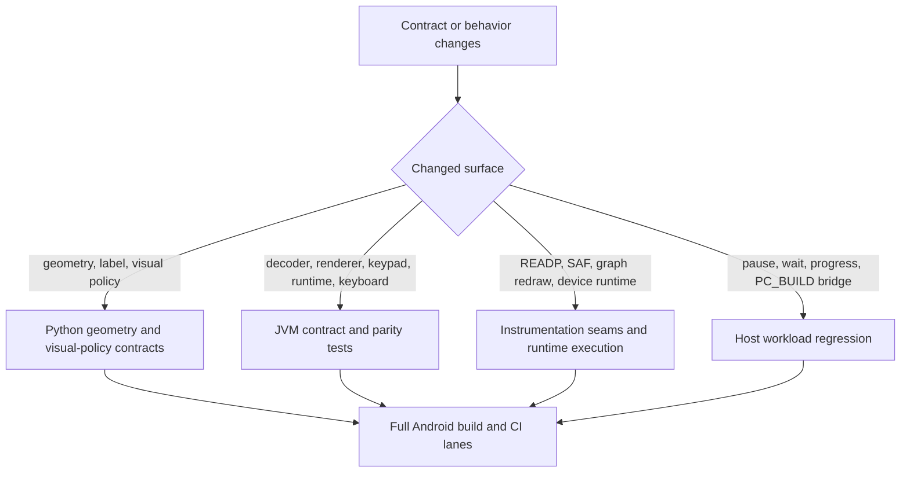

# Tests And Contracts

This page maps the maintainer verification surfaces, the contracts they lock,
and the smallest rerun lane that should move with each kind of change.

Read `01-build-and-source-layout.md` first. This page assumes the build,
ownership, and CI lane split are already clear.

Read this page when a task changes geometry, keypad snapshots, JNI seams,
storage flow, READP program loading, runtime cadence, or CI verification.

## Verification Flow



## Contract Inventory

| Contract surface | Source of truth | Focused verification surfaces | First rerun lane |
| --- | --- | --- | --- |
| shell geometry, top-right menu bounds, and LCD frame | `scripts/r47_contracts/derive_shell_geometry.py`, `R47Geometry.kt` | `scripts/r47_contracts/test_shell_geometry_contract.py`, `ReplicaOverlayGoldenTest.kt`, `MainShellThemeTest.kt` | grouped `scripts/r47_contracts` validation lane, then `:app:testDebugUnitTest --tests io.github.ppigazzini.r47zen.ReplicaOverlayGoldenTest --tests io.github.ppigazzini.r47zen.MainShellThemeTest` |
| key-label and visual policy constants | `scripts/r47_contracts/derive_key_label_geometry.py`, `scripts/r47_contracts/derive_key_visual_policy.py`, `scripts/r47_contracts/data/r47zen_ui_contract.json`, `KeyRenderSpec.kt`, `KeyRenderPainter.kt`, `CalculatorKeyView.kt`, `CalculatorSoftkeyPainter.kt` | `scripts/r47_contracts/test_key_label_geometry_contract.py`, `scripts/r47_contracts/test_key_visual_policy_contract.py`, `CalculatorKeyViewRenderSpecTest.kt`, `CalculatorSoftkeyPainterCanvasTest.kt` | grouped `scripts/r47_contracts` validation lane, then focused JVM render-spec tests when the Kotlin builder or shared painter stage moved |
| keypad font policy and C47 font coverage | `scripts/r47_contracts/data/r47_key_font_policy_contract.json`, `scripts/r47_contracts/derive_key_font_policy.py`, `ReplicaKeypadLayout.kt`, `CalculatorKeyView.kt`, `CalculatorSoftkeyPainter.kt`, `C47TypefacePolicy.kt` | `scripts/r47_contracts/test_key_font_policy_contract.py`, `CalculatorKeyViewFontSelectionTest.kt` | grouped `scripts/r47_contracts` validation lane, then `:app:testDebugUnitTest --tests io.github.ppigazzini.r47zen.CalculatorKeyViewFontSelectionTest` |
| top-label lane solve and alpha-case label export | `TopLabelLaneLayout.kt`, staged `assign.c` and `items.c`, `keypad_scene.c`, `ReplicaKeypadLayout.kt`, `CalculatorKeyView.kt` | `TopLabelLaneLayoutTest.kt`, `KeypadTopLabelLayoutTest.kt`, `scripts/r47_contracts/test_alpha_case_export_contract.py` | `cd android && ./gradlew :app:testDebugUnitTest --tests io.github.ppigazzini.r47zen.TopLabelLaneLayoutTest --tests io.github.ppigazzini.r47zen.KeypadTopLabelLayoutTest`, then the grouped contract scripts for the alpha-case export |
| `assign.c` layout tables, `items.c` display vocabulary, shared keyboard-layout JSON, and Android local override boundary | `scripts/r47_contracts/derive_keyboard_layout_contract.py`, `scripts/r47_contracts/data/r47_keyboard_layout_contract.json`, root `src/c47/assign.c`, root `src/c47/items.c`, and `keypad_scene.c` | `scripts/r47_contracts/test_keyboard_layout_contract.py`, `KeyboardLayoutContractRenderTest.kt` | grouped `scripts/r47_contracts` validation lane, then `:app:testDebugUnitTest --tests io.github.ppigazzini.r47zen.KeyboardLayoutContractRenderTest` when Android-local label export, render parity, or the shared contract payload moved |
| overlay geometry replay for unchanged keypad scenes | `MainActivity.kt`, `ReplicaOverlayController.kt`, `ReplicaOverlay.kt`, `ReplicaKeypadLayout.kt` | `MainKeySnapshotRenderTest.kt` | `cd android && ./gradlew :app:testDebugUnitTest` |
| keypad scene export manifest and decoder | `KeypadSnapshot`, exported keypad fixtures, `keypad_scene.c` | `KeypadFixtureContractTest.kt`, `KeypadSnapshotDecoderTest.kt` | `cd android && ./gradlew :app:testDebugUnitTest` |
| rendered keypad and softkey semantics | `ReplicaKeypadLayout.kt`, `CalculatorKeyView.kt`, `CalculatorSoftkeyPainter.kt`, `KeyRenderSpec.kt`, `ReplicaOverlayController.kt`, `KeypadLabelModes.kt`, `C47TypefacePolicy.kt` | `CalculatorKeyViewRenderSpecTest.kt`, `CalculatorKeyViewFontSelectionTest.kt`, `ExportedKeypadFixtureRenderTest.kt`, `CalculatorSoftkeyPainterContractTest.kt`, `CalculatorSoftkeyPainterCanvasTest.kt`, `ReplicaOverlayGoldenTest.kt`, `ReplicaOverlayControllerLabelModeTest.kt` | `cd android && ./gradlew :app:testDebugUnitTest` |
| physical keyboard mapping and first-key shell focus routing | `PhysicalKeyboardBindingTables.kt`, `PhysicalKeyboardMapper`, `PhysicalKeyboardInputController`, `ReplicaOverlay.kt` | `PhysicalKeyboardInputParityTest.kt`, `ReplicaOverlayVisualPolicyTest.kt` | `cd android && ./gradlew :app:testDebugUnitTest --tests io.github.ppigazzini.r47zen.PhysicalKeyboardInputParityTest --tests io.github.ppigazzini.r47zen.ReplicaOverlayVisualPolicyTest` |
| core thread, display loop, and runtime gate behavior | `NativeCoreRuntime.kt`, `NativeDisplayRefreshLoop.kt`, `NativeKeypadSnapshotStore.kt`, `jni_lifecycle.c`, `jni_display.c`, `android_runtime.c` | `NativeCoreRuntimeTest.kt`, `NativeDisplayRefreshLoopTest.kt`, `GraphRedrawInstrumentedTest.kt`, `run_workload_regressions.sh` | focused JVM tests first, then the host workload lane when the compatibility path moved |
| live program-stop key routing (which keys publish the out-of-band direct stop, which run states accept it, and whether a key is forwarded or swallowed) | `LiveProgramStopKeyPolicy.kt`, `LiveKeyRouter.kt`, `MainActivity.kt` `dispatchLiveKey`, `jni_input.c` `r47_direct_stop_allowed`, upstream `src/c47/programming/input.c` (`key == 36 || key == 33` while `*prevStop == PGM_RUNNING`) | `scripts/r47_contracts/test_live_stop_key_policy_contract.py` (cross-source lock of the Kotlin policy to upstream `input.c`), `LiveProgramStopKeyPolicyTest.kt` (literal-code key-set sweep), `LiveKeyRouterTest.kt` (forward when the gate declines, swallow only when it accepts, never query the gate for non-stop keys), `DisplayLifecycleInstrumentedTest.directStopGateDeclinesInteractiveWaitStates` (pure run-state gate predicate) and `requestStopProgramHonorsRunStateGateEndToEnd` (the real `requestStopProgramNative` exercised end to end across every run state via deterministic `setProgramRunStop` injection rather than an emergent 90 s SPIRALk busy-stop wait), `ProgramFixtureInstrumentedTest` (rejects a direct stop accepted while parked in an interactive wait) | `scripts/r47_contracts/run_contract_suite.sh` and `:app:testReleaseUnitTest --tests io.github.ppigazzini.r47zen.LiveProgramStopKeyPolicyTest --tests io.github.ppigazzini.r47zen.LiveKeyRouterTest`, then the connected lane when the native gate or bridge moved |
| developer performance HUD preference, configurable sample-window slider, snapshot transport, and shell visibility | `DeveloperPerformanceSnapshot.kt`, `NativeDisplayRefreshLoop.kt`, `MainActivityPreferenceController.kt`, `MainActivity.kt`, `ReplicaOverlay.kt`, `android/app/src/main/res/xml/root_preferences.xml`, `android/app/src/main/res/values/strings.xml` | `NativeDisplayRefreshLoopTest.kt`, `MainActivityPreferenceControllerTest.kt`, `SettingsPreferenceSummaryTest.kt`, `ReplicaOverlayGoldenTest.kt` | `cd android && ./gradlew :app:testDebugUnitTest --tests io.github.ppigazzini.r47zen.NativeDisplayRefreshLoopTest --tests io.github.ppigazzini.r47zen.MainActivityPreferenceControllerTest --tests io.github.ppigazzini.r47zen.SettingsPreferenceSummaryTest --tests io.github.ppigazzini.r47zen.ReplicaOverlayGoldenTest` |
| graph LCD touch gate (proven `CM_GRAPH` path with `-MNU_PLOT_FUNC` and `-MNU_GRAPHS`), multi-touch pointer continuity, post-start continuation deadband for stationary-finger jitter, bounded queued-pan backlog capping (`<= 4.0f` normalized backlog per axis), bounded per-apply pan splitting (`<= 1.0f` normalized per native apply), widened pinch queue clamp (`0.4f..2.5f`), native oversized-input rejection, transactional finite graph-bounds commit checks (`+/-1.0e38f`), restore-time graph-bounds sanitization after `restoreCalc()`, and LCD graph-touch settings copy | `ReplicaOverlay.kt`, `MainActivityPreferenceController.kt`, `MainActivity.kt`, `GraphGestureAccumulator.kt`, `android/app/src/main/cpp/r47zen/jni_input.c`, `android/app/src/main/cpp/r47zen/jni_lifecycle.c`, `android/app/src/main/cpp/r47zen/jni_program_load_test.c`, `android/app/src/main/res/values/strings.xml` | `GraphGestureAccumulatorTest.kt`, `ReplicaOverlayGoldenTest.kt`, `MainActivityPreferenceControllerTest.kt`, `SettingsPreferenceSummaryTest.kt`, `GraphTouchStressInstrumentedTest.kt` | `cd android && ./gradlew :app:testDebugUnitTest --tests io.github.ppigazzini.r47zen.GraphGestureAccumulatorTest --tests io.github.ppigazzini.r47zen.ReplicaOverlayGoldenTest --tests io.github.ppigazzini.r47zen.MainActivityPreferenceControllerTest --tests io.github.ppigazzini.r47zen.SettingsPreferenceSummaryTest && ./gradlew :app:assembleDebugAndroidTest :app:connectedDebugAndroidTest --tests io.github.ppigazzini.r47zen.GraphTouchStressInstrumentedTest` |
| stop delivery and first-stop LCD cleanup during long-running program execution | `MainActivity.kt`, `LiveProgramStopKeyPolicy.kt`, `ProgramLoadTestBridge.kt`, `jni_program_load_test.c`, `ReplicaOverlayController.kt`, `NativeDisplayRefreshLoop.kt`, `NativeKeypadSnapshotStore.kt`, `NativeCoreRuntime.kt`, `jni_display.c`, `jni_input.c`, `jni_lifecycle.c`, `android_runtime.c` | `LiveProgramStopKeyPolicyTest.kt`, `NativeDisplayRefreshLoopTest.kt`, `ReplicaOverlayControllerLabelModeTest.kt`, `ProgramFixtureInstrumentedTest.kt`, `DisplayLifecycleInstrumentedTest.kt`, `scripts/workload-regressions/run_workload_regressions.sh`, and focused JVM stop-routing checks | rerun `LiveProgramStopKeyPolicyTest` first, then the host workload lane, then `:app:assembleDebugAndroidTest` plus `:app:connectedDebugAndroidTest` when the Android-owned stop or first-stop refresh seam moved |
| settings lifecycle and activity recreation LCD preservation | `MainActivity.kt`, `NativeCoreRuntime.kt`, `jni_activity_bridge.c`, `jni_lifecycle.c`, `ProgramLoadTestBridge.kt` | `DisplayLifecycleInstrumentedTest.kt`, `scripts/android/run_16kb_runtime_smoke.sh`; on the JVM, `NativeCoreRuntimeTest.kt` (only the core thread releases the activity globals, a stopped host parks the loop, and a host that attaches during the thread's exit gets a fresh thread), `NativeFileRequestGateTest.kt`, and `FactoryResetControllerTest.kt` | `:app:testDebugUnitTest` first, then `:app:assembleDebugAndroidTest` plus `:app:connectedDebugAndroidTest`, or `bash ./scripts/android/run_16kb_runtime_smoke.sh` when 16 KB runtime proof matters |
| settings behavior copy, main-shell menu copy, follow-up copy-popup parity, developer performance HUD copy, fixed dark shell and popup theme invariants, the explicit checked settings-switch orange-track and blue-thumb tint mapping, adaptive settings host layout, and dependent keypress haptic default-toggle plus custom-duration copy | `SettingsActivity.kt`, `SettingsSwitchPreference.kt`, `MainActivity.kt`, `DisplayActionController.kt`, `android/app/src/main/cpp/r47zen/jni_clipboard.c`, `android/app/src/main/cpp/r47zen/android_helpers.c`, `android/app/src/main/res/layout/settings_activity.xml`, `android/app/src/main/res/layout-w600dp/settings_activity.xml`, `android/app/src/main/res/xml/root_preferences.xml`, `android/app/src/main/res/values/strings.xml`, `AndroidManifest.xml`, `android/app/src/main/res/values/themes.xml` | `DisplayActionControllerTest.kt`, `SettingsActivityThemeTest.kt`, `SettingsPreferenceSummaryTest.kt`, `SettingsLinkTest.kt`, `MainShellThemeTest.kt` | `cd android && ./gradlew :app:testDebugUnitTest --tests io.github.ppigazzini.r47zen.DisplayActionControllerTest --tests io.github.ppigazzini.r47zen.SettingsActivityThemeTest --tests io.github.ppigazzini.r47zen.SettingsPreferenceSummaryTest --tests io.github.ppigazzini.r47zen.SettingsLinkTest --tests io.github.ppigazzini.r47zen.MainShellThemeTest` |
| keypad haptic gate, Android-default toggle versus custom `0..100 ms` override, and press-only keypad cadence | `HapticFeedbackController.kt`, `ReplicaKeypadLayout.kt`, `MainActivity.kt`, `SettingsActivity.kt`, `android/app/src/main/res/xml/root_preferences.xml`, `android/app/src/main/res/values/strings.xml`, `AndroidManifest.xml` | `HapticFeedbackControllerTest.kt`, `ReplicaKeypadLayoutHapticsTest.kt`, `SettingsPreferenceSummaryTest.kt` | `cd android && ./gradlew :app:testDebugUnitTest --tests io.github.ppigazzini.r47zen.HapticFeedbackControllerTest --tests io.github.ppigazzini.r47zen.ReplicaKeypadLayoutHapticsTest --tests io.github.ppigazzini.r47zen.SettingsPreferenceSummaryTest` |
| beeper volume normalization and audio settings dispatch | `MainActivityPreferenceController.kt`, `android/app/src/main/res/xml/root_preferences.xml`, `MainActivity.kt` | `MainActivityPreferenceControllerTest.kt` | `cd android && ./gradlew :app:testDebugUnitTest --tests io.github.ppigazzini.r47zen.MainActivityPreferenceControllerTest` |
| LCD display theme normalization, inverse polarity, palette contrast, palette ownership, and the LCD raster | `LcdThemePolicy.kt`, `PackedLcdRaster.kt`, `MainActivityPreferenceController.kt`, `MainActivity.kt`, `android/app/src/main/res/xml/root_preferences.xml`, `android/app/src/main/res/values/arrays.xml`, `android/app/src/main/res/values/strings.xml` | `LcdThemePolicyTest.kt`, `PackedLcdRasterTest.kt`, `MainActivityPreferenceControllerTest.kt`, `SettingsPreferenceSummaryTest.kt`, `scripts/r47_contracts/test_lcd_palette_owner_contract.py` | `cd android && ./gradlew :app:testDebugUnitTest --tests io.github.ppigazzini.r47zen.LcdThemePolicyTest --tests io.github.ppigazzini.r47zen.PackedLcdRasterTest --tests io.github.ppigazzini.r47zen.MainActivityPreferenceControllerTest --tests io.github.ppigazzini.r47zen.SettingsPreferenceSummaryTest`, then the grouped `scripts/r47_contracts` lane |
| system-bar and cutout insets on every screen, fixed shell-menu copy, orange-blue touch-target placement, copy-popup shape, first-touch discovery-hint dismissal, and any retained discovery-hint surfaces | `MainActivity.kt`, `DisplayActionController.kt`, `WindowModeController.kt`, `SystemBarInsets.kt`, `ReplicaOverlay.kt`, `android/app/src/main/res/values/strings.xml`, `android/app/src/main/res/values/themes.xml` | `DisplayActionControllerTest.kt`, `MainShellThemeTest.kt`, `ReplicaOverlayVisualPolicyTest.kt`, `SystemBarInsetsTest.kt`, `WindowModeControllerTest.kt`, `SystemBarInsetsInstrumentedTest.kt` | `cd android && ./gradlew :app:testDebugUnitTest --tests io.github.ppigazzini.r47zen.DisplayActionControllerTest --tests io.github.ppigazzini.r47zen.MainShellThemeTest --tests io.github.ppigazzini.r47zen.ReplicaOverlayVisualPolicyTest --tests io.github.ppigazzini.r47zen.SystemBarInsetsTest --tests io.github.ppigazzini.r47zen.WindowModeControllerTest`, then the `SystemBarInsetsInstrumentedTest` connected selection |
| SAF picker, startup work-directory routing, detached-fd handoff, and work-directory tree persistence | `StorageAccessCoordinator.kt`, `SettingsActivity.kt`, `WorkDirectory.kt`, `jni_storage.c`, `hal/io.c` | `StorageAccessCoordinatorTest.kt`, `WorkDirectoryTest.kt`, `StorageAccessCoordinatorInstrumentedTest.kt` | JVM tests first, then `:app:assembleDebugAndroidTest` and instrumentation when the Android-only seam moved |
| program load and run through Android READP | `android/app/build.gradle` `stageProgramFixtureAssets` (androidTest assets only), `ProgramLoadTestBridge.kt`, `jni_program_load_test.c`, staged `PROGRAMS` fixtures | `ProgramFixtureInstrumentedTest.kt`, `FactorsInstrumentedTest.kt` | `:app:compileReleaseAndroidTestKotlin` first for harness edits, then the grouped `ProgramFixtureInstrumentation` connected selection through `scripts/android/run_connected_android_tests.sh` |
| pause, wait, and progress compatibility in `PC_BUILD` mode, plus per-fixture numeric program results | `android_runtime.c`, staged core, workload harness, imported `.p47` fixtures | `scripts/workload-regressions/run_workload_regressions.sh`, `host_workload_regression.c` (liveness for every fixture plus an X-register oracle: `NQueens.p47` seeded with `N = 8` must return the independently verified valid 8-queens solution) | the `host-workload-regressions` lane in `linux-ci.yml` (no emulator), then `./scripts/android/build_android.sh --run-sim-tests --collect-host-pgo --validate-release-pgo` when the collector-driven CI contract moved |
| Android HAL compatibility with upstream `PC_BUILD` helper exports | `android/app/src/main/cpp/r47zen/hal/io.c`, `android/app/src/main/cpp/r47zen/hal/lcd.c`, staged core headers under `src/c47/hal/` | `:app:buildCMakeRelWithDebInfo`, `:app:externalNativeBuildRelease`, and latest-upstream scratch reproduction after `upstream.sh sync --latest` plus `hydrate_submodules.sh` when the staged core moved. A signature change fails the build, but a changed *meaning* behind an unchanged signature does not: `scripts/android/run_keypad_generation_contract.sh` is the behavioral half for `hal/lcd.c`, and locks the `bitblt24` blit semantics documented in `src/c47/hal/lcd.h`; `scripts/android/run_hal_io_contract.sh` locks the write-failure report of `hal/io.c` | rerun the narrow native Gradle build first, then `run_keypad_generation_contract.sh` and `run_hal_io_contract.sh`, then the latest-upstream Android build lane when new upstream HAL symbols appear |
| upstream sync restore boundary | `scripts/upstream-sync/upstream.sh` | `scripts/upstream-sync/upstream.sh verify-restore-boundary` | `bash ./scripts/upstream-sync/upstream.sh verify-restore-boundary` |
| which upstream bytes the derived goldens came from | `scripts/r47_contracts/data/upstream_provenance.json`, `scripts/r47_contracts/upstream_provenance.py`, the `UPSTREAM_R47_*_PATH` constants in `scripts/r47_contracts/_repo_paths.py` | `scripts/r47_contracts/test_upstream_provenance_contract.py` | grouped `scripts/r47_contracts` validation lane; coverage fails there, drift only reports |

`Theme.R47` and `Theme.R47.PopupMenu` are intentional fixed-dark contracts.
If a future change makes the shell or popup menus follow the device light or
dark setting again, treat that as a regression and restore
`SettingsActivityThemeTest.kt` and `MainShellThemeTest.kt` before merging.

## Python Contract Suite

The canonical R47 contract suite lives under `scripts/r47_contracts/`.
The maintained entry point is
`bash ./scripts/r47_contracts/run_contract_suite.sh`.
That runner uses the repo-managed Python environment through
`uv run --group dev ...` so `ruff`, `ty`, and the `fontTools`-backed font
derivation scripts all use the same maintained dependency set.
The `python-contracts` job in `android-ci.yml` calls that runner, so the
keyboard-layout audit stays in the standard execution lane.
`pyproject.toml` owns the `ruff` rule set (`select = ["ALL"]` plus a short
documented `ignore`), and the runner passes no `--select`: a CLI selector
overrides the configured `select` and discards the configured `ignore` with it,
so an ignored rule would come back only in that lane. Keeping the selector in
one file also means a `ruff` bump lands the same new rules in the hook and the
suite at once.
If a one-off maintainer check needs an untracked package, prefer
`uv run --with <packages list> ...` instead of mutating `pyproject.toml`.
Only pin the dependency in `pyproject.toml` when the package becomes part of a
maintained repo lane such as a checked-in contract, repeatable local workflow,
or CI-owned verification surface.
It keeps two canonical checked-in source files:
`scripts/r47_contracts/data/r47_physical_geometry.json` for measured
physical-R47 geometry and
`scripts/r47_contracts/data/r47zen_ui_contract.json` for the implemented
Android logical canvas, chrome, key-surface, label layout, and solver policy.
The font pass adds a third checked-in contract document,
`scripts/r47_contracts/data/r47_key_font_policy_contract.json`, for the shipped
C47 font asset names, lane fallback policy, runtime cmap expectations, and the
live keypad-label coverage corpus that backs the standard-first keypad rule.
Each `font_fallback_policy` array is ordered by runtime preference, not
alphabetically.
The same JSON keeps `numeric` in `font_assets` and lane `font_coverage` as a
measured font alias for coverage evidence, but `numeric` is not part of the
runtime fallback arrays.
To check an external GIMP export, pass its JSON path to
`validate_geometry_dataset.py`; no GIMP dataset is tracked in this repository.

Two helper modules serve the suite and assert nothing themselves:
`scripts/r47_contracts/_kotlin_consts.py` reads `const val` expressions out of
the Kotlin sources the tests compare against, and
`scripts/r47_contracts/runtime_fonts.py` finds the font files the font and
visual-policy derivers read, hydrated `res/fonts` first, then the app's
assets.

The two hand-maintained inputs have a declared shape, and the loader is the
gate. `scripts/r47_contracts/_contract_data.py` owns a valgebra schema for each:
`PhysicalGeometry`, a closed `TypedDict` the geometry derivers read with static
types, and `ANDROID_UI_CONTRACT`, a closed dict literal the UI-contract readers
take apart with the `*_member` accessors. `load_physical_geometry` and
`load_android_ui_contract` validate the file as they read it, so a missing or
unknown key, a wrong type, a JSON `true` where a number belongs, or a malformed
`#AARRGGBB` colour fails once with its path as a `ContractDataError`, before any
deriver runs. `load_contract_document` stays schema-free for the validator CLI,
which accepts foreign dataset paths. The derived goldens are not shape-checked
on purpose: the whole-document re-derivation their tests perform is the
stronger claim. The geometry and UI-contract derivers and their tests read
through these loaders, so `run_contract_suite.sh` exercises the gate on every
run. The schema catches shape and nothing else: a value of the right type with
the wrong number is still the numeric contracts' job.

A checked-in contract JSON is verified at two layers so it is not a
self-blessing snapshot. A `*_payload_matches_contract_json` test is only a
**freshness** guard: it proves the committed JSON is a faithful re-derivation,
but on its own it is circular because re-running the deriver re-blesses any
change. Each such snapshot must therefore also have a **correctness** oracle --
tests that root in facts outside the snapshot (the real upstream `assign.c` /
`items.c` rows, the real font files on disk, documented keypad constants, or the
Kotlin constants) so a re-blessed wrong value fails even when the freshness
guard passes. `test_keyboard_layout_contract.py` (per-key value assertions) and
`test_key_font_policy_contract.py` (font files, fallback validity, and keypad
constants) follow this pairing; a new snapshot contract must add its correctness
oracle before it is trusted.

`run_contract_suite.sh` is the complete list of modules the grouped Python lane
runs. What each one locks:

- `validate_geometry_dataset.py`: structural and spacing checks for the
  physical dataset plus Android UI contract validation against `R47Geometry.kt`,
  `R47KeypadPolicy.kt`, and `CalculatorKeyView.kt`; this covers the
  native-only `chrome.lcd_windows.native` contract, the top-right
  `chrome.main_menu_button` rectangle, the native `400 x 240` aspect-ratio
  lock, integer width and height for native mode, and the rule that
  `chrome.lcd_windows` exposes only the native LCD window
- `derive_touch_grid.py`: shared touch-grid payload derivation from measured key
  centers
- `derive_shell_geometry.py`, `derive_key_label_geometry.py`, and
  `derive_key_visual_policy.py`: the payloads the three tests below compare
  with the Kotlin constants; each runs on its own first, so a deriver that
  raises fails the lane before its test does
- `test_shell_geometry_contract.py`: logical canvas, the visible main-menu
  button rectangle, the native LCD rectangle, the native LCD aspect-ratio and
  centered integer-bounds contract, and shell constants against
  `R47Geometry.kt`
- `test_key_label_geometry_contract.py`: key-label and key-surface constants,
  the shared render-spec vocabulary, the main-key left-anchored body-layout
  seam, the shared `KeyRenderPainter` stage, and softkey render-spec geometry
  fields, against `CalculatorKeyView.kt`, `CalculatorSoftkeyPainter.kt`,
  `KeyRenderSpec.kt`, `KeyRenderPainter.kt`, `R47KeypadPolicy.kt`, and
  `R47Geometry.kt`
- `test_key_visual_policy_contract.py`: visual-policy constants against
  `R47KeypadPolicy.kt`
- `derive_keyboard_layout_contract.py`: the four R47 variant tables from
  `assign.c`, representative `assign.c` rows, the current `items.c` display
  vocabulary for the audited slice, Android static and formatter assists, and
  representative exported keypad scenes, all derived from the live tree into the shared
  `scripts/r47_contracts/data/r47_keyboard_layout_contract.json` payload
- `derive_key_font_policy.py`: runtime font asset paths, Unicode cmaps,
  fallback-owner snippets, and lane-by-lane keypad label coverage against the
  exported keypad fixtures
- `test_key_font_policy_contract.py`: the checked-in keypad font-policy JSON
  against the live Python-derived payload and Kotlin owner snippets
- `test_alpha_case_export_contract.py`: staged core alpha-label export rules in
  `assign.c`, `items.c`, and `keypad_scene.c`, plus the Kotlin alpha-layout
  handling in `CalculatorKeyView.kt` and `ReplicaKeypadLayout.kt`
- `test_keyboard_layout_contract.py`: `assign.c` layout-truth rules, `items.c`
  shift and display vocabulary for the audited slice, representative generated
  `assign.c` semantics, the Android single-badge `HOME` or `MyM`, blank-G,
  visible-space `·_·` placeholder, and formatter assists, and drift between
  the live payload and the checked-in `r47_keyboard_layout_contract.json`
  document
- `derive_live_stop_key_policy.py` and `test_live_stop_key_policy_contract.py`:
  the live `R/S` and `EXIT` stop codes and their `PGM_RUNNING` guard, parsed
  from upstream `src/c47/programming/input.c`, against
  `LiveProgramStopKeyPolicy.kt`; a cross-source oracle, not a snapshot
- `test_lcd_packed_row_contract.py`: `LCD_ROW_SIZE_BYTES` in `hal/lcd.h`
  against the Kotlin `PACKED_ROW_SIZE_BYTES`, and the packed buffer size as row
  stride times pixel height
- `test_lcd_palette_owner_contract.py`: every LCD palette base colour is
  written once, in the `LcdTheme` entries of `LcdThemePolicy.kt`, in the one
  notation `"#RRGGBB".toColorInt()`, and no other `src/main` Kotlin file or
  resource copies one in any colour notation; it proves the scanner on seeded
  copies first. Black is exempt, and a copy of a resolved palette is out of
  its reach
- `test_keypad_snapshot_wire_contract.py`: key count, labels per key, scene
  contract version, label-slot order, total meta length, and every meta lane
  offset agree between `keypad_fixture_bridge.h`, `KeypadSnapshot.kt`, and the
  exported fixture manifest
- `test_jni_registration_contract.py`: the `RegisterNatives` table in
  `jni_registration.c` and `MainActivity`'s `external fun` set are equal, and
  each entry binds the implementation with the same name suffix; every
  `GetMethodID` in the glue names a `@Keep` `MainActivity` method with the same
  JNI signature, checked on a seeded drift first; the
  `R47_SHELL_*` codes in `jni_bridge.h` equal `NativeShellCodes.kt`, and
  `jni_input.c` resolves each to an `items.h` symbol, never a number
- `test_robolectric_sdk_owner_contract.py`: no JVM test `@Config` and no
  `robolectric.properties` sets `sdk`, `minSdk`, or `maxSdk`, so every
  Robolectric class runs at the targetSdk; it proves its scanner on seeded
  text first
- `test_upstream_provenance_contract.py`: the provenance ledger covers exactly
  the upstream inputs the contract modules declare (see below)

These Python tests are the first contract surface to inspect when a geometry or
label rule change begins in the checked-in calculators-specific payloads rather
than in Android runtime glue.

### Upstream Provenance Ledger

`scripts/r47_contracts/data/upstream_provenance.json` records which upstream
bytes the committed goldens were derived from: one entry per upstream input,
carrying its path and `sha256`. The derivers that read each input and the
goldens and test modules it feeds are the surface map in
`scripts/r47_contracts/upstream_provenance.py`, kept in code only.
`upstream_provenance.py` reads the ledger through a closed valgebra schema
(`Ledger`): a ledger with an unknown key, another schema version, or a
`sha256` that is neither 64 hex digits nor the empty string an unhydrated input
records is refused as a `ProvenanceError` rather than read leniently.

This exists because the freshness guard is circular. The goldens re-derive from
live inputs that arrive with no commit here, so re-running a deriver re-blesses
whatever the tree currently says, including a wrong change. The ledger is the
out-of-band record that makes `did upstream actually move this input?` a
question the tree can answer.

It keys on content, never on commit archaeology: `upstream.sh` fetches upstream
shallow, so the local object store holds a single upstream commit and
`git log -- <path>` cannot attribute a per-file change here. The recorded
`upstream_commit` is a watermark for the snapshot as a whole.

Two findings, gated differently on purpose:

- **coverage** - the suite reads an upstream input the ledger omits, or the
  ledger lists one nothing reads any more. A repo-side mistake, deterministic,
  and a hard failure through `test_upstream_provenance_contract.py`. The
  declared set is introspected from the `UPSTREAM_R47_*_PATH` constants in
  `scripts/r47_contracts/_repo_paths.py` and the font assets in
  `scripts/r47_contracts/derive_key_font_policy.py`, so a new upstream input
  cannot enter the suite without the ledger noticing.
- **drift** - a recorded input moved. Normal under a tracks-latest-HEAD policy,
  so it is reported and never fails a lane by itself. The report names the
  goldens and test modules the moved bytes put in question, from the surface
  map in `upstream_provenance.py`; the contract test holds that every module
  of the suite that names an input is listed against it, and that every input
  has a test module.

```bash
# report drift and coverage (exit 0); the contract suite runs this last
PYTHONPATH=scripts uv run --group dev python -m r47_contracts.upstream_provenance

# re-record in the commit that re-blesses a golden - a deliberate act
PYTHONPATH=scripts uv run --group dev python -m r47_contracts.upstream_provenance \
    --record --upstream-commit <sha>

# re-record a move that changed no golden; refuses otherwise
PYTHONPATH=scripts uv run --group dev python -m r47_contracts.upstream_provenance \
    --record-if-unaffected
```

Re-recording erases the evidence that something moved, so do it only after the
independent correctness tests pass and the drift is root-caused, and name the
upstream commit in the commit body. Regenerating without that is laundering.
`--record-if-unaffected` is the root cause for the common case, an upstream
edit that changed nothing a golden reads: it refuses when a golden a moved
input feeds differs from HEAD, so a golden re-blessed in the working tree
cannot pass as unaffected, and when a test module guarding a moved input
fails, and it prints each moved input with the goldens it found unchanged and
the tests it ran. Without it the same `moved` lines print on every run until a
real change arrives, and that change then looks like the others.
`--check-drift` exits non-zero on drift for deliberate maintainer use; do not
gate a lane on it.

## Android JVM Contract Suite

The focused JVM suite under `android/app/src/test/java/io/github/ppigazzini/r47zen/` is the
main parity surface for Kotlin-side decoder, renderer, lifecycle, and input
contracts.

Its Robolectric classes run at the SDK the app targets, and only there: no
class names an `sdk` in `@Config`, so Robolectric takes the targetSdkVersion of
the merged manifest, which `R47_DEFAULT_ANDROID_TARGET_SDK` sets.
`RobolectricSdkTest.kt` fails when the framework under test is any other level,
and `test_robolectric_sdk_owner_contract.py` fails on a class or a
`robolectric.properties` that pins one. From API 36 Robolectric's sandbox
needs `java.base/jdk.internal.access` exported, which `app/build.gradle` passes
to every unit-test JVM. A targetSdk newer than the pinned Robolectric supports
fails every Robolectric class, which is the signal to bump Robolectric with it.

Beside it, `scripts/android/run_detekt.sh` runs detekt's default rule set over
the main and test Kotlin sources. `android/app/detekt-baseline.xml` lists the
findings the code carried when detekt was adopted; a new finding fails, and so
does an entry no finding matches anymore. It is a static check, not a test: it
bounds function and class size, complexity, and magic numbers in new code, and
proves nothing about behaviour.

Each JVM test file and what it locks; `run_docs_lint.sh` fails when a test
source is missing from this page:

- `KeypadFixtureContractTest.kt`: asserts that the exported keypad-fixture
  manifest still matches `KeypadSnapshot` contract values such as scene version,
  metadata length, key count, and labels-per-key
- `KeypadSnapshotDecoderTest.kt`: asserts the fixed metadata-lane decode and
  label fallback behavior of `KeypadSnapshot.fromNative(...)`
- `KeypadSnapshotDecoderPropertyTest.kt`: a Kotest `checkAll` property test
  from a fixed seed that proves `KeypadSnapshot.fromNative(...)` stays total for
  an arbitrary, possibly malformed, `meta`/`labels` pair -- never throws, falls
  back to `EMPTY` on short `meta`, and never indexes out of bounds for any key
  code; a failure is shrunk to the smallest failing input before it is
  reported
- `MainKeySnapshotRenderTest.kt`: locks that an unchanged snapshot does not
  reset a rendered key, alpha-layout behavior, layout-class-sensitive keypad
  rendering, render-spec stability for rejected snapshots, and
  controller-owned same-snapshot replay after a scaling change and after PiP
  exit
- `KeypadSnapshotRefreshGateTest.kt`: the refresh gate skips an unchanged
  snapshot until it is reset, and lets every snapshot through when disabled
- `KeypadTopLabelLayoutTest.kt`: the keypad applies the placements the lane
  solver returns, keeps outer labels inside the overlay and a scaled label's
  glyph bottom on its siblings', and, with the shipped fonts, lays out every
  exported keypad scene centered and unscaled at three phone sizes
- `TopLabelLaneLayoutTest.kt`: the top-label lane solver's spacing,
  corridor, screen-edge, and scale rules, on the plain JVM, including which
  escalation step resolves a row and two Kotest sweeps over dense rows
- `CalculatorKeyViewFontSelectionTest.kt`: locks the Android-local
  standard-first policy so primary, top-label, and fourth-label text stay on
  the standard calculator font and only fall back to the tiny font when the
  standard face is unavailable; the Python font-policy contract keeps the
  shipped font data, lane fallback chains, and keypad corpus in sync with that
  JVM proof surface
- `C47TextRendererTest.kt`: locks the shared text-paint flags, fitted-text
  minimum scale, and the equivalence between the fitted-label path and a direct
  label-spec build at the resolved final size
- `KeyRenderSpecSlotTest.kt`: locks the typed Kotlin label-slot and adornment-
  slot accessors while preserving the stable serialized `id` strings consumed
  by the Python and JSON-backed contract surfaces
- `ExportedKeypadFixtureRenderTest.kt`: proves exported keypad fixtures apply to
  both main keys and softkeys in the live renderer path
- `KeyboardLayoutContractRenderTest.kt`: loads the shared
  `r47_keyboard_layout_contract.json` classpath resource, keeps representative
  exported keypad scenes aligned with that shared payload, and proves
  `CalculatorKeyView` still renders the contract-owned primary, shifted, and
  static single-label states for keys `11`, `12`, `35`, `36`, and `37`
- `CalculatorKeyViewRenderSpecTest.kt`: locks the spec-layer main-key body
  bounds, including the left-anchored percent-width body layout, primary
  anchor, top-label group bounds, fourth-label anchor, detached mirror-sync
  bounds, and accessibility text before pixels are drawn
- `CalculatorSoftkeyPainterContractTest.kt` and
  `CalculatorSoftkeyPainterCanvasTest.kt`: lock softkey content-description,
  overlay, preview, strike rendering rules, the grey-32 empty-slot versus
  grey-64 populated-slot fill split, including dotted-row and preview-target
  decorations on native empty slots, the lower-left to upper-right barred
  strike-out slash, the shared softkey text-paint antialias bit, and the
  spec-layer value-field and overlay geometry seam
- `SoftkeyOverlayPainterTest.kt`: locks the extracted overlay-painter stage for
  the menu-badge label and underline path without routing through the larger
  softkey renderer owner
- `PackedLcdRasterTest.kt`: locks the LCD raster pixel-for-pixel against
  expected pixels built from the coordinates each test lit, never from a second
  row decoder: a new raster paints every pixel the background for every theme,
  polarity, and luminance bound; a host's first frame decodes every row,
  flagged or not; a later frame decodes only its flagged rows; and a palette
  change, even to the same palette, repaints the held frame
- `ReplicaOverlayGoldenTest.kt`: keeps the native shell rendering stable. The
  LCD raster's composition into the frame is locked by a structural colour
  oracle (`nativeChrome_compositesLcdRasterColours`), and a fresh overlay
  decodes its first frame whole and invalidates the whole LCD
  (`packedLcd_firstFrame_isDecodedWhole_andInvalidatesTheWholeLcd`). Native-only
  chrome draws no shell, so outside the LCD window every pixel is the overlay's
  black background, which
  `nativeChrome_isTheBlackBackgroundOutsideTheLcdWindow` holds exactly. Where
  the LCD window sits and the coarse shape of the frame in it are locked by
  `lcdWindow_matchesTextGolden`, a **code-only** ASCII-luminance downsample of
  the render of a packed sample frame, held in `LCD_WINDOW_TEXT_GOLDEN`. Its
  ramp maps every luminance up to 28 to one blank, so it cannot tell black
  from a dark grey; the exact test can. A text golden is deliberate here: its
  `assertEquals` diff shows the visual change as a grid a reviewer can confirm,
  where a SHA hash only says "differs" and invites a blind re-bless, and it adds
  no binary reference image to the repository. It also
  locks the absence of full-width top-bezel interception, covers
  developer-performance HUD visibility when the setting is enabled, and verifies
  LCD graph-touch setting gating, accumulated-slop pan start, post-start jitter
  deadband, plus multi-touch pointer replacement continuity after
  primary-pointer release
- `MainShellThemeTest.kt`: locks the `WindowModeController` PiP request to the
  native LCD `400 x 240` aspect ratio, the fixed shell-menu copy, and the
  retained dark settings-discovery hint surfaces in light system mode
- `SystemBarInsetsTest.kt`: dispatches synthetic bar and cutout insets and
  locks the safe-area padding: added to the declared padding, replaced rather
  than accumulated on a second pass, dropped while disabled, consumed so no
  descendant pads again, and applied to the content root of `SettingsActivity`,
  `RepoNoticeIndexActivity`, and `NoticeAssetActivity`
- `WindowModeControllerTest.kt`: locks the PiP entry flag, and that the main
  screen pads by the safe area with fullscreen off, under light bar icons, and
  keeps the whole window with fullscreen on
- `ReplicaOverlayControllerLabelModeTest.kt`: locks main-key mode routing into
  the app-facing whole-snapshot export, the single-snapshot USER-mode
  contract that keeps printed main-key legends, the Virtuoso blank-keycap
  composition, and the Kotlin-side softkey `graphic` and `off` scene masks,
  including the requirement that those masks keep enabled blank capsules
  distinct from native empty-slot scenes, plus runtime non-null snapshot
  refresh normalization so selected softkey mode does not regress back to
  dynamic full labels
- `PhysicalKeyboardInputParityTest.kt`: locks printable, function-key,
  shortcut, and modifier-tap mapping behavior across the Android-owned mapping
  and shortcut tables, and that HOME and MYMENU pass their `NativeShellCodes`
- `ReplicaOverlayVisualPolicyTest.kt`: locks shell-owned keyboard focus,
  including `FOCUS_BLOCK_DESCENDANTS`, so the first DPAD event is routed to the
  calculator instead of Android focus search
- `NativeCoreRuntimeTest.kt`: locks single-init, queued-task,
  save-on-pause, and native-deadline waiting behavior on the core thread; that
  a save queued before dispose stops the loop runs in the shutdown drain; that
  every reattach, from the live or a restarted core thread, swaps the activity
  ref on the core thread, while the first attach leaves it to `initNative`;
  that a dispose releases the activity globals on the core thread and never
  from the calling thread, even past the join fence; that a host attaching
  while the core thread exits gets a fresh core thread; that a stopped host
  parks the loop, which still runs tasks but does not tick, until the host
  starts; and that an `Error` on the core thread stops the runtime as an
  exception does
- `NativeDisplayRefreshLoopTest.kt`: locks packed-display generation gating,
  unchanged-frame skip behavior, keypad-generation retry-after-busy-copy,
  cached-snapshot reuse, no-synthetic-empty refresh behavior, that a copy which
  changed no row is consumed without counting an LCD update, and the default
  `500 ms` plus configurable `100..1000 ms` developer-performance HUD window
  semantics on the UI observer loop
- `StorageAccessCoordinatorTest.kt` and `WorkDirectoryTest.kt`: lock the
  first-run welcome-dialog picker route, missing-directory recovery,
  work-directory tree persistence, detached-fd cancellation, and work-directory
  tree subfolder rules
- `NativeFileRequestGateTest.kt`: locks that a native file request ends in
  exactly one result or cancel: a dropped launch is cancelled on destroy, a
  launched picker with no answer is cancelled once when the app stops, an
  answered one is not, and an answer reaching a recreated Activity's gate still
  reaches native
- `SettingsLinkTest.kt`: locks that the two external links in Settings show a
  toast instead of crashing when no app can open them
- `SettingsActivityThemeTest.kt`: locks the settings-owned dark surface theme
  contract, the explicit checked switch tint mapping of orange track plus blue
  thumb, and the wide-window `layout-w600dp` host layout that centers the
  preferences inside a bounded Material panel
- `SettingsPreferenceSummaryTest.kt`: locks fixed settings copy, including the
  developer performance HUD summary and sample-window slider range, without
  depending on runtime on/off state, and holds the `lcd_luminance` range and
  the `lcd_luminance`, `lcd_theme`, and `lcd_negative` defaults in
  `root_preferences.xml` to the `MainActivityPreferenceController` constants
  (`lcdPreferences_declareTheControllerLimitsAndDefaults`)
- `HapticFeedbackControllerTest.kt` and `ReplicaKeypadLayoutHapticsTest.kt`:
  lock the `haptic_enabled` gate, the `haptic_use_android_default` toggle, the
  `haptic_keypress_duration_ms` `0..100` clamp, the Android-default versus
  custom override split, the press-only view-based
  `HapticFeedbackConstants.VIRTUAL_KEY` keypad cadence, the
  release-without-haptic path, the cancel-without-haptic path, and the
  predefined-vibrator or short one-shot override when the view path declines,
  when the user opts into a custom keypress-duration override, or when custom
  mode is set to `0 ms`; the haptics test also sends a real two-pointer
  sequence through the overlay and requires one key per touch, in either lift
  order
- `MainActivityPreferenceControllerTest.kt`: locks persisted `beeper_volume`
  normalization against the XML-declared `0..100` range, plus `lcd_theme`
  fallback to the supported display-theme set, legacy `lcd_mode` migration,
  `lcd_luminance` clamp to `MIN_LCD_LUMINANCE..MAX_LCD_LUMINANCE`,
  `lcd_negative` dispatch, `show_developer_performance_hud` dispatch, and
  deferred overlay apply and preference-change dispatch
- `GraphGestureAccumulatorTest.kt`: locks the Android-owned graph-touch queue
  accumulator so non-finite pan input is dropped, queued pinch scale stays
  clamped to `0.4f..2.5f`, and oversized queued pan is split into bounded
  per-apply chunks before JNI apply
- `GraphGestureFlusherTest.kt`: with a fake clock, main looper, and core queue,
  locks that deltas coalesce into one queued flush, that a flush applies one
  batch even when deltas arrive during it, that flushes keep the minimum
  interval, and that no motion is lost across flushes
- `GraphGestureAccumulatorPropertyTest.kt`: a Kotest `checkAll` property test
  from a fixed seed that proves the same clamp, split, drop, and bounded-drain
  invariants hold across a randomized finite and non-finite input space, not
  just the example endpoints, and shrinks a failure before reporting it
- `LcdThemePolicyTest.kt`: locks unknown theme fallback to the default display
  theme and keeps every shipped normal and inverse LCD palette above its
  declared contrast floor across the supported luminance range
- `CalculatorKeyViewCanvasTest.kt`: draws a measured main key and asserts each
  of the primary, f, g, and fourth label lanes paints its text in its own
  colour from the label state
- `GraphTouchVisualPolicyTest.kt`: locks `ReplicaOverlay.isSignificantPinch`,
  so a pinch drives the LCD zoom only when its scale factor is finite and
  differs from 1 by at least `PINCH_EPSILON`
- `NativeKeypadSnapshotStoreTest.kt`: locks the keypad snapshot cache: a copy
  on first sight, reuse while the generation holds, a recopy when it
  advances, the prior snapshot kept when a copy fails, and one cache per
  label mode
- `SlotSessionControllerTest.kt`: locks a slot switch as save, set, load, and
  persist, and that an out-of-range or current slot id is ignored
- `LibraryLicenseNoticesTest.kt`: reads the library-licence assets the build
  merged for the variant under test, so a variant whose
  `library-licenses/NOTICE-INDEX.json` is missing or empty fails on the JVM
- `KeyboardLayoutContractResources.kt`, `KeypadFixtureResources.kt`,
  `TestJsonResources.kt`, and `KeypadTestSnapshots.kt` are helpers, not
  tests: the first three load the keyboard-layout contract, the exported
  keypad fixtures, and the JSON test resources, and the last builds a keypad
  snapshot from a few key states

Use `cd android && ./gradlew :app:testDebugUnitTest` as the smallest grouped
lane when one of those Kotlin- or Robolectric-owned contracts changes.

## Android Instrumentation Contract Suite

The instrumentation suite under
`android/app/src/androidTest/java/io/github/ppigazzini/r47zen/` is the device or emulator
surface for Android-only runtime seams.

Each instrumentation source and what it covers:

- `ProgramLoadTestBridge.kt`: exposes the instrumentation-only native bridge for
  runtime readiness, async function execution, redraw flags, seeding helpers,
  direct-stop publication, and state snapshots, including a visible-LCD
  snapshot hash that ignores transport dirty flags, plus an extreme graph-touch
  stress hook used to prove oversized pan and pinch inputs are rejected without
  mutating graph bounds under repeated extremes, plus a restore-sanitization
  hook that injects invalid graph bounds and verifies the restore path repairs
  them before refresh
- `ProgramFixtureInstrumentedTest.kt`: stages canonical `PROGRAMS` fixtures and
  exposes one Android test method per required fixture so the hosted emulator
  lane can batch `BinetV4.p47`, `GudrmPL.p47`, `MANSLV2.p47`, `NQueens.p47`,
  and `SPIRALk.p47` inside the grouped `ProgramFixtureInstrumentation`
  selection while still reporting fixture-local progress through the
  instrumentation stream
- `scripts/android/run_connected_android_tests.sh`: owns the hosted emulator
  wrapper that runs each non-fixture instrumentation class in a selection of
  its own and the complete `ProgramFixtureInstrumentedTest` class under one
  bounded outer timeout, failing the lane if a selection hangs, runs no test,
  or reports a class other than the one it asked for
- `GraphTouchStressInstrumentedTest.kt`: launches `MainActivity`, waits for
  runtime readiness, runs extreme native graph-touch stress iterations through
  `ProgramLoadTestBridge.runExtremeGraphTouchStress(...)` to prove
  graph-bounds stability under repeated very large pan and pinch deltas, and
  separately verifies the restore path sanitizes injected invalid graph bounds
  before refresh
- The connected-device lane includes a required `MANSLV2.p47`
  bounded-stop regression inside that shared per-fixture wrapper: after
  observed post-load activity it requests a direct stop through
  `ProgramLoadTestBridge.requestStopProgram()`, which reuses the same upstream
  `fnStopProgram(0)` publisher as live `R/S` and `EXIT`. The Android fixture
  resets every staged run to the upstream `doFnReset(CONFIRMED, false)`
  baseline before load and skips blocked state snapshots rather than stalling
  the test thread behind `screenMutex`, including the terminal load-timeout
  path after a `READP` worker exceeds its budget. Blocking `snapshotState()` is
  only safe after the worker is idle; when the worker still owns
  `screenMutex`, the harness must fall back to `trySnapshotState()` and report
  failure without waiting on the mutex. The direct-stop publisher itself must
  also stay lock-free, because `MANSLV2` can still be running inside the
  asynchronous `R/S` worker while that worker owns `screenMutex`. That keeps
  the harness publishing the
  bounded stop request while the shared core is busy. That proves the required
  Android bounded-stop delivery path through the owned seam, and the hosted
  wrapper fails the lane if `MANSLV2` times out rather than downgrading it to
  degraded coverage. The grouped PROGRAMS harness waits for actual
  calculator `programRunStop` quiescence rather than the short-lived `R/S`
  key-dispatch worker and performs cleanup before the activity closes: it
  drains only genuinely-busy `PGM_RUNNING`/`PGM_PAUSED` fixtures through the
  out-of-band stop and lets the forceful `resetRuntime()` (`doFnReset`) clear
  any program parked in the interactive `PGM_WAITING`/`PGM_RESUMING` states,
  which prevents one hung fixture from leaking runtime state into the next CI
  case without spinning on a stop the parked program is entitled to decline. The remaining gap is narrower: there is still no
  focused device lane proving that a
  forced-busy keypad snapshot path stays responsive under every non-yielding
  shared-core loop.
- `DisplayLifecycleInstrumentedTest.kt`: locks the lifecycle LCD contract so a
  background save, a Settings-style pause or resume, and full
  `ActivityScenario.recreate()` preserve the visible packed LCD snapshot. The
  background save is **display-passive** (`saveCalc()` never touches
  `packedDisplayBuffer`), so `backgroundSavePreservesInjectedDisplaySnapshot`
  injects a non-trivial framebuffer via
  `ProgramLoadTestBridge.backgroundSaveKeepsInjectedDisplayBuffer` and asserts the
  save leaves it unchanged, with no program run.
  Pause/resume and recreation both **re-render `packedDisplayBuffer` from
  calculator state** against upstream HEAD, so a raw injected framebuffer
  survives neither and neither can be asserted that way. Instead
  `pauseResumePreservesSpiralkGraphSnapshot` and
  `activityRecreationPreservesSpiralkGraphSnapshot` both drive a real `SPIRALk`
  graph -- a cursor-free, byte-stable display whose re-render from the persisted
  graph state reproduces the same framebuffer. Its
  `directStopGateDeclinesInteractiveWaitStates` case is the
  runtime-regression guard: it probes the pure `r47_direct_stop_allowed`
  predicate (via `ProgramLoadTestBridge.directStopAllowedForRunState`) across
  every run state and asserts the out-of-band direct stop is **declined** for
  the interactive `PGM_WAITING`/`PGM_RESUMING` waits (so the live keypad cannot
  swallow `R/S`/`EXIT` mid-program) and accepted only for busy
  `PGM_RUNNING`/`PGM_PAUSED`. `requestStopProgramHonorsRunStateGateEndToEnd` then
  injects each run state via `setProgramRunStop` and asserts the real
  `requestStopProgram()` accepts the busy states and declines the rest end to
  end, tying the predicate to the real seam without a program run.
- `FactorsInstrumentedTest.kt`: asserts that the `FACTORS` runtime path runs to
  completion and leaves X in the expected result type
- `GraphRedrawInstrumentedTest.kt`: locks the redraw-gate contract behind
  `ProgramLoadTestBridge.forceRefresh()`, which runs `r47_force_refresh()`
- `StorageAccessCoordinatorInstrumentedTest.kt`: locks detached-fd handoff and
  cancellation behavior through the Android file-descriptor seam
- `SystemBarInsetsInstrumentedTest.kt`: with fullscreen off, requires the main
  calculator view and the Settings toolbar and list to lie inside the real
  system-bar and cutout insets, and requires a non-zero status-bar inset so the
  check cannot pass on a window without bars
- `scripts/android/run_16kb_runtime_smoke.sh`: asserts that a connected device
  or emulator reports `16384`-byte pages before it runs the focused activity
  recreation lifecycle probe on the live Android runtime
- `TestAssets.kt` is a helper: it reads the `PROGRAMS` fixtures through the
  instrumentation context, the test APK, which holds them; the app under test
  carries none

Use `cd android && ./gradlew :app:assembleDebugAndroidTest` first, then
`cd android && ./gradlew :app:connectedDebugAndroidTest` when the task touches
the Android-only runtime seam.

## Host Regression And Build Contracts

The repo also keeps non-device contract surfaces for the shared core and the
Android compatibility layer.

- `scripts/workload-regressions/run_workload_regressions.sh` builds the staged
  core plus Android bridge in `HOST_TOOL_BUILD` and `PC_BUILD`, then runs the
  canonical host workload set through the host compatibility path: the
  imported `.p47` fixtures `BinetV4.p47`, `GudrmPL.p47`, `MANSLV2.p47`,
  `NQueens.p47`, and `SPIRALk.p47`. Every imported fixture runs in its own
  host process under the same outer timeout-and-kill safety net, while
  `MANSLV2` remains the bounded direct-stop-after-activity probe inside that
  framework. It runs as the dedicated `host-workload-regressions` lane in
  `linux-ci.yml` on every pull request (no emulator), in addition to remaining
  the focused host compatibility rerun surface
- `host_workload_regression.c` reads the X register after each fixture and
  logs it (`INFO: <fixture> X register = <type>:<value>`), so a changed result
  is visible. `NQueens.p47` is a per-fixture numeric oracle: seeded with `N = 8`
  it runs a full 8-queens search to completion and its X-register result is
  asserted against the independently verified valid solution
  `-> 8., 4., 1., 3., 6., 2., 7., 5.`. A wrong result fails the lane (the harness
  exits non-zero, which `run_workload_regressions.sh` propagates; a timeout
  fails it too, unless a tolerate setting names that fixture, as the sanitized
  lane does for `SPIRALk`). `SPIRALk.p47` carries an X-register pin (final
  `X = 150`): the harness's own recorded result, checked equal across machines,
  not a value derived apart from the program. Its plot image stays unpinned
  because the number of points plotted before it finishes is not reproducible
  across machines. Only `MANSLV2` stays liveness-only, because its direct-stop
  interrupt leaves no completed state to assert; it fails if it finishes
  before any direct stop was requested, since the stop seam then went untested.
  The runner's fixture list and the harness's `kProgramFixtureScenarios` table
  must name the same fixtures, or the runner fails before it builds
- The two plotting fixtures (`BinetV4.p47`, `GudrmPL.p47`) leave an image
  rather than a scalar in X, so `expected_display_hash` pins each: an FNV-1a
  digest of the final LCD bitmap with the status bar's clock columns masked.
  These are regression pins, the harness's own recorded output, not
  independent oracles. `compute_display_hash` in
  `scripts/workload-regressions/host_workload_regression.c` owns the digest:
  its comment states the packing order, why it reads pixels through
  `lcd_buffer_pixel_on`, why the mask covers the clock and not the whole bar,
  and the two build-time guards that fail when an upstream constant stops
  packing into whole octets. The annunciators and the softkey rows stay in
  the digest, so a golden that moves when they move is the pin catching
  changed chrome.
- To root-cause a drifted plotting golden, dump the 400x240 buffer either side
  of the upstream change and diff it by row: `GudrmPL` paints all three
  softkey rows (`y 171..239`), so a diff confined to `y >= 171` is changed
  chrome, and any plot-area row that moves is a changed result.
- That host probe does not prove the Android stop-delivery or UI-thread ANR
  contract. It does prove that the shared compatibility path can start the five
  imported fixtures, compute the verified 8-queens result, and accept a bounded
  direct stop for `MANSLV2`, before Android-shell responsiveness enters the
  picture. The outer timeout keeps a hung workload from hanging the lane; in
  the correctness lane that timeout fails the run, and only the tolerate
  settings the sanitized and PGO lanes set turn it into degraded coverage.
- That host-only compatibility path does not widen the Android emulator
  `PROGRAMS` fixture matrix.
- `scripts/workload-regressions/run_workload_regressions_sanitized.sh` reruns
  the same corpus with the staged core and Android bridge built under
  AddressSanitizer and UndefinedBehaviorSanitizer, so the most-executed
  shared-core paths run against a memory and undefined-behavior adversary.
  AddressSanitizer is the hard gate: a use-after-free, overflow, or bad free
  fails the lane. UndefinedBehaviorSanitizer runs in recoverable report mode
  (the alignment check off, leak detection off) because the upstream-owned core
  trips portable-but-undefined constructs this repo cannot fix in `src/`; those
  surface for triage without failing. `SPIRALk` is pathologically slow under
  ASan, so it is bounded by the outer timeout and degraded to coverage while the
  other four fixtures must complete. It runs in the `host-workload-regressions`
  lane beside the plain run.
- `scripts/workload-regressions/build_graph_crash_harness.sh` builds
  `graph_crash_harness.c` with the same tree under AddressSanitizer and UndefinedBehaviorSanitizer and hammers the
  graph re-solve path the way a fast pan/zoom does. It exits 1 when the
  upstream solver leaks the RAM free-memory-region list:
  `numberOfFreeMemoryRegions` must stay within `R47_GRAPH_HARNESS_REGION_SLACK`
  (default 2) of its count after the first re-solve and below
  `MAX_FREE_REGIONS - 1`, so a slow leak fails long before it exhausts the
  table on a device. A negative slack forces the failure path, which is how to
  check the assertion still fires. `R47_GRAPH_HARNESS_ITERS` bounds the run;
  the `host-workload-regressions` job of `linux-ci.yml` runs 4000 re-solves.
- `scripts/workload-regressions/build_clipboard_overflow_harness.sh` builds
  `clipboard_overflow_harness.c` with the same tree under AddressSanitizer and drives the clipboard register dumps past
  their buffer caps in the same CI job. It is a memory-safety probe: AddressSanitizer
  aborts on an overrun, and nothing checks the dumped text itself.
- `scripts/android/run_keypad_generation_contract.sh` links `hal/lcd.c` alone on
  the host -- no emulator, no device -- and runs
  `scripts/android/keypad_generation_contract_test.c`. It asserts six
  `hal/lcd.c` contracts. First, `LCD_write_line` must bump
  `keypadSnapshotGeneration`, the signal the display loop uses to re-read dynamic
  softkeys such as the EQN editor. Second, `init_lcd_buffers` must leave the
  unused `screenData` compatibility framebuffer NULL, so no dead 384 KB stays
  resident. Third, `bitblt24` must implement the `fill` semantics of upstream
  `src/c47/hal/lcd.h`: with `BLT_NONE` only the pixels where `val` has a 1 are
  written, and with `BLT_SET` the dx columns are written white before `BLT_OR`
  and dark before `BLT_ANDN`. That third one is the reason the test exists in
  this shape.
  `bitblt24` keeps its signature across upstream revisions, so a divergence in
  what `fill` *means* compiles clean and shows up only as wrong pixels: upstream
  492298ff redefined it and rewrote `softmenus.c` `drawKeyFrame` to depend on the
  new reading, which turned the softkey frame into a silent no-op against the
  older Android implementation. Fourth, `lcd_buffer` must use the polarity of
  the upstream simulator HALs, which upstream 1560394c moved onto the DMCP one:
  a 1 bit is white, so `BLT_OR` draws dark by clearing bits, `lcd_clear_buf`
  leaves no pixel on, `lcd_buffer_pixel_on` reads a 0 bit as on, and
  `LCD_write_line` inverts each row into the packed snapshot, where a 1 bit
  stays dark for `ReplicaOverlay`. The same merge added the first core code that
  writes `lcd_buffer` bytes itself, the function-name box in `screen.c`, which
  drew inverted on the older polarity. Nothing drawn through `bitblt24` alone can
  show that: swapping the two ops and the reader cancels out, which is why the
  BinetV4 hash did not move when the HAL did. The polarity assertions count
  dark pixels over a whole row, so they stay valid independently of the column
  mirroring inside the Android `bitblt24`. Fifth, `LCD_write_line` flags a
  packed row and bumps `packedDisplayGeneration` only when the row's pixels
  changed, `init_lcd_buffers` flags every packed row, and
  `lcd_try_take_packed_snapshot` copies every row, clears every flag, and
  refuses while the core holds `packedDisplayMutex`; `PackedLcdRaster` decodes
  every flagged row without comparing, so a wrong flag either way reaches the
  screen. Sixth, a dark pixel drawn at `(x, y)` lands alone at pixel byte
  `49 - x / 8`, mask `0x80 >> x % 8`, of packed row `y`: the mirroring, pinned,
  and the rule `PackedLcdRaster` decodes by. It runs in the
  `host-workload-regressions` lane of `linux-ci.yml`.
- `scripts/android/run_hal_io_contract.sh` links `hal/io.c` alone on the host,
  with the host build flag that compiles out the SAF branch, and runs
  `scripts/android/hal_io_contract_test.c`. The autosave file is made a link to
  the device under test: a write `/dev/full` refuses is reported once per file,
  whether the flush or the writes themselves find it, and a regular file, a
  read, and `/dev/null`, whose `fsync` answers `EINVAL`, are not reported. It
  runs in the `host-workload-regressions` lane of `linux-ci.yml`.
- `scripts/workload-regressions/build_bridge_tsan_harness.sh` builds
  `bridge_tsan_harness.c` with the staged core and Android bridge under
  ThreadSanitizer and races the UI read path
  against the core, the one concurrency surface the single-threaded ASan/UBSan
  lanes never exercise. A startup phase runs the UI entry points -- the keypad
  copy through `r47_try_copy_app_keypad_snapshot` and the packed-display copy
  through `r47_try_take_packed_display`, the native half of
  `getPackedDisplayBuffer` -- while `r47_init_runtime` runs, which is what locks
  the init lock and the `r47_runtime_ready()` gate. A steady-state phase then
  has a producer thread drive `sendKey` plus `r47_force_refresh` while a
  consumer thread samples the generation counters, reads the keypad through
  `r47_get_keypad_meta`, and takes the packed display through
  `r47_try_take_packed_display`. A data race or
  lock-order inversion in the Android-owned bridge is the hard gate and aborts
  the run; `bridge_tsan_suppressions.txt` is the upstream-core-only escape hatch
  (it holds no active entry: the bridge's `screenMutex`/`packedDisplayMutex`
  fully serialize the core, so no upstream race surfaces), matching how the sanitized
  workload lane defers un-ownable upstream undefined behavior. The harness is
  what proves the `hal/lcd.c` display-change signals
  (`packedDisplayGeneration`, `keypadSnapshotGeneration`) are race-free under
  their lock-free read path; those are C11 relaxed atomics, not plain `volatile`,
  because plain `volatile` leaves the concurrent access a data race the harness
  flags. It runs in the `host-workload-regressions` lane beside the ASan/UBSan
  run (`setarch -R` disables ASLR so ThreadSanitizer can map its shadow);
  `R47_TSAN_HARNESS_ITERS` bounds the run.
  `scripts/android/run_bridge_tsan_lane_contract.sh` keeps that gate from being
  quietly disarmed: reading live lines only, it requires `halt_on_error=1` in
  the `TSAN_OPTS` assignment and the run to use it, and admits a suppression
  only when it names a staged upstream path
  (`android/.staged-native/cpp/{c47,decNumberICU,gmp,generated}/`), because
  TSan matches a pattern against function and file names alike and a
  `race:jni_display` entry would silence the bridge. It proves both checks fail
  on seeded fixtures first.
- `scripts/android/mutation_spot_check.sh` measures assertion strength on the
  hardened pure seams: it applies known compile-clean semantic mutations to
  `LiveProgramStopKeyPolicy.kt`, `LiveKeyRouter.kt`, `KeypadSnapshot.kt`,
  `LcdThemePolicy.kt`, `GraphGestureAccumulator.kt`, and `PackedLcdRaster.kt`
  and asserts each is killed by the matching JVM test
  (`LiveProgramStopKeyPolicyTest`, `LiveKeyRouterTest`,
  `KeypadSnapshotDecoderTest`, `LcdThemePolicyTest`,
  `GraphGestureAccumulatorTest`, `PackedLcdRasterTest`). A surviving mutant marks an assertion gap and
  fails the run. The `android-tests` job in `android-ci.yml` runs it on every
  event, so the push that weakens a seam test is the run that fails; run it
  locally after changing one of those seams or its tests. The mutant list is
  `MUT_FILES` in the script. The decoder and gesture seams also carry seeded
  Kotest property tests with independent oracles:
  `GraphGestureAccumulatorPropertyTest` requires in-range pinch factors to
  drain as their plain product, beside the clamp, split, and drop invariants,
  and `KeypadSnapshotDecoderPropertyTest` requires every key and label slot to
  decode the label at its wire position `(code - 1) * LABELS_PER_KEY + slot`.
  Three of the mutants are scored by these property tests, because the example
  tests let them survive.
- `scripts/android/run_test_integrity_contract.sh` runs, rather than reads, the
  scripts that decide whether a lane can pass having tested nothing. It
  sources `run_workload_regressions.sh` (its `main` guard builds nothing) and
  drives `run_host_workload_fixture` with a stub `timeout`: with every tolerate
  variable unset, as the correctness lane runs, an outer-timeout kill, a wrong
  result, and a bounded-stop failure must each fail, and each tolerate
  variable must widen only what it names. It runs `mutation_spot_check.sh`
  against a sandbox of seam copies and a fake `gradlew`
  (`R47_MUTATION_ANDROID_DIR`): every mutant must be compiled before it is
  scored, a surviving mutant, a zero-test class, missing results XML, and a
  non-compiling mutant must each fail the run, and the seam sources must come
  back unchanged. It also checks `count_androidtest_cases`, the connected
  lane's zero-test guard, against JUnit XML in AGP's shape (a `<testsuites>`
  wrapper and suite names with digits of their own), and runs
  `run_connected_android_tests.sh` against a sandbox with a fake `gradlew`
  (`R47_CONNECTED_ANDROID_DIR`) that, like `connectedReleaseAndroidTest`, runs
  only the first class of a comma-joined filter: every class must run in a
  selection of its own and report results for exactly that class, a later
  selection that runs nothing must fail even after earlier ones ran tests, a
  stale result file must never count, and each selection's results must
  survive for the artifact upload. Last, it holds the runner's class list to
  the androidTest tree: every file whose live code declares a `@Test` must be
  a selection, and every selection must be such a file, so a new
  instrumented class cannot sit on disk and never run.
- `scripts/workload-regressions/collect_host_pgo_profile.sh`, the PGO
  collector, trains on a different corpus from this harness on purpose
  (`--help` lists it), so the two are separate verification surfaces
- `scripts/workload-regressions/host_workload_regression.c` is the harness that
  probes the wait, pause, progress, and workload-run behavior behind that lane
- `./scripts/android/build_android.sh --run-sim-tests --collect-host-pgo --validate-release-pgo`
  is the normal pull-request owner of the Android wrapper testSuite rerun,
  the host-side PGO collector, and the Android release-native PGO consumer
  check in one lane. The lower-level collector script remains available for
  focused debugging.
- `scripts/upstream-sync/upstream.sh verify-restore-boundary` fails when the
  repo-owned restore allowlist would re-own authoritative upstream root
  surfaces, and also when a tracked root entry, a file or a directory, is
  missing from that allowlist (the overlay would then replace it, or a file in
  it, with upstream's copy); `sync` runs that same guard before it restores
  tracked paths, and the `restore-boundary` pre-commit hook runs it on every
  commit. It reads the index, so it sees what the commit adds
- `scripts/upstream-sync/test_resolver_policy.sh` runs `upstream.sh` against
  a throwaway local repository standing in for upstream: with no pin, `--auto`
  and `--latest` resolve the latest HEAD; a pin in `upstream.lock` is honoured
  by `--auto` and `--locked` and ignored by `--latest`; `--locked` with no pin
  fails; and `verify-source-policy` fails on a pin in `upstream.source`.
  `scripts/upstream-sync/test_fetch_retry.sh` drives `retry_with_backoff` in
  `scripts/lib/common.sh` with a command that fails a set number of times, so
  a transient fetch error retries instead of failing the lane. Both need no
  network and run in the `upstream-resolver-policy` job of `linux-ci.yml`
- `android-ci.yml` keeps its verification jobs distinct --
  `upstream-simulator-sanity`, `python-contracts`,
  `android-build-test-package`, `sign-dev-prerelease`, and `android-tests` --
  and `ci-required` needs all of them
- `.github/workflows/android-release.yml` reruns the same wrapper-owned
  host-core optimization flow as `android-build-test-package` and builds
  `:app:bundleRelease -Pr47.pgoProfilePath=...` unsigned; its emulator job runs
  lint, JVM tests, and instrumentation assembly, and `sign-production-release`
  signs the outputs before it publishes release evidence
- `scripts/android/run_production_signing_scope_contract.sh` and
  `scripts/android/run_signing_isolation_contract.sh`, in the
  `run_workflow_contracts.sh` host group, lock the release-credential
  isolation: each signing key and the Play upload identity is named by one job
  only, no file stores a key for that identity, and no job that names a
  credential syncs, builds, compiles, or emulates the upstream core, or
  restores an Actions cache. Each first
  proves it fails on seeded fixtures. The group runs as a `pre-commit` hook, in the `python-contracts`
  job of `android-ci.yml` (where `ci-required` depends on it), and in the
  `host-workload-regressions` job of
  `linux-ci.yml`. `scripts/android/sign_android_artifacts.sh` verifies its own
  outputs against the keystore certificate, and
  `scripts/android/run_published_artifacts_verifier_contract.sh` locks the
  downstream verifier

When a change touches staged-core compatibility, `yieldToAndroidWithMs(...)`,
or wait and progress behavior, start with the host workload harness before you
assume the problem is Android UI code.

## Host CI Contracts

`bash scripts/android/run_workflow_contracts.sh` runs the host CI contracts in
one pass; its `CONTRACTS` array is the complete list. They need no SDK, no
staged tree, and no device, and finish in seconds, so they run as a
`pre-commit` hook, in the `python-contracts` job of `android-ci.yml` (which
`ci-required` depends on), and in `host-workload-regressions` of
`linux-ci.yml`. The last column says whether a contract executes the thing it
guards or proves itself on seeded fixtures (it can fail), or only reads text
(a rewrite that keeps the matched tokens can fool it).

| contract | locks | can fail on its own |
|---|---|---|
| `run_ci_contract_lib_meta_test.sh` | the comment-safe helpers in `scripts/lib/ci_contract.sh` treat a commented directive as absent, and `strip_c_comments` blanks C, Kotlin, and Groovy comments while keeping the live code beside them | yes, fixtures |
| `run_ndk_resolution_contract.sh` | `resolve_android_ndk_version.sh`: a missing pinned NDK is fatal, never a silent fallback | yes, fake SDK trees |
| `run_release_abi_single_source_contract.sh` | no workflow hardcodes `--expected-abis`; they read `R47_DEFAULT_ANDROID_ABI_FILTERS` | text |
| `run_published_artifacts_verifier_contract.sh` | `verify_published_release_artifacts.sh` accepts a valid release and rejects tampered bytes, a wrong version, a leaked ABI, a wrong signing mode, an unsigned APK, signer mismatches, and a signed release checked with no pin or a malformed one, each on the check named for it; the tracked signer pin is 64 hex digits, the README states it, and the release workflow passes it | yes, synthetic evidence |
| `run_previous_release_contract.sh` | `resolve_previous_release.sh` counts from the newest published counter release and skips drafts, prereleases, date-scheme codes, and quoted lines | yes, synthetic releases list |
| `run_production_signing_scope_contract.sh` | each signing key is named only by its signing job, and the Play upload identity only by `upload-to-play`, with no stored service-account key | yes, fixtures |
| `run_signing_isolation_contract.sh` | no job that names a signing key or the Play upload identity, or holds a write-scoped token, builds or runs upstream code, uses an action off its allowlist (so none restores an Actions cache), or pastes a `${{ }}` expression into its run script; `setup-signing-tools` uses only `setup-android` | yes, fixtures |
| `run_release_provenance_contract.sh` | `publish-production-release` attests and verifies SLSA provenance for the APK, the AAB, and both packaging-evidence zips, with the permissions that needs; live lines only, so a commented-out step fails it | text |
| `run_privileged_remote_script_contract.sh` | no workflow or script pipes a network fetch into a shell | text |
| `run_llvm_toolchain_install_contract.sh` | every user of `llvm-config-<major>` installs `llvm-<major>`, which ships `llvm-profdata`; live lines only | text |
| `run_build_deps_single_source_contract.sh` | Linux build dependencies come only from `install_linux_build_deps.sh`; live lines only | text |
| `run_toolchain_pin_coherence_contract.sh` | the documentary Gradle and AGP pins in `r47-defaults.properties` match the wrapper and the version catalog, and the release-notes links on [09-official-references.md](09-official-references.md) name the same AGP line and Gradle version | text |
| `run_build_jdk_pin_coherence_contract.sh` | the Gradle toolchain, every `setup-java`, and the doctor read the build JDK pin: the pin is read into `buildJdkVersion` once and never reassigned, every `JavaLanguageVersion.of` takes it, and no `jvmToolchain` sets a second one; live code only | yes, seeded copies of the Gradle file and the doctor |
| `run_action_pin_consistency_contract.sh` | one SHA and tag per action, shfmt, shellcheck, actionlint, zizmor, ruff, and Python pinned alike in CI, pre-commit, `uv.lock`, and `pyproject.toml`, and no `-latest` runner label (see [07](07-ci-and-release-workflow.md#pins-that-live-in-more-than-one-file)) | yes, fixtures |
| `run_wrap_safe_time_contract.sh` | millisecond deadlines compare wrap-safely (it compiles `scripts/android/wrap_safe_time_contract_test.c` against `r47_time.h`), and every deadline site includes and calls the helpers, comments aside, with no raw comparison in either operand order | yes, compiles and runs a C test; the patterns prove themselves on seeded lines |
| `run_setup_android_packages_contract.sh` | every `setup-android` use passes explicit `packages:` without the legacy `tools` package | text |
| `run_setup_android_composite_contract.sh` | SDK setup lives only in the composite, its actions are SHA-pinned on live lines, each cache key covers every input its install step reads, the composite saves its cache itself with `actions/cache/save` (never `actions/cache`, which saves after the job's upstream steps), and each save names its restore's paths and key | yes, cache-key and save fixtures |
| `run_bridge_tsan_lane_contract.sh` | the TSan lane keeps `halt_on_error=1` and upstream-only suppressions (see above) | yes, fixtures |
| `run_lock_free_signal_atomicity_contract.sh` | the lock-free display and refresh signals are defined C11 atomics, never plain `volatile`, comments aside, and every use in the glue is an `atomic_*(&signal, ...)` call | yes, fixtures |
| `run_mini_gmp_accounting_contract.sh` | the shipped mini-gmp hands the GMP accounting hooks the size of every block it frees or reallocates, so the count returns to zero (`scripts/android/mini_gmp_accounting_contract_test.c`) | yes, compiles and runs a C test under AddressSanitizer and UBSan, after it fails on a copy whose free passes size 0 |
| `run_program_load_bridge_default_contract.sh` | the program-load test bridge defaults off and the release workflow never turns it on; the test host activity (`r47.includeInstrumentationHost`) defaults off and `build-production-release-bundle` never turns it on; live code only | text |
| `run_test_integrity_contract.sh` | the workload fixture-exit policy, the mutation spot-check, the connected lane's zero-test count, and that its selections are exactly the androidTest classes on disk (see above) | yes, runs them; the selection check on a seeded tree first |
| `run_privacy_policy_parity_contract.sh` | the markdown and shipped-HTML privacy policies share section headings and a last-updated date | text |
| `run_commit_message_contract.sh` | `scripts/docs/check_commit_message.sh` accepts and rejects seeded messages on both sides of each commit rule it holds, for a message file and for `--range` | yes, seeded messages and a scratch repository |
| `run_glue_sources_contract.sh` | `r47zen/glue_sources.txt` lists every glue `.c` but the program-load test bridge, each listed file exists, and no build file names three or more glue sources by hand | yes, a seeded hand list |
| `run_jni_surface_check_contract.sh` | `check_jni_surface.sh`, which `collect_packaging_evidence.sh` runs over every signed APK, fails a dex that lost a registered native, a native flag, a `GetMethodID` callback, a callback signature, or the `MainActivity` class name | yes, fixtures built from the C sources' names |
| `run_quiet_grep_pipeline_contract.sh` | no script, workflow, or composite action pipes a command into `grep -q`: grep exits at its first match, the command feeding it dies of SIGPIPE, and under `pipefail` the match reads as a miss, so the output is captured first and matched with `<<<` | yes, fixtures |

"Text" contracts are a floor: they catch the drift they name, and a later
edit that keeps the matched tokens can pass them. Prefer an executing check
when one of them guards something that matters.

## Which Lane To Run First

- geometry or label-policy change rooted in `scripts/r47_contracts/`: run the
  grouped contract-script lane first
- keypad-scene export, decoder, renderer, keyboard, or runtime-coordinator
  change in Kotlin: run `cd android && ./gradlew :app:testDebugUnitTest`
- SAF, `READP`, redraw-gate, direct-stop LCD cleanup, or other Android-only
  runtime seam change: run
  `:app:assembleDebugAndroidTest`, then `:app:connectedDebugAndroidTest`
- 16 KB runtime proof on a connected target: run
  `bash ./scripts/android/run_16kb_runtime_smoke.sh`
- sync allowlist or upstream overlay contract change: run
  `bash ./scripts/upstream-sync/upstream.sh verify-restore-boundary`
- pause, wait, progress, or `PC_BUILD` event-loop compatibility change: run
  `scripts/workload-regressions/run_workload_regressions.sh`
- host-core PGO collector or release-native consumer change: run
  `./scripts/android/build_android.sh --run-sim-tests --collect-host-pgo --validate-release-pgo`
- staged-native, simulator, or CI-critical verification change: run
  `./scripts/android/build_android.sh --run-sim-tests`
- release identity, signing, or packaging change: run
  `bash scripts/android/run_workflow_contracts.sh`, lint,
  `:app:testDebugUnitTest`, `:app:assembleDebugAndroidTest`,
  `./scripts/android/build_android.sh --run-sim-tests --collect-host-pgo --validate-release-pgo`, and
  `:app:bundleRelease -Pr47.pgoProfilePath=/abs/path/to/r47-host-core.profdata`,
  then collect packaging evidence when the release artifact contract moves

## Contract Change Rules

- Update the owning contract file and the owning verification surface in the
  same change.
- Keep generated or exported manifest values such as scene contract version,
  metadata length, and labels-per-key aligned across the producer and decoder.
- Treat `ProgramLoadTestBridge.kt` and `jni_program_load_test.c` as a paired
  instrumentation seam.
- When a geometry rule changes, update both the checked-in Python payload logic
  and the Kotlin owner or parity tests that consume it.
- Do not claim a contract change is safe until the smallest relevant local lane
  and the matching CI lane are both identified.
