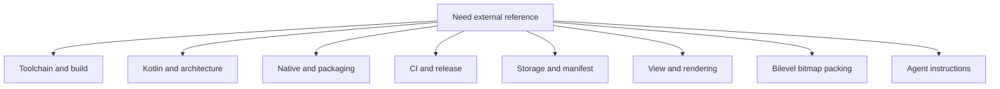

# Official References

This page groups the canonical external references that back the maintainer
docs and the checked-in Android workflow.

An entry states what its page said when it was last read. A page outside this
repo moves with no commit here, so read the page before relying on a claim:
`scripts/docs/check_external_links.sh` catches a dead link, not a changed
sentence. Where an entry says what this repo does, that part is this repo's
decision, not the vendor's.

## Reference Map

## Upstream project surfaces

- [C47 GitLab project](https://gitlab.com/rpncalculators/c43): the authoritative
  upstream source repository consumed by this Android overlay. The GitLab path
  keeps the older `c43` name; the project identifies itself as C47.
- [C47 lblGtoXeq.c run loop](https://gitlab.com/rpncalculators/c43/-/blob/master/src/c47/programming/lblGtoXeq.c):
  authoritative upstream run-loop source used when comparing Android stop-key
  behavior against the desktop simulator's `R/S` and `EXIT` parity during
  long-running program execution.
- [C47 keyboard.c desktop key dispatch](https://gitlab.com/rpncalculators/c43/-/blob/master/src/c47/keyboard.c):
  upstream `PC_BUILD` key-callback surface to inspect when desktop input seems
  to publish stop intent earlier than Android.
- [C47 addons.c key polling helpers](https://gitlab.com/rpncalculators/c43/-/blob/master/src/c47/c47Extensions/addons.c):
  authoritative `anyKeyWaiting()` and `exitKeyWaiting()` source used when a
  stop-path analysis depends on the desktop simulator's polled `EXIT` or `R/S`
  behavior; the two helpers do not poll the same keys, so read both.
- [C47 project wiki](https://gitlab.com/rpncalculators/c43/-/wikis/home):
  upstream's developer wiki, linked from the upstream README: installation, build
  setup, developer guidelines, CI setup, and releases. Its home page names itself
  the C43 wiki. It does not document calculator behavior; read the source for
  that.
- [C47 community wiki](https://gitlab.com/h2x/c47-wiki/-/wikis/home): community
  documentation hub that covers the broader C47 ecosystem, including R47
  variant context and user-facing project documentation.

## Toolchain references

- [Android Gradle plugin 9.5 release notes](https://developer.android.com/build/releases/agp-9-5-0-release-notes):
  official Android build release notes for the AGP line the `agp` entry of
  `android/gradle/libs.versions.toml` pins; one page covers every patch of a
  line, and `run_toolchain_pin_coherence_contract.sh` fails when this link
  names another line. Its compatibility table states a JDK *minimum* and
  default of `17` and no maximum, which is why this repo's build JDK is a
  measured pin in `android/r47-defaults.properties` rather than a copy of that
  number. The same table states a Gradle minimum of `9.6.0`, which the wrapper
  in `android/gradle/wrapper/gradle-wrapper.properties` must clear, a maximum
  supported API level of `37`, and a build-tools minimum and default of
  `36.0.0`. `android/app/build.gradle` sets no `buildToolsVersion`, so AGP
  builds with its own default from this table.
  `R47_DEFAULT_ANDROID_BUILD_TOOLS_VERSION` names the SDK package CI installs
  and the `apksigner`, `zipalign`, and `aapt2` the signing and packaging-evidence
  scripts run, not what AGP uses.
  `R47_DEFAULT_ANDROID_COMPILE_SDK_MINOR` makes the build compile
  against a minor platform, `android-<compileSdk>.<minor>`. AGP has no
  `targetSdkMinor`: a minor SDK version is a compile-time API surface only, so
  `targetSdk` stays a bare major and the shipped manifest does not move with
  it.
- [Java versions in Android builds](https://developer.android.com/build/jdks):
  official Android reference separating the JDK that runs Gradle from the Java
  toolchain, `sourceCompatibility`/`targetCompatibility`, and the Kotlin
  `jvmTarget`. It is the source for the recommendation this repo follows -
  always declare the toolchain rather than inheriting the JDK that launched
  Gradle - and for how far the app's language level reaches:
  `sourceCompatibility` does not affect Kotlin source, `targetCompatibility`
  sets the class-file format of Java and Kotlin output, a higher level may let
  Kotlin use a Java feature directly or force a higher `minSdk`, and no JVM
  runs on an Android device or emulator.
- [d8](https://developer.android.com/tools/d8): official reference for the tool
  AGP runs to compile class files into the dex a device runs, desugaring Java
  language features on the way; a minified release goes through R8 instead. The
  page names no range of class-file versions it accepts, so only a build at a new
  language level, debug and minified release both, proves the dexer takes it.
- [Gradle Java toolchains](https://docs.gradle.org/current/userguide/toolchains.html):
  official Gradle reference for toolchain declaration, auto-detection, and
  auto-provisioning. `android/settings.gradle` configures no toolchain download
  repository, so a host without the pinned JDK fails with "Cannot find a Java
  installation on your machine"; the page does not print that message.
- [Gradle compatibility matrix](https://docs.gradle.org/current/userguide/compatibility.html):
  official table of which Java versions can run Gradle and be used as
  toolchains per Gradle release; check it before moving the build JDK pin, and
  do not confuse "can run Gradle" with "AGP tests this".
- [Kotlin release process](https://kotlinlang.org/docs/releases.html):
  official JetBrains release page documenting the language, tooling, and bug-fix
  cadence.
- [Kotlin Gradle plugin compatibility](https://kotlinlang.org/docs/gradle-configure-project.html#apply-the-plugin):
  JetBrains' table of the minimum and maximum Gradle and AGP versions each KGP
  fully supports. Read it before an AGP, Gradle, or `kotlin` bump. Above a
  maximum the page warns of deprecation warnings and features that may not
  work, so a pin there rests only on this repo's own proof, which
  [the dependency cadence](01-build-and-source-layout.md#dependency-update-cadence)
  lists.
- [Gradle 9.9.0 release notes](https://docs.gradle.org/9.9.0/release-notes.html):
  official Gradle release notes for the wrapper version
  `gradle-wrapper.properties` pins; `run_toolchain_pin_coherence_contract.sh`
  fails when this link names another, and when the properties set a key the
  tracked `gradle-wrapper.jar` does not read. A Gradle bump runs the `wrapper`
  task twice, as [the Gradle Wrapper](https://docs.gradle.org/9.9.0/userguide/gradle_wrapper.html)
  says, so the jar is the new version's; the second run is the one that replaces
  the jar. Keep the repo's own `android/gradlew` launcher, which the task
  overwrites with Gradle's script.
- [Improve the Performance of Gradle Builds](https://docs.gradle.org/current/userguide/performance.html):
  official Gradle guidance for inspecting a build to set a baseline, creating
  builds for specific developer workflows, and enabling parallel execution, the
  daemon, the build cache, the configuration cache, and incremental custom
  tasks. It says a short-lived CI agent may not benefit from the daemon.
- [Command-Line Interface](https://docs.gradle.org/current/userguide/command_line_interface.html):
  official Gradle CLI reference for running multiple tasks in one invocation and
  setting `--max-workers`. Keeping a CI task graph in one invocation rather than
  splitting overlapping work across Gradle processes is this repo's decision;
  the page does not say it.
- [Configuration Cache](https://docs.gradle.org/current/userguide/configuration_cache.html):
  official Gradle guidance for reusing configuration work across repeated task
  graphs. `android/gradle.properties` enables it for every build in this repo. A
  fresh CI runner starts with no entries, so a hosted lane gains only when it
  repeats a task graph, as the connected-test wrapper does across its selections.
- [Build Environment Configuration](https://docs.gradle.org/current/userguide/build_environment.html):
  official reference for `gradle.properties`, command-line precedence, and the
  documented homes for settings such as `org.gradle.parallel`,
  `org.gradle.caching`, `org.gradle.workers.max`, and `org.gradle.jvmargs`.
- [Version catalogs](https://docs.gradle.org/current/userguide/version_catalogs.html):
  Gradle guidance for centralizing dependency coordinates in
  `gradle/libs.versions.toml` and consuming them through `libs` accessors.
- [Android 17](https://developer.android.com/about/versions/17): official
  platform overview for API `37`, the checked-in compile and target SDK level.
- [CMake release notes index](https://cmake.org/cmake/help/latest/release/index.html):
  official release-note index for tracking when it is worth leaving the current
  checked-in CMake line.
- [NDK downloads](https://developer.android.com/ndk/downloads): the current LTS
  release and its `ndkVersion` string; check it before moving
  `R47_DEFAULT_ANDROID_NDK_VERSION`. Per-release changes are on the
  [NDK wiki](https://github.com/android/ndk/wiki), and an LLVM update there
  changes the host runtime
  `scripts/workload-regressions/collect_host_pgo_profile.sh` needs. The
  [revision history](https://developer.android.com/ndk/downloads/revision_history)
  page can lag both. AGP's compatibility table names a default NDK and no
  minimum, and `ndkVersion` in `android/app/build.gradle` overrides that default.
- [ccache manual](https://ccache.dev/manual/latest.html): official compiler
  cache reference for the Linux and Windows simulator lanes and the
  `upstream-simulator-sanity` and `android-build-test-package` jobs of
  `.github/workflows/android-ci.yml`; use it when changing cache directories,
  compiler wrappers, or hit-rate expectations.

## Architecture and Kotlin

- [Guide to app architecture](https://developer.android.com/topic/architecture):
  separation of concerns, state ownership, lifecycle boundaries, and
  single-source-of-truth guidance.
- [Better performance through threading](https://developer.android.com/topic/performance/threads):
  main-thread budget, worker-thread ownership, and queue-based background-work
  guidance behind the deadline-driven core-thread design. The keypad refresh
  itself runs on the UI thread;
  [06-runtime-hot-paths.md](06-runtime-hot-paths.md#hot-path-change-rules) owns
  the rule that it never blocks behind `screenMutex`.
- [Choreographer.FrameCallback](https://developer.android.com/reference/android/view/Choreographer.FrameCallback):
  official frame-callback contract for `doFrame(...)`. The callback runs on the
  `Looper` thread attached to the `Choreographer` when a new display frame is
  being rendered. Use this when documenting UI-side cadence fields or other
  frame-sensitive polling loops such as `NativeDisplayRefreshLoop`.
- [ANRs](https://developer.android.com/topic/performance/issues/anr):
  official foreground input-dispatch timeout, main-thread lock-contention, and
  ANR trace guidance used when Android-specific hangs look like UI-thread
  stalls rather than pure core-thread starvation.
- [Fundamentals of testing Android apps](https://developer.android.com/training/testing/fundamentals):
  official Android guidance for local versus instrumented tests, test scope,
  and dependency decoupling; use this when deciding whether a repo contract
  belongs in Robolectric, instrumentation, or a host script.
- [Test your app's accessibility](https://developer.android.com/guide/topics/ui/accessibility/testing):
  official Android guidance for TalkBack, Switch Access, Accessibility
  Scanner, pre-launch accessibility reports, and other verification surfaces to
  use when a UI change claims accessibility improvement.
- [Get a result from an activity](https://developer.android.com/training/basics/intents/result):
  Activity Result API registration and lifecycle contract for SAF launchers.
- [ActivityResultCaller](https://developer.android.com/reference/androidx/activity/result/ActivityResultCaller):
  AndroidX API reference for `registerForActivityResult()` and unconditional
  registration rules.
- [Develop Android apps with Kotlin](https://developer.android.com/kotlin):
  Android-specific Kotlin guidance and tooling entry point.
- [Kotlin coding conventions](https://kotlinlang.org/docs/coding-conventions.html):
  official file naming, formatting, immutability, and test-naming guidance for
  Kotlin maintainability.
- [Kotlin language documentation](https://kotlinlang.org/docs/home.html):
  language-level reference.

## Launcher icon

- [AdaptiveIconDrawable reference](https://developer.android.com/reference/android/graphics/drawable/AdaptiveIconDrawable):
  authoritative Android runtime model for adaptive icon foreground/background
  layers and mask behavior.
- [Adaptive icons](https://developer.android.com/develop/ui/views/launch/icon_design_adaptive):
  layer sizes, the safe zone, and themed icons. The `AdaptiveIconDrawable`
  reference gives a 72 dp masked viewport; this page's 66 dp is the area no OEM
  mask clips, so keep critical content inside it. `ic_launcher.xml` has no
  monochrome layer: from Android 16 QPR 2 the system themes the icon automatically
  when the user enables themed icons and the launcher supports them; otherwise,
  and on earlier versions, the launcher shows the color icon. How automatic
  theming renders this opaque foreground is not measured.
- [Splash screen guidance](https://developer.android.com/develop/ui/views/launch/splash-screen):
  launcher icon interaction with splash-screen surfaces on modern Android.
- [Google Play icon design specifications](https://developer.android.com/distribute/google-play/resources/icon-design-specifications):
  Play listing icon requirements (512x512 PNG) which are separate from runtime
  launcher resources.

Current repository icon surfaces:

- Drawing source:
  `android/app/icon-source/r47zen.svg`, which the APK does not carry. Nothing
  generates the runtime vectors from it, so a change must reach each by hand, and
  `scripts/r47_contracts/test_launcher_icon_contract.py` fails until it does:
  the full icons draw the SVG's paths in its colors, the adaptive foreground
  draws them but the background, and `ic_launcher_background` in
  `android/app/src/main/res/values/colors.xml` is the SVG's background.
- Adaptive icon XML:
  `android/app/src/main/res/mipmap-anydpi-v26/ic_launcher.xml` and
  `android/app/src/main/res/mipmap-anydpi-v26/ic_launcher_round.xml`
- Runtime vectors and fallbacks:
  `android/app/src/main/res/drawable/ic_launcher_foreground.xml`,
  `android/app/src/main/res/drawable/ic_launcher_foreground_inset.xml` (the
  adaptive foreground the `mipmap-anydpi-v26` icons use),
  `android/app/src/main/res/mipmap/ic_launcher.xml`, and
  `android/app/src/main/res/mipmap/ic_launcher_round.xml`

## Native and build integration

- [Configure the app module](https://developer.android.com/build/configure-app-module):
  application ID and namespace, and how the two differ.
- [Configure build variants](https://developer.android.com/build/build-variants):
  build types and `applicationIdSuffix`, which the debug and dev channels use.
- [Add C and C++ code to your project](https://developer.android.com/studio/projects/add-native-code):
  the official Gradle plus CMake integration path.
- [Android ABIs](https://developer.android.com/ndk/guides/abis): ABI baselines,
  `abiFilters`, and the generic `arm64-v8a` contract this repo keeps for the
  shipped default artifact.
- [Android CPU features](https://developer.android.com/ndk/guides/cpu-features):
  native feature-probing guidance to use only if the repo ever adds same-ABI
  runtime dispatch.
- [Profile-guided Optimization](https://developer.android.com/ndk/guides/pgo):
  official NDK guidance for PGO on an app or library: start with representative
  workloads, build with `-fprofile-generate`, run the instrumented app on a
  device and make its process write raw profiles explicitly, merge them with the
  same NDK `llvm-profdata`, and then rebuild with `-fprofile-use`. It covers
  device collection only and is silent on host training and ThinLTO; both are
  this repo's decisions. The doc also notes that library profiles are generally
  reusable across architectures unless the library has architecture-specific
  code paths. In this repo, the maintained host-core training surface is the
  broad `broad-ci` `testSuite` base plus the imported `.p47` overlay merged
  into one host profile; keep that separate from the host compatibility rerun
  and Android test lanes. If Android app-process profile collection is ever
  added, treat it as a separate experiment rather than as a replacement for
  host-core training or app benchmarking.
- [Benchmark your app (Views)](https://developer.android.com/topic/performance/views/benchmarking/benchmarking-overview-views):
  official Android benchmark map for a View-based app. Use Macrobenchmark for
  out-of-process end-user flows such as startup, scrolling, and animations, and
  use Microbenchmark only for isolated hot functions or UI subroutines after a
  profiler has already identified the bottleneck. The general
  [Benchmark your app](https://developer.android.com/topic/performance/benchmarking/benchmarking-overview)
  page covers Macrobenchmark alone.
- [Write a Macrobenchmark](https://developer.android.com/topic/performance/benchmarking/macrobenchmark-overview):
  official Android app benchmarking guidance. Benchmark a release-like,
  `profileable`, non-debuggable app from a separate `com.android.test` module,
  collect the JSON and trace outputs, treat emulator numbers as
  non-representative, and treat those artifacts as a distinct app-performance
  surface, not as a substitute for shared-core PGO corpus selection. This repo
  has no such module: `android/settings.gradle` includes only `:app`.
- [System tracing overview](https://developer.android.com/topic/performance/tracing):
  official Perfetto and system tracing overview. Use tracing for root-cause
  analysis once a benchmark or workload points at a regression; it complements
  native-core PGO and Android benchmarking rather than replacing either one.
- [Inspect rendering speed](https://developer.android.com/topic/performance/rendering/inspect-gpu-rendering):
  official developer-option guidance for mapping on-screen frame bars to the
  rendering pipeline. Use it as a fast local visualizer for
  input, layout, draw, upload, and GPU-wait pressure before deeper tracing. The
  page says the tool "doesn't work with apps that use the NDK" because OpenGL
  takes a full-screen context; this app links the NDK but draws through Views
  with no OpenGL surface, so that cause does not apply. Inferred from the source,
  not measured.
- [Configure the NDK for the Android Gradle plugin](https://developer.android.com/studio/projects/configure-agp-ndk):
  `ndkVersion` guidance for AGP-based projects, including the command-line
  `sdkmanager` package syntax this repo uses in CI.
- [JNI tips](https://developer.android.com/ndk/guides/jni-tips): explicit
  registration, thread attachment, reference management, exception rules, and
  the guidance to minimize marshaling and prefer region-style copy calls when
  a simple copy contract is enough. `getPackedDisplayBuffer` in
  `android/app/src/main/cpp/r47zen/jni_display.c` copies under a critical section
  instead, and its comment states what that section allows. The page also says
  to build "with a version script (preferred) or use -fvisibility=hidden" so only
  `JNI_OnLoad` is exported. `android/app/src/main/cpp/CMakeLists.txt` does
  neither, so the library exports the whole core, at the cost the page names:
  larger and slower code and possible symbol collisions. That is a gap.
- [Memory error debugging and mitigation](https://developer.android.com/ndk/guides/memory-debug):
  Android's map of PAC/BTI, GWP-ASan, HWASan, MTE, and ASan.
  `android/app/src/main/cpp/CMakeLists.txt` adds PAC/BTI on `arm64-v8a`, and
  `scripts/security/check_native_hardening.sh` verifies it on the library. A
  shipped build sets no `android:gwpAsanMode`, so
  [GWP-ASan](https://developer.android.com/ndk/guides/gwp-asan) is the platform
  default there: recoverable on Android 14 and higher, off below. The debug build
  and every instrumented run set it to `always`, which crashes on what it finds,
  through `src/instrumentationHost/AndroidManifest.xml`, and
  `collect_packaging_evidence.sh` fails an APK that ships with it. No lane runs HWASan,
  which the page recommends for testing; the sanitizer surface is the host
  harnesses under `scripts/workload-regressions/`, which do not exercise the
  Android build.
- [simpleperf](https://developer.android.com/ndk/guides/simpleperf): official
  native profiler for symbol, DSO, thread, and call-graph attribution before
  hot-path micro-optimization. Current guidance is to identify the hottest
  DSOs, functions, and threads first, then inspect call graphs before changing
  code. Use it after a physical-device benchmark or canonical workload timing
  run points at a regression; the in-app developer HUD is only a quick local
  smoke signal.
- [Custom trace events in native code](https://developer.android.com/topic/performance/tracing/custom-events-native):
  official ATrace or Perfetto guidance for Android-owned native spans and
  thread naming.
- [Clang Users Manual](https://clang.llvm.org/docs/UsersManual.html): official
  Clang optimization, profile-generation, and profile-use reference behind NDK
  PGO flag interpretation. It distinguishes sampling from instrumentation
  profiles, recommends representative workloads, and treats IR-based
  instrumentation as the preferred optimization profile format.
- [How To Build Clang and LLVM with PGO](https://llvm.org/docs/HowToBuildWithPGO.html):
  LLVM's guide to building Clang itself with PGO; it sends other software to the
  Clang Users Manual above, which owns the flags this repo uses. Read it only for
  its benchmark section: "PGO does best when the profiles gathered represent how
  the user plans to use the compiler."
- [llvm-profdata](https://llvm.org/docs/CommandGuide/llvm-profdata.html):
  official merge and inspection tool for indexed profile data. `merge` raw
  profiles before `-fprofile-use`, and `show` or `overlap` when diagnosing
  profile quality. The version rule is the NDK PGO page's, not this page's: use
  "the llvm-profdata and clang from the same NDK release".
- [target_compile_options](https://cmake.org/cmake/help/latest/command/target_compile_options.html):
  target-scoped compile-flag ownership, including config-specific generator
  expressions.
- [target_link_options](https://cmake.org/cmake/help/latest/command/target_link_options.html):
  target-scoped link-flag ownership for the Android ThinLTO plus `lld` path.
- [Support 16 KB page sizes](https://developer.android.com/guide/practices/page-sizes):
  packaging, ELF and RELRO alignment, and testing guidance for native apps, plus
  the Google Play rule for apps targeting API 35 and higher: "Starting February
  1, 2027, if your app updates don't support 16 KB memory page sizes, you won't
  be able to release these updates."
  [04-native-core-and-jni.md](04-native-core-and-jni.md#16-kb-and-packaging-contract)
  owns what this repo checks and what it does not.

## CI and release plumbing

- [Build your app for release to users](https://developer.android.com/build/build-for-release):
  APK, AAB, and signing guidance for the release lane defined by this repo.
- [Use Play App Signing](https://support.google.com/googleplay/android-developer/answer/9842756):
  official Google Play guidance for upload keys, app-signing-key custody,
  bundle-first release flow, and upload-key reset behavior.
- [Enable app optimization with R8](https://developer.android.com/topic/performance/app-optimization/enable-app-optimization):
  Android guidance to enable optimization for release builds. For AGP 9.3 and
  higher the page gives the `optimization { enable = true }` block with keep
  rules under `src/<variant>/keepRules`, and it labels `minifyEnabled` and
  `shrinkResources` the legacy DSL, which it says is still supported.
  `android/app/build.gradle` uses the legacy DSL; the block has not been tried
  here.
- [Building and testing Java with Gradle](https://docs.github.com/en/actions/tutorials/build-and-test-code/java-with-gradle):
  GitHub Actions guidance for Gradle cache setup, Java toolchain setup, and
  Gradle-oriented workflow structure.
- [setup-gradle cache providers](https://github.com/gradle/actions/blob/main/docs/setup-gradle.md#selecting-a-cache-provider):
  the `enhanced`, `basic`, and `external` providers, the files the `basic` key
  hashes, and how `external` hands Gradle User Home to another cache; read it
  before changing the Gradle cache steps in the Android workflows.
- [Dependency caching reference](https://docs.github.com/en/actions/reference/workflows-and-actions/dependency-caching):
  GitHub's rules for cache keys, immutable entries, branch scope, and eviction,
  which the Gradle and SDK caches in the Android workflows rely on, plus the
  triggers that may write the default branch's scope and the `cache-mode` key. No
  workflow here sets `cache-mode`:
  `scripts/android/run_signing_isolation_contract.sh` holds a credential job to no
  cache by reading the workflow text, and that contract is this repo's only limit.
- [Secure use reference](https://docs.github.com/en/actions/reference/security/secure-use):
  GitHub Actions guidance for least-privilege `GITHUB_TOKEN` policy, action
  pinning, trusted-code boundaries, and secret-exposure minimization in
  workflow design. The page ranks a workflow dependency lockfile first and
  offers the full-length commit SHA to repositories without one. This repo
  pins by SHA and has no lockfile.
- [Keeping the actions in your workflows secure and up to date](https://docs.github.com/en/actions/reference/security/secure-use#keeping-the-actions-in-your-workflows-secure-and-up-to-date):
  GitHub guidance for reviewing and refreshing SHA-pinned actions; same-line
  version comments are part of the supported Dependabot update surface when the
  pinned commit maps to a tagged release. The page's `Monitoring the actions in
  your workflows` section states that Dependabot creates no alert for an action
  pinned to a SHA, so for this repo's actions the
  weekly version update in `.github/dependabot.yml` is the notice, and a
  vulnerable pinned action raises no alert.
- [Workflow dependency lockfiles](https://docs.github.com/en/actions/concepts/security/workflow-dependency-lockfiles)
  and [Locking action dependencies in a repository's workflows](https://docs.github.com/en/actions/how-tos/secure-your-work/lock-workflow-dependencies):
  the `actions.lock` file `gh actions-lock` writes beside the workflows, one
  commit and one numeric repository identity for each action, transitive ones
  included, reusable workflow calls excluded. Onboarding a workflow also
  satisfies the SHA-pinning policy. This repo has no lockfile, so a transitive
  action runs whatever commit the reference in its parent action resolves to at
  run time.
- [Using secrets in GitHub Actions](https://docs.github.com/en/actions/how-tos/write-workflows/choose-what-workflows-do/use-secrets):
  GitHub guidance for repository and environment secrets, shell-safe secret
  handling, and the Base64 binary-blob pattern used for small upload keystores.
- [Deployments and environments](https://docs.github.com/en/actions/reference/workflows-and-actions/deployments-and-environments):
  environment protection rules, required reviewers, deployment branch
  restrictions, and environment-secret gating for the protected release lane.
- [Events that trigger workflows](https://docs.github.com/en/actions/reference/workflows-and-actions/events-that-trigger-workflows#schedule):
  schedule-trigger semantics, default-branch-only execution, UTC defaults, delay
  or drop behavior, and the automatic disabling of a scheduled workflow in a
  public repository after 60 days without repository activity, relevant to the
  daily signed dev-prerelease lane: upstream moves with no commit here, so a
  quiet repository can stop the lanes that track it. The page does not define
  repository activity.
- [Manually running a workflow](https://docs.github.com/en/actions/how-tos/manage-workflow-runs/manually-run-a-workflow):
  the maintainer entry point for versioned protected releases outside the
  scheduled dev-prerelease lane.
- [Passing information between jobs](https://docs.github.com/en/actions/how-tos/write-workflows/choose-what-workflows-do/pass-job-outputs):
  GitHub Actions guidance for promoting step outputs through
  `jobs.<job_id>.outputs` and consuming them in dependent jobs through
  `needs.<job_id>.outputs.*`.
- [Control workflow concurrency](https://docs.github.com/en/actions/how-tos/write-workflows/choose-when-workflows-run/control-workflow-concurrency):
  workflow-level concurrency controls used to cancel superseded runs for the
  same pull request or ref.
- [Store and share data with workflow artifacts](https://docs.github.com/en/actions/tutorials/store-and-share-data):
  artifact upload and download behavior for GitHub Actions.
- [Using artifact attestations to establish provenance for builds](https://docs.github.com/en/actions/how-tos/secure-your-work/use-artifact-attestations/use-artifact-attestations):
  the permissions and `gh attestation verify` that `publish-production-release`
  and `upload-to-play` use. `android-release.yml` calls `actions/attest`, as
  the page's examples do, twice: with no predicate it makes SLSA build
  provenance, and with `sbom-path` an SBOM attestation, whose SPDX 2.3
  predicate type `gh attestation verify --predicate-type` names.
  `actions/attest-build-provenance` is a wrapper over it whose README sends new
  workflows to `actions/attest`.
- [Configuring OpenID Connect in Google Cloud Platform](https://docs.github.com/en/actions/how-tos/secure-your-work/security-harden-deployments/oidc-in-google-cloud-platform)
  and [OpenID Connect reference](https://docs.github.com/en/actions/reference/security/oidc):
  the `id-token: write` exchange in `upload-to-play`, the token claims, and the
  immutable default `sub` format of a repository as new as this one.
- [Manage releases in a repository](https://docs.github.com/en/repositories/releasing-projects-on-github/managing-releases-in-a-repository):
  the release model used by the main-branch snapshot lane.
- [Workflow syntax: `run-name`](https://docs.github.com/en/actions/reference/workflows-and-actions/workflow-syntax#run-name):
  a `run-name` that is omitted or only whitespace falls back to the
  event-specific title, which is how `android-ci.yml` names only a dispatch
  that pins an upstream commit.
- [Version your app](https://developer.android.com/studio/publish/versioning):
  `versionCode` must increase with every release, can never be reused on
  Play, and tops out at 2100000000; `versionName` is the only value shown to
  users.
- [Semantic Versioning 2.0.0](https://semver.org/): the version form the
  [version rules](10-writing.md#version-numbers) follow; item 3 (a modified
  release is a new version), item 7 (PATCH resets on a MINOR step), item 9
  (a `-` suffix makes a pre-release), and item 11 (precedence).
- [node-semver increment fixtures](https://github.com/npm/node-semver/blob/main/test/fixtures/increments.js):
  how npm's `inc()` steps from a pre-release (`['1.2.3-4', 'patch', '1.2.3']`,
  `['1.2.3-4', 'minor', '1.3.0']`), which `check_release_version.sh` follows
  for the first release after the `-signed` names.
- [F-Droid Build Metadata Reference](https://f-droid.org/docs/Build_Metadata_Reference/):
  `UpdateCheckMode: Tags` reads the version files in tagged revisions, which
  is why the tracked defaults file must hold the released numbers at each
  release tag.
- [Obtainium](https://github.com/ImranR98/Obtainium): the updater the README's
  Obtainium section configures, read for the settings the section gives. In
  `lib/app_sources/github.dart`, a release with no asset matching "Filter
  links by regex" is skipped while "Fallback to older releases" stays at its
  default, on; with it off, the search stops at that release. The version is
  the tag unless "Use release
  title as version string" is on; `lib/services/version_service.dart` applies
  "Trim version string with RegEx" and keeps the last match;
  `lib/providers/apps_provider_install.dart` refuses a download whose package
  differs from the app's ID, so one entry follows one app.
- [Obtainium deep links and badges](https://github.com/ImranR98/apps.obtainium.imranr.dev/blob/main/BADGING.md):
  the `obtainium://app/` and redirect-page link forms, and the redirect page's
  analytics and ad script, one reason the README offers no one-tap link.

## Google Play setup and policy

- [Create and set up your app](https://support.google.com/googleplay/android-developer/answer/9859152):
  Play Console app creation, package-name permanence, app contact details, and
  the initial Play App Signing and declaration flow.
- [Prepare your app for review](https://support.google.com/googleplay/android-developer/answer/9859455):
  App content requirements such as privacy policy, ads declaration, sign-in
  details, target audience, permissions declaration, and content ratings. The
  page does not cover the
  [financial features](https://support.google.com/googleplay/android-developer/answer/13849271)
  and [health apps](https://support.google.com/googleplay/android-developer/answer/14738291)
  declarations or the
  [government information](https://support.google.com/googleplay/android-developer/answer/9514050)
  requirements.
- [Provide information for Google Play's Data safety section](https://support.google.com/googleplay/android-developer/answer/10787469):
  required Data safety submission flow. An app on a closed, open, or production
  track completes the form even when it collects nothing; an app active only on
  internal testing is exempt.
- [User Data](https://support.google.com/googleplay/android-developer/answer/10144311):
  privacy-policy requirements, data-use restrictions, disclosure rules, and the
  account-deletion rule when an app creates user accounts.
- [Target API level requirements for Google Play apps](https://support.google.com/googleplay/android-developer/answer/11926878):
  current new-app and update target SDK floors for Google Play distribution.
- [Prepare your app for the resizability and orientation changes in Android 17](https://developer.android.com/blog/posts/prepare-your-app-for-the-resizability-and-orientation-changes-in-android-17):
  Google's statement of the next Play target SDK floor, API 37 in August 2027,
  which the requirement page above does not state.
- [Policy Deadlines](https://support.google.com/googleplay/android-developer/table/12921780)
  and [Announcements](https://support.google.com/googleplay/android-developer/announcements/13412212):
  Play's dated policy changes, and the notices that also carry console and
  quality requirements the table leaves out. Read both when a Play claim is at
  stake; no gate in this repo watches them.
- [Trader status declaration](https://support.google.com/googleplay/android-developer/answer/17594752):
  the account-level trader or non-trader declaration every active developer
  account owes Play, its deadline, and what each answer shows on the listing.
  Play Console shows the submitted answer; the listing shows it only where display
  is required, such as the EEA and the UK.
- [Play Console technical quality requirements](https://support.google.com/googleplay/android-developer/answer/17492799):
  the Android vitals memory and bitmap thresholds and the DEX optimization floor,
  which the page lists as upcoming, not yet mandated, from February 2027. The DEX
  floor binds only "Apps with > 10 MB DEX code". `r47.releaseMinify` in
  `android/app/build.gradle` owns whether a release is shrunk. Android vitals in
  Play Console and the Google Play Developer Reporting API show this app's memory
  metrics; no gate in this repo reads them.
- [Best practices for your store listing](https://support.google.com/googleplay/android-developer/answer/13393723):
  app title, short description, full description, icon, screenshot, and feature
  graphic rules used for store-facing naming and anti-impersonation review.
- [Manage target audience and app content settings](https://support.google.com/googleplay/android-developer/answer/9867159):
  target-age selection, neutral age screen guidance, and child-directed scope
  boundaries.
- [Google Play Families Policies](https://support.google.com/googleplay/android-developer/answer/9893335):
  child-directed app rules, underage data limits, ad constraints, and legal
  obligations when a product targets children.
- [Content rating requirements for apps, games, and the ads served on both](https://support.google.com/googleplay/android-developer/answer/9859655):
  IARC questionnaire and rating-authority flow for Play publication.
- [App testing requirements for new personal developer accounts](https://support.google.com/googleplay/android-developer/answer/14151465):
  closed-test and production-access gate that can block first release even when
  the bundle is otherwise ready.
- [Google Play Developer API: Getting Started](https://developers.google.com/android-publisher/getting_started):
  the Cloud project, API enablement, and Play Console service-account invite
  that `upload-to-play` relies on.
- [APKs and Tracks](https://developers.google.com/android-publisher/tracks):
  the edits flow, track names, and release status values the upload uses.
- [google-github-actions/auth](https://github.com/google-github-actions/auth):
  Workload Identity Federation through a service account, and its security
  considerations for numeric repository and owner ids in attribute conditions.
- [r0adkll/upload-google-play](https://github.com/r0adkll/upload-google-play):
  the upload action, its inputs, and its federated-credentials-file usage.

## Storage and file access

- [Access documents and other files from shared storage](https://developer.android.com/training/data-storage/shared/documents-files):
  SAF create, open, tree access, and persistable URI permissions.
- [Back up user data with Auto Backup](https://developer.android.com/identity/data/autobackup):
  backup defaults plus the `fullBackupContent` and `dataExtractionRules`
  formats used by the manifest.

## Manifest and platform behavior

- [<activity>](https://developer.android.com/guide/topics/manifest/activity-element):
  exported, `resizeableActivity`, `screenOrientation`, `configChanges`, and
  `onNewIntent()`-relevant launch-mode behavior. The page's warnings still offer
  an opt-out from ignored orientation and resizability; the next entry is the
  rule for this app.
- [Restrictions on orientation and resizability are ignored](https://developer.android.com/about/versions/17/changes/ff-restrictions-ignored):
  the rule behind the manifest's portrait lock. From API level 37 there is no
  opt-out: on a display of smallest width 600 dp and up the platform ignores
  `screenOrientation`, `resizeableActivity`, `minAspectRatio`, and
  `maxAspectRatio`. It binds this app while `R47_DEFAULT_ANDROID_TARGET_SDK` in
  `android/r47-defaults.properties` names API level 37 or higher. The exceptions
  are games, a user's choice in the device's aspect ratio settings, and smaller
  screens.

## View-based UI and rendering

- [Android is Compose-first](https://developer.android.com/develop/ui/compose/first):
  the vendor's position on the toolkit this app is built on. It holds the
  `android.widget` View toolkit and the View-based Jetpack libraries in
  maintenance mode, critical fixes only, and names `ConstraintLayout`,
  `Fragment`, `Preference`, and Material Design Components (Views) among them;
  `android.view` stays supported as the plumbing under every UI toolkit. That
  splits this app: `ReplicaOverlay` extends `ViewGroup`, while
  `CalculatorKeyView` extends `ConstraintLayout` and the settings screens use
  `androidx.preference` and Material Components. The
  [announcement](https://android-developers.googleblog.com/2026/05/android-ui-development-is-compose-first.html)
  plans no deprecation or removal of View components, and recommends building
  new features with Compose and converting existing features when they are
  touched. The guides are moving to Compose with Views pages linked
  from them, so a link in this section can land on Compose samples. No page
  here records a decision on staying or moving; that is a gap.
- [Material Components for Android](https://github.com/material-components/material-components-android):
  its README puts the library this app themes with in maintenance mode, with
  no planned feature releases for Views, and tells projects using it to begin or
  continue migrating to Compose, so a Material 3 page below can describe a
  component this library will not gain.
- [Add haptic feedback to events](https://developer.android.com/develop/ui/views/haptics/haptic-feedback):
  official Android haptics guidance for view-based feedback, predefined
  `VibrationEffect` usage, fallback tradeoffs, and keypress interaction
  constants. The doc includes press/release examples, but this app keeps a
  press-only keypad pulse and defaults to the Android system response through a
  dedicated toggle. The custom duration slider goes against this page:
  `HapticFeedbackController` plays it through `VibrationEffect.createOneShot`,
  which the page strongly discourages as often too loud for regular feedback. It
  stays an opt-in behind that toggle, and `MAX_HAPTIC_KEYPRESS_DURATION_MS` owns
  its bound. The default path also falls back to a vibrator effect when
  `performHapticFeedback` returns false: `createPredefined(EFFECT_CLICK)` from API
  29, and a fixed-duration vibration below it. The page's "falling back to nothing
  rather than a discordant alternative" covers an unavailable predefined effect,
  not this return value, so applying it here is this repo's reading.
- [Keep your app responsive](https://developer.android.com/topic/performance/anrs/keep-your-app-responsive):
  official Android guidance for 5 s input deadlines, minimizing main-thread
  work, minimizing lock contention, and using Perfetto or CPU profiling when
  responsiveness regresses.
- [Rendering](https://developer.android.com/topic/performance/rendering):
  official entry point for reducing overdraw, optimizing view hierarchies, and
  using Profile GPU Rendering on View-based UI.
- [Slow rendering](https://developer.android.com/topic/performance/issues/render):
  official jank and frozen-frame guidance for the 16 ms, 700 ms, and 5 s
  thresholds, plus the UI-thread and `RenderThread` split used when diagnosing
  rendering regressions. Validate jank on release-like builds, use Perfetto for
  frame-level diagnosis, keep View-based rendering under the frame budget, and
  avoid UI-thread allocation or draw-path work. The benchmark and
  Macrobenchmark references are under Native and build integration.
- [Overview of measuring app performance](https://developer.android.com/topic/performance/measuring-performance):
  official Android triage guide for startup, scroll jank, and other app
  performance problems before committing to one benchmark or profiling surface.
- [Baseline Profiles overview](https://developer.android.com/topic/performance/baselineprofiles/overview):
  official ART install-time optimization guidance for app startup and critical
  user journeys. The current guidance says many apps see about 30% faster first
  launch or runtime on covered paths, that profile-generation and release
  builds need different minify settings, and that release builds should remain
  minified while profile generation stays unobfuscated.
- [JankStats library](https://developer.android.com/topic/performance/jankstats):
  official per-window frame-reporting and UI-state annotation library. Use it
  only as optional Android-local observability when stateful jank reports help;
  it is not this repo's primary CI or contract surface.
- [BufferQueue and Gralloc](https://source.android.com/docs/core/graphics/arch-bq-gralloc):
  AOSP graphics-pipeline reference explaining that Android already moves
  graphics buffers through `BufferQueue` by handle rather than by copying.
  Use this when evaluating and rejecting app-local triple buffering for a
  View-based LCD path.
- [Haptics design principles](https://developer.android.com/develop/ui/views/haptics/haptics-principles):
  official Android guidance for subtle frequent touch feedback, matching
  effect strength to event importance, and avoiding overly long or buzzy
  keypress vibrations.
- [VibrationEffect](https://developer.android.com/reference/android/os/VibrationEffect):
  Android API reference for one-shot and waveform amplitude bounds, predefined
  effects, and newer composition APIs.
- [Implement dark theme](https://developer.android.com/develop/ui/views/theming/darktheme):
  official DayNight, dark-theme, and Force Dark guidance for view-based apps;
  use this when deciding whether a settings surface should follow the system,
  opt into a dedicated dark theme, or expose an in-app override.
- [AppCompatDelegate](https://developer.android.com/reference/androidx/appcompat/app/AppCompatDelegate):
  official AppCompat night-mode override API reference, including
  `setLocalNightMode()` and its `uiMode` recreation behavior.
- [Display content edge-to-edge in views](https://developer.android.com/develop/ui/views/layout/edge-to-edge):
  visible-system-bar, inset, icon-contrast, and scrim guidance for view-based
  activities that draw behind or alongside system bars. The page enables the
  layout with `WindowCompat.enableEdgeToEdge(window)`.
  `SystemBarInsets.drawEdgeToEdge` calls the `SystemBarStyle` overload of
  `ComponentActivity.enableEdgeToEdge`, which the
  [EdgeToEdge reference](https://developer.android.com/reference/androidx/activity/EdgeToEdge)
  deprecates from `androidx.activity` 1.14.0-alpha03 in favor of that call plus
  `WindowInsetsControllerCompat` for icon appearance.
- [Core app quality guidelines](https://developer.android.com/docs/quality-guidelines/core-app-quality):
  current Android quality baseline for standard components, adaptive parity,
  touch-target sizing, content descriptions, and readable visuals across form
  factors. Its `Fullscreen_Display` item asks an app to fill the window in both
  orientations with only minor letterboxing.
- [Adaptive app quality guidelines](https://developer.android.com/docs/quality-guidelines/adaptive-app-quality):
  current Android adaptive-layout guidance for apps that should fill the
  available window and keep critical flows usable across phones, tablets,
  foldables, and resizable windows. The page leaves each team to pick the
  requirements that fit its app. The platform gives this app the full window, but
  `ReplicaChromeLayout.computeProjection` centers the portrait replica in it at
  one scale, so a window of another aspect ratio shows bars, and the Tier 3 rule
  "The app is not letterboxed" does not hold for the replica.
- [Hide system bars for immersive mode](https://developer.android.com/develop/ui/views/layout/immersive):
  `WindowInsetsControllerCompat.hide()` and `show()` behavior plus transient
  bar guidance for fullscreen content. Its desktop-windowing note binds this app:
  the caption bar stays visible even in immersive mode, and the page requires
  `systemBars()` or `captionBar()` insets to keep content out from under the
  window controls. `SystemBarInsets.padToSafeArea` therefore pads by the caption
  bar while fullscreen mode is on, the default (`fullscreen_mode` in
  `android/app/src/main/res/xml/root_preferences.xml`), and by nothing else, so a
  phone, which has no caption bar, keeps the whole screen. Held by
  `SystemBarInsetsTest.kt`; not run on a desktop-windowing device.
- [Responsive/adaptive design with views](https://developer.android.com/develop/ui/views/layout/responsive-adaptive-design-with-views):
  official large-screen and multi-window guidance for view-based apps,
  including `ConstraintLayout` recommendations and alternative layout-resource
  qualifiers such as `layout-w600dp`.
- [Use window size classes](https://developer.android.com/develop/ui/views/layout/use-window-size-classes):
  breakpoint model for adaptive layouts.
- [Add a font as an XML resource](https://developer.android.com/develop/ui/views/text-and-emoji/fonts-in-xml):
  official Android guidance for bundling font files or families and retrieving
  them as `Typeface` resources; use this when evaluating future Android-only
  font-family packaging, but keep in mind that this repo also uses the same
  canonical TTFs as native raster-font inputs under repo-root `res/fonts`.
- [Autosize TextViews](https://developer.android.com/develop/ui/views/text-and-emoji/autosizing-textview):
  official Android guidance for bounded dynamic `TextView` content, uniform
  autosize ranges, and preset sizes; use this when a text surface becomes truly
  dynamic, but keep keypad legends on the contract-owned fitted-sizing path
  unless the geometry contract is intentionally reopened.
- [Preference components and attributes](https://developer.android.com/develop/ui/views/components/settings/components-and-attributes):
  `PreferenceScreen`, `PreferenceCategory`, `SwitchPreferenceCompat`, summary
  attributes, dependency relationships, `SeekBarPreference`, and XML ownership
  guidance for settings screens.
- [Use saved Preference values](https://developer.android.com/develop/ui/views/components/settings/use-saved-values):
  preference persistence plus `OnPreferenceChangeListener` and
  `OnSharedPreferenceChangeListener` guidance when settings text or behavior
  must update at runtime.
- [Customize your settings](https://developer.android.com/develop/ui/views/components/settings/customize-your-settings):
  `SummaryProvider` and `SimpleSummaryProvider`, which
  `android/app/src/main/res/xml/root_preferences.xml` uses through
  `useSimpleSummaryProvider`.
- [Principles for improving app accessibility](https://developer.android.com/guide/topics/ui/accessibility/principles):
  official Android guidance for meaningful labels, built-in accessibility
  features, and using cues other than color; use this when settings copy or
  display themes risk relying on color alone. The page's samples are Compose;
  [Principles for improving app accessibility (Views)](https://developer.android.com/guide/topics/ui/accessibility/views/principles-views)
  carries the View labels, actions, and widget extension, and does not cover the
  color cue.
- [WCAG 2.2 Contrast (Minimum)](https://www.w3.org/WAI/WCAG22/Understanding/contrast-minimum.html):
  canonical secondary accessibility reference for minimum text contrast ratios;
  use this after the Android implementation docs when a palette decision needs
  an explicit contrast floor.
- [WCAG 2.2 Use of Color](https://www.w3.org/WAI/WCAG22/Understanding/use-of-color.html):
  canonical secondary accessibility reference for avoiding color-only meaning;
  use this after the Android implementation docs when evaluating whether a UI
  surface still communicates through text, shape, or layout.
- [Layout](https://m3.material.io/foundations/layout/layout-overview/overview):
  current Material 3 guidance for panes, spacers, and breakpoints, the Material 3
  name for window size classes. These Material 3 pages render in a browser, so a
  link check sees only a title.
- [Lists](https://m3.material.io/components/lists/overview):
  current Material 3 guidance for list scanning, slots, and the December 2025
  expressive update to list selection treatment.
- [Button groups](https://m3.material.io/components/button-groups/overview):
  current Material 3 replacement for deprecated segmented buttons when a future
  custom settings surface needs grouped option controls.
- [Switch](https://m3.material.io/components/switch/overview):
  current Material 3 guidance for standard on-off settings controls and visible
  selected state. `SwitchPreferenceCompat` does not render this page's shape: it
  inflates `SwitchCompat`, which `Theme.Material3` styles from the Material
  Components switch rather than `MaterialSwitch`, and
  `SettingsSwitchPreference` changes only its tints.
- [Create a custom drawing](https://developer.android.com/develop/ui/views/layout/custom-views/custom-drawing):
  `Canvas`, `Paint`, measurement, and drawing guidance for custom views,
  including the rule to create drawing objects ahead of time and move
  size-dependent geometry into `onSizeChanged()`.
- [Optimize a custom view](https://developer.android.com/develop/ui/views/layout/custom-views/optimizing-view):
  official custom-view hot-path guidance for keeping `onDraw()` lean,
  eliminating avoidable allocations during drawing or animation, minimizing
  unnecessary `invalidate()` calls, avoiding stray `requestLayout()` churn, and
  preferring shallow hierarchies or custom `ViewGroup` ownership when
  application-specific layout assumptions reduce work.
- [How Android draws views](https://developer.android.com/guide/topics/ui/how-android-draws):
  official measure, layout, and draw-pass overview for View-based rendering,
  including invalid-region behavior and when `requestLayout()` rather than
  `invalidate()` is the correct owner path.
- [Canvas.drawText](https://developer.android.com/reference/android/graphics/Canvas#drawText(java.lang.String,%20float,%20float,%20android.graphics.Paint)):
  direct text-draw API for custom `Canvas` owners that render text with a
  caller-supplied `Paint`.
- [Paint](https://developer.android.com/reference/android/graphics/Paint):
  official Android API reference for `ANTI_ALIAS_FLAG`,
  `SUBPIXEL_TEXT_FLAG`, `LINEAR_TEXT_FLAG`, `measureText(...)`, and the text
  measurement and font-metrics APIs that can change both glyph metrics and draw
  behavior; the `LINEAR_TEXT_FLAG` entry states that the flag disables font
  hinting and glyph caching to serve smooth adjustment of scale.
  `C47TextRenderer` leaves it off for keypad legends; that is this repo's
  decision, not the page's.
- [TextPaint](https://developer.android.com/reference/android/text/TextPaint):
  `Paint` subclass used for text measurement and drawing in widget text paths.
- [AOSP TextView.java](https://android.googlesource.com/platform/frameworks/base/+/refs/heads/android17-release/core/java/android/widget/TextView.java):
  platform source initializes widget text with
  `mTextPaint = new TextPaint(Paint.ANTI_ALIAS_FLAG)`, so widget-backed text is
  already antialiased and an explicit antialias flag on that path changes
  nothing. Read a release branch: the `android-latest-release` manifest names the
  current one, and `refs/heads/main` of this project does not carry current
  source.
- [Layout](https://developer.android.com/reference/android/text/Layout):
  Android's base text-layout class for visual elements on screen; built with a
  `TextPaint`, exposes `draw(Canvas)`, and documents that its `TextPaint`
  remains in active use for drawing and measuring text.
- [StaticLayout](https://developer.android.com/reference/android/text/StaticLayout):
  widget-oriented text layout path that Android explicitly contrasts with the
  direct `Canvas.drawText(...)` route for custom display objects.
- [PrecomputedText.Params](https://developer.android.com/reference/android/text/PrecomputedText.Params):
  Android text-measurement contract object that packages the `TextPaint`, break
  strategy, hyphenation, and text-direction inputs used for layout work outside
  a final `TextView` or `StaticLayout`.
- [Make custom views more accessible (Views)](https://developer.android.com/guide/topics/ui/accessibility/views/custom-views):
  directional-controller, click-action, accessibility-event, and
  accessibility-node guidance for custom interactive views.

## Agent instructions

- [AGENTS.md](https://agents.md/): the cross-tool format the root `AGENTS.md`
  follows, a plain markdown file of project instructions that coding agents
  read.
- [How Claude remembers your project](https://code.claude.com/docs/en/memory#agents-md):
  Anthropic's reference for which instruction files Claude Code loads. By default
  it reads `AGENTS.md` directly only where no `CLAUDE.md`, `.claude/CLAUDE.md`,
  or `CLAUDE.local.md` exists in the working directory or above it, from v2.1.277
  and with its built-in plugin on; its `Project instructions` setting changes
  that, and the `managed-only` value leaves out both files. A `CLAUDE.md` that
  imports `@AGENTS.md` is the shape it documents for a project that also has a
  `CLAUDE.md`, for the `claude-md` value, and for a session that cannot load
  `AGENTS.md`, and the one the root `CLAUDE.md` uses.

## Bilevel bitmap packing conventions

These back the packing order `compute_display_hash` uses in
`scripts/workload-regressions/host_workload_regression.c`, documented in that
function's comment. The 1-bit-per-pixel
conventions agree across all four: the leftmost pixel of a group occupies the
high-order bit, and every scanline restarts on a byte boundary. They disagree on
row order and on row padding, which is why those two are decided here rather
than inherited.

- [PNG Specification (Third Edition)](https://www.w3.org/TR/png/): the W3C
  bitmap layout. At bit depth 1 the leftmost pixel occupies the
  high-order bits of a byte, scanlines are top-down when not interlaced, each
  begins on a byte boundary, and any trailing bits in the final byte of a
  scanline are undefined. That last rule is the portability trap a fixed-width
  digest must design around.
- [TIFF 6.0 Specification](https://download.osgeo.org/libtiff/doc/TIFF6.pdf):
  Adobe's baseline bilevel format, mirrored by the libtiff project. `FillOrder`
  (tag 266) defaults to 1, which stores lower column values in the higher-order
  bits; the reverse ordering exists as value 2 and is uncommon enough that the
  spec warns readers may not support it.
- [Bitmap storage (Win32 GDI)](https://learn.microsoft.com/en-us/windows/win32/gdi/bitmap-storage),
  [BITMAPV4HEADER](https://learn.microsoft.com/en-us/windows/win32/api/wingdi/ns-wingdi-bitmapv4header),
  and [BITMAPINFOHEADER](https://learn.microsoft.com/en-us/windows/win32/api/wingdi/ns-wingdi-bitmapinfoheader):
  the DIB layout upstream's `fnScreenDump` writes, with a header of
  `BITMAPV4HEADER`'s size; `BITMAPINFOHEADER` owns the stride rule. Same
  high-order-bit-first packing, but rows run bottom-up for a positive height and
  each row is
  padded to a 4-byte boundary. This repo's display digest deliberately takes
  neither: top-down keeps the row index in the same coordinate space as the
  status-bar mask, and padding bytes would put uninitialized data in a digest.
- [PBM format description](https://netpbm.sourceforge.net/doc/pbm.html): the
  netpbm raw bilevel format, the smallest complete statement of the same
  convention - leftmost pixel in the most significant bit, rows byte-aligned,
  no padding beyond the row.

The notable counterexample is the X11 XBM format, which packs the leftmost pixel
in the *least* significant bit. Nothing here consumes XBM; it is named because a
reader who has met it is the reader most likely to assume the opposite order.
