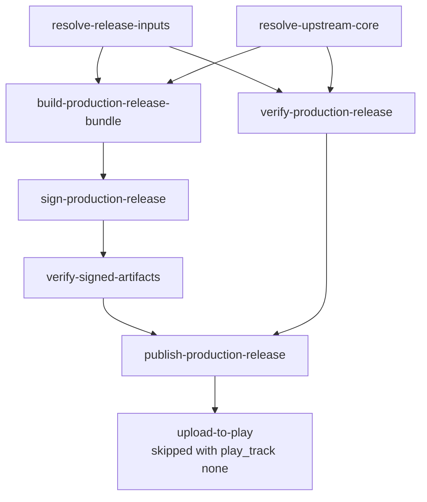

# Cutting A Release

This page is the ordered procedure for publishing a signed production release
of R47 Zen, what to do when the workflow refuses, and how to re-release a past
build. It is a checklist, not a reference:
[07-ci-and-release-workflow.md](07-ci-and-release-workflow.md#production-release-workflow)
owns what each job does and why, and every step below links the rule it
follows.

A release is one dispatch of `.github/workflows/android-release.yml` on `main`.
Nothing else publishes a production release, and every job after the two
resolve jobs runs only on `main`.

## Before you dispatch

1. **The commit is on `main` and `android-ci` is green on it.** The release
   builds the dispatched ref's overlay with the newest upstream HEAD, so a red
   `ci-required` on the same commit is a failure you are about to ship.

   ```sh
   gh run list --workflow android-ci.yml --branch main --limit 1
   ```

2. **Find the version code.** It is a counter: exactly the previous production
   release's code plus one
   ([why](07-ci-and-release-workflow.md#build-production-release-bundle)). The
   workflow reads the previous code with the same script you can run:

   ```sh
   gh api 'repos/ppigazzini/r47zen/releases?per_page=100' >releases.json
   bash scripts/android/resolve_previous_release.sh --releases-json releases.json --cap 100000
   ```

   It prints `previous_code=<n>` and `previous_tag=<tag>`; dispatch with
   `<n> + 1`.

3. **Choose the version name**, `major.minor.patch-signed.YYYYMMDDVV`, for
   example `0.1.12-signed.2026101201`. The release tag is
   `r47zen-v<version_name>`, and the workflow refuses a tag that exists.

4. **Choose the Play track.** `internal` is the default, `alpha` is the closed
   testing track, and `none` publishes the GitHub release alone
   ([`upload-to-play`](07-ci-and-release-workflow.md#upload-to-play)).
   Production is never a dispatch value: promote in Play Console.

## Dispatch

```sh
gh workflow run android-release.yml --ref main \
  -f version_code=<previous+1> \
  -f version_name=<major.minor.patch-signed.YYYYMMDDVV> \
  -f play_track=internal
gh run watch "$(gh run list --workflow android-release.yml --limit 1 --json databaseId --jq '.[0].databaseId')"
```

`play_release_notes` sets the Play notes (500 characters at most); left blank,
they name the version and the upstream commit. In the GitHub UI: Actions ->
Android Release -> Run workflow, with the same inputs.

The jobs run in this order; a job starts when every job above it that it
needs has passed:



`verify-production-release` runs the emulator lane, and nothing is published
until it passes.

## After it finishes

1. Open the release page and check the notes name the signing certificate. If
   they carry a "Reinstall required" notice, the signer changed: that is
   expected only after a deliberate key rotation.
2. Check one downloaded APK the way the README tells users to
   (`apksigner verify --print-certs`), against the value in
   `android/r47-defaults.properties`.
3. With a Play track set, the release is on that track. Promote it in Play
   Console when it should reach production.

## When the workflow refuses

`resolve-release-inputs` checks the inputs before anything builds, so most
refusals cost a minute. Read the failed step's log; each message names its
cause.

| message | what it means | do this |
|---|---|---|
| `version_code must be <n> (previous production release used <m>), got <x>.` | the code is not the previous plus one | dispatch again with `<n>` |
| `version_code <x> is above 100000; it must be a small counter ...` | a date was typed as the code | dispatch with the counter from step 2 |
| `version_name '<x>' is malformed; ...` | the name misses the `major.minor.patch-signed.YYYYMMDDVV` shape | fix the name |
| `Release tag <tag> already exists; refusing to overwrite a published release.` | that name was released | pick the next name; set `allow_overwrite=true` only to re-cut that release on purpose |
| `allow_overwrite=true re-cuts version_code <x>, which Play refuses to take twice; ...` | a re-cut keeps the code, and Play takes a code once | re-cut with `play_track=none`, or release the next code |
| `Could not determine whether <tag> exists (git ls-remote exit <n>); ...` | the tag check failed on the network or auth | rerun the failed job |
| `Expected one APK evidence archive on <tag>, found <n>.` or `The APK evidence of <tag> records no signing certificate ...` | the previous release lacks the evidence the reinstall notice is computed from | restore the previous release's `*-apk-packaging-evidence.zip` asset; the workflow will not publish without knowing whether installs can update |
| `Missing required production release signing secret for <name>.` | an `R47_RELEASE_*` secret is missing from the `production-release` environment | see [Repository settings](07-ci-and-release-workflow.md#repository-settings) |
| `upload-to-play` fails with "Precondition check failed" | an edit was open in Play Console | close it, then rerun the failed job alone; the GitHub release is already published ([limits](07-ci-and-release-workflow.md#upload-to-play)) |
| Play answers that the track does not exist | the track name | the first value to check is `internal` versus `qa` ([limits](07-ci-and-release-workflow.md#upload-to-play)) |

A failure in a build, sign, or verify job is a regression, not a refusal:
nothing was published, so fix it on `main`, wait for `android-ci` to pass, and
dispatch again with the same code and name.

## Re-releasing a past build

Every published build records the upstream core revision it was built from in
`BUILD-METADATA.txt` (`upstream_commit=<sha>`), inside its
`*-packaging-evidence.zip` archive and linked from the release notes. The
`upstream_commit` dispatch input feeds that commit back
([`build-production-release-bundle`](07-ci-and-release-workflow.md#build-production-release-bundle)).

1. **Find the upstream commit.** Read the linked upstream commit in the
   release notes, or `upstream_commit=` from `BUILD-METADATA.txt` in the
   release's packaging-evidence archive. Note `android_source_commit=` too if
   you need the overlay (see the limit below).
2. **Re-release the signed production build** with that full 40-character
   commit and the next version code and name:

   ```sh
   gh workflow run android-release.yml --ref main \
     -f upstream_commit=<recorded-sha> \
     -f version_code=<previous+1> \
     -f version_name=<major.minor.patch-signed.YYYYMMDDVV>
   ```

   `resolve-upstream-core` then resolves `--locked --commit <sha>`, and the new
   release records the same `upstream_commit` in its own `BUILD-METADATA.txt`.
3. **Reproduce a dev prerelease instead** by dispatching
   `.github/workflows/android-ci.yml` with `-f upstream_commit=<recorded-sha>`
   (optionally `dev_version_code` and `dev_version_name`). A manual dispatch
   always builds, even when a release for the derived tag exists.
4. **Verify** that the new `BUILD-METADATA.txt` reports
   `upstream_commit=<recorded-sha>`. A blank `upstream_commit` resolves the
   newest HEAD, the normal path.

The limit: `upstream_commit` pins only the upstream core. The overlay is the
dispatched ref, and the release jobs run only on `main`, so a re-release
combines the pinned core with the current `main` overlay. A bit-exact rebuild
of an old artifact also needs the overlay at its recorded
`android_source_commit`. The packaged `THIRD-PARTY.spdx.json` takes its
creation time from the commit, or from `SOURCE_DATE_EPOCH` when set, never
from the clock, so it is not what makes two builds of one commit differ.

The local counterpart is the git-ignored `upstream.lock`
(`scripts/upstream-sync/upstream.sh resolve --latest --write-lock`, then trim
it to the commit you want), which pins a developer's own builds without
touching CI.
