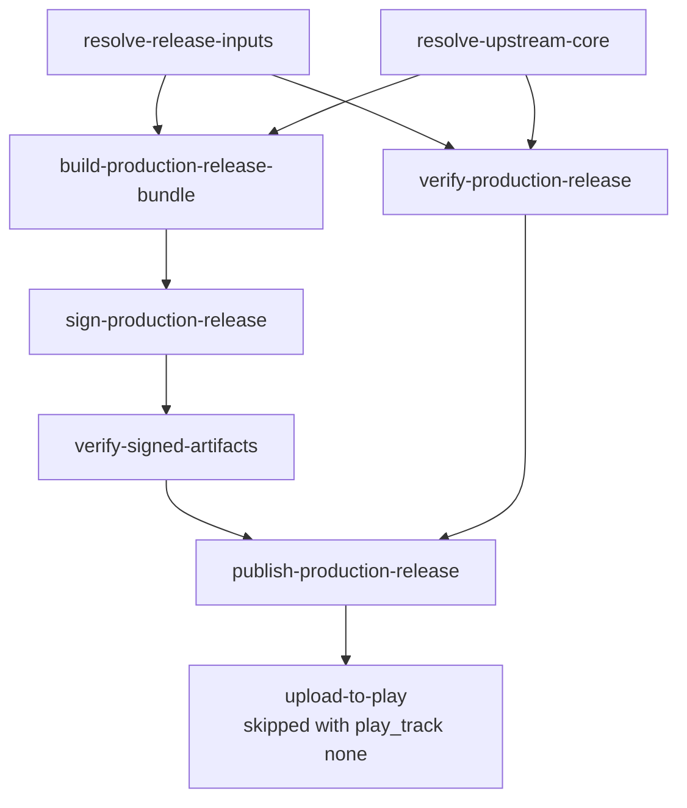

# Cutting A Release

This page is the ordered procedure for publishing a signed production release
of R47 Zen, what to do when the workflow refuses, and how to re-release a past
build. It is a checklist, not a reference:
[07-ci-and-release-workflow.md](07-ci-and-release-workflow.md#production-release-workflow)
owns what each job does and why,
[10-writing.md](10-writing.md#version-numbers) owns the version rules, and
every step below links the rule it follows.

A release is one dispatch of `.github/workflows/android-release.yml` on `main`.
Nothing else publishes a production release, and every job after the two
resolve jobs runs only on `main`.

## Before you dispatch

1. **The commit is on `main` and `android-ci` is green on it.** The release
   builds the dispatched ref's overlay with the newest upstream HEAD, so a red
   `ci-required` on the same commit is a failure you are about to ship.

   ```sh
   gh run list --workflow android-ci.yml --branch main --limit 1
   ```

2. **Read the two numbers you are about to release.**
   `android/r47-defaults.properties` holds the next release: its Play version
   code and its version.

   ```sh
   grep -E '^R47_DEFAULT_ANDROID_VERSION_(CODE|NAME)=' android/r47-defaults.properties
   ```

   The commit after the previous release set them; the workflow refuses them
   unless the code is the previous production release's plus one and the
   version is the next SemVer step
   ([rules](10-writing.md#version-numbers)). The `Check the next release
   numbers` step of `android-ci`'s `upstream-release-gate` job runs the same
   checks on every run and warns when they fail. If app code changed since the
   previous release and the file still names a PATCH step, commit the MINOR
   step first.

3. **Choose the Play track.** `none`, the default, publishes the GitHub
   release alone; `internal` is the internal testing track, `alpha` the
   closed testing track, and `production` the production track
   ([`upload-to-play`](07-ci-and-release-workflow.md#upload-to-play)).

## Dispatch

Type the two numbers from step 2 as confirmations:

```sh
gh workflow run android-release.yml --ref main \
  -f confirm_version_code=<R47_DEFAULT_ANDROID_VERSION_CODE> \
  -f confirm_version=<R47_DEFAULT_ANDROID_VERSION_NAME> \
  -f play_track=alpha
gh run watch "$(gh run list --workflow android-release.yml --limit 1 --json databaseId --jq '.[0].databaseId')"
```

`play_release_notes` sets the Play notes (500 characters at most); left blank,
they name the version and the calculator core. In the GitHub UI: Actions ->
Android Release -> Run workflow, with the same inputs.

The jobs run in this order; a job starts when every job above it that it
needs has passed:



`verify-production-release` runs the emulator lane, and nothing is published
until it passes.

## After it finishes

1. Open the release page and check the notes name the signing certificate. If
   they carry a "Reinstall required" notice, the signer changed: that is
   expected only after a deliberate key rotation.
2. Check one downloaded APK the way the README tells users to
   (`apksigner verify --print-certs`), against the value in
   `android/r47-defaults.properties`.
3. With `internal` or `alpha`, the release is on that track; promote it in
   Play Console when it should reach production. With `production`, Google
   reviews it, and it reaches every user once approved.
4. **Open the next release.** Commit the next code (this one plus one) and
   the next PATCH step in `android/r47-defaults.properties`; the run summary
   prints both lines:

   ```sh
   git commit -m "chore(release): open 0.1.14 (11)" android/r47-defaults.properties
   ```

   Until this commit lands, dev pre-releases read the released version as
   their base and sort before it, and the next release run is refused.

## When the workflow refuses

`resolve-release-inputs` checks the inputs before anything builds, so most
refusals cost a minute. Read the failed step's log; each message names its
cause.

| message | what it means | do this |
|---|---|---|
| `android/r47-defaults.properties says R47_DEFAULT_ANDROID_VERSION_CODE=<x>, confirm_version_code says <y>.` (or `..._VERSION_NAME=...`, `confirm_version`) | the typed confirmation is not the file | dispatch again with the file's value, or fix the file first |
| `R47_DEFAULT_ANDROID_VERSION_CODE must be <n> (previous production release used <m>), got <x>.` | the file's code is not the previous plus one, usually a forgotten "open the next release" commit | commit `<n>` and its version, then dispatch |
| `R47_DEFAULT_ANDROID_VERSION_CODE <x> is above 100000; ...` | a date was written as the code | commit the counter |
| `... the release takes the PATCH step, <v>, not <x>.` | app code is unchanged since the previous release, and the file names another version | commit `<v>` |
| `App code (android/app/src/main/) changed since <prev> ... The release takes the MINOR step, PATCH reset: <v> ...` | app code changed, and the file names a PATCH step | commit `<v>` ([rules](10-writing.md#version-numbers)) |
| `Commit <sha> of the previous release <prev> is not in the local history ...` | the checkout lost history | rerun; the job checks out with `fetch-depth: 0` |
| `Release tag <tag> already exists; refusing to overwrite a published release.` | that version was released | commit the next version; set `allow_overwrite=true` only to re-cut that release on purpose |
| `allow_overwrite=true re-cuts version code <x>, which Play refuses to take twice; ...` | a re-cut keeps the code, and Play takes a code once | re-cut with `play_track=none`, or release the next code |
| `allow_overwrite=true re-cuts <tag>, so the version must stay <v>, not <x>.` | a re-cut republishes the previous release under its own tag | set the file back to that release's numbers, or release the next ones |
| `Could not determine whether <tag> exists (git ls-remote exit <n>); ...` | the tag check failed on the network or auth | rerun the failed job |
| `Expected one APK evidence archive on <tag>, found <n>.`, `The APK evidence of <tag> records no signing certificate ...`, or `... records no android_source_commit ...` | the previous release lacks the evidence the reinstall notice and the version check read | restore the previous release's APK packaging-evidence asset; the workflow will not publish without it |
| `Missing required production release signing secret for <name>.` | an `R47_RELEASE_*` secret is missing from the `production-release` environment | see [Repository settings](07-ci-and-release-workflow.md#repository-settings) |
| `upload-to-play` fails with "Precondition check failed" | an edit was open in Play Console | close it, then rerun the failed job alone; the GitHub release is already published ([limits](07-ci-and-release-workflow.md#upload-to-play)) |
| `upload-to-play` fails on `production` with a permission error | the Play upload account lacks the production release permission | grant it in Play Console ([`upload-to-play`](07-ci-and-release-workflow.md#upload-to-play)), then rerun the failed job alone |
| Play answers that the track does not exist | the track name | the first value to check is `internal` versus `qa` ([limits](07-ci-and-release-workflow.md#upload-to-play)) |

A failure in a build, sign, or verify job is a regression, not a refusal:
nothing was published, so fix it on `main`, wait for `android-ci` to pass, and
dispatch again with the same numbers.

## Re-releasing a past build

Every published build records the upstream core revision it was built from in
`BUILD-METADATA.txt` (`upstream_commit=<sha>`), inside its packaging-evidence
archive and linked from the release notes. The `upstream_commit` dispatch
input feeds that commit back
([`build-production-release-bundle`](07-ci-and-release-workflow.md#build-production-release-bundle)).

1. **Find the upstream commit.** Read the linked upstream commit in the
   release notes, or `upstream_commit=` from `BUILD-METADATA.txt` in the
   release's packaging-evidence archive. Note `android_source_commit=` too if
   you need the overlay (see the limit below).
2. **Re-release the signed production build** with that full 40-character
   commit, as the next release in `android/r47-defaults.properties`:

   ```sh
   gh workflow run android-release.yml --ref main \
     -f upstream_commit=<recorded-sha> \
     -f confirm_version_code=<R47_DEFAULT_ANDROID_VERSION_CODE> \
     -f confirm_version=<R47_DEFAULT_ANDROID_VERSION_NAME>
   ```

   `resolve-upstream-core` then resolves `--locked --commit <sha>`, and the new
   release records the same `upstream_commit` in its own `BUILD-METADATA.txt`.
3. **Reproduce a dev prerelease instead** by dispatching
   `.github/workflows/android-ci.yml` with `-f upstream_commit=<recorded-sha>`.
   A manual dispatch always builds, even when a release for the derived tag
   exists.
4. **Verify** that the new `BUILD-METADATA.txt` reports
   `upstream_commit=<recorded-sha>`. A blank `upstream_commit` resolves the
   newest HEAD, the normal path.

The limit: `upstream_commit` pins only the upstream core. The overlay is the
dispatched ref, and the release jobs run only on `main`, so a re-release
combines the pinned core with the current `main` overlay. A bit-exact rebuild
of an old artifact also needs the overlay at its recorded
`android_source_commit`. The packaged `THIRD-PARTY.spdx.json` takes its
creation time from the commit, or from `SOURCE_DATE_EPOCH` when set, never
from the clock, so it is not what makes two builds of one commit differ.

The local counterpart is the git-ignored `upstream.lock`
(`scripts/upstream-sync/upstream.sh resolve --latest --write-lock`, then trim
it to the commit you want), which pins a developer's own builds without
touching CI.
